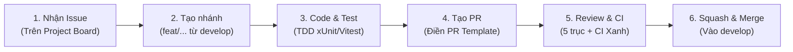

# QUY CHUẨN ĐÓNG GÓP & LÀM VIỆC TRÊN GITHUB
## DỰ ÁN PETSPA & HOTEL MANAGEMENT (SE310)

Tài liệu này là quy ước làm việc bắt buộc cho cả 4 thành viên trong nhóm nhằm đảm bảo chất lượng kỹ thuật, tính nhất quán của mã nguồn và hoàn thành đúng hạn 4 tuần.

---

## 1. Quy trình đóng góp tổng thể (End-to-End Workflow)

Mỗi công việc kỹ thuật đều phải đi qua 6 bước khép kín:


1. **Nhận việc:** Chọn 1 Issue từ cột `Backlog` trên GitHub Project, tự gán bản thân (`Assignee`), kéo sang cột `In Progress`.
2. **Tạo nhánh:** Cắt nhánh mới từ nhánh `develop` mới nhất:
   ```bash
   git fetch origin
   git checkout develop
   git rebase origin/develop
   git checkout -b feat/issue-<số>-<tên-ngắn>
   ```
3. **Phát triển:** Viết mã nguồn kèm test (xUnit cho Backend, Vitest cho Frontend).
4. **Kiểm tra cục bộ & Rebase trước khi push:**
   ```bash
   git fetch origin
   git rebase origin/develop
   dotnet test backend/PetSpa.sln
   git push origin feat/issue-<số>-<tên-ngắn>
   ```
5. **Mở Pull Request:** Mở PR hướng vào nhánh `develop`, điền đầy đủ PR Template.
6. **Review & Merge:** Chờ CI chạy xanh và đạt đủ lượt Approve theo Ma trận Review mới được bấm **Squash and Merge**.

---

## 2. Quy tắc phân nhánh (Branching Conventions)

- **Nhánh chính (Trunk branches):**
  - `main`: Chỉ chứa mã nguồn ổn định nhất phục vụ nộp báo cáo và demo nghiệm thu cuối kỳ. Chỉ có Nhóm trưởng (Lead) mới được merge vào `main`.
  - `develop`: Nhánh làm việc trung tâm của cả 4 thành viên. Mọi tính năng đều rẽ nhánh từ `develop` và gộp về `develop`.
- **Nhánh tính năng (Feature branches - cắt từ `develop`):**
  - Cú pháp chuẩn hóa gắn mã Issue: `feat/issue-<số-issue>-<tên-ngắn>`
    - Ví dụ: `feat/issue-01-core-envelope`, `feat/issue-04-availability`, `feat/issue-06-booking-create`
  - Nhánh kiểm thử tích hợp E2E: `test/issue-<số-issue>-<tên-ngắn>` (Ví dụ: `test/issue-13-e2e-spa-flow`)
  - Sửa lỗi/Bug: `fix/issue-<số-issue>-<tên-lỗi>` (Ví dụ: `fix/issue-25-slot-overlap`)
  - Mở khóa sửa Schema database (Chỉ Tech Lead): `schema/amend-<tên-cột>` (Ví dụ: `schema/amend-invoice-flag`)

---

## 3. Quy chuẩn Commit (Conventional Commits)

Thông điệp commit phải ngắn gọn, súc tích và có tiền tố phân loại rõ ràng:
- `feat:` Thêm API endpoint mới, Service mới, hoặc UI component mới
- `fix:` Sửa lỗi logic, sửa bug API, sửa lỗi hiển thị UI
- `test:` Bổ sung hoặc cập nhật unit/integration test
- `chore:` Cập nhật cấu hình build, package dependency, tài liệu, script

*Ví dụ chuẩn:*
- `feat: implement booking creation endpoint POST /api/bookings`
- `fix: resolve room capacity calculation overlap in D05`
- `test: add integration test for invoice payment state lock`

*(Tuyệt đối không commit vô nghĩa như: "update", "fix bug", "done", "edit file".)*

---

## 4. Quy trình tạo Pull Request (PR)

Khi mở PR trên GitHub:
1. **Tiêu đề PR:** Phải theo định dạng: `[FEAT]: <Tên tính năng>` hoặc `[FIX]: <Tên lỗi>`.
2. **Mục tiêu merge:** Luôn chọn base branch là **`develop`** (tuyệt đối không chọn `main`).
3. **Điền PR Template bắt buộc:**
   - Liên kết Issue tương ứng (cú pháp: `Closes #<số-issue>`).
   - Ghi rõ endpoint hoặc DTO trong `docs/design/api-contract.md` đã triển khai.
   - Ghi rõ mã quyết định nghiệp vụ `D01–D19` hoặc `Q01–Q08` đã tuân thủ.
   - Tích chọn xác nhận kiểm thử cục bộ đã pass 100%.

---

## 5. Quy tắc Code Review & Hợp nhất (Merge Policy)

Áp dụng quy tắc quản trị kỷ luật để bảo đảm chất lượng và bù đắp giới hạn của gói GitHub Free:
1. **Luật cấm tự duyệt & tự merge:** **Không ai được phép tự bấm Approve hoặc bấm Merge trên PR của chính mình.**
2. **Ma trận Phê duyệt (Approval Matrix):**
   - PR của thành viên (Dev A, B, C): Bắt buộc được **Tech Lead** bấm Approve.
   - PR của Tech Lead: Bắt buộc được **ít nhất 1 thành viên khác (Dev A, B hoặc C)** bấm Approve.
   - PR rủi ro cao (Khung kiến trúc Base Envelope #1 và Luồng tiền Hóa đơn/Thanh toán #11): Bắt buộc có **ít nhất 2 thành viên khác bấm Approve**.
3. **Điều kiện để được Merge:**
   - **CI Pipeline XANH 100%:** Toàn bộ build (`dotnet build`) và test (`dotnet test`, `npm test`) trên GitHub Actions phải pass 100% trên commit rebase mới nhất.
   - **Đạt đủ số lượt Approve:** Theo ma trận mục 5.2.
   - **Không warning mới:** Mã nguồn biên dịch sạch với 0 errors, 0 warnings.
4. **5 Trục Code Review (Theo chuẩn Addy Osmani):** Người review phải soi chiếu qua 5 trục:
   - **Correctness:** Có khớp 100% schema trong `api-contract.md` không? Có vi phạm D01-D19, M2-01–M2-15 không? Có cả Happy Path và Sad Path test không?
   - **Readability:** Code có dễ đọc, đặt tên chuẩn tiếng Việt camelCase cho DTO, logic thẳng thắn không?
   - **Architecture:** Có giữ cấu trúc 3 tầng tối giản không (không đẻ Repository/CQRS rườm rà)?
   - **Security:** Có bị lộ connection string, password, JWT secret không?
   - **Performance:** Có dính lỗi truy vấn N+1 trong EF Core không?
5. **Hình thức Merge:** Bắt buộc chọn **Squash and Merge** để gom toàn bộ commit nhỏ của nhánh thành 1 commit duy nhất trên `develop`. Sau khi merge xong, xóa nhánh tính năng ngay để tránh rác repo.

---

## 6. Quy trình Mở khóa Schema Database (Schema Amendment Protocol)

- **Nguyên tắc:** Schema 33 bảng vật lý đã đóng băng từ Milestone 3. Mặc định **không sửa file Entity, không tạo migration mới trong các PR tính năng thông thường**.
- **Quy trình khi phát hiện thiếu/sai cột bắt buộc:**
  1. Thành viên phát hiện mở thảo luận với Tech Lead, chứng minh: *"Không có cách nào thực hiện nghiệp vụ bằng các cột hiện tại"*.
  2. Chỉ **Tech Lead** mới được phép tạo nhánh `schema/amend-<tên-cột>` từ `develop`.
  3. Cập nhật Entity, sinh migration bằng `dotnet ef migrations add`, cập nhật tests.
  4. Mở PR, bắt buộc có ít nhất **2 thành viên khác bấm Approve** mới được merge.
  5. Khi merge xong, thông báo toàn nhóm lập tức chạy:
     ```bash
     git fetch origin
     git rebase origin/develop
     ```

---

## 7. Hệ thống 5 Nhãn dán chuẩn (Labels)

Để tránh over-engineering, nhóm chỉ sử dụng duy nhất **5 nhãn dán cốt lõi**:
- `backend`: Công việc liên quan đến .NET API, C#, EF Core, Neon DB, xUnit.
- `frontend`: Công việc liên quan đến Vue 3, PrimeVue, Pinia, Tailwind, Vitest.
- `feature`: Yêu cầu phát triển tính năng mới theo Use Case.
- `bug`: Báo cáo lỗi logic, sai contract hoặc test thất bại.
- `blocked`: Cảnh báo tác vụ đang bị nghẽn (cần sự trợ giúp ngay từ thành viên khác).

*(Trạng thái công việc đã được quản lý bằng các cột trên GitHub Project: Backlog $\rightarrow$ Ready $\rightarrow$ In Progress $\rightarrow$ In Review $\rightarrow$ Done. Không tạo thêm nhãn trạng thái để tránh mâu thuẫn dữ liệu).*

---

## 8. Kỷ luật khi sử dụng AI Agent (Codex / Antigravity)

- **Trách nhiệm con người:** AI agent chỉ là công cụ hỗ trợ sinh mã. Thành viên tạo PR phải tự chịu trách nhiệm giải trình và hiểu từng dòng code được merge vào hệ thống.
- **Không phá vỡ hợp đồng:** Tuyệt đối không để AI tự ý sửa đổi tên trường JSON hoặc route API khác với `docs/design/api-contract.md`.
- **Kiểm thử trước tiên:** Mọi mã nguồn do AI tạo ra đều phải có unit test đi kèm để kiểm chứng hành vi thực tế.

### 8.1 Điểm vào chung cho Codex và Antigravity

Khi giao Issue cho agent, yêu cầu đọc theo thứ tự:

1. `AGENTS.md` ở root repo.
2. Tài liệu này và [backend/README.md](../backend/README.md) để biết quy trình, vị trí file và môi trường test.
3. Issue được giao, phần tương ứng trong [kế hoạch Sprint 1](../docs/plans/sprint-1-core-plan.md) và [chi tiết Issues](../docs/plans/github-issues-sprint-1.md).
4. Chỉ các mục contract, thiết kế và quyết định nghiệp vụ liên quan đến Issue; không đọc toàn bộ `docs/` một lượt.

Các file được Git theo dõi ở trên là hướng dẫn chung cho nhóm. Cấu hình agent cục bộ như `.codex/instructions.md` không thay thế chúng và không bắt buộc các thành viên phải dùng cùng công cụ. Nếu agent không tự đọc `AGENTS.md`, thành viên phải chỉ rõ file này trong prompt.

---

## 9. Ownership và phối hợp để giảm conflict

### 9.1 Phạm vi mỗi Issue

- Người nhận Issue ghi vào mô tả Issue: module/file dự kiến sửa, DTO/service sẽ cung cấp hoặc sử dụng, phụ thuộc phải merge trước và cách kiểm thử. Phân công Lead/Dev A/B/C theo kế hoạch Sprint 1; vị trí file theo backend README.
- Tạo nhánh sau khi các Issue tiên quyết đã merge vào `develop`. Khi còn chờ, có thể chuẩn bị test case/DTO theo contract, nhưng không tự coi code trên nhánh chưa merge là nền tảng đã ổn định.
- Mỗi người sửa module mình phụ trách; nếu cần đổi interface hoặc logic thuộc module khác, trao đổi với người phụ trách và ghi quyết định vào Issue trước. Ownership là trách nhiệm phối hợp, không phải mỗi module có database riêng.
- Giữ PR tập trung theo Issue; không format toàn solution, đổi tên/di chuyển file hàng loạt hoặc sửa tiện code ngoài phạm vi. Các thay đổi nền tảng dùng chung nên tách thành PR nhỏ để merge trước, rồi các nhánh phụ thuộc rebase.

### 9.2 File dùng chung

| Vùng dễ conflict | Người điều phối | Cách thay đổi |
|---|---|---|
| `Program.cs`, DI, middleware, cấu hình authentication | Tech Lead | Thành viên nêu đăng ký/cấu hình cần thêm trong Issue; Lead thống nhất người thực hiện. Giữ thay đổi nhỏ, không thay pipeline ngoài phạm vi. |
| `.csproj`, package/tool versions, `.github/workflows/` | Tech Lead | Nêu nhu cầu và ảnh hưởng trước khi thêm dependency hoặc đổi CI; không tự nâng version từ một Issue tính năng. |
| `Core/Common`, DTO/interface nhiều module sử dụng | Chủ module cung cấp, Lead điều phối | Chốt tên, input/output, lỗi và transaction trước khi các nhánh sử dụng; không tạo các bản trùng nhau để né conflict. |
| Test factory/fixture và cấu hình test dùng chung | Tech Lead hoặc người được giao | Thống nhất phạm vi ảnh hưởng; test từng module vẫn do người làm tính năng phụ trách. |
| Entity, DbContext, Configuration, Migrations | Tech Lead | Tuân thủ Schema Amendment Protocol ở mục 6; PR tính năng không tự sửa schema. |
| API contract và quyết định nghiệp vụ | Tech Lead tổng hợp để nhóm duyệt | Báo điểm không khớp; không tự sửa contract để hợp thức hóa implementation. |

Các vai trò trên là quy ước phối hợp và review, chưa phải cơ chế tự động chặn sửa file trên GitHub. Không thay thế số lượt Approve và CI ở mục 5.

### 9.3 Khi cập nhật nhánh và xử lý conflict

- Fetch/rebase theo mục 1 trước khi push. Chỉ bắt đầu khi working tree sạch hoặc đã chủ động lưu công việc; không dùng `reset --hard`, `clean` hoặc checkout đè file để làm sạch thay người khác.
- Khi conflict, đọc cả hai thay đổi và trao đổi với người phụ trách nếu liên quan logic/contract. Không chọn toàn bộ `ours`/`theirs` để bỏ qua phần code chưa hiểu. Sau khi giải quyết, kiểm tra diff và chạy lại build/test liên quan trên kết quả đã ghép.
- Không force-push `develop`/`main` hoặc nhánh của thành viên khác. Nếu rebase nhánh cá nhân đã push cần cập nhật lịch sử remote, chỉ dùng `--force-with-lease` sau khi xác nhận không có người khác cùng làm trên nhánh đó.
- Trước khi đề nghị review, mô tả rõ các file chung đã sửa và việc phối hợp trong PR; chưa chạy check nào thì ghi rõ, không đánh dấu pass thay CI.
