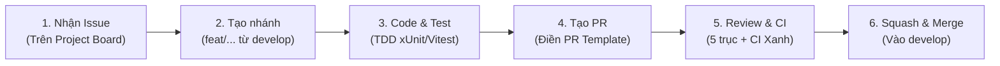

# QUY CHUẨN ĐÓNG GÓP & LÀM VIỆC TRÊN GITHUB
## DỰ ÁN PETSPA & HOTEL MANAGEMENT (SE310)

Tài liệu này là quy ước làm việc bắt buộc cho cả 4 thành viên trong nhóm nhằm đảm bảo chất lượng kỹ thuật, tính nhất quán của mã nguồn và hoàn thành đúng hạn 4 tuần.

---

## 1. Quy trình đóng góp tổng thể (End-to-End Workflow)

Mỗi công việc kỹ thuật đều phải đi qua 6 bước khép kín:

1. **Nhận việc:** Chọn 1 Issue từ cột `Backlog` trên GitHub Project, tự gán bản thân (`Assignee`), kéo sang cột `In Progress`.
2. **Tạo nhánh:** Cắt nhánh mới từ nhánh `develop` mới nhất (`git checkout develop && git pull origin develop`).
3. **Phát triển:** Viết mã nguồn kèm test (xUnit cho Backend, Vitest cho Frontend).
4. **Kiểm tra cục bộ:** Chạy test pass 100% trước khi đẩy lên remote (`git push origin <tên-nhánh>`).
5. **Mở Pull Request:** Mở PR hướng vào nhánh `develop`, điền đầy đủ PR Template.
6. **Review & Merge:** Chờ CI chạy xanh và tối thiểu 1 người khác duyệt mới được Squash & Merge.

---

## 2. Quy tắc phân nhánh (Branching Conventions)

- **Nhánh chính (Trunk branches):**
  - `main`: Chỉ chứa mã nguồn ổn định nhất phục vụ nộp báo cáo và demo nghiệm thu cuối kỳ. Chỉ có Nhóm trưởng (Lead) mới được merge vào `main`.
  - `develop`: Nhánh làm việc trung tâm của cả 4 thành viên. Mọi tính năng đều rẽ nhánh từ `develop` và gộp về `develop`.
- **Nhánh tính năng (Feature branches - cắt từ `develop`):**
  - Thêm tính năng mới: `feat/<tên-ngắn>` (Ví dụ: `feat/booking-api`, `feat/auth-jwt`, `feat/axios-adapter`)
  - Sửa lỗi/Bug: `fix/<tên-lỗi>` (Ví dụ: `fix/cors-origin`, `fix/slot-overlap`)
  - Bổ sung kiểm thử: `test/<tên-module>` (Ví dụ: `test/invoice-flow`)
  - Cấu hình hạ tầng/CI: `chore/<nội-dung>` (Ví dụ: `chore/neon-connection`)

---

## 3. Quy chuẩn Commit (Conventional Commits)

Thông điệp commit phải ngắn gọn, súc tích và có tiền tố phân loại rõ ràng:
- `feat:` Thêm API endpoint mới, Service mới, hoặc UI component mới
- `fix:` Sửa lỗi logic, sửa bug API, sửa lỗi hiển thị UI
- `test:` Bổ sung hoặc cập nhật unit/integration test
- `chore:` Cập nhật cấu hình build, package dependency, tài liệu, script

*Ví dụ chuẩn:*
- `feat: implement booking creation endpoint POST /api/bookings`
- `fix: resolve room capacity calculation overlap in D05`
- `test: add integration test for invoice payment state lock`

*(Tuyệt đối không commit vô nghĩa như: "update", "fix bug", "done", "edit file".)*

---

## 4. Quy trình tạo Pull Request (PR)

Khi mở PR trên GitHub:
1. **Tiêu đề PR:** Phải theo định dạng: `[FEAT]: <Tên tính năng>` hoặc `[FIX]: <Tên lỗi>`.
2. **Mục tiêu merge:** Luôn chọn base branch là **`develop`** (tuyệt đối không chọn `main`).
3. **Điền PR Template bắt buộc:**
   - Liên kết Issue tương ứng (cú pháp: `Closes #<số-issue>`).
   - Ghi rõ endpoint hoặc DTO trong `docs/design/api-contract.md` đã triển khai.
   - Ghi rõ mã quyết định nghiệp vụ `D01–D19` hoặc `Q01–Q08` đã tuân thủ.
   - Tích chọn xác nhận kiểm thử cục bộ đã pass 100%.

---

## 5. Quy tắc Code Review & Hợp nhất (Merge Policy)

Áp dụng quy tắc quản trị kỷ luật để bù đắp giới hạn của gói GitHub Free:
1. **Luật cấm tự merge:** **Không ai được tự ý bấm nút "Merge" trên PR của chính mình.**
2. **Điều kiện để được Merge:**
   - **CI Pipeline XANH:** Toàn bộ build và test trên GitHub Actions phải pass 100%.
   - **Tối thiểu 1 Approve:** Phải có sự xem xét và phê duyệt của ít nhất 1 thành viên khác (hoặc Lead).
3. **5 Trục Code Review (Theo chuẩn Addy Osmani):** Người review phải soi chiếu qua 5 trục:
   - **Correctness:** Có khớp 100% schema trong `api-contract.md` không? Có vi phạm D01-D19 không? Có test case không?
   - **Readability:** Code có dễ đọc, đặt tên chuẩn, logic thẳng thắn không?
   - **Architecture:** Có giữ cấu trúc 3 tầng tối giản không (không đẻ Repository/CQRS rườm rà)?
   - **Security:** Có bị lộ connection string, password, JWT secret không?
   - **Performance:** Có dính lỗi truy vấn N+1 trong EF Core không?
4. **Hình thức Merge:** Bắt buộc chọn **Squash and Merge** để gom toàn bộ commit nhỏ của nhánh thành 1 commit duy nhất trên `develop`. Sau khi merge xong, xóa nhánh tính năng ngay để tránh rác repo.

---

## 6. Hệ thống 5 Nhãn dán chuẩn (Labels)

Để tránh over-engineering, nhóm chỉ sử dụng duy nhất **5 nhãn dán cốt lõi**:
- `backend`: Công việc liên quan đến .NET API, C#, EF Core, Neon DB, xUnit.
- `frontend`: Công việc liên quan đến Vue 3, PrimeVue, Pinia, Tailwind, Vitest.
- `feature`: Yêu cầu phát triển tính năng mới theo Use Case.
- `bug`: Báo cáo lỗi logic, sai contract hoặc test thất bại.
- `blocked`: Cảnh báo tác vụ đang bị nghẽn (cần sự trợ giúp ngay từ thành viên khác).

*(Trạng thái công việc đã được quản lý bằng các cột trên GitHub Project: Backlog $\rightarrow$ Ready $\rightarrow$ In Progress $\rightarrow$ In Review $\rightarrow$ Done. Không tạo thêm nhãn trạng thái để tránh mâu thuẫn dữ liệu).*

---

## 7. Kỷ luật khi sử dụng AI Agent (Codex / Antigravity)

- **Trách nhiệm con người:** AI agent chỉ là công cụ hỗ trợ sinh mã. Thành viên tạo PR phải tự chịu trách nhiệm giải trình và hiểu từng dòng code được merge vào hệ thống.
- **Không phá vỡ hợp đồng:** Tuyệt đối không để AI tự ý sửa đổi tên trường JSON hoặc route API khác với `docs/design/api-contract.md`.
- **Kiểm thử trước tiên:** Mọi mã nguồn do AI tạo ra đều phải có unit test đi kèm để kiểm chứng hành vi thực tế.
