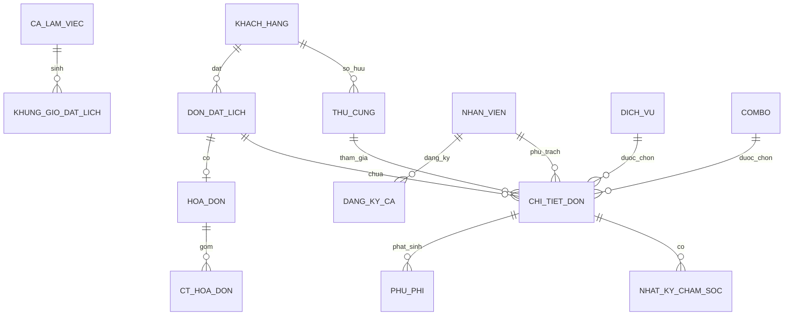

# ERD và Data Dictionary gốc — chỉ dùng đối chiếu

> Trích phụ lục A của SRS gốc từ Git HEAD trước đợt chuẩn hóa ngày 17/10/2026, để giữ dấu vết 19 bảng. Đây không phải schema mới được duyệt. PIN/hash ở khách, invoice/refund/cọc và các FK cũ có thể mâu thuẫn baseline mới; không dùng trực tiếp để sinh migration.
>
> Yêu cầu hiện hành: [SRS 1.1](../../requirements/SRS_He_Thong_Quan_Ly_Spa_Thu_Cung_AI_Readable.md). Các thay đổi cần thiết ở chương 5 của SRS; schema vật lý mới chờ system-design.md. Nội dung dưới được giữ nguyên để đối chiếu, không được ưu tiên hơn quyết định người dùng.
# PHỤ LỤC A. THIẾT KẾ ERD & DATA DICTIONARY CHI TIẾT

Phụ lục này mở rộng Chương 5 bằng mô hình thực thể quan hệ (ERD) chi tiết, danh mục thuộc tính của 19 bảng PostgreSQL, các quan hệ chính, ràng buộc toàn vẹn và index khuyến nghị. Thiết kế được chuẩn hóa theo 3NF và bám theo phạm vi MVP 28 Must-have Use Cases.

## A.1. Các cải tiến kỹ thuật cốt lõi

- Giải quyết mô hình Multi-Pet Booking: một Booking có thể đăng ký nhiều thú cưng, mỗi thú cưng có dịch vụ và tiến độ riêng.
- Tách biệt `id` khóa chính nội bộ với `tracking_code` dạng chuỗi ngẫu nhiên để giảm nguy cơ IDOR.
- Bổ sung `khung_gio_dat_lich` theo ngày để kiểm soát sức chứa bằng Pessimistic Locking (`SELECT ... FOR UPDATE`).
- Bổ sung `ct_hoa_don` dạng Snapshot để lưu nguyên đơn giá và tên khoản mục tại thời điểm chốt thanh toán.

## A.2. Quan hệ giữa các thực thể
| Thực thể nguồn | Quan hệ | Thực thể đích | Ý nghĩa |
| --- | --- | --- | --- |
| KHACH_HANG | 1-N | THU_CUNG | Một khách hàng sở hữu nhiều thú cưng |
| KHACH_HANG | 1-N | DON_DAT_LICH | Một khách hàng có nhiều booking |
| THU_CUNG | 1-N | CHI_TIET_DON | Một thú cưng có nhiều dịch vụ/booking |
| DON_DAT_LICH | 1-N | CHI_TIET_DON | Booking chứa nhiều pet/dịch vụ |
| DON_DAT_LICH | 1-0..1 | HOA_DON | Mỗi booking tối đa một hóa đơn |
| HOA_DON | 1-N | CT_HOA_DON | Hóa đơn gồm nhiều dòng snapshot |
| CHI_TIET_DON | 1-N | NHAT_KY_CHAM_SOC | Mỗi lượt dịch vụ có nhiều nhật ký |
| CHI_TIET_DON | 1-N | PHU_PHI | Phụ phí gắn với từng lượt dịch vụ |
| CA_LAM_VIEC | 1-N | KHUNG_GIO_DAT_LICH | Ca làm việc sinh slot theo ngày |
| NHAN_VIEN | 1-N | CHI_TIET_DON | Nhân viên phụ trách chăm sóc |
| DICH_VU / COMBO | 1-N | CHI_TIET_DON | Dịch vụ đơn hoặc combo được chọn |
| NHAN_VIEN | 1-N | DANG_KY_CA | Nhân viên đăng ký nhiều ca |

### ERD dạng Mermaid (biểu diễn các quan hệ nêu trên)

## A.3. Data Dictionary - Đặc tả 19 bảng

### PHÂN HỆ 1: KHÁCH HÀNG & THÚ CƯNG (CUSTOMER & PET)

#### 1. Bảng `khach_hang` (Thông tin khách hàng)
| STT | Tên Cột | Kiểu Dữ Liệu | Ràng Buộc | Ý Nghĩa / Nghiệp Vụ |
| --- | --- | --- | --- | --- |
| 1 | id | INT | PK, SERIAL | Khóa chính tự tăng |
| 2 | so_dien_thoai | VARCHAR(15) | UNIQUE, NOT NULL | SĐT định danh tài khoản, công cụ tra cứu chính |
| 3 | email | VARCHAR(150) | NOT NULL | Email nhận mã tracking và thông báo booking |
| 4 | ten_khach_hang | VARCHAR(100) | NOT NULL | Họ và tên khách hàng |
| 5 | ma_tracking_hash | VARCHAR(255) | NULL | Mã tracking bảo mật đã hash bằng bcrypt |
| 6 | thong_tin_stk | TEXT | NULL | Thông tin Ngân hàng + STK để nhận tiền hoàn (nếu có) |
| 7 | created_at | TIMESTAMP | DEFAULT CURRENT_TIMESTAMP | Thời điểm tạo hồ sơ |
| 8 | updated_at | TIMESTAMP | DEFAULT CURRENT_TIMESTAMP | Thời điểm cập nhật cuối |
| 9 | deleted_at | TIMESTAMP | NULL | Thời điểm xóa mềm (Soft delete) |

#### 2. Bảng `thu_cung` (Hồ sơ thú cưng)

| STT | Tên Cột | Kiểu Dữ Liệu | Ràng Buộc | Ý Nghĩa / Nghiệp Vụ |
| --- | --- | --- | --- | --- |
| 1 | id | INT | PK, SERIAL | Khóa chính tự tăng |
| 2 | khach_hang_id | INT | FK, NOT NULL | Khách hàng sở hữu (`khach_hang.id`) |
| 3 | ten_thu_cung | VARCHAR(100) | NOT NULL | Tên gọi của bé |
| 4 | loai_pet | VARCHAR(20) | NOT NULL | CHO hoặc MEO (CHECK constraint) |
| 5 | giong_loai | VARCHAR(100) | NULL | Giống (ví dụ: Poodle, Corgi, Mèo Anh lông ngắn...) |
| 6 | can_nang_dang_ky | NUMERIC(5,2) | NULL | Cân nặng ước tính khách khai báo lúc đặt lịch (kg) |
| 7 | ghi_chu_di_ung | TEXT | NULL | Bệnh nền, dị ứng dầu tắm, tính khí (dữ/nhát) |
| 8 | created_at | TIMESTAMP | DEFAULT CURRENT_TIMESTAMP | Thời điểm tạo |
| 9 | updated_at | TIMESTAMP | DEFAULT CURRENT_TIMESTAMP | Thời điểm cập nhật |
| 10 | deleted_at | TIMESTAMP | NULL | Xóa mềm |

#### 3. Bảng `ho_so_tiem_chung` (Ảnh giấy tờ tiêm phòng)

| STT | Tên Cột | Kiểu Dữ Liệu | Ràng Buộc | Ý Nghĩa / Nghiệp Vụ |
| --- | --- | --- | --- | --- |
| 1 | id | INT | PK, SERIAL | Khóa chính |
| 2 | thu_cung_id | INT | FK, NOT NULL | Thuộc thú cưng nào (`thu_cung.id`) |
| 3 | duong_dan_anh | TEXT | NOT NULL | Đường dẫn URL file ảnh sổ tiêm chủng |
| 4 | ngay_tiem | DATE | NULL | Ngày tiêm mũi gần nhất |
| 5 | loai_vac_xin | VARCHAR(100) | NULL | Tên vắc-xin (dại, 7 bệnh, 4 bệnh...) |
| 6 | created_at | TIMESTAMP | DEFAULT CURRENT_TIMESTAMP | Thời điểm tải lên |

### PHÂN HỆ 2: DANH MỤC DỊCH VỤ & KHÁCH SẠN (MASTER SERVICES)

#### 4. Bảng `dich_vu` (Dịch vụ Spa đơn lẻ)
| STT | Tên Cột | Kiểu Dữ Liệu | Ràng Buộc | Ý Nghĩa / Nghiệp Vụ |
| --- | --- | --- | --- | --- |
| 1 | id | INT | PK, SERIAL | Khóa chính |
| 2 | ten_dich_vu | VARCHAR(100) | NOT NULL | Tắm vệ sinh, cắt tỉa tạo kiểu, cạo vôi răng... |
| 3 | loai_dich_vu | VARCHAR(50) | NOT NULL | SPA_BASIC, SPA_ADVANCED, HEALTHCARE |
| 4 | mo_ta | TEXT | NULL | Mô tả quy trình |
| 5 | gia_co_ban | NUMERIC(12,2) | NOT NULL | Giá gốc dịch vụ chưa nhân hệ số cân nặng |
| 6 | thoi_luong_phut | INT | DEFAULT 60 | Thời lượng dự kiến thực hiện (phút) |
| 7 | is_active | BOOLEAN | DEFAULT TRUE | Trạng thái hiển thị (TRUE: mở, FALSE: ẩn) |

#### 5. Bảng `combo` (Gói combo dịch vụ)

| STT | Tên Cột | Kiểu Dữ Liệu | Ràng Buộc | Ý Nghĩa / Nghiệp Vụ |
| --- | --- | --- | --- | --- |
| 1 | id | INT | PK, SERIAL | Khóa chính |
| 2 | ten_combo | VARCHAR(100) | NOT NULL | Tên gói combo |
| 3 | mo_ta | TEXT | NULL | Chi tiết quyền lợi gói |
| 4 | gia_combo | NUMERIC(12,2) | NOT NULL | Giá trọn gói (hoặc giá cơ sở gói) |
| 5 | is_active | BOOLEAN | DEFAULT TRUE | Trạng thái áp dụng |

#### 6. Bảng `chi_tiet_combo` (Dịch vụ thành phần trong Combo)

| STT | Tên Cột | Kiểu Dữ Liệu | Ràng Buộc | Ý Nghĩa / Nghiệp Vụ |
| --- | --- | --- | --- | --- |
| 1 | id | INT | PK, SERIAL | Khóa chính |
| 2 | combo_id | INT | FK, NOT NULL | Thuộc combo (`combo.id`) |
| 3 | dich_vu_id | INT | FK, NOT NULL | Dịch vụ con (`dich_vu.id`) |

#### 7. Bảng `he_so_can_nang` (Bảng hệ số tính giá)

| STT | Tên Cột | Kiểu Dữ Liệu | Ràng Buộc | Ý Nghĩa / Nghiệp Vụ |
| --- | --- | --- | --- | --- |
| 1 | id | INT | PK, SERIAL | Khóa chính |
| 2 | can_nang_tu | NUMERIC(5,2) | NOT NULL | Mức cân từ (kg), ví dụ: 0.0 |
| 3 | can_nang_den | NUMERIC(5,2) | NOT NULL | Mức cân đến (kg), ví dụ: 5.0 |
| 4 | he_so | NUMERIC(4,2) | NOT NULL | Hệ số nhân giá (ví dụ: 1.0, 1.3, 1.6) |
| 5 | ghi_chu | VARCHAR(100) | NULL | Ví dụ: Dưới 5kg, 5-10kg, trên 20kg... |

#### 8. Bảng `loai_phong` (Danh mục phòng Hotel thú cưng)

| STT | Tên Cột | Kiểu Dữ Liệu | Ràng Buộc | Ý Nghĩa / Nghiệp Vụ |
| --- | --- | --- | --- | --- |
| 1 | id | INT | PK, SERIAL | Khóa chính |
| 2 | ten_phong | VARCHAR(100) | NOT NULL | Phòng tiêu chuẩn, Phòng VIP, Penthouse... |
| 3 | kich_co | VARCHAR(20) | NOT NULL | S, M, L, XL |
| 4 | gia_theo_ngay | NUMERIC(12,2) | NOT NULL | Đơn giá lưu trú 1 ngày đêm (VNĐ) |
| 5 | is_active | BOOLEAN | DEFAULT TRUE | Trạng thái phòng sẵn sàng hoạt động |

### PHÂN HỆ 3: ĐẶT LỊCH, SỨC CHỨA & VẬN HÀNH (BOOKING & CAPACITY)

#### 9. Bảng `ca_lam_viec` (Định mức ca mẫu)
| STT | Tên Cột | Kiểu Dữ Liệu | Ràng Buộc | Ý Nghĩa / Nghiệp Vụ |
| --- | --- | --- | --- | --- |
| 1 | id | INT | PK, SERIAL | Khóa chính |
| 2 | ten_ca | VARCHAR(50) | NOT NULL | Ca sáng, Ca chiều, Ca tối |
| 3 | gio_bat_dau | TIME | NOT NULL | Giờ mở (VD: 08:00) |
| 4 | gio_ket_thuc | TIME | NOT NULL | Giờ đóng (VD: 12:00) |
| 5 | slot_pet_mac_dinh | INT | DEFAULT 10 | Số pet tối đa tiếp nhận trong ca |
| 6 | is_active | BOOLEAN | DEFAULT TRUE | Có áp dụng không |

#### 10. Bảng `khung_gio_dat_lich` (Slot theo ngày - Kiểm soát Race Condition)

| STT | Tên Cột | Kiểu Dữ Liệu | Ràng Buộc | Ý Nghĩa / Nghiệp Vụ |
| --- | --- | --- | --- | --- |
| 1 | id | INT | PK, SERIAL | Khóa chính |
| 2 | ngay | DATE | NOT NULL | Ngày phục vụ (YYYY-MM-DD) |
| 3 | ca_lam_viec_id | INT | FK, NOT NULL | Khung ca tương ứng (`ca_lam_viec.id`) |
| 4 | tong_slot | INT | NOT NULL | Sức chứa tối đa của ngày đó |
| 5 | slot_da_dat | INT | DEFAULT 0 | Số pet đã đăng ký xác nhận |
| 6 | slot_con_lai | INT | NOT NULL | `tong_slot - slot_da_dat` (>= 0) |
| 7 | updated_at | TIMESTAMP | DEFAULT CURRENT_TIMESTAMP | Thời điểm lock & update |

#### 11. Bảng `don_dat_lich` (Đơn đặt lịch tổng quát)

| STT | Tên Cột | Kiểu Dữ Liệu | Ràng Buộc | Ý Nghĩa / Nghiệp Vụ |
| --- | --- | --- | --- | --- |
| 1 | id | INT | PK, SERIAL | Khóa chính nội bộ |
| 2 | tracking_code | VARCHAR(20) | UNIQUE, NOT NULL | Chuỗi random entropy cao (VD: TRK-8X2K9A) giao diện khách tra cứu |
| 3 | khach_hang_id | INT | FK, NOT NULL | Khách hàng đặt đơn |
| 4 | khung_gio_id | INT | FK, NULL | Slot giữ chỗ Spa (`khung_gio_dat_lich.id`) |
| 5 | loai_don | VARCHAR(20) | NOT NULL | SPA, HOTEL, COMBO_SPA_HOTEL |
| 6 | trang_thai | VARCHAR(30) | NOT NULL | PENDING, CONFIRMED, IN_PROGRESS, READY, COMPLETED, CANCELLED |
| 7 | thoi_gian_bat_dau | TIMESTAMP | NOT NULL | Thời gian hẹn bắt đầu |
| 8 | thoi_gian_ket_thuc | TIMESTAMP | NULL | Thời gian trả phòng nếu là Hotel |
| 9 | tong_tien_tam_tinh | NUMERIC(12,2) | DEFAULT 0 | Giá ước tính ban đầu khi đặt trên web |
| 10 | ghi_chu_khach | TEXT | NULL | Lời nhắn dặn dò của khách hàng |
| 11 | created_at | TIMESTAMP | DEFAULT CURRENT_TIMESTAMP | Thời điểm tạo |
| 12 | updated_at | TIMESTAMP | DEFAULT CURRENT_TIMESTAMP | Thời điểm cập nhật trạng thái |
| 13 | deleted_at | TIMESTAMP | NULL | Xóa mềm |

#### 12. Bảng `chi_tiet_don` (Dịch vụ theo từng Pet trong Booking)

| STT | Tên Cột | Kiểu Dữ Liệu | Ràng Buộc | Ý Nghĩa / Nghiệp Vụ |
| --- | --- | --- | --- | --- |
| 1 | id | INT | PK, SERIAL | Khóa chính |
| 2 | don_dat_lich_id | INT | FK, NOT NULL | Đơn đặt lịch cha (`don_dat_lich.id`) |
| 3 | thu_cung_id | INT | FK, NOT NULL | Bé thú cưng được làm dịch vụ (`thu_cung.id`) |
| 4 | dich_vu_id | INT | FK, NULL | Dịch vụ Spa đơn (nếu có) |
| 5 | combo_id | INT | FK, NULL | Gói Combo Spa (nếu có) |
| 6 | loai_phong_id | INT | FK, NULL | Loại phòng lưu trú Hotel (nếu có) |
| 7 | nhan_vien_id | INT | FK, NULL | Thợ trực tiếp phụ trách chăm sóc |
| 8 | can_nang_thuc_te | NUMERIC(5,2) | NULL | Cân nặng cân lại tại quầy khi check-in |
| 9 | tinh_trang_long | VARCHAR(50) | NULL | Tình trạng lông thực tế (rối, bình thường...) |
| 10 | don_gia_chot | NUMERIC(12,2) | NOT NULL | Giá sau khi nhân hệ số cân nặng thực tế |
| 11 | la_dich_vu_them | BOOLEAN | DEFAULT FALSE | TRUE nếu là dịch vụ khách yêu cầu thêm trong lúc làm |
| 12 | trang_thai_cham_soc | VARCHAR(30) | DEFAULT 'WAITING' | WAITING, IN_PROGRESS, PAUSED, READY, DONE |
| 13 | created_at | TIMESTAMP | DEFAULT CURRENT_TIMESTAMP | Thời điểm tạo |
| 14 | updated_at | TIMESTAMP | DEFAULT CURRENT_TIMESTAMP | Cập nhật tiến độ |

#### 13. Bảng `nhat_ky_cham_soc` (Nhật ký tiến độ chăm sóc)

| STT | Tên Cột | Kiểu Dữ Liệu | Ràng Buộc | Ý Nghĩa / Nghiệp Vụ |
| --- | --- | --- | --- | --- |
| 1 | id | INT | PK, SERIAL | Khóa chính |
| 2 | chi_tiet_don_id | INT | FK, NOT NULL | Thuộc lượt dịch vụ của pet nào (`chi_tiet_don.id`) |
| 3 | nhan_vien_id | INT | FK, NOT NULL | Nhân viên tải ảnh / ghi nhận |
| 4 | loai_nhat_ky | VARCHAR(30) | NOT NULL | CHECK_IN, IN_PROGRESS, SU_CO, READY_CHECK_OUT |
| 5 | duong_dan_anh | TEXT | NOT NULL | URL ảnh thực tế của bé |
| 6 | ghi_chu_suc_khoe | TEXT | NOT NULL | Tình trạng da, ve rận, vết thương (nếu có) |
| 7 | thoi_gian_ghi_nhan | TIMESTAMP | DEFAULT CURRENT_TIMESTAMP | Giờ hệ thống ghi nhận |

### PHÂN HỆ 4: TÀI CHÍNH, HÓA ĐƠN & PHỤ PHÍ (FINANCE & BILLING)

#### 14. Bảng `hoa_don` (Hóa đơn thanh toán)
| STT | Tên Cột | Kiểu Dữ Liệu | Ràng Buộc | Ý Nghĩa / Nghiệp Vụ |
| --- | --- | --- | --- | --- |
| 1 | id | INT | PK, SERIAL | Khóa chính |
| 2 | don_dat_lich_id | INT | FK, NOT NULL | Liên kết 1-1 với đơn (`don_dat_lich.id`) |
| 3 | tong_tien_dich_vu | NUMERIC(12,2) | NOT NULL | Tổng tiền các gói spa / khách sạn |
| 4 | tong_phu_phi | NUMERIC(12,2) | DEFAULT 0 | Tổng các khoản gỡ rối, đón trễ, phụ thu... |
| 5 | giam_gia | NUMERIC(12,2) | DEFAULT 0 | Tiền khuyến mãi / Voucher giảm |
| 6 | tong_thanh_toan | NUMERIC(12,2) | NOT NULL | `tong_tien_dich_vu + tong_phu_phi - giam_gia` |
| 7 | tien_coc | NUMERIC(12,2) | DEFAULT 0 | Tiền khách đã cọc trước (nếu có) |
| 8 | da_thanh_toan | NUMERIC(12,2) | DEFAULT 0 | Số tiền thực tế khách đã trả |
| 9 | trang_thai_thanh_toan | VARCHAR(20) | NOT NULL | UNPAID, PARTIAL_PAID, PAID, REFUNDED |
| 10 | phuong_thuc_thanh_toan | VARCHAR(30) | NULL | CASH, BANK_TRANSFER |
| 11 | created_at | TIMESTAMP | DEFAULT CURRENT_TIMESTAMP | Thời điểm tạo hóa đơn |
| 12 | updated_at | TIMESTAMP | DEFAULT CURRENT_TIMESTAMP | Thời điểm chốt thanh toán |

#### 15. Bảng `ct_hoa_don` (Snapshot chi tiết dòng Hóa đơn)

| STT | Tên Cột | Kiểu Dữ Liệu | Ràng Buộc | Ý Nghĩa / Nghiệp Vụ |
| --- | --- | --- | --- | --- |
| 1 | id | INT | PK, SERIAL | Khóa chính |
| 2 | hoa_don_id | INT | FK, NOT NULL | Thuộc hóa đơn nào (`hoa_don.id`) |
| 3 | chi_tiet_don_id | INT | FK, NULL | Xuất phát từ mục booking nào |
| 4 | ten_khoan_muc | VARCHAR(150) | NOT NULL | Tên dịch vụ chụp lại (VD: Tắm Poodle 4kg) |
| 5 | so_luong | INT | DEFAULT 1 | Số lượng (lần / ngày) |
| 6 | don_gia_snapshot | NUMERIC(12,2) | NOT NULL | Đơn giá đã áp dụng |
| 7 | thanh_tien | NUMERIC(12,2) | NOT NULL | `so_luong * don_gia_snapshot` |

#### 16. Bảng `phu_phi` (Phụ phí phát sinh thực tế)

| STT | Tên Cột | Kiểu Dữ Liệu | Ràng Buộc | Ý Nghĩa / Nghiệp Vụ |
| --- | --- | --- | --- | --- |
| 1 | id | INT | PK, SERIAL | Khóa chính |
| 2 | hoa_don_id | INT | FK, NOT NULL | Cộng vào hóa đơn (`hoa_don.id`) |
| 3 | chi_tiet_don_id | INT | FK, NULL | Phát sinh cho bé thú cưng nào |
| 4 | ten_phu_phi | VARCHAR(100) | NOT NULL | Phí gỡ lông rối, Trị bọ chét, Đón trễ 2h... |
| 5 | so_tien | NUMERIC(12,2) | NOT NULL | Số tiền phụ thu |
| 6 | ly_do | TEXT | NULL | Ghi chú giải thích cho khách hàng |
| 7 | created_at | TIMESTAMP | DEFAULT CURRENT_TIMESTAMP | Giờ nhân viên thêm phụ phí |

### PHÂN HỆ 5: NHÂN SỰ & ĐÁNH GIÁ (HR & REVIEWS)

#### 17. Bảng `nhan_vien` (Tài khoản nhân sự & Admin)
| STT | Tên Cột | Kiểu Dữ Liệu | Ràng Buộc | Ý Nghĩa / Nghiệp Vụ |
| --- | --- | --- | --- | --- |
| 1 | id | INT | PK, SERIAL | Khóa chính |
| 2 | ten_nhan_vien | VARCHAR(100) | NOT NULL | Tên nhân sự |
| 3 | ten_dang_nhap | VARCHAR(50) | UNIQUE, NOT NULL | Tên đăng nhập vào hệ thống quản trị |
| 4 | mat_khau_hash | VARCHAR(255) | NOT NULL | Mật khẩu hash bằng bcrypt / Argon2 |
| 5 | vai_tro | VARCHAR(20) | NOT NULL | ADMIN hoặc STAFF |
| 6 | so_dien_thoai | VARCHAR(15) | NULL | Số điện thoại liên lạc nội bộ |
| 7 | email | VARCHAR(150) | NULL | Email công việc |
| 8 | is_active | BOOLEAN | DEFAULT TRUE | Trạng thái tài khoản (đang làm/nghỉ việc) |
| 9 | created_at | TIMESTAMP | DEFAULT CURRENT_TIMESTAMP | Ngày tạo tài khoản |

#### 18. Bảng `dang_ky_ca` (Lịch làm việc thực tế của nhân viên)

| STT | Tên Cột | Kiểu Dữ Liệu | Ràng Buộc | Ý Nghĩa / Nghiệp Vụ |
| --- | --- | --- | --- | --- |
| 1 | id | INT | PK, SERIAL | Khóa chính |
| 2 | nhan_vien_id | INT | FK, NOT NULL | Nhân viên trực (`nhan_vien.id`) |
| 3 | ca_lam_viec_id | INT | FK, NOT NULL | Ca làm việc (`ca_lam_viec.id`) |
| 4 | ngay_lam_viec | DATE | NOT NULL | Ngày trực cụ thể (YYYY-MM-DD) |
| 5 | trang_thai_duyet | VARCHAR(20) | DEFAULT 'PENDING' | PENDING, APPROVED, REJECTED |
| 6 | created_at | TIMESTAMP | DEFAULT CURRENT_TIMESTAMP | Thời điểm nộp đăng ký |

#### 19. Bảng `danh_gia` (Phản hồi & Số sao từ khách hàng)

| STT | Tên Cột | Kiểu Dữ Liệu | Ràng Buộc | Ý Nghĩa / Nghiệp Vụ |
| --- | --- | --- | --- | --- |
| 1 | id | INT | PK, SERIAL | Khóa chính |
| 2 | don_dat_lich_id | INT | FK, NOT NULL | Đơn được đánh giá (`don_dat_lich.id`) |
| 3 | khach_hang_id | INT | FK, NOT NULL | Khách hàng thực hiện review |
| 4 | so_sao | INT | NOT NULL | Từ 1 đến 5 sao (`CHECK (so_sao BETWEEN 1 AND 5)`) |
| 5 | binh_luan | TEXT | NULL | Nội dung nhận xét |
| 6 | hien_thi_nhan_vien | BOOLEAN | DEFAULT FALSE | Cấu hình bảo mật: mặc định ẩn với nhân viên |
| 7 | created_at | TIMESTAMP | DEFAULT CURRENT_TIMESTAMP | Thời điểm gửi đánh giá |

## A.4. Ràng buộc và Index khuyến nghị
| Nhóm | Định nghĩa |
| --- | --- |
| CHECK | `thu_cung.loai_pet IN (CHO, MEO)` |
| CHECK | `don_dat_lich.loai_don IN (SPA, HOTEL, COMBO_SPA_HOTEL)` |
| CHECK | `don_dat_lich.trang_thai IN (PENDING, CONFIRMED, IN_PROGRESS, READY, COMPLETED, CANCELLED)` |
| CHECK | `chi_tiet_don.trang_thai_cham_soc IN (WAITING, IN_PROGRESS, PAUSED, READY, DONE)` |
| CHECK | `hoa_don.trang_thai_thanh_toan IN (UNPAID, PARTIAL_PAID, PAID, REFUNDED)` |
| CHECK | `nhan_vien.vai_tro IN (ADMIN, STAFF)` |
| CHECK | `danh_gia.so_sao BETWEEN 1 AND 5` |
| CHECK | `khung_gio_dat_lich.slot_con_lai >= 0` |
| UNIQUE | `khung_gio_dat_lich(ngay, ca_lam_viec_id)` |
| INDEX | `khach_hang(so_dien_thoai)` |
| INDEX | `don_dat_lich(tracking_code)` |
| INDEX | `don_dat_lich(trang_thai, thoi_gian_bat_dau)` |
| INDEX | `khung_gio_dat_lich(ngay, ca_lam_viec_id)` |
| INDEX | `chi_tiet_don(don_dat_lich_id)` |
| INDEX | `nhat_ky_cham_soc(chi_tiet_don_id)` |
| INDEX | `dang_ky_ca(ngay_lam_viec, nhan_vien_id)` |

---

Tài liệu này là căn cứ chuẩn để lập trình Backend Web API, xây dựng CSDL PostgreSQL và thiết kế giao diện Frontend React/Next.js cho đồ án.
