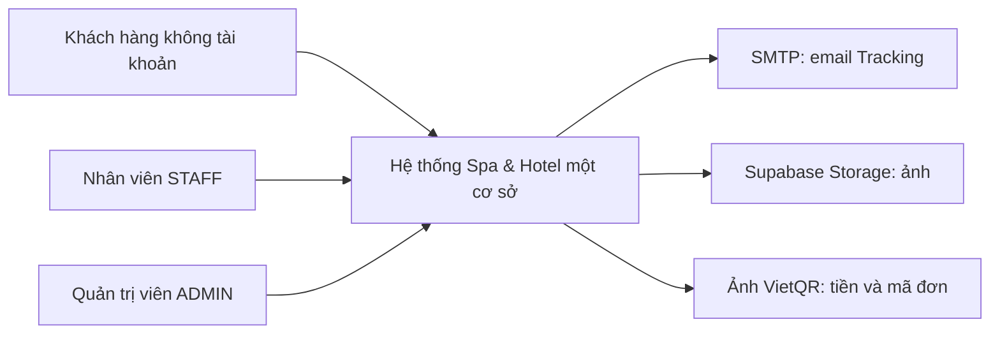
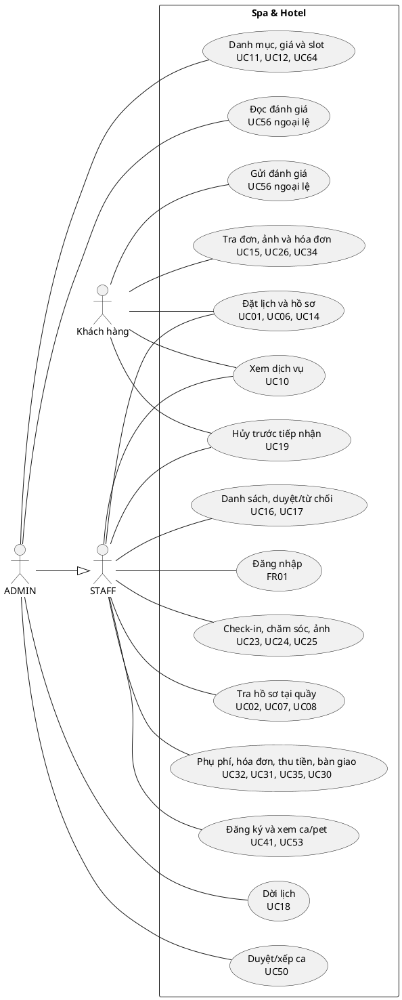
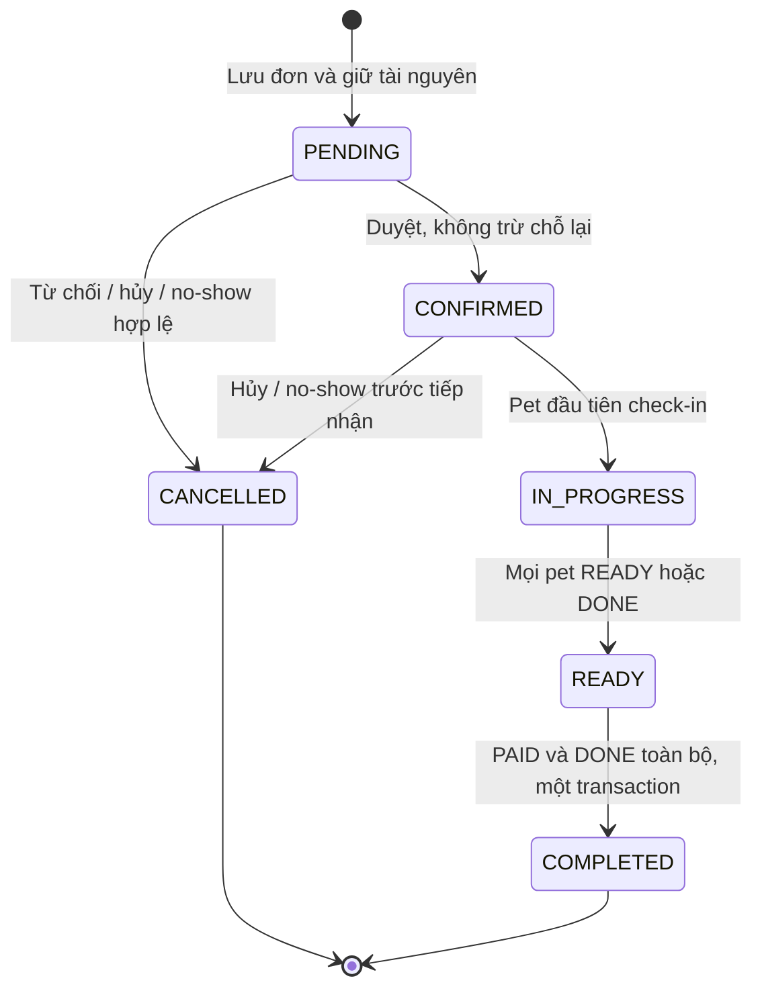
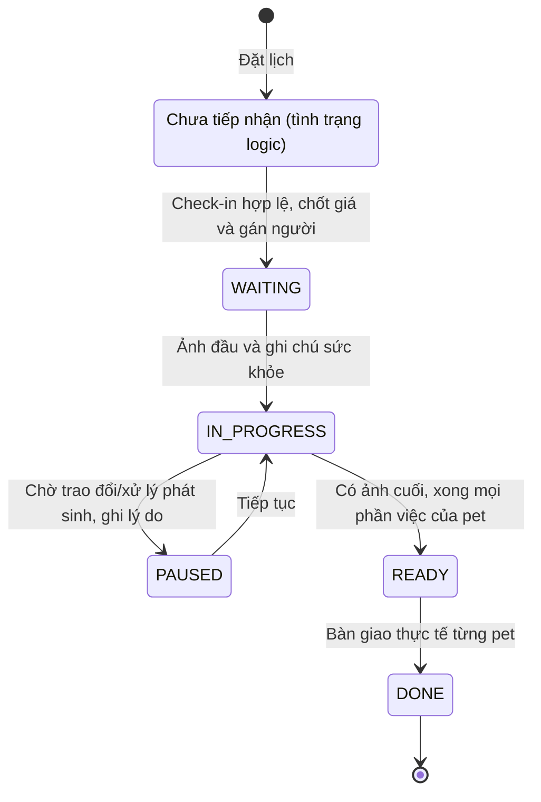
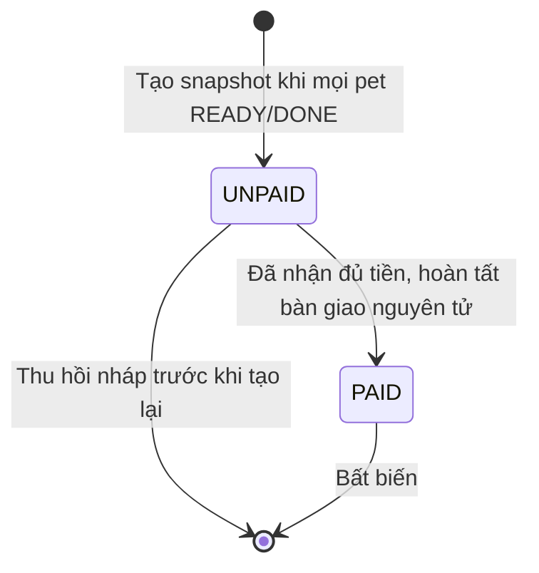
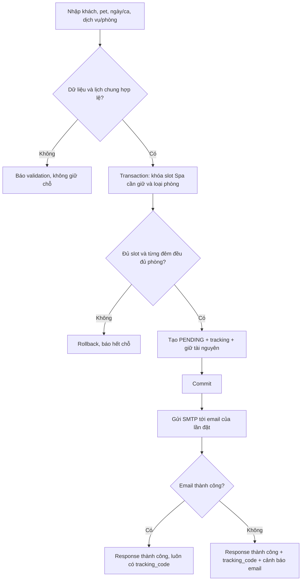
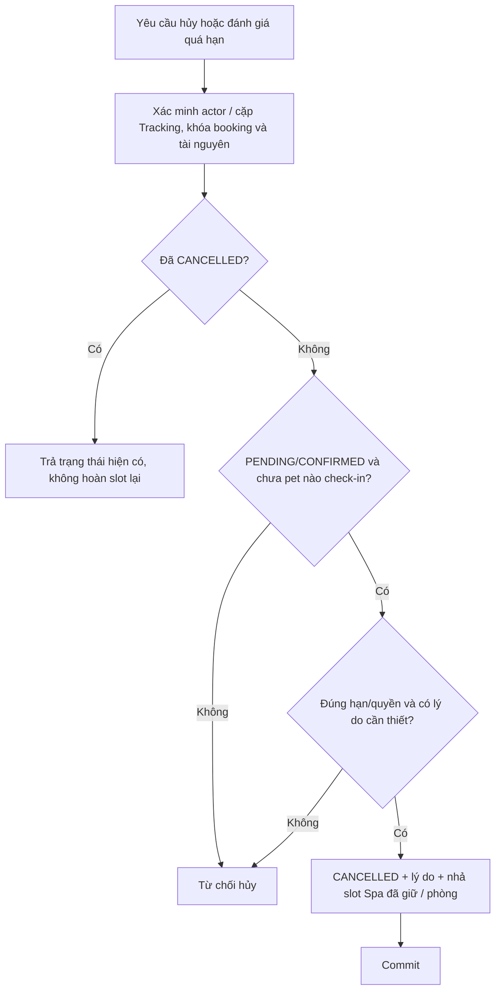
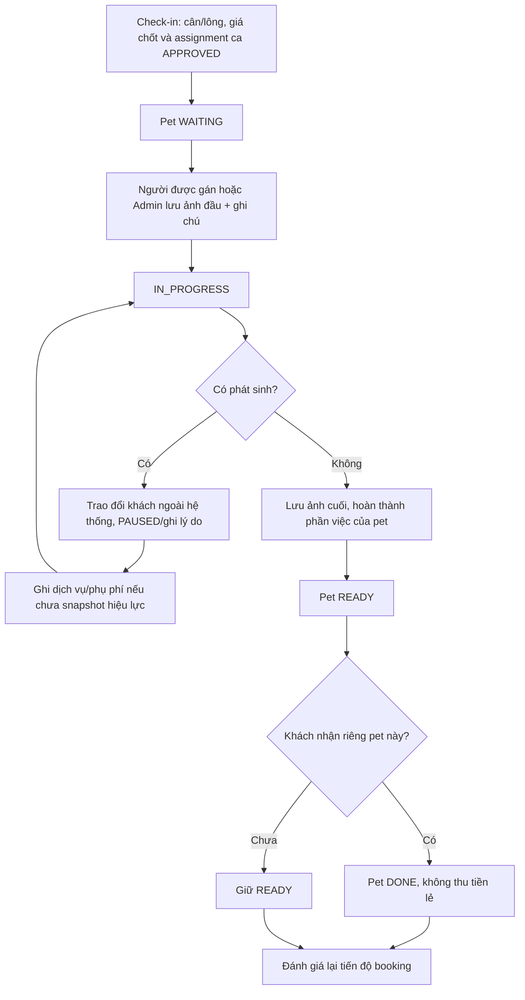
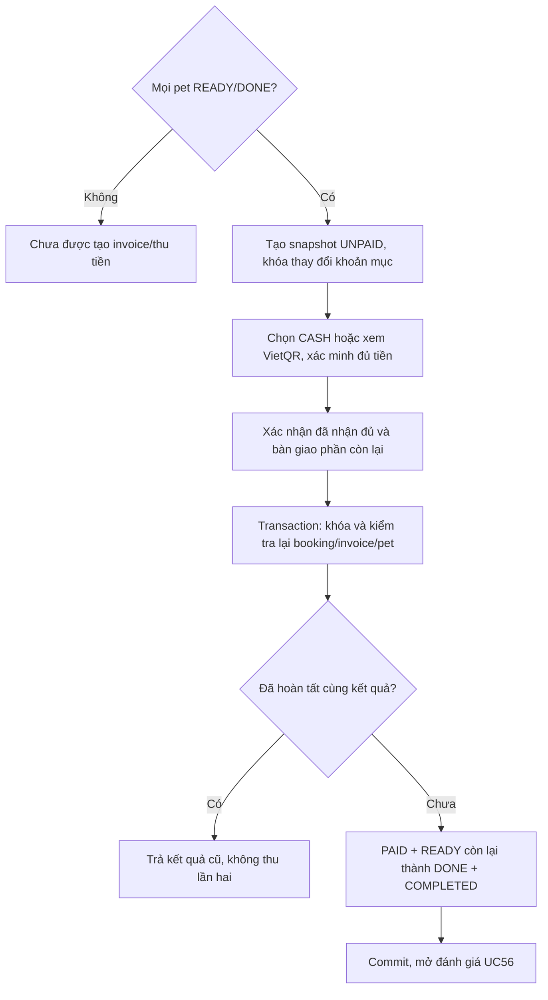
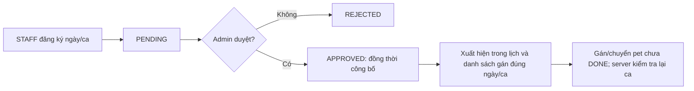

# Phân tích hệ thống — Spa & Hotel thú cưng

**Phiên bản:** 1.1, 17/10/2026. **Trạng thái:** baseline Q01–Q08 và hai đề xuất chuẩn hóa D13/D14 đã được người dùng duyệt; các lựa chọn vật lý tiếp theo được trình bày ở system-design.md.

**Nguồn:** [SRS 1.1](../requirements/SRS_He_Thong_Quan_Ly_Spa_Thu_Cung_AI_Readable.md), [nhật ký quyết định](../requirements/scope-and-decisions.md), [mapping UI](../requirements/frontend-use-case-mapping.md).

Tài liệu trả lời hệ thống cần làm gì, ai được làm và điều kiện hợp lệ. Không thay schema, API đang chạy hoặc frontend; chưa phải ERD/Data Dictionary vật lý hay kế hoạch viết code đã được duyệt.

## 1. Bối cảnh, ranh giới và tác nhân

- Customer đặt và xem đúng một booking sau xác minh, không truy cập hồ sơ qua SĐT đơn lẻ.
- STAFF không có role quầy/groomer riêng. STAFF xem lịch hẹn để vận hành, chỉ cập nhật care/ảnh đúng pet mình được gán.
- ADMIN có quyền vận hành của STAFF và quyền quản trị; override assignment của người thao tác, không override điều kiện ảnh, sức chứa hoặc PAID bất biến.
- SMTP/Storage/QR là hệ thống ngoài. SMTP và QR không tự thay đổi kết quả đặt lịch hoặc xác nhận tiền.
- Seed tài khoản là điều kiện môi trường demo; CRUD user, reset password, ticket khiếu nại/refund/voucher không thuộc core.

## 2. Use Case Diagram tổng quan

Sơ đồ PlantUML dưới đây gom các UC cùng mục tiêu để dễ đọc; mã từng UC và kết quả riêng nằm ở SRS 3.1. Quan hệ kế thừa actor thể hiện Admin được thực hiện các thao tác Staff, không làm Customer trở thành Auth role.

Customer xem pet chỉ trong booking đã xác minh (phần Public của UC07), không có đường từ Customer đến tra hồ sơ tại quầy. Sơ đồ nhóm không có nghĩa mỗi nhóm chỉ dùng một API.

## 3. Ma trận quyền mục tiêu

| Thao tác | Customer | STAFF | ADMIN | Điều kiện tài nguyên |
|---|---|---|---|---|
| Xem catalog đang hoạt động | Có | Có | Có | Không tiết lộ dữ liệu quản trị không cần thiết. |
| Tạo booking | Public | Đặt hộ | Có | Kiểm tra cả dữ liệu và tài nguyên trong Backend. |
| Tra khách/pet cũ bằng SĐT | Không | Có | Có | Nhân viên xác minh tại quầy; ownership đúng khách. |
| Xem Public booking/ảnh/invoice | Đúng SĐT + Tracking | Có thể dùng đường nội bộ | Có | Không mở thêm booking khác cùng SĐT. |
| Danh sách/chi tiết booking nội bộ | Không | Có | Có | Đọc nội bộ không đồng nghĩa quyền care mọi pet. |
| Duyệt/từ chối | Không | Có | Có | Chỉ PENDING, chưa tiếp nhận; trả chỗ một lần khi từ chối. |
| Hủy | Theo BR-12 | Có | Có | PENDING/CONFIRMED, chưa pet nào check-in; khách còn >=2h trước đầu ca; nội bộ bắt buộc lý do. |
| No-show | Không | Có | Có | Hết ca +30 phút, chưa pet nào check-in. Hủy thường trước hạn phải ghi lý do, không giả làm hết hạn. |
| Dời lịch | Không | Không | Có | Chỉ PENDING/CONFIRMED, trước mọi check-in; lịch mới hợp lệ, không có snapshot hiệu lực. |
| Check-in/chốt giá/gán/chuyển người | Không | Có | Có | Có ca APPROVED của người được gán tại ngày/ca thao tác; chỉ chuyển người trước DONE. |
| Chuyển care state/upload nhật ký | Không | Chỉ người được gán | Có override | Vẫn kiểm tra guard ảnh, ghi chú, DONE và khóa snapshot. |
| Phụ phí/dịch vụ thêm | Không cần approval web | Có | Có | Đã trao đổi khách ngoài hệ thống, có lý do, không có snapshot hiệu lực. |
| Bàn giao READY→DONE | Không | Có | Có | Xác nhận bàn giao thực tế; không tự sinh thanh toán lẻ. |
| Tạo snapshot/hủy nháp UNPAID | Không | Có | Có | Mọi pet READY/DONE để tạo; không thu hồi PAID. |
| Xác nhận đủ tiền + hoàn tất | Không | Có | Có | Mọi pet READY/DONE, invoice UNPAID, thực nhận đủ tiền và bàn giao còn lại. |
| Đăng ký/xem lịch mình | Không | Có | Có nếu tham gia | APPROVED hiển thị là lịch đã công bố. |
| Duyệt/xếp ca, cấu hình catalog/slot | Không | Không | Có | Không gây sức chứa âm hoặc phá assignment/booking hợp lệ đang dùng. |
| Gửi đánh giá | Đúng booking COMPLETED | Không qua API nội bộ | Không giả đánh giá khách | Một lần/booking, 1–5 sao. |
| Danh sách đánh giá | Không | Không | Có | Không trả review trong workspace response của STAFF. |

Role check chỉ là lớp đầu. ID trong route/body không chứng minh quyền: Backend phải kiểm tra booking/customer/pet/assignment liên quan. UI ẩn nút không thay thế kiểm tra này.

## 4. Mô hình nghiệp vụ và bất biến

### 4.1. Lịch dự kiến, tiếp nhận và bàn giao thực tế

Booking có một lịch nhận/trả dự kiến dùng để tính giá/phòng. Qua đêm thì mọi pet có loại phòng; nhu cầu lịch dự kiến khác nhau phải tách đơn. Bàn giao thực tế lẻ được chấp nhận khi pet READY và không sửa lịch/giá đã cam kết của từng pet. Trả sớm giữ nguyên tiền Hotel; đón trễ vài giờ ghi phụ phí trước snapshot, không tự gia hạn nhiều ngày.

Chưa check-in là tình trạng khác WAITING. Phải ghi nhận đủ thông tin để biết đã tiếp nhận hay chưa, kể cả khi enum vật lý sau này vẫn giữ bộ trạng thái cũ. Chỉ nhìn WAITING không đủ để hủy/no-show hoặc cho phép bắt đầu care.

### 4.2. Slot Spa

- Đếm pet chính có Spa của ca ngày bắt đầu, không đếm mọi pet trong booking hỗn hợp và không đếm dòng dịch vụ thêm.
- HOTEL-only có thể cần một ca hẹn nhưng lượng giữ Spa = 0.
- PENDING giữ ngay; duyệt không giữ lần hai. Hủy/từ chối/no-show nhả đúng lượng đã giữ; retry không nhả thêm.
- Dời lịch là một chuyển đổi tài nguyên nguyên tử, không nhả lịch cũ trước rồi mới thử lịch mới.
- Không hủy/no-show toàn đơn đã tiếp nhận một phần dù trạng thái cha bị lỗi/chưa đồng bộ.

### 4.3. Suất phòng Hotel

Với từng loại phòng và từng đêm d trong [nhận, trả), cộng số pet Hotel đang giữ của đơn PENDING/CONFIRMED/IN_PROGRESS/READY; thêm số pet Hotel yêu cầu và so sánh so_luong_phong. Ngày trả không chiếm đêm mới. Booking nhiều pet phải giữ nhiều suất; add-on không giữ thêm suất của pet đã có phòng.

Khóa loại phòng và kiểm tra lại trong transaction trước khi ghi reservation. Nếu nhiều loại phòng/slot, thiết kế tiếp theo phải quy định thứ tự khóa thống nhất. Không cần bảng tồn kho đêm hoặc mã chuồng vật lý chỉ để làm phép kiểm tra này.

Pet DONE sớm trong booking còn mở không tự xóa các đêm đã đặt khỏi công thức đã chốt. Không có luồng gia hạn/tái tính giá Hotel tự động. Hệ thống chưa được tuyên bố xử lý tối ưu tồn phòng khi khách ở quá nhiều ngày; đó là ngoài phạm vi hiện tại.

### 4.4. Hồ sơ và nhật ký

- Public trùng SĐT chỉ map khách; snapshot tên/email người đặt theo booking. Tracking hiển thị snapshot của đơn, không trả master/email cũ chỉ vì khách tạo đơn mới cùng SĐT. Không dùng Public để lấy pet cũ hoặc sửa master.
- Public không gộp pet theo tên; nội bộ chọn ID pet cũ sau xác minh ownership.
- Cân hiện tại tại hồ sơ có thể thay đổi; cân thực tế từng lần phục vụ và nhật ký không thay đổi theo hồ sơ master.
- Mọi ảnh nhật ký của đơn được khách xem sau xác minh đúng cặp, không mở cả lịch sử pet qua đơn khác. Giấy tiêm chủng là tài liệu riêng, không tự coi mọi giấy tờ đều là ảnh nhật ký Public.
- Đổi người phụ trách giữ tác giả ảnh/ghi chú cũ; Admin override vẫn ghi người thực hiện thật.

### 4.5. Giá và hóa đơn

`Spa = gia_dich_vu_hoac_combo × he_so_can_nang`.

`Hotel = gia_phong_moi_dem × so_dem`.

`Dong_tich_hop = Spa + Hotel`; `Tong_hoa_don = tổng giá đã chốt + tổng phụ phí`, không cọc/voucher.

Phụ phí phải gắn được booking/pet trước invoice. Snapshot giữ các khoản mục tại thời điểm chốt; catalog đổi sau đó không sửa invoice. Một invoice hiệu lực; có thể thu hồi UNPAID rồi mới sửa đơn và chốt lại. Cơ chế lưu lịch sử nháp và ràng buộc unique vật lý sẽ ở thiết kế, không lẫn với hoàn tiền.

Thanh toán/bàn giao không thể dựa vào ảnh QR hoặc response từ dịch vụ tạo QR. Nhân viên phải xác nhận đã nhận đủ và bàn giao; retry cùng lệnh không phát sinh khoản thu khác.

## 5. State Diagram

### 5.1. Booking

Dời lịch không đổi state PENDING/CONFIRMED nhưng đổi tài nguyên nguyên tử. READY cho phép còn nợ tiền kể cả mọi pet đã được bàn giao lẻ. Không có đường từ IN_PROGRESS sang CANCELLED trong core này. Theo T02/T08 đã duyệt, chỉ thêm Spa khi pet WAITING/IN_PROGRESS/PAUSED và chưa có invoice hiệu lực; không mở lại pet READY/DONE để thêm dịch vụ.

### 5.2. Pet/lượt phục vụ

NotReceived không tự thêm enum vào CSDL; là phân biệt nghiệp vụ bắt buộc. Xác nhận thanh toán có thể chuyển đồng thời mọi pet còn READY sang DONE; pet đã DONE không bị thao tác lại. Không chuyển PAUSED thẳng DONE để né ảnh cuối. Không tự mở lại pet đã bàn giao để thêm dịch vụ.

### 5.3. Hóa đơn hiệu lực

Thu hồi nháp kết thúc hiệu lực snapshot đó, không biến thành REFUNDED hoặc sửa PAID. Mô hình lưu dấu vết nháp ở thiết kế tiếp theo. Không PARTIAL_PAID trong core.

## 6. Activity Diagram cho các luồng trọng yếu

### 6.1. Đặt lịch, sức chứa và email

Lưu booking và giữ chỗ nằm trong transaction; SMTP không nằm trong transaction CSDL. Retry sau mất kết nối phải nhận cùng kết quả đặt lịch theo chính sách chống lặp sẽ được thiết kế, không cứ retry là tạo thêm đơn.

### 6.2. Hủy/no-show

Khách: còn ít nhất hai giờ trước đầu ca. No-show: hết ca 30 phút. Hủy thường của nội bộ không bị điều kiện hai giờ của khách nhưng vẫn phải trước tiếp nhận và có lý do. Hotel-only không được cộng trả một slot chưa từng giữ.

### 6.3. Chăm sóc, phát sinh và bàn giao lẻ

### 6.4. Snapshot và xác nhận thanh toán gộp

### 6.5. Ca và phân công

REJECTED của đăng ký ca là state riêng của lịch, không phải state của booking. Không giữ bước published độc lập chỉ vì mock frontend hiện có.

## 7. Kịch bản nghiệm thu trên giấy

Đây là tiêu chí để đối chiếu thiết kế và viết test sau này, không phải kết quả đã chạy Backend.

| ID | Tình huống | Kết quả bắt buộc |
|---|---|---|
| AC01 | Hai request đồng thời lấy slot Spa cuối | Chỉ một request được giữ chỗ; không âm slot. |
| AC02 | Hotel-only khi Spa hết slot nhưng phòng còn | Đặt được nếu các điều kiện Hotel/ngày/ca hẹn hợp lệ; Spa không bị trừ. |
| AC03 | Loại phòng có 2 suất, A ở 01→02, B ở 02→03, C đặt 01→03 một pet | Nhận C; mỗi đêm tổng 2 suất, không cộng A+B sai thành cùng đêm. |
| AC04 | Booking mới có 3 pet Hotel cùng loại còn 2 suất | Từ chối nguyên booking, không giữ hai suất rồi lưu một phần. |
| AC05 | Hủy PENDING hai lần hoặc hủy và no-show chạy đồng thời | Một lần hủy hiệu lực, một lần nhả chỗ. |
| AC06 | Khách tự hủy đúng trước đầu ca 2 giờ; sau đó một phút | Trường hợp đúng ngưỡng được xét hủy; trường hợp còn <2 giờ bị từ chối. |
| AC07 | Đã check-in một pet trong đơn nhiều pet rồi quá hạn no-show | Không hủy toàn đơn/nhả tài nguyên của pet đang ở tiệm. |
| AC08 | STAFF khác assignment gửi care update; Admin gửi update thiếu ảnh | STAFF bị chặn quyền; Admin vẫn bị chặn thiếu ảnh. |
| AC09 | Một pet DONE sớm, pet còn lại IN_PROGRESS | Không tạo/thu tiền invoice; booking chưa READY; giá/lịch dự kiến không tách theo pet. |
| AC10 | Pet cuối READY, một số pet đã DONE, xác nhận thu đủ bị retry | Một PAID; READY còn lại thành DONE; booking COMPLETED, không ghi tiền lần hai. |
| AC11 | Snapshot UNPAID còn hiệu lực rồi thêm phụ phí | Chặn; phải thu hồi nháp trước, sau đó chốt lại. PAID không được thu hồi/sửa. |
| AC12 | SMTP bị chặn khi bảo vệ đồ án | Booking và chỗ giữ vẫn thành công, JSON/màn hình có tracking + cảnh báo. |
| AC13 | Public nhập SĐT cũ với tên/email mới | Không trả hồ sơ cũ, không đổi master; snapshot người đặt thuộc lần booking. |
| AC14 | Dời lịch sang ca/phòng đã đầy | Booking và tài nguyên lịch cũ giữ nguyên. |
| AC15 | Đánh giá hai lần hoặc STAFF gọi danh sách đánh giá | Lần hai không tạo bản ghi mới; STAFF không nhận danh sách. |
| AC16 | Pet Hotel trả sớm, hoặc đón trễ vài giờ trước snapshot | Giữ giá cam kết; trường hợp trễ thêm phụ phí rõ lý do, không tự tính lại số đêm. |

## 8. Các vấn đề đầu vào đã được thiết kế giải quyết

Các quyết định nghiệp vụ Q01–Q08 đã đóng. Những mục sau là công việc thiết kế, không yêu cầu người dùng trả lời lại cùng câu hỏi:

1. Cách lưu ca hẹn Hotel mà lượng giữ Spa=0; ngày/giờ dùng tính deadline không được vô tình thay khi cấu hình ca đổi.
2. Cách nhóm pet/lượt phục vụ với các dòng dịch vụ thêm; tính READY/DONE theo pet, không đếm lại slot/phòng. Spa thêm vào Hotel ở ngày sau nhận cần chỉ rõ ngày/ca thực hiện để kiểm soát công suất; không tự ghi reservation vào ca quá khứ. Nếu không làm phần này phải đưa giới hạn rõ ràng để duyệt, không im lặng bỏ kiểm tra.
3. Biểu diễn chưa check-in, thời điểm nhận/bàn giao thực tế và tác giả thao tác; không tự tạo enum/database columns khi mới phân tích.
4. Phụ phí gắn booking trước invoice; snapshot hóa đơn một hiệu lực và cơ chế thu hồi nháp UNPAID. Không giữ máy móc FK cũ làm phụ phí không thể tạo trước hóa đơn.
5. Order khóa tài nguyên, idempotency, race hủy/check-in, create/cancel/dời Hotel, upload metadata và chống invoice/review trùng.
6. Secret environment/User Secrets, bucket private/object references và cấp quyền đọc ảnh; không embed App Password/Supabase privileged key vào code/tài liệu.
7. D13/D14 đã duyệt: CANCELLED + loại lý do cho từ chối/no-show; UC18 chỉ PENDING/CONFIRMED trước tiếp nhận. Không hỏi lại hai quyết định này. Phiên bản framework/hosting/SLA đo thực tế chốt cùng kiến trúc.

T01–T09 trong [system-design.md](system-design.md) đã được duyệt, giải quyết các điểm trên; phiên bản runtime/hosting còn chưa chọn. Chặng tiếp theo là rà soát [API contract](api-contract.md) và [traceability](requirements-traceability.md). Chưa triển khai code, không chạy migration hoặc test ứng dụng trong chặng tài liệu.
