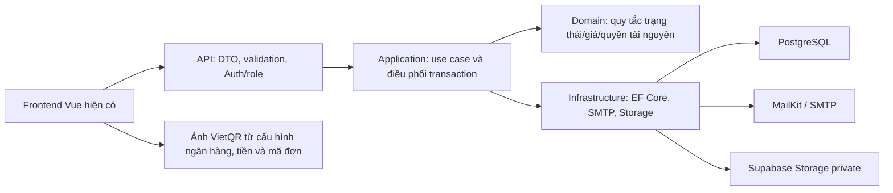
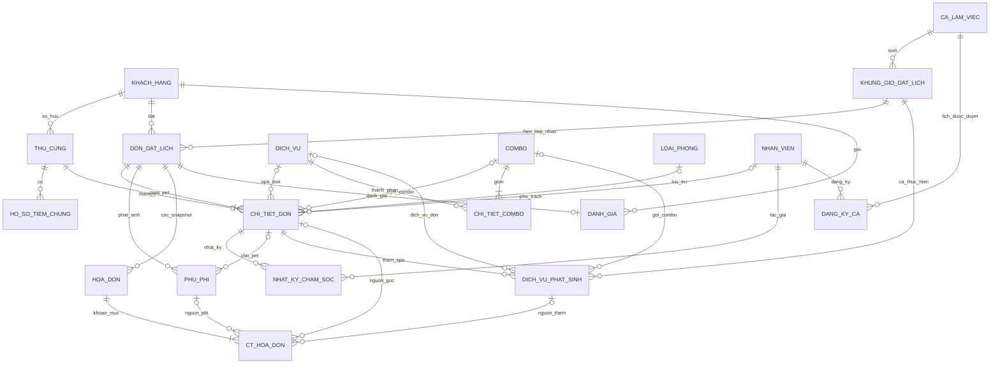
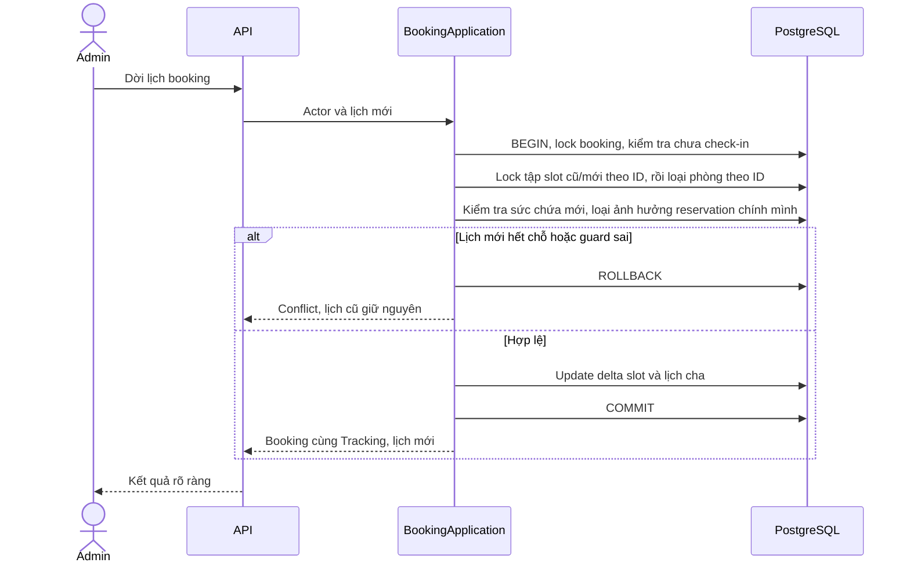

# Thiết kế kiến trúc và dữ liệu — Spa & Hotel

**Phiên bản:** 1.0, 17/10/2026. **Trạng thái:** người dùng đã duyệt T01–T09; chưa sinh code, DDL hoặc migration.

**Bổ sung 18/10/2026:** [D15–D19](../requirements/scope-and-decisions.md) đã được xác nhận sau bản 1.0: vaccine cho cả Spa, loại lông riêng, ngày nghỉ nhận/trả có chăm sóc Hotel, đổi role và gửi lại Tracking. Data Dictionary/ERD/API draft cũ chưa phản ánh đầy đủ các bổ sung này. Cần thiết kế bổ sung cách lưu dữ liệu và quyền trước khi dùng bản này sinh migration; chưa tự thêm bảng hoặc sửa ERD/Word/Figma trong đợt lập kế hoạch frontend.

**Baseline bắt buộc:** [SRS 1.1](../requirements/SRS_He_Thong_Quan_Ly_Spa_Thu_Cung_AI_Readable.md), [quyết định D01–D14](../requirements/scope-and-decisions.md), [phân tích nghiệp vụ](system-analysis.md). [ERD gốc](references/erd-original-reference.md) là nguồn đối chiếu, không phải schema mới đã duyệt.

T01–T09 được người dùng xác nhận bằng yêu cầu “oke mình duyệt các lựa chọn T01-T09”. Đây là baseline thiết kế cho triển khai sau này; không phải schema đã áp dụng. Giữ hai role, tập booking state và business rules đã chốt.

## 1. Kiến trúc đề xuất

### T01 — Một Backend triển khai chung, phân chia trách nhiệm trong code

Chọn modular monolith: một .NET Web API, một PostgreSQL database và một EF Core DbContext cho transaction liên phân hệ. Quy mô một tiệm không cần microservices, message broker, Redis hoặc một hệ CQRS framework.



Phân chia dự kiến trong `backend/src/` (chưa tạo thư mục):

| Project | Trách nhiệm | Giới hạn |
|---|---|---|
| PetSpa.Api | Endpoint, request/response, JWT/role policy, map lỗi | Không tự tính giá hoặc sửa DbContext từ controller. |
| PetSpa.Application | Booking, Capacity, Care, Billing, Schedule, Catalog, Tracking/Review use cases | Điều phối transaction; gọi abstraction gửi mail/file; không phụ thuộc HTTP/UI. |
| PetSpa.Domain | Trạng thái, công thức, guard và các kiểu nghiệp vụ | Không gọi SMTP/Supabase/EF trực tiếp. |
| PetSpa.Infrastructure | DbContext/mapping/query/lock, MailKit, Storage client | Một transaction DB cho use case cần nguyên tử; không generic repository chỉ để bọc lại mọi thao tác EF. |

Không tách mỗi module thành một service deploy riêng. EF/DB nằm ở Infrastructure; Application định nghĩa interface nghiệp vụ cần thiết, không bắt buộc thêm thư viện mediator. Runtime/package versions và hosting chốt trước implementation, không tự nâng framework trong giai đoạn này.

### Phân ranh dữ liệu/API

- Public: catalog, tạo booking, đúng booking qua SĐT/tracking, hủy hợp lệ và UC56. Không endpoint Public tra customer theo SĐT.
- Internal STAFF/ADMIN: Auth và các use case vận hành. Policy care kiểm tra assignment; Admin override actor, vẫn chạy guard nghiệp vụ.
- Admin: catalog/giá/công suất/xếp ca và danh sách đánh giá. Không CRUD user ngoài seed.
- DTO không trả EF entity nguyên khối. Public dùng snapshot người đặt của booking; STAFF không nhận reviews qua response tổng hợp.
- Frontend service boundary được nối theo contract sau, không đổi toàn bộ UI hoặc đưa workGroup mock vào JWT/DB.

## 2. Những lựa chọn dữ liệu chính

| ID | Đề xuất | Lý do/trade-off |
|---|---|---|
| T02 | Một `chi_tiet_don` = một pet/booking, unique `(don_dat_lich_id, thu_cung_id)`; tách dịch vụ thêm vào `dich_vu_phat_sinh`. | Chỉ có một state/assignment/room reservation cho pet. Thêm một bảng có mục đích cụ thể thay vì tạo thêm dòng pet rồi phải đồng bộ READY/DONE ở nhiều dòng. |
| T03 | `don_dat_lich.khung_gio_id` là ca hẹn cho mọi loại booking; giữ Spa chỉ tính pet có Spa. | Hotel-only vẫn có mốc đầu/cuối ca cho hủy/no-show; FK có giá trị không có nghĩa đã trừ slot. |
| T04 | Pre-check-in: care state, cân thực tế, giá chốt và thời điểm check-in đều NULL; sau tiếp nhận mới WAITING. | Không thêm enum pet mới; không đánh đồng đăng ký với đã vào tiệm. |
| T05 | `phu_phi` thuộc booking/pet, không bắt buộc FK invoice. Invoice lines snapshot nguồn phụ phí. | Ghi phụ phí trước khi hóa đơn tồn tại; không làm thay đổi snapshot cũ. |
| T06 | Hóa đơn có cờ/thời điểm thu hồi nháp, unique một invoice chưa thu hồi/booking; PAID không được thu hồi. | Giữ lịch sử nháp, cho tạo lại mà không sửa/xóa invoice đã hiệu lực; không thêm refund workflow. |
| T07 | `slot_da_dat` là bộ đếm được cập nhật dưới khóa; `slot_con_lai` là giá trị tính `tong_slot-slot_da_dat`. | Giữ cột còn lại nhưng tránh hai bộ đếm lệch nhau. Hành động trả chỗ giảm slot_da_dat nên slot_con_lai tăng đúng lượng tương ứng. |
| T08 | Dịch vụ Spa phát sinh có ca thực hiện riêng; giữ suất theo pet/ca, không theo số dịch vụ. | Giải quyết Hotel thêm Spa ngày sau nhận, không ghi vào slot quá khứ. Đòi hỏi một lựa chọn ngày/ca tối thiểu ở thao tác thêm dịch vụ sau này. |
| T09 | Lưu mốc đầu/cuối ca hẹn theo booking và thời điểm check-in/bàn giao/hủy/thu tiền; snapshot giá thành phần. | Cấu hình ca/giá/hồ sơ pet thay đổi không làm dịch chuyển deadline hoặc sửa giá chốt/lịch sử. |

Tổng đề xuất **20 bảng nghiệp vụ**: tận dụng 19 nhóm bảng gốc, thêm `dich_vu_phat_sinh`; không thêm bảng tồn phòng theo đêm, chuồng vật lý, lịch sử sức khỏe hay ticket. Danh sách cột có thay đổi so với gốc; chưa duyệt thì chưa được sinh migration.

## 3. ERD đề xuất



`he_so_can_nang` là bảng cấu hình, áp dụng rồi snapshot hệ số vào lượt phục vụ; không bắt buộc FK lịch sử tới khoảng cân có thể bị thay đổi. Invoice có nhiều bản nháp lịch sử nhưng chỉ một bản chưa thu hồi; không phải nhiều hóa đơn cùng thu tiền cho một booking. Mỗi invoice line có đúng một loại nguồn, không đồng thời trỏ cả pet/phụ phí/dịch vụ thêm.

## 4. Data Dictionary đề xuất

### 4.1. Quy ước chung

- PK giữ `integer` identity để ít thay đổi ERD cũ; FK cùng kiểu, không thay toàn hệ thống sang UUID chỉ vì có Tracking. Request chống trùng dùng UUID riêng.
- Tiền VND dùng `numeric(14,0)`, không float; cân nặng `numeric(5,2)`, hệ số `numeric(6,3)`. Đề xuất làm tròn tới 1 VND tại mỗi khoản chốt bằng quy tắc nửa đơn vị làm tròn lên, phải thống nhất Backend/UI trước code.
- Ngày công suất/ca dùng `date`, giờ ca mẫu `time`, thời điểm thực tế và audit dùng `timestamptz`; tính ngày nghiệp vụ theo Asia/Ho_Chi_Minh.
- Các bảng có `created_at`; bảng thay đổi có `updated_at`. Catalog dùng `is_active`, không hard-delete bản ghi đã được tham chiếu. Các field audit actor thêm ở thao tác quan trọng bên dưới.
- `NOT NULL`, CHECK/UNIQUE trong phần này là ràng buộc đề xuất, chưa phải migration. Điều kiện liên bảng/role không giả vờ được một CHECK đơn giản bảo vệ; Application phải kiểm tra trong transaction.

### 4.2. Hồ sơ và catalog (bảng 1–8)

| Bảng | Cột nghiệp vụ chính và kiểu | Ràng buộc/điều chỉnh |
|---|---|---|
| 1. khach_hang | id; so_dien_thoai varchar(15); ten_khach_hang varchar(100); email varchar(150); deleted_at timestamptz NULL | SĐT chuẩn hóa unique, tên/email bắt buộc; bỏ ma_tracking_hash, không cần thông tin hoàn tiền. Public không update master cũ. |
| 2. thu_cung | id; khach_hang_id; ten_thu_cung varchar(100); loai_pet varchar(20); giong_loai varchar(100) NULL; can_nang_dang_ky numeric(5,2) NULL; ghi_chu_di_ung text NULL; deleted_at NULL | CHO/MEO; cân >0 nếu có. Không UNIQUE theo tên/loài. Lịch sử phục vụ ở chi tiết/nhật ký, không bảng cân riêng. |
| 3. ho_so_tiem_chung | id; thu_cung_id; object_path text; ngay_tiem date NULL; loai_vac_xin varchar(100) NULL | Tham chiếu file private. Ảnh dùng trong booking cần liên kết rõ với pet/ownership; không tin đường dẫn do client tùy ý nhập. |
| 4. dich_vu | id; ten_dich_vu varchar(100); loai_dich_vu varchar(50); mo_ta text NULL; gia_co_ban numeric(14,0); thoi_luong_phut int; is_active bool | Giá >=0, thời lượng >0. Dịch vụ cắt tỉa không đặt riêng theo BR-05. |
| 5. combo | id; ten_combo varchar(100); mo_ta text NULL; gia_combo numeric(14,0); is_active bool | Giá >=0. Combo có tối thiểu một thành phần; quy tắc thành phần kiểm tra khi tạo/sửa. |
| 6. chi_tiet_combo | id; combo_id; dich_vu_id | UNIQUE(combo_id,dich_vu_id), không thành phần trùng; FK catalog RESTRICT. |
| 7. he_so_can_nang | id; can_nang_tu numeric(5,2); can_nang_den numeric(5,2); he_so numeric(6,3); ghi_chu text NULL | Khoảng [từ,đến), từ>=0, đến>từ, hệ số>0; cấm khoảng giao nhau; không có khoảng phù hợp thì báo lỗi cấu hình, không âm thầm dùng hệ số 1. |
| 8. loai_phong | id; ten_phong varchar(100); kich_co varchar(20); gia_theo_ngay numeric(14,0); so_luong_phong int; is_active bool | Giá/số suất >=0; khóa dòng loại phòng khi tạo/hủy/dời hoặc thay capacity. Không giảm dưới đỉnh reservation còn hiệu lực ở các đêm liên quan. |

### 4.3. Lịch hẹn, pet và chăm sóc (bảng 9–13)

| Bảng | Cột chính và kiểu | Ràng buộc/ý nghĩa |
|---|---|---|
| 9. ca_lam_viec | id; ten_ca varchar(50); gio_bat_dau time; gio_ket_thuc time; slot_pet_mac_dinh int; is_active bool | Ca cùng ngày, giờ kết thúc > bắt đầu; capacity >=0. Không thêm ca xuyên đêm trong đợt đầu. |
| 10. khung_gio_dat_lich | id; ngay date; ca_lam_viec_id; tong_slot int; slot_da_dat int; slot_con_lai int tính từ hai cột trước | UNIQUE(ngay,ca_lam_viec_id), 0<=slot_da_dat<=tong_slot. Hotel-only vẫn được hẹn ở khung có slot Spa=0. |
| 11. don_dat_lich | id; request_id uuid; request_fingerprint text; tracking_code varchar(20); khach_hang_id; khung_gio_id; loai_don varchar(20); trang_thai varchar(30); thoi_gian_bat_dau/thoi_gian_ket_thuc timestamptz; ca_ket_thuc_du_kien timestamptz; ten_nguoi_dat varchar(100); email_nguoi_dat varchar(150); tong_tien_tam_tinh numeric(14,0); ghi_chu_khach text NULL; loai_huy varchar(30) NULL; ly_do_huy text NULL; huy_at timestamptz NULL; nguoi_huy_id int NULL | request_id unique chống retry; tracking unique; loại SPA/HOTEL/COMBO_SPA_HOTEL; booking state giữ đúng 6 giá trị đã chốt. thoi_gian_bat_dau là đầu ca đã hẹn; ngày nhận/trả nghiệp vụ suy ra theo múi giờ VN. Hủy ghi loại/lý do/thời điểm; actor nội bộ nếu có. HOTEL/COMBO trả ngày sau nhận; SPA kết thúc dự kiến trong ngày. |
| 12. chi_tiet_don | id; don_dat_lich_id; thu_cung_id; dich_vu_id int NULL; combo_id int NULL; loai_phong_id int NULL; nhan_vien_id int NULL; ho_so_tiem_chung_id int NULL; can_nang_khai_bao numeric(5,2); can_nang_thuc_te numeric(5,2) NULL; tinh_trang_long text NULL; trang_thai_cham_soc varchar(30) NULL; check_in_at/ready_at/ban_giao_at timestamptz NULL; nguoi_check_in_id/nguoi_ban_giao_id int NULL; gia_spa_co_so_chot/he_so_chot/gia_spa_chot/gia_phong_moi_dem_chot/so_dem_chot/don_gia_chot | UNIQUE(booking,pet). Tối đa một dich_vu_id/combo_id; phải có Spa hoặc Hotel. Bỏ la_dich_vu_them khỏi bảng này theo T02. Trước check-in state/giá chốt NULL; sau check-in có người phụ trách, cân/lông/giá và state WAITING..DONE. DONE phải có ban_giao_at. Giá chốt thành phần giữ độc lập catalog. Cột tiền numeric(14,0), hệ số numeric(6,3), số đêm int. |
| 13. nhat_ky_cham_soc | id; chi_tiet_don_id; nhan_vien_id; loai_nhat_ky varchar(30); object_path text; ghi_chu_suc_khoe text; can_nang_ghi_nhan numeric(5,2) NULL; thoi_gian_ghi_nhan timestamptz | Ảnh đầu/cuối gắn đúng lượt phục vụ; tác giả bất biến. Cân theo dõi về sau không ghi đè cân dùng chốt giá ở check-in; cập nhật cân hiện tại hồ sơ có kiểm soát. Không đổi tác giả khi chuyển người. |

Hồ sơ pet được chọn phải thuộc customer của booking. Nếu người đặt Public dùng SĐT đã có thì các thông tin người đặt nằm ở snapshot, không được serialize master cũ vào response Public. Booking Hotel kiểm tra mọi pet có phòng; booking hỗn hợp chỉ pet có Spa mới giữ slot Spa.

### 4.4. Hóa đơn, phụ phí, dịch vụ thêm (bảng 14–16 và 20)

| Bảng | Cột chính và kiểu | Ràng buộc/ý nghĩa |
|---|---|---|
| 14. hoa_don | id; don_dat_lich_id; tong_tien_dich_vu/tong_phu_phi/tong_thanh_toan/da_thanh_toan numeric(14,0); trang_thai_thanh_toan varchar(20); phuong_thuc_thanh_toan varchar(30) NULL; tao_boi_id; paid_at timestamptz NULL; thu_tien_boi_id int NULL; thu_hoi_at timestamptz NULL; thu_hoi_boi_id int NULL; ly_do_thu_hoi text NULL | Trạng thái invoice hiệu lực UNPAID/PAID; không PARTIAL_PAID/REFUNDED. Giam_gia/tien_coc bỏ khỏi core. Partial UNIQUE(don_dat_lich_id) khi thu_hoi_at IS NULL. Chỉ UNPAID được thu hồi; PAID có paid_at/người thu/phương thức và thu đủ tổng. |
| 15. ct_hoa_don | id; hoa_don_id; loai_khoan varchar(30); chi_tiet_don_id/phu_phi_id/dich_vu_phat_sinh_id int NULL; ten_khoan_muc varchar(150); so_luong int; don_gia_snapshot/thanh_tien numeric(14,0) | Đúng một nguồn; loại SPA/HOTEL/DICH_VU_THEM/PHU_PHI. Hotel N đêm × giá/đêm; Spa 1 × giá đã nhân hệ số, không nhân lại. Giá/tên không đọc catalog để sửa sau snapshot. |
| 16. phu_phi | id; don_dat_lich_id; chi_tiet_don_id int NULL; ten_phu_phi varchar(100); so_tien numeric(14,0); ly_do text; tao_boi_id; huy_at timestamptz NULL | Số tiền >=0, lý do bắt buộc. Thuộc đơn trước invoice; nếu gắn pet thì phải cùng booking. Không FK hoa_don_id bắt buộc; invoice line trỏ về nguồn này. Chỉ sửa/thu hồi khi không có snapshot hiệu lực. |
| 20. dich_vu_phat_sinh | id; request_id uuid; chi_tiet_don_id; dich_vu_id/combo_id int NULL; khung_gio_id; gia_co_so_chot/gia_chot numeric(14,0); can_nang_ap_dung numeric(5,2); he_so_chot numeric(6,3); ly_do text; tao_boi_id; trang_thai varchar(20); hoan_tat_at/huy_at timestamptz NULL | request_id unique; đúng một dịch vụ/combo, giữ BR-05. State CHO_THUC_HIEN/HOAN_TAT/HUY của phần việc, không phải booking state. Ngày/ca thực hiện không quá khứ, nằm trong đợt phục vụ hợp lệ. Phải hoàn tất mọi phần việc chưa hủy mới cho pet READY. Không tạo pet/room reservation mới. |

Đề xuất giới hạn thêm Spa khi pet WAITING/IN_PROGRESS/PAUSED và chưa có invoice hiệu lực; không mở lại pet READY/DONE. Nếu muốn bổ sung Spa sau READY cần duyệt riêng quy tắc mở lại tiến độ/ảnh cuối, không âm thầm làm trong code. Phụ phí như đón trễ vẫn thêm được khi pet READY/DONE, booking chưa COMPLETED và đã thu hồi nháp nếu có.

### 4.5. Nhân sự và đánh giá (bảng 17–19)

| Bảng | Cột chính và kiểu | Ràng buộc/ý nghĩa |
|---|---|---|
| 17. nhan_vien | id; ten_nhan_vien varchar(100); ten_dang_nhap varchar(50); mat_khau_hash text; vai_tro varchar(20); so_dien_thoai/email NULL; is_active bool | Username unique chuẩn hóa; ADMIN/STAFF. Không workGroup trong Auth target. Seed không chứa mật khẩu plaintext trong code/tài liệu. |
| 18. dang_ky_ca | id; nhan_vien_id; ca_lam_viec_id; ngay_lam_viec date; trang_thai_duyet varchar(20); duyet_boi_id int NULL; duyet_at timestamptz NULL | UNIQUE(nhan_vien_id,ngay_lam_viec,ca_lam_viec_id), PENDING/APPROVED/REJECTED. Không is_published. Cấm duyệt các ca chồng giờ của cùng nhân viên; không thu hồi ca đang dùng mà bỏ qua assignment. |
| 19. danh_gia | id; don_dat_lich_id; khach_hang_id; so_sao int; binh_luan text NULL; hien_thi_nhan_vien bool default false | UNIQUE(don_dat_lich_id), 1<=sao<=5. Backend suy ra khách từ booking đã xác minh, chỉ COMPLETED. Không API đọc danh sách cho STAFF hoặc toggle công khai reviews. |

## 5. Ràng buộc, index và delete rules

- Unique: normalized SĐT, username, tracking_code, booking.request_id, addon.request_id, (booking,pet), (ngày,ca), (nhân viên,ngày,ca), danh_gia.booking và partial unique hóa đơn hiệu lực.
- Index theo truy vấn: booking(state,khung_gio_id), booking(customer), chi_tiet_don(loai_phong_id,booking), chi_tiet_don(nhan_vien_id,state), nhat_ky(chi_tiet_don_id,thoi_gian), dang_ky_ca(ngày,ca,state), addon(khung_gio_id,state), invoice(paid_at) cho thống kê nhẹ.
- Slot CHECK: 0<=slot_da_dat<=tong_slot; slot_con_lai = tong_slot-slot_da_dat. Phòng CHECK so_luong_phong>=0 không tự bảo vệ được công suất từng đêm; transaction service phải kiểm tra.
- Check-in invariant: check_in_at NULL thì cân thực tế/state/giá chốt chưa có; check-in xong mới có WAITING. DONE iff đã bàn giao, không dùng cân mới của hồ sơ để suy ra check-in cũ.
- Cancellation: CANCELLED yêu cầu loai_huy, ly_do_huy, huy_at; còn lại các field hủy NULL. Public tự hủy chỉ CUSTOMER_CANCELLED; loại và quyền/thời điểm kiểm tra server. STAFF_REJECTED chỉ PENDING, STAFF_CANCELLED khi CONFIRMED; NO_SHOW theo hạn đã chốt. Nội bộ ghi lý do thực tế khi khách gọi, không tin client tự đặt actor.
- FK RESTRICT cho hồ sơ/catalog/pet/booking/ảnh/invoice đã được sử dụng; ưu tiên is_active/thu hồi theo lifecycle. Không cascade từ booking sang hóa đơn PAID hoặc nhật ký để mất chứng cứ. Không tạo API xóa cứng lịch sử.
- Hai nguồn conditional thuộc cùng booking/pet cần composite FK hoặc kiểm tra transaction; không cho gắn phụ phí của đơn khác vào invoice. CHECK row đơn lẻ không kiểm tra được ownership/role/đêm.
- Không bảng lịch sử sức khỏe mới. Những thay đổi catalog/giờ/capacity phải giữ các invariants đang có, không tuyên bố chỉ FK/CHECK là đủ.

## 6. Giữ sức chứa và transaction

### 6.1. Thứ tự khóa và ranh giới

Thiết kế đề xuất dùng transaction ngắn ở READ COMMITTED với row locks; mọi writer liên quan phải dùng cùng protocol. Thứ tự: booking hiện hữu theo ID → khung ca Spa bị ảnh hưởng theo ID tăng → loại phòng theo ID tăng → invoice/chi tiết liên quan; thao tác gán cần khóa/kiểm tra đăng ký ca trước khi ghi assignment. Không lấy khóa booking cha sau khi đã giữ khóa con. Với tạo mới chưa có booking cũ, bắt đầu từ tập tài nguyên được sắp xếp.

PostgreSQL hỗ trợ row locks và khuyến nghị thứ tự khóa nhất quán để tránh vòng chờ; đây là cơ sở cho protocol do nhóm đề xuất, không phải PostgreSQL tự suy ra nghiệp vụ Spa/Hotel. [Tài liệu PostgreSQL](https://www.postgresql.org/docs/current/explicit-locking.html).

No-show lazy được xử lý trong transaction riêng theo cùng protocol, trước khi transaction đặt/dời bắt đầu khóa tài nguyên; không khóa slot rồi quay lại hủy booking khác theo thứ tự ngược. Không network call SMTP/Storage/QR trong SQL transaction.

Tạo mới phải claim request_id bằng header booking dưới UNIQUE trong chính transaction trước khi giữ tài nguyên. Khung hẹn phải được đảm bảo tồn tại trước bước này (upsert row có slot_da_dat=0, không giữ chỗ); không để khung thiếu làm bỏ protocol idempotency. Nếu key đã được transaction khác commit, đọc fingerprint và trả booking cũ nếu cùng payload; khác payload thì conflict. Pre-check ngoài transaction chỉ là tối ưu, không thay UNIQUE; không để retry cùng key bị báo hết slot do chính request đầu vừa giữ suất cuối.

### 6.2. Spa: suất pet/ca, không phải số dịch vụ

Tập giữ chỗ chuẩn là DISTINCT(chi_tiet_don_id,khung_gio_id):

1. Pet có Spa lúc đặt: ca hẹn của booking.
2. Dịch vụ phát sinh chưa hủy: ca thực hiện của addon.

UNION hai tập để pet đã có Spa và thêm một dịch vụ cùng ca không chiếm thêm suất. Nếu thêm Spa trong ca khác thì là một lượt năng lực khác và phải kiểm tra ca mới. Các booking CANCELLED không giữ; COMPLETED vẫn tính vào số lượt đã tiếp nhận của ca đó, vì đây là năng lực phục vụ theo ca chứ không phải ghế trống tức thời.

Mọi thêm/xóa/dời/cancel tính delta của tập trước/sau dưới khóa và cập nhật slot_da_dat; không cộng/trừ theo số dòng dịch vụ. Một hàm ReleaseSpaCapacity dùng chung cho CANCELLED nhả phần giữ thực tế đúng một lần. Gọi lại khi booking đã CANCELLED không cập nhật bộ đếm nữa.

### 6.3. Hotel

Khóa các loại phòng liên quan; truy vấn pet chính của booking active PENDING/CONFIRMED/IN_PROGRESS/READY và kiểm tra từng đêm [nhận,trả). Không tồn kho theo đêm để phải increment/decrement một bảng khác. Khi hủy, đổi booking thành CANCELLED trong cùng transaction khiến reservation không còn được tính; vẫn khóa các loại phòng để đồng bộ writer. Khi COMPLETED, phải dùng cùng protocol vì tập đơn active thay đổi.

Dời lịch loại trừ reservation cũ của chính booking khi đánh giá khoảng mới để không tự đếm đôi. Cấm giảm capacity dưới đỉnh đang giữ. Availability response ngoài transaction chỉ là tham khảo; lệnh ghi luôn kiểm tra lại. Không cam kết <5ms nếu chưa đo.

### 6.4. Dời lịch D14

1. Xác thực Admin, mở transaction và khóa booking; kiểm tra PENDING/CONFIRMED, không check_in_at/cân thực tế/luồng phục vụ ở bất kỳ pet nào, không snapshot hiệu lực.
2. Lập hợp nhất tài nguyên cũ/mới, khóa theo thứ tự cố định; không khóa kiểu ca cũ trước/ca mới sau tùy từng đơn.
3. Kiểm tra giờ/ca mới, room từng đêm mới và sức chứa Spa sau khi trừ ảnh hưởng reservation cũ của chính booking.
4. Cập nhật delta slot, ngày/giờ ở cha, ca_ket_thuc_du_kien và giữ phòng theo khoảng mới, tính lại tạm tính; không đổi giá chốt vì chưa check-in.
5. Commit. Bất kỳ validation/concurrency failure nào rollback toàn bộ; lịch cũ chưa bị mất với transaction khác.

Thứ tự trên giữ cùng kết quả nghiệp vụ “nhả cũ/giữ mới nguyên tử”, nhưng không cố tình cập nhật bộ đếm trước khi biết lịch mới hợp lệ. Retry có giới hạn khi DB báo deadlock/conflict; không lặp vô hạn hoặc retry gửi SMTP như tạo booking mới.

### 6.5. Hủy D13 và race với check-in

Hủy và check-in đều khóa cùng booking trước. Hủy kiểm tra lại toàn bộ pet và deadline sau khi đã khóa. Ghi CANCELLED, loại/lý do/người/thời điểm, nhả Spa qua hàm chung và kết thúc room reservation trong cùng transaction. Nếu check-in thắng trước thì hủy bị chặn; nếu hủy thắng thì check-in bị chặn. Request hủy lặp trả kết quả hiện tại, không nhả hai lần.

Giới hạn khách tự hủy dùng mốc đầu ca của booking, no-show dùng cuối ca đã snapshot +30 phút. Hotel không giữ Spa vẫn áp dụng hai mốc này. Core không cho dời/hủy booking đã nhận một phần pet bằng cách chỉ sửa state cha cho quay về CONFIRMED.

### 6.6. Snapshot, thu hồi nháp, PAID

- Khóa booking rồi invoice, kiểm tra mọi pet READY/DONE và không phần việc addon chưa hoàn tất. Tạo snapshot từ giá đã chốt, không tính lại giá catalog; unique một invoice hiệu lực chặn lặp.
- Thu hồi chỉ UNPAID; ghi actor/thời điểm/lý do, giữ lines cũ; sau thu hồi mới sửa phụ phí hoặc dữ liệu được phép rồi tạo snapshot mới. Không xóa hoặc cập nhật PAID.
- Xác nhận tiền khóa booking/tài nguyên cần thay đổi và invoice; kiểm tra đã nhận đủ, method, số tiền chốt, mọi pet READY/DONE. Cập nhật invoice PAID, mọi READY→DONE, booking COMPLETED cùng commit. PAID/COMPLETED rồi thì trả kết quả cũ, không ghi khoản thu nữa.
- Mọi pet đã DONE lẻ mà invoice vẫn UNPAID: booking vẫn READY, không coi là đã trả tiền. Không hệ ledger/refund/partial payment ngoài scope; thống kê tiền thu từ invoice PAID và paid_at.

## 7. Sequence trọng yếu

### 7.1. Dời lịch và rollback



### 7.2. Booking, ảnh và email

```mermaid
sequenceDiagram
    actor Customer
    participant API
    participant App as BookingApplication
    participant Storage as SupabaseStorage
    participant DB as PostgreSQL
    participant Mail as SMTP
    Customer->>API: Booking, request_id và ảnh vaccine tùy chọn
    API->>App: Dữ liệu đã giới hạn/kiểm tra
    App->>DB: Tra request_id đã hoàn thành trước
    alt Request cũ cùng payload
        DB-->>App: Booking cũ và Tracking
        App-->>Customer: Cùng kết quả, không giữ chỗ lần nữa
    else Request mới
        App->>Storage: Upload file đã kiểm tra, ngoài DB transaction
        App->>DB: BEGIN, claim header PENDING qua UNIQUE request_id
        App->>DB: Lock tài nguyên, kiểm tra và ghi chi tiết/giữ chỗ
        alt Không thể lưu booking
            App->>DB: ROLLBACK
            App->>Storage: Dọn file staging best effort
            App-->>Customer: Lỗi, không có booking một phần
        else Đã lưu
            App->>DB: COMMIT
            App->>Mail: Gửi Tracking tới email snapshot
            Mail-->>App: Thành công hoặc lỗi/timeout có giới hạn
            App-->>Customer: Luôn success + tracking; warning nếu email lỗi
        end
    end
```

Upload vaccine chỉ gọi Storage khi khách đính kèm ảnh, cho mọi loại dịch vụ; thiếu ảnh không chặn đặt lịch. Theo D15 cập nhật ngày 18/10, policy xác minh mặc định tắt; nếu bật thì nhân viên kiểm tra ảnh/giấy tại quầy trước check-in. Cách lưu policy và dấu vết xác minh cần thiết kế bổ sung. Nếu dọn file thất bại, file không được tham chiếu vẫn private, ghi log để dọn thủ công/lazy; không giữ lock SQL trong lúc chờ xóa file. Không hứa transaction phân tán giữa DB và Storage/SMTP.

## 8. Tích hợp và bảo mật

- Public upload đi qua Backend với giới hạn file/content kiểm tra thật. Object path do server sinh; kiểm tra file thuộc đúng lượt upload/request/booking, không nhận arbitrary URL làm chứng minh quyền.
- Bucket private. Backend chỉ cấp quyền đọc file sau role hoặc SĐT/tracking đúng booking; URL ký thời hạn ngắn chỉ là phương tiện đọc, không persist làm đường dẫn bền vững. Mô hình private/signed access được Supabase hỗ trợ; phạm vi booking là logic do Backend tự bảo vệ. [Supabase Storage buckets](https://supabase.com/docs/guides/storage/buckets/fundamentals).
- MailKit cấu hình secrets ngoài repo, timeout hữu hạn; commit booking rồi gửi. request_id unique + fingerprint phân biệt retry cùng payload với dùng lại key cho payload khác; trường hợp khác payload phải báo conflict, không trả nhầm booking.
- QR dùng tiền invoice hiệu lực và Tracking, không SĐT/email. URL ngân hàng cấu hình server trả về; secret keys không đi kèm URL. QR lỗi vẫn hiển thị số tiền/nội dung và lựa chọn tiền mặt; không tự ghi PAID.
- JWT/role ở API + tài nguyên ở Application. Tracking input không log nguyên cặp nhạy cảm; thông báo sai cặp thống nhất và rate limit có scope tránh khóa toàn khách chỉ bằng SĐT.
- Seed credentials lấy từ cấu hình an toàn, hash trước lưu; không seed tài khoản default công khai có thể dùng khi deploy. Không endpoint CRUD user chỉ để tạo dữ liệu demo.

## 9. Phạm vi duyệt và kiểm chứng

Đây là thiết kế đã duyệt, không phải kiểm thử implementation. Kiểm tra tài liệu bằng ID UC/BR, cardinality/constraints và các kịch bản giấy AC01–AC16; bổ sung dời chéo ca, Hotel-only no-show và addon cùng ca/khác ca. Không chạy frontend test/build cho lượt chỉ tài liệu. ERD/Sequence hiện ở dạng source Mermaid; chưa tuyên bố đã render hoặc chạy SQL.

T01 kiến trúc; T02 bảng dịch vụ phát sinh, một pet/lượt duy nhất; T03–T09 field/constraints và snapshot/công suất đều đã duyệt. [API contract](api-contract.md) và [traceability/lộ trình](requirements-traceability.md) là sản phẩm tiếp theo để rà soát trước code. Việc duyệt thiết kế không tự cho phép chạy migration hoặc thay đổi frontend.
