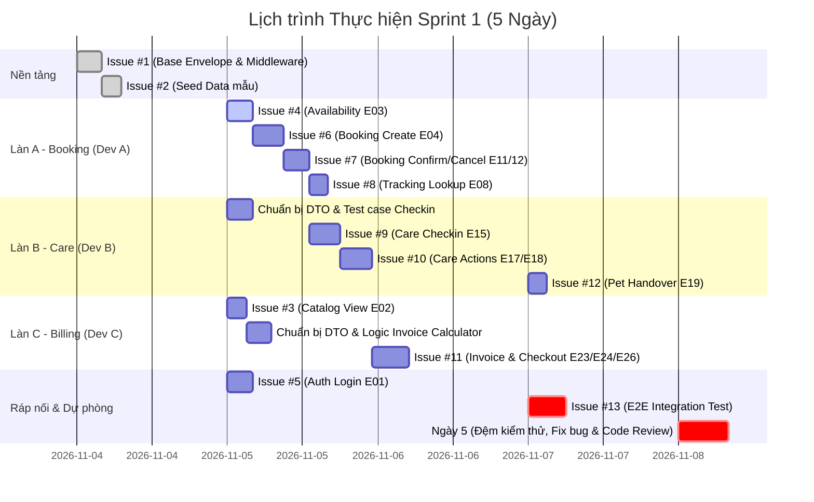

# KẾ HOẠCH SPRINT 1 — PETSPA & HOTEL (MILESTONE 4 - ĐỢT 1)

**Dự án:** Hệ thống Quản lý Vận hành Dịch vụ Spa & Hotel Thú Cưng (PetSpa & Hotel)  
**Giai đoạn:** Milestone 4 — Backend Core Slices (Sprint 1)  
**Thời gian thực hiện:** 5 ngày làm việc (Ngày 1: Nền tảng; Ngày 2–3: Phát triển song song 3 nhánh; Ngày 4: Ráp nối E2E; Ngày 5: Đệm kiểm thử & sửa lỗi)  
**Trạng thái:** BASELINE SPRINT 1 ĐÃ CHỐT  
**Nguồn quy chiếu:**
- [docs/design/system-design.md](../design/system-design.md) (v2.0-LOCKED)
- [docs/design/api-contract.md](../design/api-contract.md) (v1.0-LOCKED)
- [docs/requirements/scope-and-decisions.md](../requirements/scope-and-decisions.md) (M2-01 đến M2-15)

---

## 1. MỤC TIÊU & PHẠM VI SPRINT 1

### 1.1 Mục tiêu cốt lõi
Triển khai hoàn chỉnh **Luồng Nghiệp vụ Spa Vận hành Khép kín (Core Spa Operational Loop)** từ đầu tới cuối trên nền tảng 33 bảng Entity đã tạo ở Milestone 3:
$$\text{Xem ca/dịch vụ} \rightarrow \text{Đặt lịch Spa} \rightarrow \text{Xem & Duyệt đơn} \rightarrow \text{Check-in tiếp nhận} \rightarrow \text{Chăm sóc & Nhật ký} \rightarrow \text{Lập hóa đơn & Xem} \rightarrow \text{Thu tiền đủ} \rightarrow \text{Bàn giao thú cưng}$$

### 1.2 Phạm vi & Ranh giới (In-Scope & Out-of-Scope)
- **Trong phạm vi Sprint 1 (In-Scope):**
  - Dịch vụ SPA thực hiện trong ngày (không lưu trú qua đêm).
  - Khách vãng lai đặt lịch qua web và tra cứu bằng mã tracking 8 ký tự.
  - Lễ tân xem danh sách đơn chờ duyệt (`PENDING`), duyệt (`CONFIRMED`) hoặc từ chối (`CANCELLED`).
  - Check-in tại quầy, chốt cân nặng và size cam kết, phân công kỹ thuật viên.
  - Cập nhật tiến độ chăm sóc (`START`, `PAUSE`, `RESUME`, `READY`) kèm tải ảnh thành phẩm.
  - Lập hóa đơn snapshot bất biến, xem chi tiết hóa đơn, thu tiền đủ 1 lần (tiền mặt / chuyển khoản) chuyển `PAID`.
  - Bàn giao thú cưng chuyển `DONE`, hoàn tất đơn `COMPLETED`.
  - Cơ chế xác thực JWT cho nhân viên (`E01`).
- **Ngoài phạm vi Sprint 1 (Dời sang Sprint 2 hoặc Sprint 3):**
  - Lưu trú HOTEL qua đêm, Giữ chỗ 30 phút, Thu cọc 30% và Hoàn cọc (`E42`–`E46`) $\rightarrow$ *Sprint 2*.
  - Dịch vụ phát sinh và Phụ phí gỡ rối lông (`E20`–`E22c`), Thu hồi và tạo lại hóa đơn (`E25`) $\rightarrow$ *Sprint 2*.
  - Hủy riêng một thú cưng (`E47`), Nhận sớm thú cưng (`E48`), Trả thú cưng bị hủy (`E49`) $\rightarrow$ *Sprint 2*.
  - Đăng ký ca và Duyệt ca làm việc (`E27`–`E29`, `E54`, `E55`) $\rightarrow$ *Sprint 2*.
  - OTP qua Email MailKit (`E39`–`E41`), Phân quyền động chi tiết theo 24 Permissions (`E53`, `E60`), Đánh giá (`E35`, `E36`), Báo cáo (`E37`) $\rightarrow$ *Sprint 3*.

---

## 2. BẢN ĐỒ PHÂN BỔ 68 OPERATIONS CỦA HỆ THỐNG

| Nhóm Sprint | Trọng tâm nghiệp vụ | Số Op | Danh sách 68 Operations cụ thể (`api-contract.md` mục 2) |
|---|---|---|---|
| **Sprint 1 (Tuần 1)** | **Luồng Spa Vận hành Khép kín** | **15** | `E01` (Login), `E02` (Catalog), `E03` (Availability Spa), `E04` (Booking Spa), `E08` (Tracking lookup), `E10a` (List đơn PENDING), `E11` (Duyệt đơn), `E12` (Từ chối đơn), `E15` (Check-in), `E17` (Care Action), `E18` (Care Log & Ảnh), `E23` (Lập Invoice), `E24` (Xem Invoice), `E26` (Thu tiền đủ), `E19` (Bàn giao). |
| **Sprint 2 (Tuần 2)** | **Hotel, Cọc, Dịch vụ Phát sinh & Ca** | **28** | `E05` (Booking quầy), `E06` (Tìm khách), `E07` (Sửa pet), `E09` (Hủy tracking), `E10b` (Chi tiết đơn), `E13` (Dời ca), `E14` (Ứng viên ca), `E16` (Phân công lại), `E20` (Thêm dịch vụ phát sinh), `E21` (Hủy/xong dịch vụ phát sinh), `E22a` (Tạo phụ phí), `E22b` (Sửa phụ phí), `E22c` (Hủy phụ phí), `E25` (Thu hồi invoice), `E27` (Xem lịch ca), `E28` (Đăng ký ca), `E29` (Duyệt ca), `E42` (Ghi nhận thu cọc), `E43` (Xem danh sách cọc), `E44` (Tạo lệnh hoàn cọc), `E45` (Xác nhận hoàn cọc), `E46` (Xem danh sách hoàn cọc), `E47` (Hủy riêng pet), `E48` (Nhận sớm pet), `E49` (Trả pet hủy), `E50` (Gửi lại tracking), `E54` (Mở đợt đăng ký ca), `E55` (Điều chuyển ca), `E61` (Hoàn tất thành phần combo). |
| **Sprint 3 (Tuần 3)** | **Quản trị, OTP, Đánh giá & Hoàn thiện** | **25** | `E30a` (Tạo dịch vụ), `E30b` (Sửa dịch vụ), `E31a` (Tạo combo), `E31b` (Sửa combo), `E32` (Cập nhật khoảng size), `E33` (Sửa loại phòng), `E34a` (Xem cấu hình sức chứa), `E34b` (Sửa ca làm việc), `E34c` (Sửa slot theo ngày), `E35` (Gửi đánh giá), `E36` (Xem đánh giá Admin), `E37` (Overview tổng quan), `E38` (Danh sách nhiệm vụ chăm sóc), `E39` (Gửi OTP challenge), `E40` (Xác thực OTP), `E41` (Tra cứu pet cũ sau OTP), `E51` (Mở khóa tracking), `E52` (Ngoại lệ ảnh chăm sóc), `E53` (Cấp/thu hồi quyền nhân viên), `E56` (Cấu hình ngày nghỉ), `E57` (Cấu hình Extension flags), `E58` (Ghi đè chính sách tiêm chủng đơn cũ), `E59` (Miễn phí đón trễ sau PAID), `E60` (Đổi vai trò nhân viên). |
| **TỔNG CỘNG** | **Bao phủ toàn hệ thống** | **68** | **Đầy đủ 68/68 operations, không sót bất kỳ operation nào.** |

---

## 3. DANH SÁCH 13 ISSUES CHI TIẾT CỦA SPRINT 1

> **Quy ước đặt tên nhánh:** `feat/issue-<số>-<tên-ngắn>` (hoặc `test/issue-13-e2e-spa-flow` cho test tích hợp).  
> **Nguyên tắc phân vai:**
> - **Tech Lead (Lead):** Khung kiến trúc dùng chung, Seed Data, Xác thực JWT, Test E2E.
> - **Dev A:** Phân hệ Đặt lịch & Quản lý đơn (`E03`, `E04`, `E08`, `E10a`, `E11`, `E12`).
> - **Dev B:** Phân hệ Chăm sóc thú cưng & Bàn giao (`E15`, `E17`, `E18`, `E19`).
> - **Dev C:** Phân hệ Danh mục & Hóa đơn thanh toán (`E02`, `E23`, `E24`, `E26`).

| Issue # | Nhánh Git | Phụ trách | Est. | Endpoints | Đầu vào | Quy tắc kiểm thử bắt buộc (DoD Tests) |
|---|---|---|---|---|---|---|
| **#1** | `feat/issue-01-core-envelope` | **Tech Lead** | 4h | Khung | Không | - Cấu trúc class `ApiResponse<T>` (`success`, `data`, `message`, `errorCode`, `errors[]`, `traceId`).<br/>- `GlobalExceptionMiddleware` bắt unhandled exception trả HTTP 500 JSON đúng envelope.<br/>- *Test:* 1 unit test serialize envelope; 1 integration test giả lập throw exception kiểm tra response JSON. *(Yêu cầu 2 người duyệt)* |
| **#2** | `feat/issue-02-seed-data` | **Tech Lead** | 3h | Seed | #1 merge | - Seed dữ liệu mẫu: 4 khoảng size S/M/L/XL (`he_so_can_nang`), 2 ca Sáng/Chiều (`ca_lam_viec`), 3 dịch vụ Spa cơ bản kèm giá 4 size (`dich_vu`, `bang_gia_size`), 1 Admin + 2 Staff (`nhan_vien`).<br/>- *Test:* Integration test query DbContext kiểm tra tồn tại đủ dữ liệu seed. |
| **#3** | `feat/issue-03-catalog-view` | **Dev C** | 3h | `E02` | #1, #2 merge | - API `GET /api/catalog` trả danh mục dịch vụ, combo, khoảng size theo DTO `Catalog`.<br/>- *Test:* 1 test trả về 200 kèm danh sách dịch vụ; 1 test trả về mảng rỗng khi database chưa có dịch vụ active. |
| **#4** | `feat/issue-04-availability` | **Dev A** | 4h | `E03` | #1, #2 merge | - API `POST /api/availability` kiểm tra sức chứa ca tiếp nhận Spa theo `AvailabilityQuery` (kiểm tra đồng thời số pet và tổng số phút dịch vụ).<br/>- *Test:* 1 test ca còn chỗ trả `coTheDat: true`; 1 test ca hết chỗ/vượt trần phút trả `coTheDat: false` kèm lý do. |
| **#5** | `feat/issue-05-auth-login` | **Tech Lead** | 4h | `E01` | #1, #2 merge | - API `POST /api/auth/login` xác thực nhân viên, cấp JWT Token chứa claims (`id`, `username`, `role`).<br/>- *Test:* 1 test đăng nhập đúng tài khoản seed trả 200 + token; 1 test sai mật khẩu trả 400 `VALIDATION_FAILED`. |
| **#6** | `feat/issue-06-booking-create` | **Dev A** | 5h | `E04` | #3, #4 merge | - API `POST /api/bookings` tạo đơn Spa mới trạng thái `PENDING`, sinh mã tracking 8 ký tự duy nhất, snapshot giá dịch vụ.<br/>- Xử lý `requestId` chống trùng bấm 2 lần.<br/>- *Test:* 1 test tạo đơn hợp lệ trả 201; 1 test gửi trùng `requestId` trả kết quả cũ (idempotent); 1 test ca đã đầy trả 409 `CAPACITY_EXCEEDED`. |
| **#7** | `feat/issue-07-booking-manage` | **Dev A** | 4h | `E10a, E11, E12` | #6 merge | - API `GET /api/internal/bookings` lọc đơn `trangThai=PENDING`.<br/>- API `POST /api/internal/bookings/{id}/confirm` duyệt đơn sang `CONFIRMED`.<br/>- API `POST /api/internal/bookings/{id}/cancel` từ chối đơn sang `CANCELLED`.<br/>- *Test:* 1 test duyệt đơn PENDING thành công sang CONFIRMED; 1 test duyệt đơn đã hủy/đã xác nhận trả 409 `INVALID_TRANSITION`. |
| **#8** | `feat/issue-08-tracking-lookup`| **Dev A** | 3h | `E08` | #6 merge | - API `POST /api/tracking/lookup` nhận SĐT + mã tracking, trả thông tin tiến độ đơn.<br/>- *Test:* 1 test đúng SĐT + mã tracking trả 200 kèm chi tiết đơn; 1 test sai mã trả 404 `TRACKING_NOT_FOUND`. |
| **#9** | `feat/issue-09-care-checkin` | **Dev B** | 5h | `E15` | #3, #7 merge | - API `POST /api/internal/booking-pets/{id}/check-in` tiếp nhận pet tại quầy, chốt cân nặng thực tế và size cam kết, phân công nhân viên.<br/>- Đơn chuyển sang `IN_PROGRESS`, pet chuyển sang `WAITING`.<br/>- *Test:* 1 test check-in hợp lệ chuyển trạng thái đúng; 1 test check-in khi đơn chưa `CONFIRMED` trả 409. |
| **#10**| `feat/issue-10-care-actions` | **Dev B** | 5h | `E17, E18` | #9 merge | - API `POST /api/internal/booking-pets/{id}/care-actions` chuyển trạng thái chăm sóc (`START` $\rightarrow$ `IN_PROGRESS`, `PAUSE` $\rightarrow$ `PAUSED`, `RESUME` $\rightarrow$ `IN_PROGRESS`, `READY` $\rightarrow$ `READY`).<br/>- API `POST /api/internal/booking-pets/{id}/care-logs` ghi nhật ký kèm ảnh.<br/>- *Test:* 1 test chuyển READY thành công khi có ảnh; 1 test `PAUSED` nhảy cóc sang `READY` trả 409 `INVALID_TRANSITION`. |
| **#11**| `feat/issue-11-invoice-checkout`| **Dev C** | 6h | `E23, E24, E26`| #10 merge | - API `POST /api/internal/bookings/{id}/invoices` lập hóa đơn snapshot bất biến.<br/>- API `GET /api/internal/invoices/{id}` xem hóa đơn.<br/>- API `POST /api/internal/invoices/{id}/checkout` xác nhận thu đủ tiền mặt/chuyển khoản chuyển `PAID`.<br/>- *Test:* 1 test lập hóa đơn đủ dòng trả 201; 1 test thanh toán đủ tiền chuyển PAID; 1 test trả thiếu tiền trả 409 `AMOUNT_MISMATCH`. *(Yêu cầu 2 người duyệt)* |
| **#12**| `feat/issue-12-pet-handover` | **Dev B** | 3h | `E19` | #11 merge | - API `POST /api/internal/booking-pets/{id}/handover` bàn giao pet cho khách.<br/>- Điều kiện: Hóa đơn của đơn phải mang trạng thái `PAID`. Sau bàn giao pet chuyển `DONE`, đơn chuyển `COMPLETED`.<br/>- *Test:* 1 test bàn giao thành công khi đã PAID; 1 test bàn giao khi hóa đơn chưa thanh toán (`UNPAID`) bị chặn trả 409. |
| **#13**| `test/issue-13-e2e-spa-flow` | **Tech Lead** *(Nhóm hỗ trợ)* | 6h | E2E | Toàn bộ | - Kịch bản kiểm thử tích hợp tự động xuyên suốt: Đăng nhập nhân viên $\rightarrow$ Xem ca $\rightarrow$ Khách đặt lịch $\rightarrow$ Lễ tân duyệt đơn $\rightarrow$ Tiếp nhận check-in $\rightarrow$ Bắt đầu chăm sóc $\rightarrow$ Hoàn tất chăm sóc có ảnh $\rightarrow$ Lập hóa đơn $\rightarrow$ Thu đủ tiền $\rightarrow$ Bàn giao thú cưng.<br/>- *Test:* Pass 100% kịch bản E2E. |

---

## 4. TIẾN TRÌNH THỰC HIỆN 5 NGÀY (PARALLEL SCHEDULE)



---

## 5. QUY CHUẨN VẬN HÀNH & CHỐT CHẶN AN TOÀN (GOVERNANCE PROTOCOLS)

### 5.1 Quy trình Mở khóa Schema Database (Schema Amendment Protocol)
- **Nguyên tắc:** Schema 33 bảng đã đóng băng từ Milestone 3. Mặc định **không sửa file Entity, không tạo migration mới trong Sprint 1**.
- **Quy trình khi phát hiện thiếu/sai cột bắt buộc:**
  1. Thành viên phát hiện mở thảo luận với Tech Lead, chứng minh: *"Không có cách nào thực hiện nghiệp vụ bằng các cột hiện tại"*.
  2. Chỉ **Tech Lead** mới được phép tạo nhánh `schema/amend-<tên-cột>` từ `develop`.
  3. Cập nhật Entity, sinh migration bằng `dotnet ef migrations add`, cập nhật tests.
  4. Mở PR, bắt buộc có ít nhất **2 thành viên khác bấm Approve** mới được merge.
  5. Khi merge xong, thông báo toàn nhóm lập tức chạy:
     ```bash
     git fetch origin
     git rebase origin/develop
     ```

### 5.2 Quy tắc Phê duyệt Pull Request (PR Review Matrix)
1. **Luật cấm tự duyệt:** **Tác giả không bao giờ được phép tự Approve PR của mình.**
2. **Phân quyền duyệt:**
   - PR của thành viên (Dev A, B, C): Phải được **Tech Lead** bấm Approve.
   - PR của Tech Lead (Issue #1, #2, #5, #13): Phải được **ít nhất 1 thành viên (Dev A, B hoặc C)** bấm Approve.
   - PR rủi ro cao (Khung kiến trúc #1 và Luồng tiền #11): Bắt buộc **ít nhất 2 người bấm Approve**.
3. **Quy trình cập nhật trước khi merge:**
   - Không dùng `git pull` tạo merge commit rác. Luôn dùng:
     ```bash
     git fetch origin
     git rebase origin/develop
     ```
   - Chạy test cục bộ pass 100% trước khi push: `dotnet test backend/PetSpa.sln`.

### 5.3 Definition of Done (DoD) & Tiêu chuẩn CI
Một PR chỉ đủ điều kiện bấm **Squash and Merge** khi:
- [ ] Không có warning mới phát sinh: Mã nguồn biên dịch sạch với `0 errors, 0 warnings`.
- [ ] Có đầy đủ Unit/Integration Test: Tối thiểu 1 test cho Happy Path và 1 test cho Sad Path (bắt lỗi nghiệp vụ).
- [ ] CI Pipeline trên GitHub Actions chạy **XANH 100%** trên commit rebase mới nhất.
- [ ] Không sửa đổi file migration hoặc cấu trúc bảng khi chưa có phê duyệt mở khóa schema.
- [ ] Được phê duyệt đủ số lượng Approve theo ma trận tại mục 5.2.
