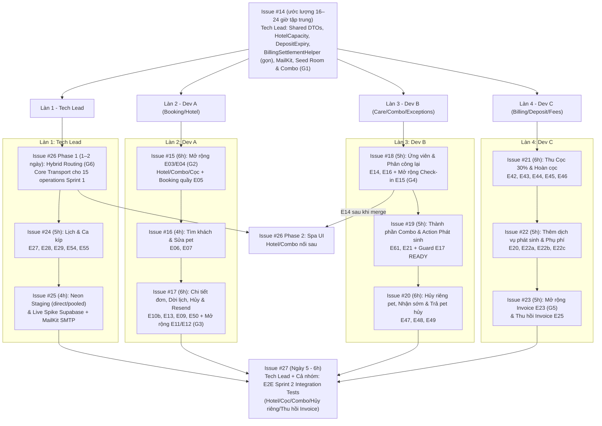

# KẾ HOẠCH SPRINT 2 — PETSPA & HOTEL (MILESTONE 4 - ĐỢT 2)

**Amendment Phase2 Spa UI (duyệt 2026-11-23):** E64 mới và E38/E62 đưa lên Sprint2; phân bổ hiện hành 15/32/24=71 operations. Tổng29/68 ở phần baseline dưới đây giữ lịch sử; implementation Phase2 theo docs/superpowers/plans/2026-11-23-issue-26-phase2-spa-ui.md, executing-plans inline. Nhánh riêng stacked Phase1PR38 + develop#18/#19, không tự mergePR38. Schema và nghiệp vụ đóng băng giữ nguyên.

> **For agentic workers:** REQUIRED SUB-SKILL: Use superpowers:subagent-driven-development (recommended) or superpowers:executing-plans to implement this plan task-by-task. Steps use checkbox (`- [ ]`) syntax for tracking.

**Goal:** Triển khai hoàn chỉnh 29 operations của Sprint 2 (Hotel, Cọc 30% & Hoàn cọc, Combo `E61`, Dịch vụ phát sinh & Phụ phí, Thu hồi hóa đơn `E25`, Ngoại lệ thú cưng `E47–E49`, Ca làm việc `E27–E29/E54–E55`), gỡ 6 chốt chặn cứng từ Sprint 1, dựng Staging Neon PostgreSQL + Spike Supabase/SMTP thật và nối Frontend Vue 3 theo Hybrid Routing cho 15 operations Sprint 1.

**Architecture:** Giữ kiến trúc Pragmatic Modular Monolith 3 tầng (`PetSpa.Core` -> `PetSpa.Api` -> `PetSpa.Tests`), controller mỏng, service inject trực tiếp `PetSpaDbContext`, tuyệt đối không thêm Repository/CQRS/MediatR và giữ nguyên Schema Freeze (33 bảng + amendment `tinh_trang_long`). Mở đầu Sprint 2 bằng Issue nền tảng (#14) từ baseline `origin/develop` (`226937e`, đã hoàn tất đủ 15 operations Sprint 1) để chốt toàn bộ shared DTOs, `BookingProjection` deposit mapping, `HotelCapacityCalculator`, `DepositExpiryService`, helper tính toán dùng chung gọn nhẹ `BillingSettlementHelper : IBillingSettlementHelper`, nâng cấp `SmtpEmailSender` lên `MailKit` và mở rộng `DbInitializer` trước khi 4 thành viên rẽ nhánh code song song.

**Tech Stack:** .NET 10 Web API, EF Core 10 + Npgsql (Neon PostgreSQL direct migration / pooled runtime theo Console), Supabase Storage (private bucket + Signed URL), MailKit/SMTP, xUnit + `PostgresWebApplicationFactory`, Vue 3 + Pinia + Axios + Vitest.

**Spec:**
- [docs/design/api-contract.md](../../design/api-contract.md) (v1.0-LOCKED)
- [docs/design/system-design.md](../../design/system-design.md) (v2.0-LOCKED)
- [docs/requirements/scope-and-decisions.md](../../requirements/scope-and-decisions.md) (`D01–D19`, `Q01–Q08`, `M2-01–M2-15`)
- [docs/plans/sprint-1-core-plan.md](../sprint-1-core-plan.md) (Baseline Sprint 1 & Governance Protocols)

## Handoff foundation Issue #14 (2026-11-22)

Đọc [spec #14](../../superpowers/specs/2026-11-22-issue-14-sprint2-foundation-design.md) và [implementation plan](../../superpowers/plans/2026-11-22-issue-14-sprint2-foundation.md) trước khi consume foundation.

- Writer chuẩn bị `slotIds`/`roomTypeIds` liên quan (mảng rỗng nếu không có), truyền named args `targetKhungGioIds`/`targetRoomTypeIds` khi gọi expiry. Dọn đủ hold quá hạn tại cutoff qua nhiều batch nếu cần, tối đa 20 booking mỗi transaction. Cả hai filters null là global sweep dành worker; filter explicit rỗng là no-op. Hai tập IDs dùng OR.
- Cleanup commit độc lập trước transaction chính. Nếu hold khác vừa hết hạn trong lúc writer chờ lock, thả/rollback transaction chính rồi dọn với cutoff mới; không khóa slot/room rồi quay lại khóa booking khác. Sau cleanup nạp lại entity/counters; không dùng graph cũ đang track như dữ liệu mới.
- `now >= HetHanAt` là hết hạn. E42 giữ booking → slots → rooms → deposit trước `ExpireLockedBookingDepositAsync`, không SaveChanges/transaction lồng trong helper. Nếu receipt đến sau HET_HAN, E42 vẫn ghi nhận và bổ sung CHO_HOAN cho phần mới thu chưa dành hoàn dưới cùng booking lock, không hồi sinh reservation.
- Hủy toàn bộ pet qua E47 giữ `LoaiHuy == null`, không tự phạt toàn đơn. Nhánh trước check-in (PENDING/CONFIRMED, thực tế mọi CheckInAt null) có thể CANCELLED khi không còn invoice UNPAID dù vẫn còn xử lý hoàn; nhánh M2-05 đang IN_PROGRESS vẫn chờ quyết toán/hoàn/trả đủ. Caller cập nhật pet state trước terminal helper; settlement tính target theo nightsStayed dù state pet đổi trước hay sau lời gọi.
- Hotel tính theo từng đêm: pet chưa check-in bị hủy nhả toàn bộ; đã check-in chưa trả vẫn giữ khoảng cam kết; đã trả chỉ nhả đêm chưa dùng, vẫn tính đêm đã ở khi booking còn active. DONE sớm không tự nhả phòng. Booking terminal không còn giữ phòng.
- Booking/Tracking dùng `DepositDto?`. Public mặc định refund.thamChieu=null; internal chỉ thấy tham chiếu đã che. Nạp đủ graph dưới transaction của use case; calculator đường đọc không tạo write-lock.
- Foundation helper không bị giới hạn số dòng. Ước lượng #14 là 16–24 giờ tập trung, không phải cam kết hoàn tất sáng Ngày 1; lịch các làn phụ thuộc phải tính lại theo thời điểm gate #14 thực sự đạt. Đo SLA <500ms, không suy ra SLA từ batch size.

---

## Global Constraints

- **Pre-Sprint 2 Git Baseline Gate (`origin/develop`):** Trước khi tạo nhánh `feat/issue-14-sprint2-foundation` hoặc bất kỳ nhánh tính năng nào của Sprint 2, mọi thành viên bắt buộc chạy `git fetch origin && git checkout develop && git rebase origin/develop` để đảm bảo đang đứng trên commit baseline `226937e` (chứa đầy đủ 15 operations Sprint 1).
- **Schema Freeze (33 bảng):** Không sửa file Entity, Configuration hoặc tạo migration mới trong các PR tính năng thông thường. Mọi thay đổi schema bắt buộc đi qua Schema Amendment Protocol (mục 5.1 của `sprint-1-core-plan.md`).
- **Chuẩn hóa số lượng Operations Sprint 2 (29/68 Operations):** Danh sách Sprint 2 trong `sprint-1-core-plan.md` mục 2 gồm chính xác **29 operations** (`E05, E06, E07, E09, E10b, E13, E50` [7] + `E14, E16, E47, E48, E49, E61` [6] + `E20, E21, E22a, E22b, E22c, E25` [6] + `E42, E43, E44, E45, E46` [5] + `E27, E28, E29, E54, E55` [5]). Tổng toàn hệ thống là $15\text{ (Sprint 1)} + 29\text{ (Sprint 2)} + 24\text{ (Sprint 3)} = 68$ operations, khớp tuyệt đối với con số **68 operations** đã khóa trong `api-contract.md` mục 7 và `M2-15`.
- **Thứ tự khóa tài nguyên chống Deadlock (`system-design.md` mục 5):** Mọi transaction ghi phải khóa theo thứ tự bất biến: `don_dat_lich` theo ID $\rightarrow$ tập `khung_gio_dat_lich` theo ID tăng dần $\rightarrow$ tập `loai_phong` theo ID tăng dần $\rightarrow$ tập `dang_ky_ca` theo ID tăng dần $\rightarrow$ `tien_coc` / `hoa_don`. Khi route nhận ID của con (như `tien_coc.id` ở `E42`/`E44`, `hoan_coc.id` ở `E45`, `hoa_don.id` ở `E25`), phải truy vấn `AsNoTracking()` lấy `DonDatLichId` trước, sau đó mở transaction và khóa từ `don_dat_lich` trở xuống để chống AB-BA Deadlock.
- **Tách đường Đọc và đường Ghi cho Hết hạn giữ chỗ cọc 30 phút (`M2-11` & `system-design.md` mục 1, 5):**
  - **Đường Đọc (`E03`) và Duyệt đơn (`E11`):** **KHÔNG** gọi write-lock `ExpireOverdueDepositsAsync` quét chéo sang đơn khác.
    - Tại `E03` (`AvailabilityService`): cả `HotelCapacityCalculator` (khi đếm suất phòng từng đêm) và `SpaCapacityCalculator` (khi tính phần `SlotDaDat`/`PhutDaGiu` hiệu lực của ca) đều trừ bỏ phần tài nguyên đang bị giữ bởi các đơn `PENDING` có yêu cầu cọc đã quá hạn (`tien_coc.trang_thai_yeu_cau == CHO_THU && tien_coc.het_han_at <= now`) ngay trong câu truy vấn đọc, đảm bảo reservation hết hiệu lực đúng deadline 30 phút mà không cần mở transaction ghi.
    - Tại `E11` (`ConfirmBookingAsync`): khóa trực tiếp đơn đang duyệt (`don_dat_lich` $\rightarrow$ `tien_coc`), nếu `tien_coc != null` mà `TrangThaiYeuCau != DA_DAP_UNG` (deadline chỉ làm hết hiệu lực yêu cầu còn CHO_THU, không làm hết hiệu lực cọc đã đáp ứng) thì từ chối duyệt (`409 INVALID_TRANSITION`).
  - **Đường Ghi chiếm tài nguyên (`E04`, `E05`, `E13`, `E20`), Đối soát cọc (`E42`) & Background Worker:**
    - Theo đúng `system-design.md` dòng 43 (*"Writer xử lý đơn quá hạn bằng transaction riêng theo protocol trước khi chiếm tài nguyên, không khóa ca rồi quay lại khóa booking khác"*): trước khi mở transaction chính chiếm slot/phòng ở `E04` ( (và khi cần thu hồi slot/phòng bị giữ quá hạn trước khi ghi ở `E05, E13, E20`), gọi `await depositExpiry.ExpireOverdueDepositsAsync(now, null, ct, targetKhungGioIds: slotIds, targetRoomTypeIds: roomTypeIds)` trong một transaction độc lập commit trước để nhả `SlotDaDat`/`PhutDaGiu` vật lý của các đơn `PENDING` quá hạn (nếu request sau đó rollback thì đơn quá hạn vẫn đã được dọn sạch).
    - Tại `E42`: khi đối soát biên lai thu cọc của một đơn cụ thể, kiểm tra `now >= deposit.HetHanAt` ngay dưới khóa của chính đơn đó bằng hàm nội bộ `ExpireLockedBookingDepositAsync` (không mở transaction lồng nhau).
    - Kết hợp `DepositExpiryBackgroundService` mỏng có cờ `DepositExpiry:BackgroundEnabled` (mặc định `false` trong môi trường `Testing`).
- **Bảo toàn hồi quy Seed Data (`EXTENSION_SETTINGS`):** Giữ mặc định `{"otpEmail":false,"cocHotel":false,"giuCho":false}` trong `DbInitializer.cs` để toàn bộ test Sprint 1 xanh 100%; các test Hotel/Cọc của Sprint 2 bật `cocHotel: true, giuCho: true` qua fixture/helper và Staging bật qua cấu hình môi trường.
- **Định dạng JSONB Giá Snapshot & Mã lỗi `409` thống nhất:**
  - `DichVuTrongDon.BangGiaSizeSnapshot` và `ThanhPhanDichVuTrongDon.GiaLeSizeSnapshot` thống nhất dùng JSON object `Dictionary<SizeBand, decimal>` (`{"s":150000,"m":200000,"l":250000,"xl":300000}` với `JsonSerializerDefaults.Web`), khớp với `BookingCreateService.cs` và `CheckinService.cs` trên `origin/develop`.
  - Khi thao tác bị chặn do đơn đã có hóa đơn hiệu lực (`TrangThai != REVOKED`) hoặc sai trạng thái bước chuyển, thống nhất trả HTTP `409` với `errorCode: "INVALID_TRANSITION"` (khớp với `CheckinService` và `InvoiceService` hiện có); sai khớp tiền trả `409 AMOUNT_MISMATCH`; thiếu ca `APPROVED` của nhân viên được gán trả `409 ASSIGNMENT_UNAVAILABLE`; vượt công suất ca/phòng trả `409 CAPACITY_EXCEEDED`.
- **Idempotency & Audit:** Mọi mutation có `requestId` phải kiểm tra replay và lưu fingerprint SHA-256 + snapshot response vào `audit_log` theo khóa unique `(ActorId, HanhDong, RequestId)` (hoặc bảng đích có unique `request_id`), cắt `TraceId` tối đa 40 ký tự (`traceId[..Math.Min(40, traceId.Length)]`). Replay cùng payload trả HTTP `200 OK` (kể cả các endpoint lần đầu trả `201 Created` như `E05, E20, E22a, E28, E42, E44, E54`), khác payload trả `409 IDEMPOTENCY_CONFLICT`.
- **Zero-Warning & Test Isolation:** Build đạt `0 errors, 0 warnings`. Mỗi integration test chạy trên database PostgreSQL tách biệt qua `PostgresTestDatabase` (`PETSPA_TEST_POSTGRES`), kiểm thử đủ Happy Path, Sad Path và FR01 permission revocation (`403 FORBIDDEN`).

## Review Focus

1. **Tiền cọc đến muộn hoặc nộp thiếu trên đơn hết hạn 30 phút (`E42` vs `M2-11`, `M2-L05`, `M2-L06`):** Khi đơn `PENDING` quá hạn `tien_coc.het_han_at` (dù được phát hiện lúc gọi `E42` hay bởi `ExpireOverdueDepositsAsync`), hệ thống chuyển đơn sang `CANCELLED`, chuyển yêu cầu cọc sang `HET_HAN`, nhả slot Spa/phòng Hotel đúng 1 lần, đặt `giuLai = 0` (**tuyệt đối không phạt giữ cọc như `NO_SHOW` theo `system-design.md` dòng 625**), ghi nhận `GiaoDichThu` (nếu có biên lai đến muộn ở `E42`) và tự động tạo bản ghi `HoanCoc` trạng thái `CHO_HOAN` cho toàn bộ số tiền cọc chưa hoàn (`thucNhan - danhHoan`) với `TaoBoiId = latestReceipt.XacNhanBoiId`.
2. **Hủy riêng 1 pet (`E47`) khi đang làm dở Combo (`E61`) và Bảo toàn tiền cọc (`M2-07`, `M2-L07`):** Khi Admin gọi `E47`, `maThanhPhanDaLam` phải khớp chính xác các `ThanhPhanDichVuTrongDon` đã `HOAN_TAT` trên server; phần việc đã làm tính theo giá lẻ snapshot (`gia_le_size_snapshot`) và đặt dòng cha `TrangThai = HOAN_TAT`, phần chưa làm chuyển `HUY` (`GiaChot = 0` nếu chưa làm thành phần nào) và chỉ nhả `SlotDaDat` nếu pet không có bất kỳ dịch vụ/thành phần nào đã `HOAN_TAT` trong ca đó (`system-design.md` dòng 376). `BillingSettlementHelper` cập nhật lại `booking.TongTamTinh`, giải phóng hạn mức hoàn cọc để Admin gọi `E44` tạo lệnh hoàn `CHO_HOAN` (hoặc khấu trừ vào hóa đơn `E23`) mà không bao giờ xảy ra hoàn cọc 2 lần.
3. **Khép vòng đời đơn `M2-04` (`COMPLETED`) và `M2-05` (`CANCELLED` khi toàn bộ pet bị hủy):** Gom điều kiện chuyển trạng thái kết thúc đơn vào hàm chung `BillingSettlementHelper.TryTransitionBookingTerminalState(booking, now)` được gọi ở cuối `E19, E47, E49, E23, E26, E45`:
   - Nhánh `M2-04` (còn $\ge 1$ pet không hủy): chỉ chuyển sang `COMPLETED` khi đã có hóa đơn `PAID`, mọi pet không hủy đều `DONE`, **và** mọi pet `CANCELLED` trong đơn đều đã trả khách (`TraLaiAt != null`).
   - Nhánh `M2-05` (toàn bộ pet đều `CANCELLED`): giữ `IN_PROGRESS` cho tới khi mọi pet đều có `TraLaiAt != null`, đã quyết toán xong (`PAID` nếu có khoản phải thu $> 0$, hoặc không có hóa đơn `UNPAID` nếu phải thu $= 0$), và mọi khoản `HoanCoc` đã `DA_HOAN` (không còn `CHO_HOAN` và không còn cọc dư chưa phân bổ), rồi mới chuyển đơn sang `CANCELLED`.
4. **Thu hồi hóa đơn `UNPAID` (`E25`) và lập lại hóa đơn mới (`E23` theo `M2-L04`):** Khi thu hồi hóa đơn `UNPAID`, bản cũ chuyển sang `REVOKED` kèm `LyDoThuHoi = request.LyDo.Trim()` (**giữ nguyên không sửa `TongTien, CocKhauTru, ConPhaiTra` và `CtHoaDon` trên bản ghi `REVOKED` để tuân thủ `ck_hoa_don_tong_tien` và bất biến lịch sử**), ẩn QR, giải phóng hiệu lực khấu trừ cọc (vì hệ thống chỉ tính `khauTru` trên hóa đơn `!= REVOKED`), mở khóa để thêm dịch vụ phát sinh/phụ phí (`E20/E22a`), và khi gọi lại `E23` phải sinh `ma_hoa_don` mới kèm `thay_the_hoa_don_id` trỏ về bản `REVOKED` gần nhất.
5. **Trùng đăng ký ca `REJECTED` ở `E28/E55` (`ix_dang_ky_ca_nhan_vien_id_ngay_ca_lam_viec_id`):** Bảng `dang_ky_ca` có unique index không lọc trên `(nhan_vien_id, ngay, ca_lam_viec_id)` và `system-design.md` mục 3/5 khóa quy tắc một quyết định duyệt ca không bị nhân viên tự mở lại còn Admin điều chuyển ca trên đăng ký đã `APPROVED`. Do đó, nếu `(NhanVienId, Ngay, CaLamViecId)` đích đã tồn tại bản ghi ở **bất kỳ trạng thái nào** (`PENDING`, `APPROVED`, hoặc `REJECTED`), cả `E28` và `E55` đều chặn trước khi insert/update và trả `409 INVALID_TRANSITION` (không để lọt xuống DB gây lỗi `23505`).

---

## 1. BẢN ĐỒ GỠ 6 CHỐT CHẶN CỨNG TỪ SPRINT 1 & PHÂN BỔ 29 OPERATIONS

### 1.1 Bảng ánh xạ gỡ 6 chốt chặn cứng từ `origin/develop`

| # | Chốt chặn trên `origin/develop` | Hiện trạng gây nghẽn | Issue & Người gỡ trong Sprint 2 | Hành vi mục tiêu sau khi gỡ |
|---|---|---|---|---|
| **G1** | `DbInitializer.cs` & `SeedDataTests.cs` | Chưa seed `LoaiPhong`, chưa seed `Combo` (`ChiTietCombo` + `BangGiaSize`), `SeedDataTests.cs` assert cứng `12` dòng `BangGiaSize`. | **Issue #14** (`Tech Lead`) | Seed thêm 2 loại phòng (`Phòng Tiêu Chuẩn`, `Phòng VIP`) và 1 combo (`Combo Tắm Cắt Toàn Diện` gồm `Tắm sấy vệ sinh` + `Cắt tỉa tạo kiểu` đủ giá 4 size $\rightarrow$ cập nhật `SeedDataTests.cs` từ `12` lên `16` dòng `BangGiaSize`). Giữ `EXTENSION_SETTINGS` mặc định `false`. |
| **G2** | `AvailabilityService.cs` & `BookingCreateService.cs` | Chặn cứng `MaLoaiPhong != null`, `MaCombo != null`, `NgayTra != intake.Ngay`. | **Issue #15** (`Dev A`) | Cho phép đặt Spa đơn, Combo (sinh `ThanhPhanDichVuTrongDon` kèm `gia_le_size_snapshot`), Hotel từng đêm `[intake.Ngay, NgayTra)` (`NgayTra > intake.Ngay` khi đơn có $\ge 1$ pet Hotel, `NgayTra == intake.Ngay` khi thuần Spa) và đơn hỗn hợp `M2-06`; tạo `TienCoc` 30% + hạn 30 phút khi `cocHotel && giuCho` bật. |
| **G3** | `BookingManagementService.cs` (`E11, E12`) | `E12` chặn hủy đơn có `TienCocDonDatLich != null` hoặc `LoaiPhongId != null`. | **Issue #17** (`Dev A`) | `E11` khóa `tien_coc` kiểm tra `DA_DAP_UNG` trước khi duyệt; `E12` (và `E09`) cho phép hủy đơn Hotel/Cọc trước check-in, nhả slot Spa + suất phòng Hotel, cập nhật `TienCoc` (`HUY` nếu còn `CHO_THU`; phạt giữ cọc nếu hủy muộn `< 2h` / `NO_SHOW`; hoặc tự tạo `HoanCoc` `CHO_HOAN` với `TaoBoiId` hợp lệ khi khách hủy hợp lệ qua `E09`). |
| **G4** | `CheckinService.cs` (`E15`) & `HandoverService.cs` (`E19`) | `E15` chỉ đọc giá `DichVuId`, bỏ qua `ComboId` và giá phòng Hotel; `E19` chưa kiểm tra `TraLaiAt != null` cho pet hủy riêng `M2-04`/`M2-05`. | **Issue #18 & #20** (`Dev B`) | `E15` chốt `SizeChot`/`GiaChot` cho cả `ComboId` từ `BangGiaSizeSnapshot` và chốt `GiaPhongChot`/`SoDemChot` (theo múi giờ `Asia/Ho_Chi_Minh`) cho pet Hotel; `E19` và `E49` gọi `BillingSettlementHelper.TryTransitionBookingTerminalState` khép vòng đời `M2-04`/`M2-05`. |
| **G5** | `InvoiceService.cs` (`E23`) | Chặn `p.LoaiPhongId.HasValue`, `service.ComboId.HasValue`, `booking.TienCocDonDatLich != null`, `total <= 0`. | **Issue #23** (`Dev C`) | Lập dòng `SPA` (dịch vụ đơn, combo hoàn tất, hoặc thành phần lẻ của pet hủy `E47`), dòng `HOTEL` (`so_dem * gia_phong_chot` với `so_luong > 0`), dòng `PHU_PHI`; khấu trừ `CocKhauTru`, tự chuyển `PAID` nếu `conPhaiTra == 0` do cọc bao phủ, và gán `ThayTheHoaDonId` sau `E25`. |
| **G6** | `frontend/src/services/api/operationClient.js` & `auth.js` | `operationClient.js` ném lỗi cứng khi `VITE_USE_MOCK_API=false`; `auth.js` đọc sai field `res.data.user`/`token` thay vì `nhanVien`/`accessToken`. | **Issue #26** (`Tech Lead`) | Phase 1 chuẩn hóa `Session` và route 15 operations Sprint 1 cùng các alias UI qua `httpClient`. Action ngoài allowlist dùng phiên demo tách biệt theo điều kiện ở Task 13. |

### 1.2 Ma trận phân công 4 làn công việc song song (14 Issues: #14 $\rightarrow$ #27)

| Làn công việc | Phụ trách | Danh sách Issues | Operations & Hạng mục sở hữu |
|---|---|---|---|
| **Làn 0 — Nền tảng & Mở khóa** | **Tech Lead** *(Dev A, B, C review)* | **Issue #14** | Shared DTOs Sprint 2, `BookingProjection` full mapping (components, hotel fields, deposit projection), `HotelCapacityCalculator` + `SpaCapacityCalculator` expired-hold read compensation, `DepositExpiryService`, class tính toán gọn nhẹ `BillingSettlementHelper : IBillingSettlementHelper`, nâng cấp `SmtpEmailSender` lên `MailKit`, mở rộng `DbInitializer` (G1). |
| **Làn 1 — Hạ tầng, Ca làm việc & Frontend** | **Tech Lead** | **Issue #24, #25, #26, #27** | **5 Ops Ca kíp:** `E27, E28, E29, E54, E55` (#24). **Staging & Spike:** Neon PostgreSQL (direct/pooled theo Console) + Spike Supabase Storage & MailKit SMTP thật (#25). **Frontend Vue 3:** Hybrid Routing cho 15 operations Sprint 1 (#26 Phase 1). **E2E Sprint 2:** Kiểm thử luồng backend qua HTTP (#27). |
| **Làn 2 — Booking, Hotel, Khách hàng & Tracking** | **Dev A** | **Issue #15, #16, #17** | **7 Ops + Gỡ G2, G3:** Mở rộng `E03, E04` cho Hotel/Combo/Cọc + `E05` Booking tại quầy (#15); `E06, E07` Tra cứu khách & sửa pet (#16); `E10b, E13, E09, E50` + mở rộng `E11/E12` hủy/dời lịch/tracking resend (#17). |
| **Làn 3 — Phân công, Combo `E61` & Ngoại lệ Pet** | **Dev B** | **Issue #18, #19, #20** | **7 Ops (`E14, E16, E61, E21, E47, E48, E49`) + Gỡ G4:** `E14, E16` + mở rộng `E15` Check-in Combo/Hotel (#18); `E61` Hoàn tất thành phần combo & `E21` Hoàn tất/hủy dịch vụ phát sinh + guard `E17 READY` (#19); `E47` Hủy riêng pet, `E48` Nhận sớm, `E49` Trả pet hủy (#20). |
| **Làn 4 — Cọc 30%, Hoàn cọc, Phát sinh & Hóa đơn** | **Dev C** | **Issue #21, #22, #23** | **10 Ops (`E42–E46, E20, E22a–c, E25`) + Gỡ G5:** `E42, E43, E44, E45, E46` Thu cọc & Hoàn cọc (#21); `E20` Thêm dịch vụ phát sinh & `E22a, E22b, E22c` Phụ phí (#22); Mở rộng `E23` Hóa đơn Hotel/Combo/Cọc & `E25` Thu hồi hóa đơn (#23). |

---

## 2. TIẾN TRÌNH THỰC HIỆN SONG SONG (PARALLEL SCHEDULE)

---

## 3. CHI TIẾT TỪNG TASK / GITHUB ISSUE CỦA SPRINT 2

### Task 1 (Issue #14): [Foundation] Nút Cổ Chai Dùng Chung Sprint 2 — Shared DTOs, Hotel Capacity, Deposit Expiry, Gọn Nhẹ `BillingSettlementHelper`, MailKit & Seed Room/Combo (G1)

- **Assignee:** `Tech Lead` *(Yêu cầu tối thiểu 2 thành viên khác Approve trước khi merge vào `develop`)*
- **Branch:** `feat/issue-14-sprint2-foundation` *(Cắt từ `origin/develop` tại commit `226937e`)*
- **Endpoints / Scope:** Nền tảng dùng chung cho 29 operations Sprint 2 + gỡ chốt chặn **G1**. Giữ `BillingSettlementHelper` gọn đúng phạm vi tính toán dùng chung (gọn theo trách nhiệm, không giới hạn số dòng) để Dev B và Dev C chạy test độc lập không bị crash DI và không làm phình Issue #14.

**Files:**
- Create: `backend/src/PetSpa.Core/DTOs/Billing/DepositDto.cs`
- Create: `backend/src/PetSpa.Core/DTOs/Billing/FeeDto.cs`
- Create: `backend/src/PetSpa.Core/DTOs/Booking/CustomerPetDto.cs`
- Create: `backend/src/PetSpa.Core/DTOs/Scheduling/ScheduleDto.cs`
- Create: `backend/src/PetSpa.Core/Interfaces/Billing/IBillingSettlementHelper.cs`
- Create: `backend/src/PetSpa.Api/Services/Billing/BillingSettlementHelper.cs`
- Create: `backend/src/PetSpa.Api/Services/HotelCapacityCalculator.cs`
- Create: `backend/src/PetSpa.Api/Services/Billing/DepositExpiryService.cs`
- Modify: `backend/src/PetSpa.Api/PetSpa.Api.csproj`
- Modify: `backend/src/PetSpa.Api/Services/SpaCapacityCalculator.cs`
- Modify: `backend/src/PetSpa.Core/DTOs/Booking/BookingResponse.cs`
- Modify: `backend/src/PetSpa.Api/Services/Booking/BookingProjection.cs`
- Modify: `backend/src/PetSpa.Api/Services/Booking/IEmailSender.cs`
- Modify: `backend/src/PetSpa.Api/Services/Booking/SmtpEmailSender.cs`
- Modify: `backend/src/PetSpa.Api/Data/Seeding/DbInitializer.cs`
- Modify: `backend/src/PetSpa.Api/Program.cs`
- Test: `backend/tests/PetSpa.Tests/Seeding/SeedDataTests.cs`
- Test: `backend/tests/PetSpa.Tests/Foundation/Sprint2FoundationTests.cs`

**Interfaces:**
- Consumes: `PetSpaDbContext`, `TimeProvider`, `MailKit`
- Produces:
  - **Shared DTOs (`api-contract.md` mục 3.1 & 3.2):**
    - `DepositDto` (`MaTienCoc`, `MaDon`, `TrangThaiYeuCau`, `CoSoTinh`, `TyLe`, `SoTienYeuCau`, `HetHanAt`, `ThucNhan`, `KhauTru`, `GiuLai`, `DanhHoan`, `DaHoan`, `IReadOnlyList<RefundDto> HoanCoc`), `RefundDto` (`MaHoanCoc`, `MaTienCoc`, `SoTien`, `LyDo`, `TrangThai`, `HoanAt`, `ThamChieu`), `PageDeposit`, `PageRefund`, `ReceiptCreate`, `RefundCreate`, `RefundConfirm`.
    - `FeeDto`, `FeeCreate`, `FeeEdit`, `ExtraServiceRequest`, `ServiceActionRequest`, `ReasonCommand`.
    - `CustomerDto`, `PetDto`, `CustomerQuery`, `PetEdit`, `RescheduleRequest`, `TrackingCancel`, `TrackingResend`, `AcknowledgedResponse`, `AssignmentRequest`, `ShiftQuery`, `PetCancelRequest`.
    - `ShiftRegistrationDto`, `ShiftWindowDto`, `ScheduleQuery`, `ShiftRegisterRequest`, `ShiftDecisionRequest`, `ShiftWindowWriteRequest`, `ShiftTransferRequest`.
  - **Full Sprint 2 `BookingProjection` (chống merge conflict 3 làn):**
    - `BookingResponse.TienCoc` đổi kiểu từ `object?` sang `DepositDto?`.
    - `BookingProjection.IncludeDetails` nạp đủ: `ChiTietDonItems` $\rightarrow$ `DichVuTrongDonItems` $\rightarrow$ `ThanhPhanDichVuTrongDonItems`, `TienCocDonDatLich` (`GiaoDichThuTienCocItems`, `HoanCocTienCocItems`), `HoaDonDonDatLichItems` (`CtHoaDonHoaDonItems`).
    - Công thức 5 trường tiền tính toán trên `DepositDto`:
      - `ThucNhan = deposit.GiaoDichThuTienCocItems.Sum(x => x.SoTien)`
      - `KhauTru = activeInvoice?.CocKhauTru ?? 0m` (chỉ lấy từ `HoaDon` có `TrangThai != InvoiceState.REVOKED`)
      - `DanhHoan = deposit.HoanCocTienCocItems.Sum(x => x.SoTien)` (gồm cả `CHO_HOAN` và `DA_HOAN`)
      - `DaHoan = deposit.HoanCocTienCocItems.Where(x => x.TrangThai == RefundState.DA_HOAN).Sum(x => x.SoTien)`
      - `GiuLai`: **CHỈ** khác `0` (`Math.Max(0m, ThucNhan - KhauTru - DanhHoan)`) khi `booking.TrangThai == BookingState.CANCELLED` trước khi có bất kỳ pet nào check-in **VÀ** `deposit.TrangThaiYeuCau != DepositRequestState.HET_HAN` **VÀ** `booking.LoaiHuy` có giá trị thuộc `CUSTOMER_CANCELLED`, `STAFF_CANCELLED` hoặc `NO_SHOW` **VÀ** (`booking.LoaiHuy == CancellationType.NO_SHOW` HOẶC (`booking.HuyAt.HasValue && booking.BatDauDuKien - booking.HuyAt.Value < TimeSpan.FromHours(2)`)). Khi `deposit.TrangThaiYeuCau == HET_HAN`, `GiuLai` luôn bằng `0` (`system-design.md` dòng 625).
  - **`HotelCapacityCalculator` & Mở rộng `SpaCapacityCalculator` cho đường Đọc:**
    - `HotelCapacityCalculator.CheckRoomAvailabilityAsync(DateOnly checkInDate, DateOnly checkOutDate, IReadOnlyCollection<int> roomTypeIds, int? excludeBookingId, DateTimeOffset now, CancellationToken ct)`:
      - Đếm số pet có `LoaiPhongId != null` từ các đơn đang ở trạng thái `PENDING`, `CONFIRMED`, `IN_PROGRESS` (loại trừ `excludeBookingId` nếu có, và **loại trừ** các đơn `PENDING` có yêu cầu cọc đã quá hạn `TienCocDonDatLich.TrangThaiYeuCau == CHO_THU && TienCocDonDatLich.HetHanAt <= now`).
      - Tuân thủ đúng `Q02` (`scope-and-decisions.md` dòng 56) và `system-design.md` dòng 377: **Không** trừ phòng sớm chỉ vì pet không bị hủy đã `DONE` sớm (`E48`) khi đơn cha vẫn `IN_PROGRESS`; chỉ giải phóng các đêm chưa ở $d \ge \text{checkInDate.AddDays(pet.SoDemDaO ?? 0)}$ đối với pet đã bị hủy riêng (`TrangThaiChamSoc == CANCELLED`) và đã trả lại thực tế (`pet.TraLaiAt != null`).
    - `HotelCapacityCalculator.LockRoomTypesAsync(int[] roomTypeIds, CancellationToken ct)`: `SELECT id FROM loai_phong WHERE id = ANY(@roomTypeIds) ORDER BY id FOR UPDATE`.
    - `SpaCapacityCalculator.CheckAsync`: bổ sung tham số tùy chọn `DateTimeOffset? readAsOfNow = null` (khi gọi từ đường Đọc `E03`, tự động trừ bù phần `SlotDaDat` và `PhutDaGiu` đang nằm trên các đơn `PENDING` có `TienCoc.TrangThaiYeuCau == CHO_THU && TienCoc.HetHanAt <= readAsOfNow` tại `KhungGioId` đó để `E03` thấy đúng chỗ trống ngay sau phút thứ 30 mà không cần mở write-lock).
  - **`IDepositExpiryService` / `DepositExpiryService` (`ExpireOverdueDepositsAsync` & `ExpireLockedBookingDepositAsync`):**
    - `Task<int> ExpireOverdueDepositsAsync(DateTimeOffset now, int? targetBookingId, CancellationToken ct, IReadOnlyCollection<int>? targetKhungGioIds = null, IReadOnlyCollection<int>? targetRoomTypeIds = null)`: dọn đủ scope bằng **các transaction riêng biệt, mỗi transaction tối đa 20 booking** trước khi các Writer (`E04, E05, E13, E20`) khóa tài nguyên, hoặc được gọi bởi `DepositExpiryBackgroundService`. Tìm các đơn `PENDING` có `TienCoc.TrangThaiYeuCau == CHO_THU && TienCoc.HetHanAt <= now` (batch tối đa 20 đơn theo ID tăng dần), khóa theo đúng thứ tự chuẩn: `don_dat_lich` $\rightarrow$ tập `khung_gio_dat_lich` (ID tăng dần) $\rightarrow$ tập `loai_phong` (ID tăng dần) $\rightarrow$ `tien_coc`, rồi gọi `ExpireLockedBookingDepositAsync`.
    - `Task ExpireLockedBookingDepositAsync(DonDatLich booking, DateTimeOffset now, CancellationToken ct)` (dùng chung cho cả `ExpireOverdueDepositsAsync` và `E42` khi đơn đã được khóa sẵn): chuyển `booking.TrangThai = CANCELLED`, `booking.LoaiHuy = NO_SHOW`, `booking.LyDoHuy = "Quá hạn thanh toán tiền cọc 30 phút"`, `booking.HuyAt = now`; chuyển `TienCoc.TrangThaiYeuCau = HET_HAN`, `KetThucAt = now`; nhả `SlotDaDat` (chỉ giảm số pet phân biệt có dịch vụ Spa active trong từng `KhungGioId`, pet Hotel-only không trừ `SlotDaDat`) và `PhutDaGiu` đúng 1 lần; và nếu đơn đã có khoản thu cọc nộp thiếu trước hạn (`thucNhan > danhHoan` theo `M2-L05`/`M2-L06`), tự động tạo bản ghi `HoanCoc` (`CHO_HOAN`) cho toàn bộ `thucNhan - danhHoan` với `TaoBoiId = latestReceipt.XacNhanBoiId`.
  - **Gọn nhẹ `IBillingSettlementHelper` / `BillingSettlementHelper` (thuần tính toán trên Entity đang track trong transaction của caller, không giới hạn số dòng):**
    - `void SettleCancelledPetInMemory(DonDatLich booking, ChiTietDon pet, IReadOnlySet<int> completedComponentIds, int nightsStayed, DateTimeOffset now)`:
      - Dịch vụ đơn đã HOAN_TAT giữ giá, chưa làm chuyển HUY/giá0. Combo chưa làm component nào chuyển cha HUY/giá0; combo dở tính tổng giá lẻ snapshot các component HOAN_TAT; combo hoàn tất toàn bộ giữ giá combo đã chốt. Component chưa làm chuyển HUY nhưng entity component không có HuyAt; mốc hủy nằm ở dòng cha/audit của caller.
      - Cập nhật `pet.SoDemDaO = nightsStayed`, tính lại `booking.TongTamTinh` (tổng các dòng dịch vụ không bị hủy + tổng tiền phòng các đêm thực tính + tổng phụ phí hiệu lực). *(Không tự tạo `HoanCoc` tại đây để Admin chủ động tạo lệnh hoàn qua `E44` hoặc khấu trừ tại `E23`, tránh xung đột hoàn cọc kép)*.
    - `decimal CalculateObligatedDepositAmount(DonDatLich booking)`: tính số tiền cọc đang bị ràng buộc bởi nghĩa vụ đơn (nếu đơn `CANCELLED` trước check-in thì bằng `GiuLai`; nếu đơn đang phục vụ hoặc `M2-05` thì bằng `activeInvoice?.CocKhauTru ?? Math.Min(thucNhan - daHoan, currentPayableTotal)`).
    - `void TryTransitionBookingTerminalState(DonDatLich booking, DateTimeOffset now)`: kiểm tra và chuyển `booking.TrangThai` sang `COMPLETED` (`M2-04`) hoặc `CANCELLED` (`M2-05`) theo đúng 3 điều kiện (mọi pet đã `DONE` hoặc `CANCELLED` có `TraLaiAt != null`; hóa đơn đã `PAID` nếu phải thu $> 0$; mọi lệnh `HoanCoc` đã `DA_HOAN` và không còn cọc dư chưa phân bổ).
  - **Nâng cấp `SmtpEmailSender` sang `MailKit` & Mở rộng `IEmailSender`:**
    - Chuyển `SmtpEmailSender.cs` sang dùng `MailKit.Net.Smtp.SmtpClient` và `MimeKit.MimeMessage` ngay tại Task 1, đồng thời bổ sung `SendTrackingResendAsync` (`E50`) và `SendRefundConfirmedAsync` (`E45`).

- [ ] **Step 1: Write the failing tests in `SeedDataTests.cs` and `Sprint2FoundationTests.cs`**
  - Trong `SeedDataTests.cs`: cập nhật 3 dòng `Assert.Equal(12, await verify.BangGiaSizeSet.CountAsync())` (tại dòng 39, 129, 219) thành `Assert.Equal(16, await verify.BangGiaSizeSet.CountAsync())`, và thêm assert kiểm tra `DbInitializer` seed đủ 2 `LoaiPhong` (`Phòng Tiêu Chuẩn` 250.000đ/đêm, 5 phòng; `Phòng VIP` 450.000đ/đêm, 3 phòng) và 1 `Combo` (`Combo Tắm Cắt Toàn Diện` gồm `Tắm sấy vệ sinh` + `Cắt tỉa tạo kiểu`, giá 4 size S/M/L/XL: 350k/480k/620k/800k), trong khi `EXTENSION_SETTINGS` vẫn giữ `otpEmail: false, cocHotel: false, giuCho: false`.
  - Trong `Sprint2FoundationTests.cs`:
    - Kiểm tra `HotelCapacityCalculator.CheckRoomAvailabilityAsync` và `SpaCapacityCalculator.CheckAsync` (với `readAsOfNow`) trên đường Đọc tự động bỏ qua suất phòng và slot/phút Spa của đơn `PENDING` có `TienCoc` trạng thái `CHO_THU` đã quá hạn (`HetHanAt <= now`) mà không cần mở transaction ghi; đồng thời không nhả phòng sớm khi pet `DONE` sớm (`E48`) trong đơn đang `IN_PROGRESS` (`Q02`).
    - Kiểm tra `DepositExpiryService.ExpireOverdueDepositsAsync` chuyển đơn quá hạn sang `CANCELLED`, `TienCoc` sang `HET_HAN` (`GiuLai == 0`), hoàn trả đúng `SlotDaDat`/`PhutDaGiu`, và nếu có khoản cọc nộp thiếu trước hạn thì tự tạo `HoanCoc` (`CHO_HOAN`) với `TaoBoiId` hợp lệ.
    - Kiểm tra `BillingSettlementHelper.SettleCancelledPetInMemory` và `TryTransitionBookingTerminalState` tính đúng giá lẻ thành phần combo và khép trạng thái `M2-04`/`M2-05`.
- [ ] **Step 2: Run tests to verify they fail**
  - Run: `dotnet test backend/PetSpa.sln --filter "FullyQualifiedName~Sprint2FoundationTests|FullyQualifiedName~SeedDataTests" -m:1`
  - Expected: FAIL.
- [ ] **Step 3: Implement DTOs, `BookingProjection`, `HotelCapacityCalculator`, `SpaCapacityCalculator` read compensation, `DepositExpiryService`, `BillingSettlementHelper`, `MailKit` `SmtpEmailSender`, `DbInitializer` expansion, and DI registrations in `Program.cs`**
  - Trong `Program.cs`: đăng ký `HotelCapacityCalculator`, `IDepositExpiryService`/`DepositExpiryService`, `DepositExpiryBackgroundService` (tắt khi `Testing`), và `IBillingSettlementHelper`/`BillingSettlementHelper`.
- [ ] **Step 4: Run tests to verify they pass**
  - Run: `dotnet test backend/PetSpa.sln -m:1`
  - Expected: PASS 100% toàn bộ suite Sprint 1 + Foundation Sprint 2, `0 warnings`.
- [ ] **Step 5: Commit & Merge PR #14**
  - `git commit -m "feat(foundation): add Sprint 2 shared DTOs, hotel capacity, deposit expiry, billing helper, MailKit, and room/combo seeds"`

---

### Task 2 (Issue #15): [Booking] Mở rộng `E03/E04` cho Hotel, Combo & Cọc 30% (G2) + API Đặt Lịch Tại Quầy `E05`

- **Assignee:** `Dev A`
- **Branch:** `feat/issue-15-hotel-combo-counter-booking`
- **Dependencies:** Issue #14 đã merge.
- **Endpoints & Rules:** `E03` (`POST /api/availability`), `E04` (`POST /api/bookings`), `E05` (`POST /api/internal/bookings` - permission `BOOKING_CREATE`), gỡ chốt chặn **G2**; tuân thủ `D04, D05, D06, D07, D10, D15, D17, M2-01, M2-06, M2-11, M2-L01, M2-L02`.

**Files:**
- Modify: `backend/src/PetSpa.Api/Services/AvailabilityService.cs`
- Modify: `backend/src/PetSpa.Api/Services/Booking/BookingCreateService.cs`
- Modify: `backend/src/PetSpa.Api/Controllers/Booking/BookingCreateController.cs`
- Test: `backend/tests/PetSpa.Tests/AvailabilityEndpointTests.cs`
- Test: `backend/tests/PetSpa.Tests/Booking/BookingCreateEndpointTests.cs`

**Interfaces:**
- Consumes: `SpaCapacityCalculator`, `HotelCapacityCalculator`, `IDepositExpiryService`, `BookingProjection`, `TimeProvider`
- Produces:
  - **Quy tắc Validation Ngày Nhận/Trả & Tổ hợp Pet (`E03, E04, E05` — chống lỗi `ck_ct_hoa_don_so_luong` và hỗ trợ đơn hỗn hợp `M2-06`):**
    - Mỗi pet trong `thuCung` bắt buộc có ít nhất 1 dịch vụ Spa/Combo (`DichVu.Count > 0`) HOẶC có phòng Hotel (`MaLoaiPhong != null`) (`M2-L02`).
    - Ở cấp toàn đơn:
      - Nếu trong đơn có **ít nhất 1 pet** có `MaLoaiPhong != null`: bắt buộc `NgayTra > intake.Ngay` (tối thiểu 1 đêm lưu trú, `soDem = NgayTra.DayNumber - intake.Ngay.DayNumber >= 1` cho các pet có `MaLoaiPhong != null`; các pet chỉ Spa trong cùng đơn hỗn hợp `M2-06` có `MaLoaiPhong == null` và `SoDemChot = null`). Mọi ca thực hiện dịch vụ Spa/Combo (`service.MaKhungGio`) phải nằm trong khoảng `[intake.Ngay, NgayTra]` và không trước giờ bắt đầu ca tiếp nhận ở ngày đầu.
      - Nếu **không có pet nào** có `MaLoaiPhong != null` (đơn thuần Spa/Combo trong ngày): bắt buộc `NgayTra == intake.Ngay`.
      - Vi phạm quy tắc ngày trả về `400 VALIDATION_FAILED` (hoặc `400 INVALID_DATE_RANGE` khi `NgayTra < intake.Ngay`).
  - `E03` (`AvailabilityService.CheckAvailabilityAsync` — Đường Đọc):
    - **Không** gọi write-lock `ExpireOverdueDepositsAsync`. Truyền `readAsOfNow: clock.GetUtcNow()` vào `SpaCapacityCalculator.CheckAsync` và `HotelCapacityCalculator.CheckRoomAvailabilityAsync` để câu truy vấn đọc tự động loại trừ slot/phút và phòng của các đơn `PENDING` đã quá hạn cọc 30 phút.
    - Với Combo (`MaCombo != null` XOR `MaDichVu != null`): tổng thời lượng phút của combo tính bằng tổng `ThoiLuongPhut` của các dịch vụ thành phần trong `ChiTietCombo` (mỗi thành phần đếm 1 lần). Pet Hotel-only (`DichVu` rỗng) yêu cầu `0` slot Spa và `0` phút Spa (`D04/Q01`, `M2-L01`), nhưng ngày tiếp nhận `intake.Ngay` và ngày trả `NgayTra` vẫn không được rơi vào `NgayNghi` (`D17`, khoảng lưu trú ở giữa được phép đi qua `NgayNghi`).
    - Nếu có pet yêu cầu `MaLoaiPhong`, điền mảng `AvailabilityResponse.Phong` cho từng đêm $d \in [\text{intake.Ngay}, \text{NgayTra})$. Nếu bất kỳ đêm nào có `suatConLai < số pet yêu cầu loại phòng đó`, trả `409 CAPACITY_EXCEEDED`.
  - `E04` (`POST /api/bookings`) & `E05` (`POST /api/internal/bookings` — Đường Ghi):
    - Trước khi mở transaction chính, cả `E04` và `E05` gọi `await depositExpiry.ExpireOverdueDepositsAsync(clock.GetUtcNow(), null, ct, targetKhungGioIds: slotIds, targetRoomTypeIds: roomTypeIds)` (chạy trong transaction riêng theo `system-design.md` dòng 43) để giải phóng `SlotDaDat`/`PhutDaGiu` vật lý của các đơn `PENDING` quá hạn cọc.
    - Nhận `multipart/form-data` với JSON field `"payload"` (`BookingCreate`) và các file đính kèm khớp `pet.VaccinationFileKey` (đồng thời hỗ trợ `application/json` khi không có file).
    - `E05` kiểm tra JWT + quyền `BOOKING_CREATE` trong DB, gán `DonDatLich.TaoBoiId = actorId`, cho phép truyền `maKhachHang` và `maThuCung` thuộc đúng khách hàng đó (`thu_cung.khach_hang_id == maKhachHang`) mà không cần `bookingProof`/`petProof`.
    - Trong transaction chính: khóa `request_id` advisory lock $\rightarrow$ tập `khung_gio_dat_lich` (ID tăng dần) $\rightarrow$ tập `loai_phong` (ID tăng dần) $\rightarrow$ tập `dang_ky_ca` (ID tăng dần).
    - Khi tạo dòng `DichVuTrongDon` cho `MaCombo`: serialize `BangGiaSizeSnapshot` theo chuẩn `Dictionary<SizeBand, decimal>`, đồng thời sinh các bản ghi con `ThanhPhanDichVuTrongDon` cho từng dịch vụ trong `ChiTietCombo` kèm `GiaLeSizeSnapshot` (`Dictionary<SizeBand, decimal>` của dịch vụ lẻ đó), `ThoiLuongSnapshot` và `TrangThai = CHO_THUC_HIEN`.
    - Khi pet có `MaLoaiPhong`: kiểm tra công suất từng đêm dưới khóa `loai_phong`, lưu `LoaiPhongId`, `GiaPhongCamKet = loaiPhong.GiaMoiDem`, `SoDemChot = NgayTra.DayNumber - intake.Ngay.DayNumber` ($\ge 1$).
    - Tính `TongTamTinh = tổng Spa/Combo theo size khai báo + tổng (GiaPhongCamKet * SoDemChot)`.
    - Đọc `EXTENSION_SETTINGS`: nếu đơn có ít nhất 1 pet Hotel (`MaLoaiPhong != null`) và `cocHotel == true && giuCho == true`, tạo bản ghi `TienCoc` (`CoSoTinhSnapshot = TongTamTinh`, `TyLe = 0.30m`, `SoTienYeuCau = Math.Round(TongTamTinh * 0.30m, 0, MidpointRounding.AwayFromZero)`, `HetHanAt = now.AddMinutes(30)`, `TrangThaiYeuCau = CHO_THU`).

- [ ] **Step 1: Write the failing tests in `AvailabilityEndpointTests.cs` and `BookingCreateEndpointTests.cs`**
  - Test `E03` với Combo, với Hotel nhiều đêm trả mảng `phong` đúng số suất còn lại từng đêm, với pet Hotel-only (`0` dịch vụ Spa) không tốn slot Spa, với ngày lưu trú đi qua ngày nghỉ (`D17` cho phép nếu ngày nhận/trả không nghỉ), và test `E03` tự động thấy cả **slot Spa lẫn phòng Hotel** trống ngay sau khi một đơn `PENDING` hỗn hợp giữ chỗ trước đó đã quá `HetHanAt` 30 phút (không cần gọi endpoint ghi nào).
  - Test `E04` đặt đơn hỗn hợp (1 pet Hotel 2 đêm + Combo, 1 pet chỉ Spa theo `M2-06`) khi bật `cocHotel: true, giuCho: true`: trả `201` kèm `tienCoc.soTienYeuCau = 30% * tongTamTinh`, sinh đủ `ThanhPhanDichVuTrongDon` cho combo; test gửi `MaLoaiPhong != null` nhưng `NgayTra == intake.Ngay` bị chặn `400`; test `E04` tự động thu hồi slot/phòng của đơn `PENDING` quá hạn cọc trước đó.
  - Test `E05` (`POST /api/internal/bookings`) bởi Lễ tân (`BOOKING_CREATE`) chọn `maKhachHang` và `maThuCung` có sẵn thành công (`201`, replay cùng `requestId` trả `200`), và test `403 FORBIDDEN` khi nhân viên bị thu hồi quyền `BOOKING_CREATE`.
- [ ] **Step 2: Run tests to verify they fail**
  - Run: `dotnet test backend/PetSpa.sln --filter "FullyQualifiedName~AvailabilityEndpointTests|FullyQualifiedName~BookingCreateEndpointTests" -m:1`
  - Expected: FAIL.
- [ ] **Step 3: Implement `AvailabilityService`, `BookingCreateService`, and `BookingCreateController` (`POST /api/internal/bookings`)**
- [ ] **Step 4: Run tests to verify they pass**
  - Run: `dotnet test backend/PetSpa.sln --filter "FullyQualifiedName~AvailabilityEndpointTests|FullyQualifiedName~BookingCreateEndpointTests" -m:1`
  - Expected: PASS 100%.
- [ ] **Step 5: Commit**
  - `git commit -m "feat(booking): support hotel, combo, 30% deposit in E03/E04 and counter booking E05"`

---

### Task 3 (Issue #16): [Customer] API Tra Cứu Hồ Sơ Khách Hàng Theo SĐT (`E06`) & Cập Nhật Thú Cưng (`E07`)

- **Assignee:** `Dev A`
- **Branch:** `feat/issue-16-customer-pet-management`
- **Dependencies:** Issue #14 đã merge.
- **Endpoints & Rules:** `E06` (`GET /api/internal/customers/lookup?soDienThoai=...`), `E07` (`PATCH /api/internal/pets/{petId}`), permission `CUSTOMER_LOOKUP`; tuân thủ `D10/Q05, D16, FR01`.

**Files:**
- Create: `backend/src/PetSpa.Api/Services/Booking/CustomerLookupService.cs`
- Create: `backend/src/PetSpa.Api/Controllers/Booking/CustomersController.cs`
- Modify: `backend/src/PetSpa.Api/Program.cs`
- Test: `backend/tests/PetSpa.Tests/Booking/CustomerPetEndpointTests.cs`

**Interfaces:**
- Consumes: `PetSpaDbContext`, `CustomerQuery`, `PetEdit`, `CustomerDto`, `PetDto`
- Produces:
  - `GET /api/internal/customers/lookup` (`E06`):
    - Kiểm tra `CUSTOMER_LOOKUP` từ DB. Validate `soDienThoai` đúng 10 chữ số ASCII (`400 VALIDATION_FAILED` nếu sai).
    - Truy vấn exact match `khach_hang.so_dien_thoai == soDienThoai && deleted_at == null`, kèm danh sách `thu_cung` (`deleted_at == null`), sắp xếp ổn định theo `Id`. Không log `soDienThoai` ra console/logger theo `api-contract.md` mục 4.
  - `PATCH /api/internal/pets/{petId}` (`E07`):
    - Kiểm tra `CUSTOMER_LOOKUP` từ DB và idempotency theo `(actorId, "PET_EDIT", request.RequestId)` trong `audit_log`.
    - Bắt buộc có `requestId` hợp lệ và **ít nhất 1 trường nghiệp vụ** khác null (`tenThuCung`, `giong`, `canNang`, `ghiChuDiUng`, `loaiLong`, `ngaySinh`); nếu không có trường nào hoặc gửi trường lạ/sai giới hạn thì trả `400 VALIDATION_FAILED`.
    - Cập nhật hồ sơ master `ThuCung` (không sửa dữ liệu snapshot `ten_pet_snapshot` hay `can_nang_khai_bao` của các `ChiTietDon` lịch sử).

- [ ] **Step 1: Write the failing tests in `CustomerPetEndpointTests.cs`**
  - Test `E06` trả `Customer[]` kèm `thuCung` khi khớp SĐT 10 số, trả mảng rỗng `[]` khi không có, trả `400` khi SĐT không đủ 10 số, trả `403` khi thu hồi `CUSTOMER_LOOKUP`.
  - Test `E07` cập nhật `canNang`, `loaiLong`, `ghiChuDiUng` thành công (`200`), replay cùng `requestId` trả `200`, đổi payload cùng `requestId` trả `409 IDEMPOTENCY_CONFLICT`, gửi body không có trường nghiệp vụ nào trả `400 VALIDATION_FAILED`, giữ nguyên snapshot ở `ChiTietDon` cũ.
- [ ] **Step 2: Run tests to verify they fail**
  - Run: `dotnet test backend/PetSpa.sln --filter "FullyQualifiedName~CustomerPetEndpointTests" -m:1`
  - Expected: FAIL.
- [ ] **Step 3: Implement `CustomerLookupService` and `CustomersController`**
- [ ] **Step 4: Run tests to verify they pass**
  - Run: `dotnet test backend/PetSpa.sln --filter "FullyQualifiedName~CustomerPetEndpointTests" -m:1`
  - Expected: PASS 100%.
- [ ] **Step 5: Commit**
  - `git commit -m "feat(booking): add customer phone lookup E06 and pet profile patch E07"`

---

### Task 4 (Issue #17): [Booking] Chi Tiết Đơn (`E10b`), Dời Lịch Nguyên Tử (`E13`), Khách Hủy Tracking (`E09`), Gửi Lại Tracking (`E50`) & Mở Rộng `E11/E12` Cho Hotel/Cọc (G3)

- **Assignee:** `Dev A`
- **Branch:** `feat/issue-17-booking-reschedule-cancel-tracking`
- **Dependencies:** Issue #15 đã merge.
- **Endpoints & Rules:** `E10b` (`GET /api/internal/bookings/{id}`), `E13` (`POST /api/internal/bookings/{id}/reschedule`), `E09` (`POST /api/tracking/cancel`), `E50` (`POST /api/tracking/resend`), mở rộng `E11/E12` (`POST /api/internal/bookings/{id}/confirm`, `POST /api/internal/bookings/{id}/cancel` - gỡ **G3**); tuân thủ `D04, D05, D13, D14, D19, Q01, M2-11, M2-13`.

**Files:**
- Modify: `backend/src/PetSpa.Api/Services/Booking/BookingManagementService.cs`
- Modify: `backend/src/PetSpa.Api/Controllers/Booking/BookingManagementController.cs`
- Modify: `backend/src/PetSpa.Api/Services/Booking/TrackingService.cs`
- Modify: `backend/src/PetSpa.Api/Controllers/Booking/TrackingController.cs`
- Test: `backend/tests/PetSpa.Tests/Booking/BookingManagementEndpointTests.cs`
- Test: `backend/tests/PetSpa.Tests/Booking/TrackingEndpointTests.cs`

**Interfaces:**
- Consumes: `SpaCapacityCalculator`, `HotelCapacityCalculator`, `IDepositExpiryService`, `BookingRowLock`, `IEmailSender`, `TimeProvider`
- Produces:
  - `E10b` (`GET /api/internal/bookings/{id}`): kiểm tra `BOOKING_APPROVE`, trả `BookingResponse` đầy đủ (kèm `TienCoc` và `HoaDon`), không tìm thấy trả `404 NOT_FOUND`.
  - Mở rộng `E11` (`ConfirmAsync`): dưới khóa `don_dat_lich`, nạp `TienCocDonDatLich` (kèm `GiaoDichThuTienCocItems`, `HoanCocTienCocItems`); nếu `TienCocDonDatLich != null` mà `TrangThaiYeuCau != DepositRequestState.DA_DAP_UNG` hoặc `(TrangThaiYeuCau == CHO_THU && HetHanAt <= now)` thì trả `409 INVALID_TRANSITION`.
  - Mở rộng `E12` (gỡ **G3**) & `E09` (`POST /api/tracking/cancel`):
    - Cho phép hủy đơn có `LoaiPhongId != null` và/hoặc `TienCocDonDatLich != null` khi đơn ở `PENDING` hoặc `CONFIRMED` và chưa có bất kỳ pet nào check-in (`CheckInAt == null`).
    - Guard phân quyền hủy muộn & No-Show tại `E12` (`api-contract.md` mục 5 dòng 231):
      - Nếu `request.LoaiHuy is CUSTOMER_CANCELLED or STAFF_CANCELLED` và `booking.BatDauDuKien - now < TimeSpan.FromHours(2)`: chỉ `actor.VaiTro == Role.ADMIN` mới được phép hủy (nếu `STAFF` gọi dù có `BOOKING_APPROVE` thì trả `403 FORBIDDEN`).
      - Nếu `request.LoaiHuy == NO_SHOW`: bắt buộc `now >= booking.MocCuoiCa.AddMinutes(30)` và lý do bắt đầu bằng `"Khách không liên hệ"` (nếu chưa tới `MocCuoiCa + 30m` trả `409 INVALID_TRANSITION`).
    - Guard tại `E09`: xác minh cặp `(soDienThoai, trackingCode)` qua cơ chế chống brute-force 5 lần/15 phút của `TrackingService`; bắt buộc còn ít nhất **2 giờ** trước `BatDauDuKien` (`booking.BatDauDuKien - now >= TimeSpan.FromHours(2)`), nếu `< 2h` trả `409 INVALID_TRANSITION`. Lưu idempotency theo `(ActorId: null, ActorLoai: "GUEST", HanhDong: "TRACKING_CANCEL", RequestId: request.RequestId)` trong `audit_log`.
    - Khi hủy đơn (`E12` hoặc `E09`): khóa `don_dat_lich` $\rightarrow$ tập `khung_gio_dat_lich` $\rightarrow$ tập `loai_phong` $\rightarrow$ `tien_coc`. Nhả `SlotDaDat` và `PhutDaGiu` một lần. Nếu đơn có `TienCoc`:
      - Nếu `TienCoc.TrangThaiYeuCau == CHO_THU`: chuyển `TrangThaiYeuCau = HUY`, `KetThucAt = now`.
      - Nếu `TienCoc.ThucNhan > 0`:
        - Khi khách tự hủy hợp lệ $\ge 2$ giờ qua `E09` (hoặc `E12` với `STAFF_REJECTED`, hoặc hủy trước $\ge 2$ giờ): tự động tạo bản ghi `HoanCoc` (`CHO_HOAN`) cho phần `ThucNhan - DanhHoan`. **Lưu ý bắt buộc để không vi phạm FK `NOT NULL` `fk_hoan_coc_tao_boi_id` ở `E09`:** gán `HoanCoc.TaoBoiId = actorId ?? booking.DuyetBoiId ?? latestReceipt.XacNhanBoiId ?? booking.TaoBoiId!.Value` và `HoanCoc.RequestId = Guid.NewGuid()`.
        - Khi hủy muộn `< 2h` (do Admin thực hiện tại `E12`) hoặc `NO_SHOW` (khi cọc đã `DA_DAP_UNG`): phạt giữ cọc (`GiuLai = ThucNhan - DanhHoan` trong `BookingProjection`, không tạo lệnh `HoanCoc`).
  - `E13` (`POST /api/internal/bookings/{id}/reschedule`):
    - Kiểm tra `BOOKING_RESCHEDULE` từ DB + idempotency. Trước khi mở transaction chính, gọi `await depositExpiry.ExpireOverdueDepositsAsync(clock.GetUtcNow(), null, ct, targetKhungGioIds: slotIds, targetRoomTypeIds: roomTypeIds)` để dọn các đơn `PENDING` quá hạn cọc đang chiếm ca/phòng đích.
    - Guard (`D14`): Chỉ cho phép khi `booking.TrangThai is PENDING or CONFIRMED` và **chưa có pet nào check-in** (`pets.All(p => p.CheckInAt == null)`). Áp dụng cùng quy tắc ngày nhận/trả như Task 2 (`NgayTra > newIntake.Ngay` nếu đơn có pet Hotel, `NgayTra == newIntake.Ngay` nếu thuần Spa).
    - Hợp nhất và khóa đồng thời `don_dat_lich` $\rightarrow$ tập `khung_gio_dat_lich` (cũ + mới theo thứ tự ID tăng dần) $\rightarrow$ tập `loai_phong` (nếu có pet Hotel) $\rightarrow$ tập `dang_ky_ca` của ca mới.
    - Tính công suất ca mới và các đêm lưu trú mới `[newIntake.Ngay, request.NgayTra)` (truyền `excludeBookingId: booking.Id` vào `HotelCapacityCalculator` và trừ phần giữ chỗ cũ của chính đơn đó nếu trùng ca). Nếu ca mới đóng/ngày nghỉ/không đủ slot, phút hoặc phòng, rollback và trả `409 CAPACITY_EXCEEDED` (giữ nguyên lịch cũ).
    - Nếu hợp lệ: hoàn trả `SlotDaDat`/`PhutDaGiu` ở ca cũ, cộng vào ca mới, cập nhật `KhungGioId`, `DichVuTrongDon.KhungGioId`, `BatDauDuKien`, `KetThucDuKien`, `MocCuoiCa`, `SoDemChot` và `TongTamTinh` (theo `M2-06` giữ nguyên `TienCoc` đã phát hành).
  - `E50` (`POST /api/tracking/resend`):
    - Rate limit chống gửi dồn theo cặp IP/SĐT. Validate `soDienThoai` (10 chữ số) và `email`.
    - Tìm các đơn có `SoDienThoaiSnapshot == request.SoDienThoai`, `EmailSnapshot == request.Email` (case-insensitive), `TrangThai is PENDING or CONFIRMED or IN_PROGRESS` (và nếu có `request.NgayHen` thì `KhungGio.Ngay == request.NgayHen`) theo `D19`/`M2-13`.
    - Nếu tìm thấy $\ge 1$ đơn, gọi `email.SendTrackingResendAsync(request.Email, codes, ct)` (bắt lỗi SMTP an toàn).
    - Luôn trả HTTP `202 Accepted` kèm `AcknowledgedResponse(true, "Nếu thông tin khớp với lịch hẹn đang hoạt động, mã tra cứu đã được gửi tới email của bạn.")`.

- [ ] **Step 1: Write the failing tests in `BookingManagementEndpointTests.cs` and `TrackingEndpointTests.cs`**
  - Test `E10b` trả chi tiết đơn `200` (kèm `tienCoc`) và `404` khi không tồn tại; test `E11` chặn duyệt đơn `409 INVALID_TRANSITION` khi `tienCoc.trangThaiYeuCau == CHO_THU`.
  - Test `E12` và `E09` hủy đơn có Hotel & Cọc đã thu (`DA_DAP_UNG`): khi khách gọi `E09` $\ge 2$h trước ca thì nhả phòng/slot và tự tạo `HoanCoc` (`CHO_HOAN`) thành công mà không lỗi FK `TaoBoiId`; khi khách gọi `E09` $< 2$h trước ca thì bị chặn `409 INVALID_TRANSITION`; khi `STAFF` gọi `E12` $< 2$h trước ca thì bị chặn `403 FORBIDDEN`; khi `ADMIN` gọi `E12` $< 2$h hoặc `NO_SHOW` (sau cuối ca + 30m) thì phạt giữ cọc (`tienCoc.giuLai == thucNhan`).
  - Test `E13` dời lịch thành công (nhả ca cũ, giữ ca mới trong 1 transaction), dời sang ca đã đầy trả `409 CAPACITY_EXCEEDED` và lịch cũ không bị mất, dời khi đã có 1 pet check-in bị chặn `409 INVALID_TRANSITION`.
  - Test `E50` gửi email qua fake sender khi khớp `SoDienThoaiSnapshot + EmailSnapshot` của đơn chưa hoàn tất, không gửi khi đơn đã `COMPLETED`/`CANCELLED`, và cả hai đều trả `202`.
- [ ] **Step 2: Run tests to verify they fail**
  - Run: `dotnet test backend/PetSpa.sln --filter "FullyQualifiedName~BookingManagementEndpointTests|FullyQualifiedName~TrackingEndpointTests" -m:1`
  - Expected: FAIL.
- [ ] **Step 3: Implement `E10b, E11 (deposit check), E12 (Hotel/Deposit), E13, E09, E50` in `BookingManagementService` and `TrackingService`**
- [ ] **Step 4: Run tests to verify they pass**
  - Run: `dotnet test backend/PetSpa.sln --filter "FullyQualifiedName~BookingManagementEndpointTests|FullyQualifiedName~TrackingEndpointTests" -m:1`
  - Expected: PASS 100%.
- [ ] **Step 5: Commit**
  - `git commit -m "feat(booking): implement E10b, reschedule E13, public cancel E09, tracking resend E50, and hotel/deposit cancellation"`

---

### Task 5 (Issue #18): [Care] Ứng Viên Ca (`E14`), Phân Công Lại (`E16`) & Mở Rộng Check-in (`E15`) Cho Combo/Hotel (G4)

- **Assignee:** `Dev B`
- **Branch:** `feat/issue-18-care-assignment-checkin-combo`
- **Dependencies:** Issue #14 đã merge.
- **Endpoints & Rules:** `E14` (`GET /api/internal/assignment-candidates?ngay=...&maCa=...`), `E16` (`PUT /api/internal/booking-pets/{id}/assignment`), mở rộng `E15` (`POST /api/internal/booking-pets/{id}/check-in` - gỡ **G4**); permission `CHECKIN_PERFORM`; tuân thủ `D03/Q07, D07/Q06, D11/Q07`.

**Files:**
- Modify: `backend/src/PetSpa.Api/Services/Care/CheckinService.cs`
- Modify: `backend/src/PetSpa.Api/Services/Care/CareOperation.cs`
- Modify: `backend/src/PetSpa.Api/Controllers/Care/BookingPetsController.cs`
- Modify: `backend/src/PetSpa.Core/Interfaces/Care/ICheckinService.cs`
- Test: `backend/tests/PetSpa.Tests/Care/CheckinEndpointTests.cs`
- Test: `backend/tests/PetSpa.Tests/Care/AssignmentEndpointTests.cs`

**Interfaces:**
- Consumes: `PetSpaDbContext`, `CareOperation`, `ShiftQuery`, `AssignmentRequest`
- Produces:
  - `E14` (`GET /api/internal/assignment-candidates`):
    - Kiểm tra `CHECKIN_PERFORM` từ DB. Validate `ngay` và `maCa > 0` (nếu ca không tồn tại trả `404 NOT_FOUND`).
    - Trả danh sách `Employee[]` gồm các nhân viên `IsActive == true`, có quyền `CARE_UPDATE` trong `NhanVienQuyen`, và có bản ghi `DangKyCa` trạng thái `APPROVED` tại `(ngay, maCa)`, sắp xếp theo `Id`.
  - `E16` (`PUT /api/internal/booking-pets/{id}/assignment`):
    - Kiểm tra `CHECKIN_PERFORM` từ DB + idempotency qua `CareOperation`.
    - Khóa `don_dat_lich` $\rightarrow$ `khung_gio_dat_lich` $\rightarrow$ `dang_ky_ca` `FOR UPDATE` (chống write-skew với `E55` điều chuyển ca).
    - Guard (`Q07`, `api-contract.md` mục 5 dòng 232): Đơn chưa có hóa đơn hiệu lực (`TrangThai != REVOKED`), pet đang ở trạng thái đã tiếp nhận và chưa kết thúc (`TrangThaiChamSoc is WAITING or IN_PROGRESS or PAUSED or READY`, chưa `DONE` hoặc `CANCELLED`).
    - Nhân viên được gán (`request.MaNhanVien`) **luôn bắt buộc** phải active, có quyền `CARE_UPDATE` và có ca `APPROVED` hiện tại/ca thao tác (kể cả khi người gọi `E16` là Admin; nếu không có ca `APPROVED` hoặc không có `CARE_UPDATE` thì trả `409 ASSIGNMENT_UNAVAILABLE`).
    - Cập nhật `pet.NhanVienId = request.MaNhanVien`, giữ nguyên `NhanVienId` của mọi `NhatKyChamSoc` cũ (`D11/Q07`), ghi `AuditLog` kèm `request.LyDo`.
  - Mở rộng `E15` (`CheckinService.cs` - gỡ **G4**):
    - Hỗ trợ pet có dòng `ComboId != null`: đọc giá theo size từ `line.BangGiaSizeSnapshot` (JSON `Dictionary<SizeBand, decimal>`, hoặc fallback bảng `BangGiaSize` theo `ComboId` và `SizeId`), cập nhật `line.SizeChot` và `line.GiaChot`.
    - Hỗ trợ pet Hotel (`pet.LoaiPhongId != null`, kể cả pet Hotel-only có `0` dòng `DichVuTrongDon`): chốt `pet.GiaPhongChot = pet.GiaPhongCamKet ?? pet.LoaiPhong.GiaMoiDem` và `pet.SoDemChot = pet.SoDemChot ?? Math.Max(1, HcmDate(booking.KetThucDuKien).DayNumber - HcmDate(booking.BatDauDuKien).DayNumber)` (quy đổi `BatDauDuKien`/`KetThucDuKien` sang múi giờ `Asia/Ho_Chi_Minh` trước khi tính ngày).

- [ ] **Step 1: Write the failing tests in `AssignmentEndpointTests.cs` and `CheckinEndpointTests.cs`**
  - Test `E14` chỉ trả nhân viên có cả `CARE_UPDATE` và ca `APPROVED` trong ngày/ca truy vấn (không trả lễ tân không có `CARE_UPDATE` hoặc kỹ thuật viên ca `PENDING`/`REJECTED`).
  - Test `E16` đổi nhân viên phụ trách khi pet đang `WAITING` hoặc `IN_PROGRESS` thành công (`200`), giữ nguyên `tenTacGia` của nhật ký check-in cũ, chặn đổi khi pet đã `DONE` (`409 INVALID_TRANSITION`) hoặc khi nhân viên mới không có ca `APPROVED` (`409 ASSIGNMENT_UNAVAILABLE`).
  - Test `E15` check-in thành công pet đặt Combo và pet đặt Hotel-only, chốt đúng `GiaChot`, `GiaPhongChot`, `SoDemChot` và cập nhật `TongTamTinh` khi đổi size cân nặng thực tế.
- [ ] **Step 2: Run tests to verify they fail**
  - Run: `dotnet test backend/PetSpa.sln --filter "FullyQualifiedName~AssignmentEndpointTests|FullyQualifiedName~CheckinEndpointTests" -m:1`
  - Expected: FAIL.
- [ ] **Step 3: Implement `E14`, `E16`, and the Combo/Hotel expansion in `CheckinService` and `BookingPetsController`**
- [ ] **Step 4: Run tests to verify they pass**
  - Run: `dotnet test backend/PetSpa.sln --filter "FullyQualifiedName~AssignmentEndpointTests|FullyQualifiedName~CheckinEndpointTests" -m:1`
  - Expected: PASS 100%.
- [ ] **Step 5: Commit**
  - `git commit -m "feat(care): add assignment candidates E14, reassignment E16, and combo/hotel check-in support"`

---

### Task 6 (Issue #19): [Care] Hoàn Tất Thành Phần Combo (`E61`), Hoàn Tất / Hủy Dịch Vụ Phát Sinh (`E21`) & Guard `E17 READY`

- **Assignee:** `Dev B`
- **Branch:** `feat/issue-19-combo-component-extra-service-actions`
- **Dependencies:** Issue #14 đã merge.
- **Endpoints & Rules:** `E61` (`POST /api/internal/order-services/{id}/components/{componentId}/complete`), `E21` (`POST /api/internal/extra-services/{id}/actions`), cập nhật guard `E17` (`READY`); tuân thủ `UC24, UC19B, UC32, api-contract.md mục 5 (E17/18/61 & E20/21/22)`.

**Files:**
- Modify: `backend/src/PetSpa.Api/Services/Care/CareService.cs`
- Modify: `backend/src/PetSpa.Core/Interfaces/Care/ICareService.cs`
- Create: `backend/src/PetSpa.Api/Controllers/Care/OrderServicesController.cs`
- Test: `backend/tests/PetSpa.Tests/Care/OrderServiceActionsEndpointTests.cs`

**Interfaces:**
- Consumes: `PetSpaDbContext`, `CareOperation`, `ServiceActionRequest`, `BookingCommand`
- Produces:
  - `E61` (`POST /api/internal/order-services/{id}/components/{componentId}/complete`):
    - Quyền `CARE_UPDATE` + kiểm tra assignment hiện tại và ca `APPROVED` của pet sở hữu `DichVuTrongDon` (Admin được override assignment/ca).
    - Guard: Đơn đang `IN_PROGRESS`, chưa có hóa đơn hiệu lực, pet đang ở `IN_PROGRESS` (đã `START`, không ở `WAITING`, `PAUSED`, `READY`, `DONE`, `CANCELLED`), dòng `DichVuTrongDon` (`id`) là combo (`ComboId != null`) ở trạng thái `CHO_THUC_HIEN`, và thành phần `ThanhPhanDichVuTrongDon` (`componentId`) thuộc đúng dòng đó và đang `CHO_THUC_HIEN`.
    - Cập nhật `component.TrangThai = OrderServiceState.HOAN_TAT`, `component.HoanTatAt = now`.
    - Theo `api-contract.md` mục 5: chỉ khi **tất cả** thành phần không bị hủy của combo đó đều `HOAN_TAT` thì mới chuyển dòng cha `DichVuTrongDon.TrangThai = OrderServiceState.HOAN_TAT` và `HoanTatAt = now` (hoàn tất 1 thành phần lẻ không được tự đánh dấu hoàn tất cả combo).
  - `E21` (`POST /api/internal/extra-services/{id}/actions`):
    - `id` là `DichVuTrongDon.Id` có `LaPhatSinh == true`, đơn chưa có hóa đơn hiệu lực, pet chưa `DONE`/`CANCELLED`, dòng đang ở `CHO_THUC_HIEN`.
    - Nhánh `hanhDong == COMPLETE`: yêu cầu quyền `CARE_UPDATE` + đúng assignment/ca của pet (Admin override); chuyển `DichVuTrongDon.TrangThai = HOAN_TAT`, `HoanTatAt = now` (nếu dòng là combo phát sinh còn thành phần `CHO_THUC_HIEN` thì hoàn tất luôn các thành phần đó).
    - Nhánh `hanhDong == CANCEL`: yêu cầu quyền `PET_CANCEL_LINE` (Admin) và bắt buộc có `lyDo` (`1..1000` ký tự); chỉ được hủy khi dòng đang `CHO_THUC_HIEN` và chưa có thành phần nào `HOAN_TAT` ("không hủy phần đã làm để nhả lại phút"). Khi hủy: khóa `khung_gio_dat_lich`, hoàn trả `PhutDaGiu` của dịch vụ phát sinh đó (và chỉ giảm `SlotDaDat` đi 1 nếu pet không còn bất kỳ dịch vụ active hay thành phần `HOAN_TAT` nào khác trong cùng `KhungGioId`), trừ `GiaChot` khỏi `booking.TongTamTinh`, chuyển `TrangThai = HUY`, `HuyAt = now`, `LyDo = request.LyDo` (và đặt các thành phần con nếu có sang `HUY`).
  - Cập nhật Guard `E17` (`hanhDong == READY` trong `CareService.cs`):
    - Nếu pet có bất kỳ dòng `DichVuTrongDon` nào là Combo (`ComboId != null`, hoặc có thành phần con) hoặc Dịch vụ phát sinh (`LaPhatSinh == true`) đang ở trạng thái `CHO_THUC_HIEN`, chặn chuyển sang `READY` và trả `409 INVALID_TRANSITION` (chỉ các dịch vụ đơn đặt ban đầu `!ComboId.HasValue && !LaPhatSinh` mới được tự động đánh dấu `HOAN_TAT` khi bấm `READY`).

- [ ] **Step 1: Write the failing tests in `OrderServiceActionsEndpointTests.cs`**
  - Test `E61` hoàn tất thành phần thứ 1 của combo 2 thành phần: thành phần 1 chuyển `HOAN_TAT` có `hoanTatAt`, dòng combo cha vẫn giữ `CHO_THUC_HIEN`, gọi `E17 READY` lúc này vẫn bị chặn `409 INVALID_TRANSITION`; hoàn tất tiếp thành phần thứ 2 qua `E61` thì dòng combo cha chuyển `HOAN_TAT` và pet được phép `READY`.
  - Test `E21 COMPLETE` bởi Kỹ thuật viên được gán (`CARE_UPDATE`) thành công (`200`), bởi nhân viên khác không được gán trả `403 FORBIDDEN`; và khi chưa gọi `E21 COMPLETE` cho dịch vụ phát sinh thì `E17 READY` bị chặn `409 INVALID_TRANSITION`.
  - Test `E21 CANCEL` bởi Admin (`PET_CANCEL_LINE`) khi dịch vụ phát sinh chưa làm: chuyển `HUY`, nhả đúng `PhutDaGiu` của ca thực hiện và giảm `TongTamTinh`; nếu đã có thành phần `HOAN_TAT` hoặc dòng đã `HOAN_TAT` thì trả `409 INVALID_TRANSITION`.
- [ ] **Step 2: Run tests to verify they fail**
  - Run: `dotnet test backend/PetSpa.sln --filter "FullyQualifiedName~OrderServiceActionsEndpointTests" -m:1`
  - Expected: FAIL.
- [ ] **Step 3: Implement `E61`, `E21`, and the `E17 READY` extra-service guard in `CareService` and `OrderServicesController`**
- [ ] **Step 4: Run tests to verify they pass**
  - Run: `dotnet test backend/PetSpa.sln --filter "FullyQualifiedName~OrderServiceActionsEndpointTests|FullyQualifiedName~CareActionsEndpointTests" -m:1`
  - Expected: PASS 100%.
- [ ] **Step 5: Commit**
  - `git commit -m "feat(care): implement combo component completion E61 and extra service actions E21"`

---

### Task 7 (Issue #20): [Care] Hủy Riêng Thú Cưng (`E47`), Nhận Sớm (`E48`) & Trả Thú Cưng Bị Hủy (`E49`)

- **Assignee:** `Dev B`
- **Branch:** `feat/issue-20-pet-cancel-early-handover-return`
- **Dependencies:** Issue #18, #19 (và `BillingSettlementHelper` từ #14) đã merge.
- **Endpoints & Rules:** `E47` (`POST /api/admin/booking-pets/{id}/cancel` - `PET_CANCEL_LINE`), `E48` (`POST /api/admin/booking-pets/{id}/early-handover` - `EARLY_HANDOVER_APPROVE`), `E49` (`POST /api/internal/booking-pets/{id}/return-cancelled` - `PET_HANDOVER`), cập nhật `E19` dùng chung helper khép đơn; tuân thủ `D06/Q08, M2-04, M2-05, M2-07, system-design.md mục 5, 6.2, 7.3, 7.4`.

**Files:**
- Modify: `backend/src/PetSpa.Api/Services/Care/HandoverService.cs`
- Modify: `backend/src/PetSpa.Core/Interfaces/Care/IHandoverService.cs`
- Modify: `backend/src/PetSpa.Api/Controllers/Care/BookingPetsController.cs`
- Test: `backend/tests/PetSpa.Tests/Care/PetExceptionsEndpointTests.cs`

**Interfaces:**
- Consumes: `PetSpaDbContext`, `CareOperation`, `IBillingSettlementHelper`, `PetCancelRequest`, `ReasonCommand`, `BookingCommand`
- Produces:
  - `E47` (`POST /api/admin/booking-pets/{id}/cancel`):
    - Quyền `PET_CANCEL_LINE` (Admin-only). Khóa `don_dat_lich` $\rightarrow$ tập `khung_gio_dat_lich` $\rightarrow$ tập `loai_phong` $\rightarrow$ `tien_coc`.
    - Guard: Đơn ở `CONFIRMED` hoặc `IN_PROGRESS`, chưa có hóa đơn hiệu lực (`TrangThai != REVOKED`), pet chưa `DONE`, chưa `CANCELLED`, và `pet.NhanSom == false`. Nếu đơn đã có pet khác nhận sớm (`NhanSom == true`) và đây là pet thực tế cuối cùng còn lại tại tiệm khi chưa `PAID` thì chặn `409 INVALID_TRANSITION` ("chặn hủy pet còn lại" theo `system-design.md` mục 6.3).
    - Đối chiếu bằng chứng server (`api-contract.md` mục 5 dòng 242):
      - `request.MaThanhPhanDaLam` phải khớp chính xác tập ID các `ThanhPhanDichVuTrongDon` của pet đã có `TrangThai == HOAN_TAT` trên server (nếu client gửi lệch với trạng thái `E61` trên server thì trả `409 INVALID_TRANSITION`).
      - Với pet không có Hotel (`LoaiPhongId == null`): `request.SoDemDaO` bắt buộc bằng `0`. Với pet có Hotel: nếu pet chưa check-in (`TrangThaiChamSoc == NOT_ARRIVED`) thì `soDemDaO == 0`; nếu đã check-in thì `0 <= request.SoDemDaO <= (pet.SoDemChot ?? 0)`.
    - Tính phần công suất Spa chưa dùng cần nhả: với mỗi `KhungGioId` của pet, hoàn trả `PhutDaGiu` của các dịch vụ đơn / thành phần combo còn `CHO_THUC_HIEN`; và chỉ giảm `SlotDaDat` đi 1 nếu pet đó **không có bất kỳ dịch vụ hay thành phần combo nào đã `HOAN_TAT`** trong `KhungGioId` đó (`system-design.md` dòng 376: *"Đã làm thì năng lực ca đã tiêu thụ, không trả phút đã dùng để bán lại"*).
    - Gọi `billingSettlement.SettleCancelledPetInMemory(booking, pet, completedIds, request.SoDemDaO, now)` để chốt giá lẻ thành phần combo đã làm (`GiaLeSizeSnapshot`), đánh dấu phần chưa làm sang `HUY`, cập nhật `pet.SoDemDaO` và tính lại `booking.TongTamTinh`.
    - Cập nhật `pet.TrangThaiChamSoc = PetCareState.CANCELLED`, `pet.HuyBoiId = actor.Id`, `pet.HuyAt = now`, `pet.LyDoHuy = request.LyDo.Trim()`. Nếu pet chưa từng check-in (`CheckInAt == null`), gán luôn `pet.TraLaiAt = now` (vì pet chưa vào tiệm).
    - Gọi `billingSettlement.TryTransitionBookingTerminalState(booking, now)` (nếu đơn đang `CONFIRMED` và toàn bộ pet chưa check-in đều đã `CANCELLED` và không còn invoice hiệu lực UNPAID thì đơn chuyển sang `CANCELLED` (hoàn cọc tiếp tục độc lập); nếu đơn đang `IN_PROGRESS` hoặc còn pet/tiền/cọc chờ xử lý thì giữ nguyên trạng thái theo `M2-05`).
  - `E48` (`POST /api/admin/booking-pets/{id}/early-handover`):
    - Quyền `EARLY_HANDOVER_APPROVE` (Admin-only). Khóa `don_dat_lich` `FOR UPDATE`.
    - Guard (`system-design.md` mục 6.3 & 7.3): Đơn đang `IN_PROGRESS`, pet đang `READY`, và sau khi bàn giao pet này **phải còn ít nhất 1 pet khác không bị hủy đang thực sự ở tại tiệm** (`other.Id != pet.Id && other.TrangThaiChamSoc != CANCELLED && other.TrangThaiChamSoc != DONE && other.CheckInAt != null`). Nếu không còn pet nào giữ tại tiệm (hoặc hai request `E48` gửi đồng thời cho 2 pet cuối khi chưa `PAID`), trả `409 INVALID_TRANSITION`.
    - Chuyển `pet.TrangThaiChamSoc = PetCareState.DONE`, `pet.NhanSom = true`, `pet.NhanSomBoiId = actor.Id`, `pet.NhanSomLyDo = request.LyDo.Trim()`, `pet.BanGiaoAt = now`, `pet.BanGiaoBoiId = actor.Id`. Đơn giữ nguyên `IN_PROGRESS`.
  - `E49` (`POST /api/internal/booking-pets/{id}/return-cancelled`) & Cập nhật `E19` (`HandoverAsync`):
    - Quyền `PET_HANDOVER`. Khóa `don_dat_lich` $\rightarrow$ `tien_coc` $\rightarrow$ `hoa_don` `FOR UPDATE`.
    - Guard `E49`: Đơn đang ở `CONFIRMED`, `IN_PROGRESS` hoặc `COMPLETED`; pet đang ở trạng thái `CANCELLED` và `pet.TraLaiAt == null`.
    - Kiểm tra điều kiện quyết toán trước khi trả pet hủy ở `E49`: nếu đơn có khoản phải thu (`booking.TongTamTinh > 0`), bắt buộc đã có hóa đơn hiệu lực ở trạng thái `PAID` (nếu `TongTamTinh == 0` thì không được có hóa đơn `UNPAID` đang treo), nếu chưa đạt trả `409 INVALID_TRANSITION`.
    - Ghi `pet.TraLaiAt = now`, `pet.BanGiaoBoiId = actor.Id`.
    - Cuối cả `E19` và `E49`, gọi `billingSettlement.TryTransitionBookingTerminalState(booking, now)` để khép đơn sang `COMPLETED` (`M2-04`) hoặc `CANCELLED` (`M2-05`) một cách nhất quán.

- [ ] **Step 1: Write the failing tests in `PetExceptionsEndpointTests.cs`**
  - Test `E47` hủy riêng 1 pet khi đã xong 1/2 thành phần combo (`E61`): tính đúng `GiaChot` theo giá lẻ thành phần đã làm, phần chưa làm chuyển `HUY`, nhả phút của thành phần chưa làm nhưng giữ nguyên `SlotDaDat` của ca đã tiêu thụ, pet chuyển `CANCELLED`; test gửi `maThanhPhanDaLam` không khớp `E61` trả `409 INVALID_TRANSITION`.
  - Test `E48` nhận sớm 1 pet `READY` trong đơn 2 pet khi chưa lập hóa đơn thành công (`200`, `nhanSom: true`, `trangThai: DONE`, đơn vẫn `IN_PROGRESS`); test gọi tiếp `E48` (hoặc gọi đồng thời) cho pet thứ 2 khi chưa `PAID` bị chặn `409 INVALID_TRANSITION`; test gọi `E47` hủy pet thứ 2 sau khi pet thứ 1 đã nhận sớm bị chặn `409 INVALID_TRANSITION`.
  - Test `E49` trả pet bị hủy sau khi quyết toán: ghi `traLaiAt`, và khi toàn bộ pet trong đơn đều bị hủy (`M2-05`) thì sau khi quyết toán + hoàn cọc + `E49` cuối cùng đơn chuyển sang `CANCELLED`; test `E19` bàn giao pet không hủy trong đơn 2 pet (1 pet bình thường + 1 pet hủy chưa gọi `E49`) vẫn giữ đơn ở `IN_PROGRESS` cho tới khi `E49` trả nốt pet hủy mới sang `COMPLETED`.
- [ ] **Step 2: Run tests to verify they fail**
  - Run: `dotnet test backend/PetSpa.sln --filter "FullyQualifiedName~PetExceptionsEndpointTests" -m:1`
  - Expected: FAIL.
- [ ] **Step 3: Implement `E47`, `E48`, `E49` and update `E19` in `HandoverService` and `BookingPetsController`**
- [ ] **Step 4: Run tests to verify they pass**
  - Run: `dotnet test backend/PetSpa.sln --filter "FullyQualifiedName~PetExceptionsEndpointTests|FullyQualifiedName~HandoverEndpointTests" -m:1`
  - Expected: PASS 100%.
- [ ] **Step 5: Commit**
  - `git commit -m "feat(care): implement single-pet cancel E47, early handover E48, and cancelled pet return E49"`

---

### Task 8 (Issue #21): [Billing] Thu Cọc 30% (`E42, E43`) & Hoàn Cọc (`E44, E45, E46`)

- **Assignee:** `Dev C`
- **Branch:** `feat/issue-21-deposits-and-refunds`
- **Dependencies:** Issue #14 đã merge.
- **Endpoints & Rules:** `E42` (`POST /api/internal/deposits/{id}/receipts` - `DEPOSIT_CONFIRM`), `E43` (`GET /api/internal/deposits` - `DEPOSIT_CONFIRM`), `E44` (`POST /api/admin/deposits/{id}/refunds` - `DEPOSIT_REFUND`), `E45` (`POST /api/admin/refunds/{id}/confirm` - `DEPOSIT_REFUND`), `E46` (`GET /api/admin/refunds` - `DEPOSIT_REFUND`); tuân thủ `M2-01, M2-02, M2-06, M2-07, M2-11, M2-L05, M2-L06, M2-L07, system-design.md mục 4.7`.

**Files:**
- Create: `backend/src/PetSpa.Api/Services/Billing/DepositService.cs`
- Create: `backend/src/PetSpa.Api/Controllers/Billing/DepositsController.cs`
- Modify: `backend/src/PetSpa.Api/Program.cs`
- Test: `backend/tests/PetSpa.Tests/Billing/DepositsRefundsEndpointTests.cs`

**Interfaces:**
- Consumes: `PetSpaDbContext`, `IDepositExpiryService`, `IBillingSettlementHelper`, `IFileStorageService`, `IEmailSender`, `TimeProvider`
- Produces:
  - `E42` (`POST /api/internal/deposits/{id}/receipts`):
    - Quyền `DEPOSIT_CONFIRM`.
    - **Chống AB-BA Deadlock:** Truy vấn `AsNoTracking()` lấy `DonDatLichId` từ `tien_coc.id == id` trước (nếu không có trả `404 NOT_FOUND`), sau đó mở transaction và khóa theo đúng thứ tự chuẩn: `don_dat_lich` $\rightarrow$ tập `khung_gio_dat_lich` $\rightarrow$ tập `loai_phong` $\rightarrow$ `tien_coc`.
    - Kiểm tra replay idempotency theo `(actorId, "DEPOSIT_CONFIRM", request.RequestId)` trong `audit_log` (replay hợp lệ trả `200 OK`) và chống trùng mã giao dịch ngân hàng `(NganHang, MaGiaoDich)` theo `M2-L05`.
    - **Đối soát hạn 30 phút dưới khóa (`M2-11` / `M2-L06`):**
      - Đọc `now = clock.GetUtcNow()`. Nếu `deposit.TrangThaiYeuCau == CHO_THU && now >= deposit.HetHanAt`, gọi `await depositExpiry.ExpireLockedBookingDepositAsync(booking, now, ct)` ngay trong cùng transaction để chuyển đơn sang `CANCELLED`, nhả slot/phòng và chuyển `deposit.TrangThaiYeuCau = HET_HAN`.
      - Nếu `deposit.TrangThaiYeuCau is HET_HAN or HUY` (tiền đến muộn sau khi hết hạn 30 phút hoặc đơn đã hủy): **vẫn lưu `GiaoDichThu`** (`TienCocId = deposit.Id`, `SoTien = request.SoTien`, `XacNhanBoiId = actorId`) và tự động tạo bản ghi `HoanCoc` (`RequestId = Guid.NewGuid()`, `TrangThai = CHO_HOAN`, `SoTien = thucNhan - danhHoan` bao gồm cả tiền nộp thiếu trước đó nếu chưa tạo hoàn, `TaoBoiId = actorId`, `LyDo = "Hoàn tiền cọc nhận trên đơn đã hết hạn/hủy"`) theo `M2-11`, trả `201 Created` (`DepositDto`).
      - Nếu `deposit.TrangThaiYeuCau == CHO_THU` và còn trong hạn (`now < deposit.HetHanAt`): ghi `GiaoDichThu`, tính tổng `thucNhan`. Nếu `thucNhan >= deposit.SoTienYeuCau`, chuyển `deposit.TrangThaiYeuCau = DA_DAP_UNG`, `KetThucAt = now` (thiếu cọc thì giữ `CHO_THU` và không kéo dài `HetHanAt`).
  - `E43` (`GET /api/internal/deposits`): quyền `DEPOSIT_CONFIRM`, phân trang `BookingQuery` (`trang`, `kichThuocTrang <= 100`, `tuNgay`, `denNgay`, `trangThai` lọc theo `TrangThaiYeuCau`), trả `PageDeposit`.
  - `E44` (`POST /api/admin/deposits/{id}/refunds`):
    - Quyền `DEPOSIT_REFUND` (Admin-only). Truy vấn `AsNoTracking()` lấy `DonDatLichId`, mở transaction khóa `don_dat_lich` $\rightarrow$ `tien_coc` $\rightarrow$ `hoa_don`.
    - Kiểm tra replay idempotency theo `(actorId, "DEPOSIT_REFUND_CREATE", request.RequestId)` trong `audit_log` (replay hợp lệ trả `200 OK`).
    - **Kiểm tra bất biến bảo toàn tiền (`system-design.md` mục 4.7 & `M2-L07`):**
      - Gọi `obligatedAmount = billingSettlement.CalculateObligatedDepositAmount(booking)` (nếu đơn đang phục vụ mà chưa lập hóa đơn thì giữ lại `Math.Min(thucNhan - daHoan, booking.TongTamTinh)`; nếu đã có hóa đơn hiệu lực thì giữ lại `activeInvoice.CocKhauTru`; nếu đơn hủy trước check-in thì giữ lại `GiuLai`).
      - Kiểm tra `obligatedAmount + danhHoan (tổng mọi HoanCoc CHO_HOAN + DA_HOAN) + request.SoTien <= thucNhan`. Nếu vượt quá trả `409 AMOUNT_MISMATCH`.
    - Tạo bản ghi `HoanCoc` (`RequestId = request.RequestId`, `TrangThai = CHO_HOAN`, `TaoBoiId = actorId`, `SoTien = request.SoTien`, `LyDo = request.LyDo.Trim()`), trả `201 Created` (`RefundDto`).
  - `E45` (`POST /api/admin/refunds/{id}/confirm`):
    - Quyền `DEPOSIT_REFUND` (Admin-only). Hỗ trợ cả `application/json` và `multipart/form-data` (JSON payload trong form field `"payload"` hoặc form fields của `RefundConfirm`, và file bằng chứng tùy chọn trong form field `"bangChung"` / `Request.Form.Files`; upload file qua `IFileStorageService` trước SQL transaction, lưu `BangChungPath` private, dọn orphan nếu SQL rollback).
    - Truy vấn `AsNoTracking()` lấy `DonDatLichId`, mở transaction khóa `don_dat_lich` $\rightarrow$ `tien_coc` $\rightarrow$ `hoan_coc` $\rightarrow$ `hoa_don`.
    - Kiểm tra replay idempotency theo `(actorId, "DEPOSIT_REFUND_CONFIRM", request.RequestId)` trong `audit_log`.
    - Nếu `hoanCoc.TrangThai != CHO_HOAN` trả `409 INVALID_TRANSITION`.
    - Cập nhật `TrangThai = DA_HOAN`, `HoanBoiId = actorId`, `HoanAt = request.HoanAt`, `PhuongThuc = request.PhuongThuc`, `ThamChieu = request.ThamChieu.Trim()`, `BangChungPath = uploadedObjectPath`.
    - Gọi `billingSettlement.TryTransitionBookingTerminalState(booking, now)` để khép đơn sang `CANCELLED` nếu đây là khoản hoàn cọc cuối cùng của đơn `M2-05`.
    - Sau khi commit SQL, gửi email thông báo hoàn cọc qua `email.SendRefundConfirmedAsync` (bắt lỗi an toàn).
  - `E46` (`GET /api/admin/refunds`): quyền `DEPOSIT_REFUND`, phân trang `BookingQuery` (lọc theo `hoan_coc.trang_thai`), trả `PageRefund`.

- [ ] **Step 1: Write the failing tests in `DepositsRefundsEndpointTests.cs`**
  - Test `E42` thu đủ cọc trước hạn 30 phút chuyển `DA_DAP_UNG`; thu thiếu cọc giữ `CHO_THU`; thu nhiều lần cộng dồn (`M2-L05`) và chống trùng `(nganHang, maGiaoDich)`; replay cùng `requestId` trả `200`.
  - Test `E42` khi đã quá 30 phút (`M2-L06`, bao gồm cả trường hợp đã nộp thiếu 100k trước hạn rồi nộp tiếp 200k sau hạn): tự động hủy đơn, nhả phòng/slot, chuyển cọc sang `HET_HAN` (`giuLai == 0`), vẫn ghi nhận `GiaoDichThu` và tự sinh `HoanCoc` (`CHO_HOAN`) cho toàn bộ 300k đã nhận.
  - Test `E44` tạo lệnh hoàn cọc hợp lệ (`201`) cho phần cọc dư sau khi `TongTamTinh` giảm, và chặn `409 AMOUNT_MISMATCH` khi cố tình tạo hoàn vượt `thucNhan - obligatedAmount - danhHoan` (kể cả khi chưa lập hóa đơn `E23`).
  - Test `E45` xác nhận hoàn cọc sang `DA_HOAN` (cả JSON và multipart có file `"bangChung"`, replay idempotent không hoàn 2 lần), và `E43`/`E46` phân trang đúng chuẩn.
- [ ] **Step 2: Run tests to verify they fail**
  - Run: `dotnet test backend/PetSpa.sln --filter "FullyQualifiedName~DepositsRefundsEndpointTests" -m:1`
  - Expected: FAIL.
- [ ] **Step 3: Implement `DepositService` and `DepositsController`**
- [ ] **Step 4: Run tests to verify they pass**
  - Run: `dotnet test backend/PetSpa.sln --filter "FullyQualifiedName~DepositsRefundsEndpointTests" -m:1`
  - Expected: PASS 100%.
- [ ] **Step 5: Commit**
  - `git commit -m "feat(billing): implement deposit receipts E42-E43 and refunds E44-E46"`

---

### Task 9 (Issue #22): [Billing] Thêm Dịch Vụ Phát Sinh (`E20`) & Quản Lý Phụ Phí (`E22a, E22b, E22c`)

- **Assignee:** `Dev C`
- **Branch:** `feat/issue-22-extra-services-and-fees`
- **Dependencies:** Issue #14 đã merge.
- **Endpoints & Rules:** `E20` (`POST /api/internal/booking-pets/{id}/extra-services`), `E22a` (`POST /api/internal/bookings/{id}/fees`), `E22b` (`PATCH /api/internal/fees/{id}`), `E22c` (`POST /api/internal/fees/{id}/cancel`), tất cả yêu cầu quyền `INVOICE_CREATE`; tuân thủ `D07, D08, Q06, T02/T05/T08, api-contract.md mục 5 (E20/21/22)`.

**Files:**
- Create: `backend/src/PetSpa.Api/Services/Billing/ExtraChargeService.cs`
- Create: `backend/src/PetSpa.Api/Controllers/Billing/ExtraChargesController.cs`
- Modify: `backend/src/PetSpa.Api/Program.cs`
- Test: `backend/tests/PetSpa.Tests/Billing/ExtraChargesEndpointTests.cs`

**Interfaces:**
- Consumes: `PetSpaDbContext`, `SpaCapacityCalculator`, `IDepositExpiryService`, `ExtraServiceRequest`, `FeeCreate`, `FeeEdit`, `ReasonCommand`, `TimeProvider`
- Produces:
  - `E20` (`POST /api/internal/booking-pets/{id}/extra-services`):
    - Quyền `INVOICE_CREATE`. Trước khi mở transaction chính, gọi `await depositExpiry.ExpireOverdueDepositsAsync(clock.GetUtcNow(), null, ct, targetKhungGioIds: slotIds, targetRoomTypeIds: roomTypeIds)` để dọn slot/phút của các đơn `PENDING` quá hạn cọc.
    - Mở transaction khóa `don_dat_lich` $\rightarrow$ `khung_gio_dat_lich` (`request.MaKhungGio`) $\rightarrow$ `dang_ky_ca`. Kiểm tra replay idempotency theo `(actorId, "EXTRA_SERVICE_CREATE", request.RequestId)` trong `audit_log` (replay hợp lệ trả `200 OK`).
    - Guard (`api-contract.md` mục 5 dòng 235): Đơn chưa có hóa đơn hiệu lực (`TrangThai != REVOKED`), pet đang ở trạng thái đã check-in và chưa xong (`TrangThaiChamSoc is WAITING or IN_PROGRESS or PAUSED`, có `SizeChot != null`; không thêm khi pet đã `READY`, `DONE`, `CANCELLED` hoặc `NOT_ARRIVED`), XOR `MaDichVu` hoặc `MaCombo` (dịch vụ lẻ không được là `Cắt tỉa tạo kiểu` / `SPA_ADVANCED`), và `MaKhungGio` phải thuộc khoảng ngày phục vụ hợp lệ của đơn.
    - Kiểm tra công suất ca `request.MaKhungGio` qua `SpaCapacityCalculator`: nếu pet đã có dịch vụ active (hoặc đã hoàn tất) trong cùng `MaKhungGio` thì `PetsDemand = 0` (không tăng thêm đầu pet), ngược lại `PetsDemand = 1`; `MinutesDemand = thời lượng dịch vụ hoặc tổng thời lượng thành phần combo`. Nếu không đủ trả `409 CAPACITY_EXCEEDED`.
    - Tạo dòng `DichVuTrongDon` với `RequestId = request.RequestId`, `LaPhatSinh = true`, `SizeChot = pet.SizeChot`, `GiaChot = giá theo pet.SizeChot`, `LyDo = request.LyDo.Trim()`, `TrangThai = CHO_THUC_HIEN` (nếu là combo phát sinh thì tạo kèm các dòng `ThanhPhanDichVuTrongDon` có `GiaLeSizeSnapshot`). Cộng `PhutDaGiu` (và `SlotDaDat` nếu `PetsDemand == 1`), cộng `GiaChot` vào `booking.TongTamTinh`, trả `201 Created` (`OrderService`).
  - `E22a` (`POST /api/internal/bookings/{id}/fees`):
    - Quyền `INVOICE_CREATE`. Khóa `don_dat_lich`. Kiểm tra replay idempotency theo `(actorId, "FEE_CREATE", request.RequestId)` trong `audit_log` (replay hợp lệ trả `200 OK`).
    - Guard: Đơn chưa có hóa đơn hiệu lực (`TrangThai != REVOKED`), đơn đang ở `CONFIRMED` hoặc `IN_PROGRESS` (chưa `COMPLETED`/`CANCELLED`). Nếu có truyền `maChiTietDon`, pet đó phải thuộc đúng đơn và chưa `DONE`/`CANCELLED`.
    - **Guard Phụ phí gỡ rối lông (`api-contract.md` mục 5 dòng 235):** Nếu `tenPhuPhi` là phụ phí gỡ rối lông (chứa cụm `"gỡ rối"` / `"go roi"` không phân biệt hoa thường), bắt buộc truyền `maChiTietDon` của pet thuộc đơn và pet đó phải có mã tình trạng lông cho phép thu phí gỡ rối trong `pet.TinhTrangLong` (mặc định có `"ROI_NANG"` hoặc mã có `choPhepPhuPhiGoRoi == true` trong `FUR_CONDITIONS`) HOẶC pet đã có ít nhất 1 `NhatKyChamSoc` có ảnh chứng minh (`ObjectPath != null`), nếu không trả `409 INVALID_TRANSITION`.
    - Tạo bản ghi `PhuPhi` (`SoTien > 0`, số nguyên VND, `TaoBoiId = actorId`), cộng `SoTien` vào `booking.TongTamTinh`, trả `201 Created` (`FeeDto`).
  - `E22b` (`PATCH /api/internal/fees/{id}`):
    - Quyền `INVOICE_CREATE`. Kiểm tra replay idempotency theo `(actorId, "FEE_EDIT", request.RequestId)` trong `audit_log`. Bắt buộc có `requestId`, `lyDo` (`1..1000` ký tự) và ít nhất 1 trong 2 trường `tenPhuPhi` hoặc `soTien` (`> 0`).
    - Guard: Đơn chưa có hóa đơn hiệu lực, `phuPhi.HuyAt == null`, pet gắn với phí (nếu có) chưa `DONE`. Cập nhật phí và điều chỉnh chênh lệch `booking.TongTamTinh`.
  - `E22c` (`POST /api/internal/fees/{id}/cancel`):
    - Quyền `INVOICE_CREATE`. Kiểm tra replay idempotency theo `(actorId, "FEE_CANCEL", request.RequestId)` trong `audit_log`. Guard: Đơn chưa có hóa đơn hiệu lực, `phuPhi.HuyAt == null`. Đặt `HuyAt = now`, trừ `phuPhi.SoTien` khỏi `booking.TongTamTinh`, trả `200 OK` (`FeeDto`).

- [ ] **Step 1: Write the failing tests in `ExtraChargesEndpointTests.cs`**
  - Test `E20` thêm dịch vụ đơn và combo phát sinh khi pet đang `IN_PROGRESS` hoặc `PAUSED`: giữ thêm phút ở ca thực hiện (không tăng `SlotDaDat` nếu cùng ca), lấy luôn `SizeChot` của pet để tính `GiaChot`, replay cùng `requestId` trả `200`; test chặn `E20` khi đã có hóa đơn `UNPAID` (`409 INVALID_TRANSITION`), khi pet đã `READY` (`409 INVALID_TRANSITION`), hoặc ca hết phút (`409 CAPACITY_EXCEEDED`).
  - Test `E22a` tạo phụ phí gỡ rối thành công khi pet có `"ROI_NANG"` hoặc ảnh care log, và bị chặn `409 INVALID_TRANSITION` khi pet chỉ có `"BINH_THUONG"` và chưa có ảnh; test tạo phí chung toàn đơn (`maChiTietDon: null`).
  - Test `E22b` sửa số tiền phụ phí và `E22c` hủy phụ phí cập nhật đúng `TongTamTinh`, replay idempotent qua `audit_log`, và bị chặn khi đơn đã lập hóa đơn `UNPAID`.
- [ ] **Step 2: Run tests to verify they fail**
  - Run: `dotnet test backend/PetSpa.sln --filter "FullyQualifiedName~ExtraChargesEndpointTests" -m:1`
  - Expected: FAIL.
- [ ] **Step 3: Implement `ExtraChargeService` and `ExtraChargesController`**
- [ ] **Step 4: Run tests to verify they pass**
  - Run: `dotnet test backend/PetSpa.sln --filter "FullyQualifiedName~ExtraChargesEndpointTests" -m:1`
  - Expected: PASS 100%.
- [ ] **Step 5: Commit**
  - `git commit -m "feat(billing): implement extra services E20 and surcharges E22a-E22c"`

---

### Task 10 (Issue #23): [Billing] Mở Rộng Lập Hóa Đơn (`E23`) Cho Hotel/Combo/Khấu Trừ Cọc (G5) & API Thu Hồi Hóa Đơn (`E25`)

- **Assignee:** `Dev C`
- **Branch:** `feat/issue-23-invoice-hotel-combo-withdraw`
- **Dependencies:** Issue #21, #22 đã merge.
- **Endpoints & Rules:** Mở rộng `E23` (`POST /api/internal/bookings/{id}/invoices` - gỡ **G5**), `E25` (`POST /api/internal/invoices/{id}/withdraw` - permission `INVOICE_REVOKE`), cập nhật `E26` gọi helper khép đơn `M2-05`; tuân thủ `D07, D08, Q06, M2-04, M2-05, M2-07, M2-L01..L09, system-design.md mục 4.3, 4.7, 6.3, 7.8`.

**Files:**
- Modify: `backend/src/PetSpa.Api/Services/Billing/InvoiceService.cs`
- Modify: `backend/src/PetSpa.Api/Controllers/Billing/InvoicesController.cs`
- Test: `backend/tests/PetSpa.Tests/Billing/InvoicesEndpointTests.cs`

**Interfaces:**
- Consumes: `PetSpaDbContext`, `IBillingSettlementHelper`, `CreateInvoiceCommand`, `ReasonCommand`
- Produces:
  - Mở rộng `E23` (`InvoiceService.CreateInvoiceAsync` - gỡ **G5**):
    - Khóa `don_dat_lich` $\rightarrow$ `tien_coc` $\rightarrow$ `hoa_don`.
    - Guard trạng thái pet (`M2-04`, `M2-05`): Mọi pet trong đơn phải ở trạng thái `READY`, `DONE` hoặc `CANCELLED` (không còn pet nào `NOT_ARRIVED`, `WAITING`, `IN_PROGRESS`, `PAUSED`).
    - Sinh các dòng `CtHoaDon`:
      1. **Dòng `SPA` cho pet không bị hủy (`READY`/`DONE`):** mọi `DichVuTrongDon` có `TrangThai != HUY` phải đạt `TrangThai == HOAN_TAT` và `GiaChot.HasValue` (bao gồm cả dịch vụ đơn và **Combo** có `ComboId != null`). Combo hoàn tất ghi **1 dòng `CtHoaDon`** với `DonGiaSnapshot = service.GiaChot.Value`, `ThanhTien = service.GiaChot.Value` (không nhân trùng các thành phần con).
      2. **Dòng `SPA` cho pet bị hủy riêng (`CANCELLED` qua `E47`):** với mọi dòng `DichVuTrongDon` có `TrangThai == HOAN_TAT && service.GiaChot > 0` (đã được `BillingSettlementHelper.SettleCancelledPetInMemory` chốt giá lẻ cho các thành phần đã làm tại `E47`), tạo dòng `SPA` với `DonGiaSnapshot = service.GiaChot.Value`, `ThanhTien = service.GiaChot.Value`, kèm `DienGiai` liệt kê các thành phần đã thực hiện nếu là combo hủy dở.
      3. **Dòng `HOTEL` (`M2-L01`):** với mỗi pet có `LoaiPhongId.HasValue`:
         - Nếu pet không bị hủy (`READY`/`DONE`): `soDem = pet.SoDemChot ?? 0` (bắt buộc `> 0`), `donGia = pet.GiaPhongChot ?? pet.GiaPhongCamKet ?? 0`, tạo 1 dòng `CtHoaDon` với `LoaiKhoan = "HOTEL"`, `ChiTietDonId = pet.Id`, `TenPetSnapshot = pet.TenPetSnapshot`, `TenKhoanMuc = $"Lưu trú {pet.LoaiPhong!.TenPhong}"`, `SoLuong = soDem`, `DonGiaSnapshot = donGia`, `ThanhTien = donGia * soDem`.
         - Nếu pet bị hủy riêng (`CANCELLED`) và có `pet.SoDemDaO > 0`: tạo dòng `HOTEL` với `SoLuong = pet.SoDemDaO.Value`, `DonGiaSnapshot = donGia`, `ThanhTien = donGia * pet.SoDemDaO.Value`. (Nếu `SoDemDaO == 0` thì không tạo dòng `HOTEL` 0 đêm để không vi phạm `ck_ct_hoa_don_so_luong`).
      4. **Dòng `PHU_PHI` (`M2-L09`):** với mỗi `PhuPhi` có `HuyAt == null`: nếu `ChiTietDonId.HasValue`, gán `ChiTietDonId` và `TenPetSnapshot` của đúng pet đó; nếu `ChiTietDonId == null`, gán `TenPetSnapshot = null` và `DienGiai = $"Phí chung đơn: {fee.LyDo}"`.
    - Kiểm tra `lines.Count > 0 && total > 0` (không tạo hóa đơn rỗng 0 dòng).
    - **Khấu trừ cọc (`CocKhauTru`) và xử lý Zero-Due (`api-contract.md` mục 5 dòng 236):**
      - Nếu đơn có `TienCoc`: số cọc khả dụng để khấu trừ là `availableDeposit = Math.Max(0m, thucNhan - danhHoan)` (trong đó `danhHoan` là tổng các lệnh `HoanCoc` `CHO_HOAN + DA_HOAN` đã tạo).
      - `cocKhauTru = Math.Min(total, availableDeposit)`, `conPhaiTra = total - cocKhauTru`.
      - Nếu `conPhaiTra == 0` (cọc đã bao phủ toàn bộ hóa đơn): hóa đơn sinh ra được chuyển ngay sang `TrangThai = InvoiceState.PAID`, `PaidAt = now`, `ThuBoiId = actorId` (không tạo `GiaoDichThu` 0 đồng theo `api-contract.md` mục 5), và gọi `billingSettlement.TryTransitionBookingTerminalState(booking, now)`.
    - **Liên kết hóa đơn thay thế (`M2-L04`):** Nếu đơn từng có hóa đơn `REVOKED` chưa được bản nào khác trỏ `ThayTheHoaDonId`, gán `invoice.ThayTheHoaDonId = latestUnreplacedRevokedInvoice.Id` (ánh xạ ra trường JSON `thayTheHoaDon` trong `InvoiceResponseDto`).
  - `E25` (`POST /api/internal/invoices/{id}/withdraw`):
    - Quyền `INVOICE_REVOKE` (theo FR01). Truy vấn `AsNoTracking()` lấy `DonDatLichId` từ `hoa_don.id == id`, mở transaction khóa `don_dat_lich` $\rightarrow$ `tien_coc` $\rightarrow$ `hoa_don`.
    - Kiểm tra replay idempotency theo `(actorId, "INVOICE_REVOKE", request.RequestId)` trong `audit_log`.
    - Guard: Chỉ thu hồi được khi `invoice.TrangThai == InvoiceState.UNPAID` (nếu `PAID` hoặc đã `REVOKED` thì trả `409 INVALID_TRANSITION`).
    - Cập nhật `invoice.TrangThai = InvoiceState.REVOKED`, `invoice.ThuHoiBoiId = actorId`, `invoice.ThuHoiAt = now`, `invoice.LyDoThuHoi = request.LyDo.Trim()`, `invoice.UpdatedAt = now`. **Tuyệt đối giữ nguyên không sửa `TongTien, CocKhauTru, ConPhaiTra` và toàn bộ các dòng `CtHoaDon` cũ** để tuân thủ `ck_hoa_don_tong_tien` và bảo toàn lịch sử; phân bổ cọc tự động được giải phóng vì hệ thống chỉ tính `khauTru` từ hóa đơn `TrangThai != REVOKED`; `InvoiceProjection` tự động ẩn `Qr` (`Qr = null`).
  - Cập nhật `E26` (`CheckoutInvoiceAsync`): sau khi chuyển hóa đơn sang `PAID`, gọi `billingSettlement.TryTransitionBookingTerminalState(booking, now)` để khép đơn `M2-05` nếu toàn bộ pet đều đã `CANCELLED` và đã trả khách.

- [ ] **Step 1: Write the failing tests in `InvoicesEndpointTests.cs`**
  - Test `M2-L01`: Đơn Hotel-only (0 dịch vụ Spa) lập hóa đơn `E23` sinh đúng dòng `HOTEL` với `soLuong = số đêm`, `thanhTien = đơn giá * số đêm`.
  - Test `E23` với đơn có Combo + Phụ phí riêng pet + Phụ phí chung đơn + Cọc 30%: tính đúng `tongTien`, `cocKhauTru`, `conPhaiTra`.
  - Test `E23` khi tiền cọc khả dụng $\ge$ `tongTien` (sau khi hủy riêng pet `E47` và hoàn phần cọc dư qua `E44/E45`): `conPhaiTra == 0`, hóa đơn tự động đạt `PAID` mà không sinh `GiaoDichThu` 0 đồng, và gọi `E26` trên hóa đơn đã `PAID` này sẽ bị chặn `409 INVALID_TRANSITION`.
  - Test `E25` (`M2-L04`): Thu hồi hóa đơn `UNPAID` chuyển sang `REVOKED` (lưu `LyDoThuHoi`, ẩn QR, giữ nguyên `dongTien` và `cocKhauTru` lịch sử không lỗi `ck_hoa_don_tong_tien`), sau đó thêm được phụ phí `E22a` và gọi lại `E23` sinh hóa đơn mới có `thayTheHoaDon` trỏ đúng `maHoaDon` cũ và tái phân bổ `cocKhauTru` chính xác; test chặn `E25` trên hóa đơn đã `PAID` (`409 INVALID_TRANSITION`).
- [ ] **Step 2: Run tests to verify they fail**
  - Run: `dotnet test backend/PetSpa.sln --filter "FullyQualifiedName~InvoicesEndpointTests" -m:1`
  - Expected: FAIL.
- [ ] **Step 3: Implement the `E23` expansion, `E25` withdrawal, and `E26` terminal check in `InvoiceService` and `InvoicesController`**
- [ ] **Step 4: Run tests to verify they pass**
  - Run: `dotnet test backend/PetSpa.sln --filter "FullyQualifiedName~InvoicesEndpointTests" -m:1`
  - Expected: PASS 100%.
- [ ] **Step 5: Commit**
  - `git commit -m "feat(billing): support hotel, combo, deposit deduction in E23 and invoice withdrawal E25"`

---

### Task 11 (Issue #24): [Scheduling] Lịch Làm Việc & Quản Lý Ca Kíp (`E27, E28, E29, E54, E55`)

> GitHub tracking thực tế: [Issue #48](https://github.com/kdr1416/SE310-spa-pet-and-hotel/issues/48); #24 là mã task lịch sử trong kế hoạch, không phải GitHub issue Scheduling.

> Cập nhật được duyệt 2026-11-24: [thiết kế #24](../../superpowers/specs/2026-11-23-issue-24-shift-scheduling-design.md) và [implementation plan #24](../../superpowers/plans/2026-11-24-issue-24-shift-scheduling.md). Chỉ E28 yêu cầu đợt đang mở; E54 độc lập, E29/E55 được thao tác sau deadline. Trước slot → registration locks, Scheduling và pha commit assignment E15/E16 dùng chung employee advisory key. Phạm vi bổ sung tối thiểu CheckinService.cs, helper khóa dùng chung và tests concurrency; không thay schema. E55 áp dụng thêm guard Hotel hiện tại/tương lai đã check-in chưa trả thực tế, kể cả không có service line ở nguồn. Chi tiết khóa và TDD dùng implementation plan đã liên kết; checklist cũ dưới đây là mô tả tổng quan.

- **Assignee:** `Tech Lead`
- **Branch:** `feat/issue-24-shift-scheduling`
- **Dependencies:** Issue #14 đã merge.
- **Endpoints & Rules:** `E27` (`GET /api/internal/work-schedule`), `E28` (`POST /api/internal/shift-registrations`), `E29` (`POST /api/admin/shift-registrations/{id}/decision`), `E54` (`POST /api/admin/shift-windows`), `E55` (`POST /api/admin/shift-registrations/{id}/transfer`); tuân thủ `D11/Q07, D17, UC41, UC50, UC53, api-contract.md mục 5 (E28/29/54/55)`.

**Files:**
- Create: `backend/src/PetSpa.Api/Services/Scheduling/WorkScheduleService.cs`
- Create: `backend/src/PetSpa.Api/Controllers/Scheduling/WorkScheduleController.cs`
- Modify: `backend/src/PetSpa.Api/Program.cs`
- Test: `backend/tests/PetSpa.Tests/Scheduling/WorkScheduleEndpointTests.cs`

**Interfaces:**
- Consumes: `PetSpaDbContext`, `TimeProvider`, `ScheduleQuery`, `ShiftRegisterRequest`, `ShiftDecisionRequest`, `ShiftWindowWriteRequest`, `ShiftTransferRequest`
- Produces:
  - `E27` (`GET /api/internal/work-schedule`):
    - Quyền `SCHEDULE_REGISTER`. Validate `tuNgay <= denNgay` và khoảng ngày $\le 90$ ngày (`400 INVALID_DATE_RANGE` nếu sai).
    - Nếu người gọi là `STAFF` và truyền bất kỳ `maNhanVien` nào (kể cả ID chính mình): trả `403 FORBIDDEN` (`maNhanVien` là Admin-only filter theo contract mục 3.1). Nếu không truyền `maNhanVien`: `STAFF` chỉ xem lịch của chính mình (`actorId`), `ADMIN` xem toàn bộ (hoặc theo `maNhanVien` nếu truyền).
  - `E54` (`POST /api/admin/shift-windows`):
    - Quyền `SCHEDULE_APPROVE`. Kiểm tra replay idempotency theo `(actorId, "SHIFT_WINDOW_CREATE", request.RequestId)` trong `audit_log` (replay hợp lệ trả `200 OK`). Validate `tuNgay <= denNgay` và `moAt < dongAt`.
    - Tạo bản ghi `DotDangKyCa`, ghi `AuditLog`, trả `201 Created` (`ShiftWindowDto`).
  - `E28` (`POST /api/internal/shift-registrations`):
    - Quyền `SCHEDULE_REGISTER`. Kiểm tra replay idempotency theo `(actorId, "SHIFT_REGISTER", request.RequestId)` trong `audit_log` (replay hợp lệ trả `200 OK`). Dùng employee advisory lock chung với E15/E16 trước khi kiểm tra duplicate/overlap; khóa các registration liên quan theo ID tăng. Không chỉ khóa ca mẫu/row hiện hữu vì không bảo vệ được hai đăng ký đầu tiên chồng giờ.
    - Guard:
      - Ca `request.MaCa` tồn tại và `IsActive == true`.
      - Theo `D17`: nếu `request.Ngay` nằm trong bảng `NgayNghi` (đóng tiếp nhận khách mới), chỉ nhân viên có quyền `CARE_UPDATE` mới được phép đăng ký ca để trực chăm sóc thú cưng Hotel đang lưu trú; nếu nhân viên không có quyền `CARE_UPDATE` thì trả `409 INVALID_TRANSITION`.
      - Phải có một `DotDangKyCa` bao phủ `request.Ngay` (`TuNgay <= request.Ngay <= DenNgay`) và đang trong thời gian mở (`MoAt <= now && now <= DongAt`), nếu không trả `409 INVALID_TRANSITION`.
      - **Quy tắc xử lý trùng đăng ký trên mọi trạng thái (`[I-02]`, `ix_dang_ky_ca_nhan_vien_id_ngay_ca_lam_viec_id`):** Kiểm tra xem nhân viên đã có bản ghi `DangKyCa` nào tại `(actorId, request.Ngay, request.MaCa)` ở **bất kỳ trạng thái nào** (`PENDING`, `APPROVED`, hoặc `REJECTED` — quyết định từ chối của Admin là terminal, nhân viên không được tự mở lại) hay chưa, hoặc có ca `PENDING`/`APPROVED` khác chồng khung giờ (`GioBatDau < existing.GioKetThuc && existing.GioBatDau < GioKetThuc`) trong cùng ngày hay không; nếu có thì trả `409 INVALID_TRANSITION`.
    - Tạo `DangKyCa` trạng thái `PENDING`, trả `201 Created` (`ShiftRegistrationDto`).
  - `E29` (`POST /api/admin/shift-registrations/{id}/decision`):
    - Quyền `SCHEDULE_APPROVE`. Kiểm tra replay idempotency theo `(actorId, "SHIFT_DECISION", request.RequestId)` trong `audit_log`. Khóa `khung_gio_dat_lich` (của ngày/ca đó nếu có) $\rightarrow$ `dang_ky_ca`.
    - Guard: Chỉ duyệt/từ chối khi `dangKyCa.TrangThai == PENDING` (nếu đã `APPROVED`/`REJECTED` trả `409 INVALID_TRANSITION`).
    - Nếu `quyetDinh == APPROVE`: chuyển `TrangThai = APPROVED`, `DuyetBoiId = actorId`, `DuyetAt = now`, và đảm bảo `KhungGioDatLich` của `(Ngay, CaLamViecId)` được khởi tạo sẵn nếu chưa có để ca đó sẵn sàng nhận khách (`D11/Q07`). Nếu `REJECT`: chuyển `REJECTED`, `DuyetBoiId = actorId`, `DuyetAt = now`.
  - `E55` (`POST /api/admin/shift-registrations/{id}/transfer`):
    - Quyền `SCHEDULE_APPROVE`. Kiểm tra replay idempotency theo `(actorId, "SHIFT_TRANSFER", request.RequestId)` trong `audit_log`. Khóa tập `khung_gio_dat_lich` (ca cũ + ca mới theo thứ tự ID tăng dần) $\rightarrow$ tập `dang_ky_ca` của nhân viên đó.
    - Guard (`system-design.md` mục 5 & `api-contract.md` mục 5 dòng 238):
      - Chỉ điều chuyển bản ghi `DangKyCa` đang ở trạng thái `APPROVED` sang `(request.Ngay, request.MaCa)` mới (ca mới phải tồn tại và `IsActive == true`).
      - **Kiểm tra trùng đích (`[I-02]`):** Nếu tại `(dangKy.NhanVienId, request.Ngay, request.MaCa)` đã có sẵn một bản ghi `DangKyCa` khác ở **bất kỳ trạng thái nào** (`PENDING`, `APPROVED`, hoặc `REJECTED`) hoặc chồng giờ với ca `PENDING`/`APPROVED` khác của nhân viên trong ngày `request.Ngay`, trả `409 INVALID_TRANSITION`.
    - **Chốt chặn bảo toàn công suất & assignment:**
      1. Nhân viên không được đang được gán (`ChiTietDon.NhanVienId == dangKy.NhanVienId`) cho bất kỳ thú cưng nào chưa `DONE`/`CANCELLED` có dịch vụ hoặc lịch tiếp nhận trong ca cũ (nếu có trả `409 INVALID_TRANSITION`).
      2. Nếu nhân viên có quyền `CARE_UPDATE` và ca cũ có `KhungGioDatLich` đang giữ khách (`SlotDaDat > 0` hoặc `PhutDaGiu > 0`): việc rút nhân viên khỏi ca cũ không được làm số kỹ thuật viên `APPROVED` còn lại về `0` khi `SlotDaDat > 0` và không làm trần phút khả dụng của ca cũ (`min(slot.TranPhut, remainingCareStaff * shiftMinutes)`) tụt xuống thấp hơn `slot.PhutDaGiu` đã cam kết với khách (nếu vi phạm trả `409 CAPACITY_EXCEEDED`).
    - Cập nhật `Ngay = request.Ngay`, `CaLamViecId = request.MaCa`, `LyDoDieuChuyen = request.LyDo.Trim()`, `UpdatedAt = now` (và đảm bảo `KhungGioDatLich` ở ngày/ca mới tồn tại), ghi `AuditLog`.

- [x] **Step 1: Write the failing tests in `WorkScheduleEndpointTests.cs`**
  - Test `E54` mở đợt đăng ký ca $\rightarrow$ `E28` nhân viên đăng ký ca trong đợt (`201 PENDING`, replay trả `200`) và bị chặn `409 INVALID_TRANSITION` khi ngoài đợt, chồng giờ, hoặc đăng ký lại vào đúng ca đã bị `REJECTED` trước đó $\rightarrow$ `E29` Admin duyệt ca sang `APPROVED` $\rightarrow$ `E27` nhân viên xem lịch ca của mình (và bị chặn `403` khi truyền `maNhanVien` của người khác).
  - Test `E55` điều chuyển ca `APPROVED` thành công khi ca cũ chưa có booking giữ phút; test `E55` bị chặn `409 INVALID_TRANSITION` khi ca đích đã có bản ghi `REJECTED`/`PENDING` hoặc nhân viên đang được gán pet chưa `DONE`; và test `E55` bị chặn `409 CAPACITY_EXCEEDED` khi nhân viên là kỹ thuật viên duy nhất đang gánh `PhutDaGiu > 0` ở ca cũ.
- [x] **Step 2: Run tests to verify they fail**
  - Run: `dotnet test backend/PetSpa.sln --filter "FullyQualifiedName~WorkScheduleEndpointTests" -m:1`
  - Expected: FAIL.
- [x] **Step 3: Implement `WorkScheduleService` and `WorkScheduleController`**
- [x] **Step 4: Run tests to verify they pass**
  - Run: `dotnet test backend/PetSpa.sln --filter "FullyQualifiedName~WorkScheduleEndpointTests" -m:1`
  - Expected: PASS 100%.
- [x] **Step 5: Commit**
  - `git commit -m "feat(scheduling): implement work schedule E27-E29, shift windows E54, and shift transfer E55"`

---

### Task 12 (Issue #25): [Infra] Neon Staging (direct/pooled theo Console) & Integration Spike Supabase Storage + MailKit SMTP

- **Assignee:** `Tech Lead`
- **Branch:** `chore/issue-25-staging-and-integration-spike`
- **Dependencies:** Issue #14 đã merge.
- **Scope:** Neon migration dùng direct endpoint, runtime/live smoke dùng pooled endpoint; host/port lấy từ Neon Console (thường cùng 5432, pooled host có `-pooler`), không ép 6543. Factory đọc `ConnectionStrings__MigrationConnection`, giữ connectionless fallback; bootstrap Staging qua `SeedData:Enabled`, Production vẫn chặn. Ba real-adapter tests opt-in giữ CI offline no-op PASS.
- **Spec/plan đã duyệt:** [Design](../../superpowers/specs/2026-11-24-issue-25-staging-and-live-smoke-design.md), [Implementation plan](../../superpowers/plans/2026-11-24-issue-25-staging-and-live-smoke.md).

**Handoff browser smoke #26 → #27 (chốt 2026-11-23):** #25 chuẩn bị môi trường; #27 thực hiện nghiệm thu browser có đăng nhập. Trước khi bàn giao, xác nhận backend chạy và kết nối Neon test/staging đã migrate/seed, frontend live trỏ đúng backend với `VITE_USE_MOCK_API=false` và CORS hợp lệ, tài khoản test có quyền lễ tân/thu ngân và Staff chăm sóc cùng ca APPROVED, private bucket/Signed URL và hộp thư SMTP test đã qua live spike. Chỉ bàn giao thông tin cấu hình không nhạy cảm và cách cấp tài khoản test, không ghi credentials vào plan. PostgreSQL local thật đã được dùng trong test #26; phần chưa nghiệm thu là môi trường tích hợp live và browser đăng nhập.

- [ ] Bàn giao môi trường sẵn sàng và kết quả live spike cho checklist browser Spa ở **#27 – Task 14, Step 3b**. Nếu môi trường chưa sẵn sàng, ghi rõ browser smoke là pending, không coi test double hoặc noop spike là đã nghiệm thu live.

**Files:**
- Modify: `backend/src/PetSpa.Api/appsettings.json`
- Create: `backend/tests/PetSpa.Tests/Infrastructure/LiveIntegrationSpikeTests.cs`
- Modify: `backend/README.md`
- Modify: `backend/src/PetSpa.Api/Data/PetSpaDbContextFactory.cs`, `backend/src/PetSpa.Api/Data/Seeding/DbInitializer.cs`
- Modify: `backend/tests/PetSpa.Tests/Seeding/SeedDataTests.cs`
- Create: `backend/tests/PetSpa.Tests/Infrastructure/DbContextFactoryTests.cs`, `LiveIntegrationSpikeSupportTests.cs` trong cùng thư mục
- Modify: dòng quy ước port trong `AGENTS.md`, `.codex/instructions.md`
- Không sửa Storage adapter/interface/tests hiện có; ảnh smoke phẳng `{Guid:N}.png` ở bucket Staging riêng, không prefix/overload.

**Interfaces:**
- Consumes: `IConfiguration` (`ConnectionStrings:DefaultConnection` pooled, `ConnectionStrings__MigrationConnection` direct qua factory env, `Supabase:Storage:*`, `Smtp:*`, `LiveSpike:EmailRecipient`), `IFileStorageService`, `IEmailSender`. Local `backend/.env` phải import tường minh vào process, .NET/EF/xUnit không tự nạp; không truyền credential qua CLI arguments hoặc frontend.
- Produces:
  - `LiveIntegrationSpikeTests`:
    - Mặc định pass nhanh (noop) khi biến môi trường `PETSPA_LIVE_SPIKE_ENABLED` khác `"true"` để không làm gãy CI offline.
    - Khi `PETSPA_LIVE_SPIKE_ENABLED=true`:
      1. Chỉ đọc Neon pooled endpoint; đủ 33 bảng ứng dụng theo tên/schema, sáu mã FUR_CONDITIONS và EXTENSION_SETTINGS boolean hợp lệ (`!cocHotel || giuCho`). Không migrate/seed/create/drop/reset DB.
      2. Upload PNG 1x1 hợp lệ lên private bucket, Signed URL TTL 5 phút tải anonymous HTTP200 + byte equality, public URL anonymous phải từ chối 400/403/404, Delete đúng object trong finally với token riêng 15 giây. Cleanup lỗi vẫn FAIL và báo objectPath để dọn tay; không log signed URL/raw upstream exception.
      3. Gửi 1 email kiểm thử qua `SmtpEmailSender` (MailKit) tới hộp thư test được cấu hình.
  - README hướng dẫn Tech Lead tự provisioning/migrate/bootstrap trên Staging, tắt seed/gỡ seed passwords/restart, nhắc rotation, health200 và E02 catalog200, ba live tests và handoff #27. CatalogSeed dùng AdminId thật; extension flags ban đầu false, không tự bật OTP/cọc trong smoke. SMTP acceptance và inbox delivery ghi riêng. Chưa chạy live thì handoff ghi PENDING.

- [x] **Step 1: RED regression tests cho factory/Staging guard và offline support tests cho live guard/cleanup**
- [x] **Step 2: Run regression tests to verify RED**
  - Run: `dotnet test backend/PetSpa.sln --filter "FullyQualifiedName~DbContextFactoryTests|FullyQualifiedName~SeedDataTests|FullyQualifiedName~LiveIntegrationSpikeSupportTests" -m:1`
  - Expected: FAIL đúng behavior chưa triển khai; live Facts mặc định phải no-op PASS, không dùng live-off FAIL làm RED.
- [x] **Step 3: Implement `LiveIntegrationSpikeTests` and document Staging runbook in `backend/README.md`**
- [x] **Step 4: Run tests to verify they pass**
  - Run: `dotnet test backend/PetSpa.sln -m:1`
  - Expected: PASS 100%, `0 warnings`.
- [x] **Step 5: Commit**
  - `git commit -m "chore(infra): add Neon Staging runbook and Supabase/MailKit live integration spike tests"`

---

**Execution evidence (2026-11-24):** Code và runbook đã triển khai trong nhánh #25; full offline suite `dotnet test backend/PetSpa.sln -m:1` **632/632 PASS, 0 skipped, 0 errors, 0 warnings**. Ba live Facts khi tắt flag: **3/3 no-op PASS**, chưa truy cập cloud. EF tool 10.0.14 và sinh migration SQL connectionless đã được kiểm chứng. Hai P2 từ independent review (PNG IDAT CRC, foreground-shell runbook) đã sửa và kiểm chứng. Tech Lead xác nhận `.env` đã điền; agent không đọc/import file. Migration/bootstrap/API thật/live ba dịch vụ/inbox/rotation và handoff #27 vẫn **PENDING**.

---

**Live evidence bổ sung 2026-11-24:** Được Tech Lead cho phép thực hiện: chuẩn hóa Npgsql env, migration direct tạo33 bảng, bootstrap và restart seed-disabled PASS; health/catalog200, catalog3 dịch vụ/1 combo/2 phòng/4 sizes. Seed3 accounts/24 permissions/39 grants/16 giá,2 shifts/2 APPROVED registrations/2 slots ngày **2026-11-25**. Neon smoke1/1 PASS sau bootstrap; Supabase roundtrip/private/cleanup và Gmail SMTP acceptance PASS ở lượt live trước. Các trạng thái Cloud PENDING cũ được thay bằng evidence này; inbox delivery, password rotation, browser #27/hosting vẫn PENDING. Agent không merge PR #50; khi kiểm tra cuối GitHub cho thấy PR đã được merge bên ngoài thao tác này tại c5677d4. Evidence mới được push lên nhánh Issue #25 sau khi PR đóng. Chi tiết và giới hạn topology ở mục Live acceptance của implementation plan.

---

### Task 13 (Issue #26 Phase 1): [Frontend] Core Transport & Stateless Bridge (G6)

- **Assignee:** `Tech Lead`
- **Branch:** `feat/issue-26-frontend-sprint1-hybrid-wiring`
- **Dependencies:** Issue #14 đã merge. Phase 1 có thể hoàn tất trước #18 vì dùng 15 API Sprint 1 đã có trên `develop`. Phase 2 nối `E14` sau khi #18 merge.
- **Scope:** Gỡ **G6** bằng Hybrid Routing theo allowlist cho 15 operations Sprint 1 (`E01, E02, E03, E04, E08, E10a, E11, E12, E15, E17, E18, E19, E23, E24, E26`) và 9 alias của Vue UI. Adapter kiểm tra dữ liệu bắt buộc trước khi gửi HTTP.

**Files:**
- Modify: `frontend/src/stores/auth.js`
- Modify: `frontend/src/services/api/httpClient.js`
- Modify: `frontend/src/services/api/operationClient.js`
- Modify: `frontend/src/utils/permissions.js`
- Modify: script của `frontend/src/components/shared/BookingNotifications.vue` cho debounce (ngoại lệ Task 7, giữ template)
- Create: `frontend/src/services/api/sprint1Adapter.js`
- Create: `frontend/tests/unit/sprint1HybridRouting.spec.js`

**Interfaces:**
- Consumes: `httpClient` (Axios instance, sử dụng duy nhất cờ `IS_MOCK_ENABLED = import.meta.env.VITE_USE_MOCK_API !== "false"` có sẵn, không đẻ thêm cờ config thừa), `mockCall` (`mockRepository.js`)
- Produces:
  - **Sửa `frontend/src/stores/auth.js` khớp DTO `Session` của `E01` (`POST /api/auth/login`):**
    - Khi `!IS_MOCK_ENABLED`, đọc đúng `const token = res.data.accessToken ?? res.data.token` và chuẩn hóa `const rawUser = res.data.nhanVien ?? res.data.user` thành object `user` có đủ cả tên trường contract (`maNhanVien, tenNhanVien, tenDangNhap, vaiTro, quyen, dangHoatDong`) lẫn alias UI đang dùng (`id: rawUser.maNhanVien ?? rawUser.id`, `name: rawUser.tenNhanVien ?? rawUser.name`, `role: rawUser.vaiTro ?? rawUser.role`, `permissions: rawUser.quyen ?? rawUser.permissions`, `isActive: rawUser.dangHoatDong ?? rawUser.isActive ?? true`).
  - **`sprint1Adapter.js` (Ánh xạ 14 operations còn lại và alias UI. `E01` do auth store gọi):**
    1. `catalog` / `getCatalog` (`E02 GET /api/catalog`) đọc catalog. `checkAvailability` (`E03 POST /api/availability`) gửi truy vấn công suất theo contract. Projection cho alias UI giữ các trường contract đi kèm.
    2. `createBooking` (`E04 POST /api/bookings`) gửi `FormData` gồm JSON `BookingCreate` trong field `"payload"` và file tiêm chủng nếu có. Dùng `maKhungGio` thật hoặc ánh xạ đã xác minh, chép ID xuống từng `ServiceSelection.maKhungGio`. Thiếu ánh xạ trả `MISSING_SLOT_MAPPING` trước HTTP. `shiftId`/`maCa` chỉ định ca hiển thị.
    3. `lookupBooking` / `lookupTracking` (`E08 POST /api/tracking/lookup`) gửi `trackingCode` và `soDienThoai ?? phone` đã chuẩn hóa thành 10 chữ số ASCII.
    4. Với `E10a GET /api/internal/bookings`, `getWorkspace` mặc định yêu cầu 100 đơn mỗi trang. `listBookings` chuyển tiếp tham số của caller. Khi bỏ qua phân trang, backend mặc định trả trang 1 với 20 đơn. Cả hai giữ `trang`, `kichThuocTrang`, `tongSo`. `getWorkspace.users` rỗng ở Phase 1.
    5. `reviewBooking` / `confirmBooking` / `cancelBooking` (`E11` & `E12`):
       - `confirmBooking` hoặc `reviewBooking` với `decision === "CONFIRMED"` $\rightarrow$ `POST /api/internal/bookings/{id}/confirm` (`{ requestId }`).
       - `cancelBooking` hoặc `reviewBooking` với `decision === "CANCELLED"` $\rightarrow$ `POST /api/internal/bookings/{id}/cancel` (`{ requestId, loaiHuy: payload.loaiHuy ?? "STAFF_REJECTED", lyDo: payload.lyDo ?? payload.reason }`).
    6. `checkIn` / `checkInPet` (`E15 POST /api/internal/booking-pets/{id}/check-in`) kiểm tra đủ ảnh, ghi chú sức khỏe, quyết định giá, xác nhận khách và các trường bắt buộc rồi đóng gói `FormData` gồm `"payload"` (`Checkin` JSON) và file `"anhTiepNhan"`.
    7. `careUpdate` / `performCareAction` (`E17 POST /api/internal/booking-pets/{id}/care-actions`) & `addCareLog` (`E18 POST /api/internal/booking-pets/{id}/care-logs`): đóng gói `FormData` đúng contract.
    8. `createInvoice` (`E23 POST /api/internal/bookings/{id}/invoices`), `getInvoice` (`E24 GET /api/internal/invoices/{id}`), `checkoutInvoice` / `confirmPayment` (`E26 POST /api/internal/invoices/{id}/checkout`) và `handoverPet` (`E19 POST /api/internal/booking-pets/{id}/handover`) là các command riêng. `E26` từ chối thiếu `invoiceId` thật, phương thức hoặc số tiền thực thu/trả thừa bắt buộc. `E19` yêu cầu xác nhận thực nhận.
  - Giữ `requestId` caller cung cấp cho idempotency. Khi thiếu, tạo bằng `crypto.randomUUID()`.
  - **`callOperation(action, payload, isPublic)` trong `operationClient.js`:**
    - Khi `IS_MOCK_ENABLED`, giữ luồng mock hiện tại. Khi tắt mock, action trong allowlist gọi `httpClient` và trả lỗi HTTP/network về UI. Action demo được hỗ trợ dùng actor riêng (Admin → 1, Staff → 2) trong `sessionStorage`. Chặn `updateBooking`, `addSurcharge`, `customerRequest`, `reviewRequest`, `resendTracking`, `updateAccount` với `HYBRID_ENTITY_UNSUPPORTED` khi chạy live vì các action này có thể nhận tham chiếu đến dữ liệu live. Mock repository trả lỗi unsupported cho action chưa hỗ trợ.
    - Phát `petspa-workspace-updated` đúng một lần sau mutation nội bộ thành công. Script của `BookingNotifications.vue` debounce workspace/storage refresh 300 ms.
  - `permissions.js` dùng trực tiếp `user.quyen` trong live mode. `httpClient.js` unwrap Axios response một lần, giữ API envelope và `errorCode`, `traceId`, `errors`. Với `FormData`, để Axios/trình duyệt tạo multipart boundary.

- [ ] **Step 1: Write the failing Vitest unit tests in `frontend/tests/unit/sprint1HybridRouting.spec.js`**
  - Kiểm tra `auth.js` khi login với response chuẩn Backend `E01` (`{ accessToken, expiresIn, nhanVien: { maNhanVien, tenNhanVien, tenDangNhap, vaiTro, quyen, dangHoatDong } }`) lưu đúng `token` vào `localStorage` và `user.isActive === true`.
  - Khi `VITE_USE_MOCK_API=false`, kiểm tra request hợp lệ cho 9 alias UI (`catalog`, `getWorkspace`, `createBooking`, `lookupBooking`, `reviewBooking`, `checkIn`, `careUpdate`, `createInvoice`, `confirmPayment`) và các action chuẩn Sprint 1 đi qua `httpClient` với đúng method, URL, payload/FormData và `requestId` khi contract yêu cầu. Kiểm tra validation từ chối trước HTTP khi thiếu dữ liệu bắt buộc.
  - Kiểm tra cách ly demo actor, từ chối thao tác demo lên thực thể live, lỗi live không gọi mock, và debounce chỉ refresh một lần.
- [ ] **Step 2: Run Vitest to verify tests fail**
  - Run: `npm --prefix frontend test -- --run tests/unit/sprint1HybridRouting.spec.js`
  - Expected: FAIL.
- [ ] **Step 3: Implement adapter, session, dispatch, transport, permissions và debounce theo implementation plan Phase 1**
- [ ] **Step 4: Run full frontend test suite to verify everything passes**
  - Run: `npm --prefix frontend test -- --run`
  - Expected: PASS 100%.
- [ ] **Step 5: Commit**
  - `git commit -m "feat(frontend): implement allowlist hybrid routing in operationClient and fix E01 session mapping"`

#### Handoff Issue #26 (2026-11-23)

- **Phase 1 (#26):** Nghiệm thu transport/adapter của đủ 15 operations, cách ly live/demo, validation và sự kiện theo [thiết kế đã duyệt](../../superpowers/specs/2026-11-23-issue-26-sprint1-hybrid-routing-design.md) và [implementation plan Phase 1](../../superpowers/plans/2026-11-23-issue-26-sprint1-hybrid-routing.md).
- **Phase 2 Spa (#26, duyệt 2026-11-23):** Theo [spec](../../superpowers/specs/2026-11-23-issue-26-phase2-spa-ui-design.md) và [plan inline](../../superpowers/plans/2026-11-23-issue-26-phase2-spa-ui.md). E64 cấp slot thật theo ngày; E62 đọc cấu hình lông; E38 lọc assignment trước phân trang/ký ảnh. UI Spa nối E03/E04 → E11 → E14/E62/E15 → E38/E17/E18 → E23/E24/E26 → E19. Hotel/Combo, cọc và phụ phí UI nối sau theo #15/#23; không coi #18 còn thiếu vì các endpoint đọc bổ sung này.
- **Kiểm chứng Phase 2 (2026-11-23):** Backend 425/425 và frontend 272/272 PASS, production build PASS; registry 71 unique operations. Component/adapter integration dùng transport double; luồng Spa hai pet trong `SpaFlowTests` chạy HTTP/PostgreSQL thật với media/email double. Browser kiểm tra form public live ở 1280px/390px và trạng thái backend offline, không tràn ngang. Chưa nghiệm thu smoke Supabase/SMTP thật; không tự merge PR #38 hoặc push nhánh Phase 2.

---

### Task 14 (Issue #27): [Test] Kiểm Thử Tích Hợp E2E Toàn Luồng Sprint 2 (`Hotel + Cọc 30% + Combo E61 + Phát Sinh/Phụ Phí + Hủy Riêng E47 + Thu Hồi Hóa Đơn E25`)

- **Assignee:** `Tech Lead` *(Cùng Dev A, Dev B, Dev C phối hợp nghiệm thu)*
- **Branch:** `test/issue-27-e2e-sprint2-flows`
- **Dependencies:** Toàn bộ Issues #14 $\rightarrow$ #26 (Phase 1) đã merge vào `develop`.
- **Scope:** Kiểm thử E2E tự động qua HTTP (`PostgresWebApplicationFactory`) bao phủ toàn bộ 29 operations của Sprint 2 và các kịch bản dữ liệu bắt buộc `M2-L01` đến `M2-L09`. Bổ sung nghiệm thu browser đăng nhập cho **luồng Spa #26 Phase 2** trên môi trường thật được #25 bàn giao; ghi kết quả riêng với bộ test HTTP. Hotel/Combo UI vẫn là follow-up chưa thuộc checklist Spa này.
- **Điều kiện chạy browser Spa:** #25 hoàn tất handoff môi trường ở Task 12; môi trường test phải chứa cả #26 Phase 1 từ **PR #38** và frontend/backend Phase 2 Spa. **PR #38 đã squash merge vào develop tại `141312a`; nhánh Phase 2 đã rebase lên base này và được người dùng yêu cầu push/tạo PR riêng, chưa được coi là đã merge vào develop.** Review/merge Phase 2 rồi đưa bản tích hợp lên môi trường test, hoặc chọn rõ preview chứa đủ hai phase để smoke trước merge. Checklist Spa không phải chờ frontend Hotel/Combo.

**Files:**
- Create: `backend/tests/PetSpa.Tests/Flows/Sprint2HotelComboFlowTests.cs`

**Interfaces:**
- Consumes: Toàn bộ HTTP endpoints của Sprint 1 + Sprint 2 trên PostgreSQL test database.
- Produces:
  - **Kịch bản E2E 1 — Luồng Hotel + Combo + Cọc 30% + Phát sinh/Phụ phí + Thu hồi Hóa đơn + Nhận sớm:**
    1. Admin mở đợt đăng ký ca (`E54`), Kỹ thuật viên đăng ký ca (`E28`), Admin duyệt ca (`E29`) và xem lịch (`E27`).
    2. Bật `cocHotel: true, giuCho: true` trong fixture. Khách kiểm tra công suất (`E03`) và đặt đơn hỗn hợp 2 pet (`E04`): Pet 1 đặt **Hotel 2 đêm + Combo Tắm Cắt Toàn Diện**, Pet 2 chỉ đặt **Spa đơn** $\rightarrow$ sinh yêu cầu cọc 30% toàn đơn (`M2-06`).
    3. Nhân viên xem danh sách cọc (`E43`), ghi nhận thu đủ cọc trước hạn 30 phút (`E42` $\rightarrow$ `DA_DAP_UNG`), xem chi tiết đơn (`E10b`) và duyệt đơn (`E11` $\rightarrow$ `CONFIRMED`).
    4. Lễ tân tra cứu khách hàng theo SĐT (`E06`), sửa thông tin pet (`E07`), lấy danh sách ứng viên ca (`E14`), check-in cả 2 pet (`E15`, Pet 1 có `ROI_NANG`) và phân công lại kỹ thuật viên (`E16`).
    5. Kỹ thuật viên `START` chăm sóc (`E17`), hoàn tất từng thành phần combo cho Pet 1 (`E61` lần 1 $\rightarrow$ chưa cho `READY`; `E61` lần 2 $\rightarrow$ combo `HOAN_TAT`).
    6. Lễ tân thêm 1 dịch vụ phát sinh cho Pet 2 (`E20`), Kỹ thuật viên hoàn tất dịch vụ phát sinh đó (`E21 COMPLETE`), cả 2 pet chuyển sang `READY` có ảnh (`E17`).
    7. Admin duyệt cho khách nhận sớm Pet 2 (`E48` $\rightarrow$ Pet 2 `DONE`, `nhanSom: true`, đơn vẫn `IN_PROGRESS`, chặn nhận sớm nốt Pet 1 khi chưa `PAID`).
    8. Lễ tân lập hóa đơn lần 1 (`E23`), sau đó phát hiện thiếu phụ phí gỡ rối lông của Pet 1 nên Admin thu hồi hóa đơn (`E25` $\rightarrow$ `REVOKED`), Lễ tân thêm phụ phí gỡ rối (`E22a`), sửa số tiền phụ phí (`E22b`), rồi lập lại hóa đơn mới (`E23` có `thayTheHoaDon`, trừ `cocKhauTru`), thu phần tiền còn lại (`E26` $\rightarrow$ `PAID`), và bàn giao nốt Pet 1 (`E19` $\rightarrow$ đơn `COMPLETED`).
  - **Kịch bản E2E 2 — Luồng Hủy riêng Pet (`E47`) làm phát sinh Cọc dư (`M2-07`), Tạo & Xác nhận Hoàn cọc (`E44–E46`) và Khép đơn toàn pet hủy (`M2-05`):**
    1. Lễ tân tạo đơn tại quầy (`E05`) cho 2 pet Hotel + Combo có thu cọc 30% (`E42`), duyệt đơn (`E11`), check-in Pet 1 (`E15`), hoàn tất 1/2 thành phần combo (`E61`).
    2. Admin hủy riêng Pet 2 (chưa check-in, chưa làm dịch vụ nào $\rightarrow$ `traLaiAt != null` ngay) và hủy dở Pet 1 sau 1 đêm + 1 thành phần combo (`E47`) $\rightarrow$ `BillingSettlementHelper` tính lại `TongTamTinh` theo giá lẻ 1 thành phần + 1 đêm phòng (thấp hơn tiền cọc đã thu).
    3. Admin gọi `E44` tạo lệnh hoàn cọc `CHO_HOAN` cho phần chênh lệch `thucNhan - TongTamTinh` (và kiểm tra gọi thêm `E44` vượt hạn mức bị chặn `409 AMOUNT_MISMATCH`), xem danh sách hoàn cọc (`E46`), xác nhận đã hoàn tiền thực tế (`E45` $\rightarrow$ `DA_HOAN`), lập hóa đơn cho phần đã làm (`E23` khấu trừ vừa khít số cọc còn lại nên `conPhaiTra == 0` và tự động `PAID`), rồi trả Pet 1 đã hủy tại quầy (`E49` $\rightarrow$ đơn khép sang `CANCELLED` theo đúng `M2-05`).

- [ ] **Step 1: Write the E2E integration tests in `Sprint2HotelComboFlowTests.cs`**
- [ ] **Step 2: Run the E2E tests**
  - Run: `dotnet test backend/PetSpa.sln --filter "FullyQualifiedName~Sprint2HotelComboFlowTests" -m:1`
  - Expected: PASS 100% cả 2 kịch bản E2E.
- [ ] **Step 3: Run the complete Backend & Frontend verification suites**
  - Run: `dotnet build backend/PetSpa.sln -m:1`
  - Run: `dotnet test backend/PetSpa.sln -m:1`
  - Run: `npm --prefix frontend test -- --run`
  - Expected: `0 errors, 0 warnings`, 100% xUnit và Vitest tests PASS.
- [ ] **Step 4: Commit**
  - `git commit -m "test(e2e): add Sprint 2 end-to-end integration tests for hotel, deposit, combo, and single-pet cancellation"`

**Step 3b — Browser smoke có đăng nhập: nghiệm thu live còn lại từ #26 Phase 2 (Tech Lead + nhóm)**

- [ ] Xác nhận frontend dùng `VITE_USE_MOCK_API=false`, gọi backend test/staging thật và đọc/ghi Neon test/staging; không dùng transport/media/email doubles cho lượt nghiệm thu này.
- [ ] Khách tạo lịch Spa hai pet bằng slot thật, nhận tracking code và email trong hộp thư test; lỗi gửi email không làm mất booking hoặc tracking code.
- [ ] Đăng nhập tài khoản lễ tân: tìm/duyệt đúng booking, lấy ứng viên ca hiện tại, nhập đủ dữ liệu và đồng thuận check-in từng pet; ảnh tiếp nhận được upload lên private bucket thật.
- [ ] Đăng nhập Staff được phân công: E38 chỉ hiện công việc hợp lệ; chạy START/PAUSE/RESUME/READY và nhật ký, kiểm tra ảnh thật qua Signed URL. Tài khoản/assignment không hợp lệ không đọc hoặc sửa được công việc của người khác.
- [ ] Đăng nhập tài khoản có quyền thu ngân: lập hóa đơn, kiểm tra dòng tiền/QR backend, nhập khoản thu và tiền trả lại bằng dữ liệu test; PAID không tự bàn giao. Xác nhận nhận từng pet riêng, chỉ pet cuối mới khép đơn; khách tra cứu thấy trạng thái tương ứng.
- [ ] Kiểm tra đổi tài khoản/đăng xuất giữa hai tab, thông báo và phân trang, lỗi 403/409, retry cùng requestId khi chưa rõ kết quả; dữ liệu và form của phiên trước phải được xóa. Kiểm tra desktop/mobile và thao tác bàn phím trên các form đăng nhập/check-in/thanh toán.
- [ ] Ghi ngày chạy, phiên bản frontend/backend, môi trường, vai trò test, kết quả từng bước và bằng chứng đã che thông tin nhạy cảm vào nghiệm thu #27. Lỗi UI/adapter chuyển về #26; lỗi môi trường/Supabase/SMTP về #25; lỗi nghiệp vụ về issue backend tương ứng. Để checklist chưa tick nếu chưa chạy hoặc còn blocker; không dùng kết quả xUnit/Vitest thay cho browser smoke.

---

## 4. QUY TẮC PHỐI HỢP & CHỐT CHẶN MERGE SPRINT 2

1. **Cửa khóa foundation (Issue #14):** Mọi thành viên đồng bộ nhánh `develop` về `origin/develop` (`226937e`). Không thành viên nào mở PR tính năng vào `develop` trước khi **Issue #14** được Tech Lead hoàn thành, CI chạy xanh và có ít nhất 2 thành viên bấm Approve + Squash & Merge. Ngay khi #14 merge, cả 4 thành viên rebase từ `origin/develop`.
2. **PR Rủi ro cao cần $\ge 2$ người duyệt trong Sprint 2:**
   - **Issue #14** (Foundation, Shared DTOs, `HotelCapacityCalculator`, `DepositExpiryService`, `BillingSettlementHelper` & Seed Room/Combo)
   - **Issue #20** (`E47/E48/E49` Hủy riêng pet & Nhận sớm)
   - **Issue #21** (`E42–E46` Thu cọc 30% & Hoàn cọc)
   - **Issue #23** (`E23/E25` Quyết toán hóa đơn Hotel/Combo/Cọc & Thu hồi hóa đơn)
3. **Tránh xung đột `Program.cs`:** Issue #14 đã đăng ký sẵn toàn bộ service nền tảng (`HotelCapacityCalculator`, `IDepositExpiryService`, `DepositExpiryBackgroundService`, `IBillingSettlementHelper`). Với 4 service của các nhánh tính năng (`CustomerLookupService` ở #16, `DepositService` ở #21, `ExtraChargeService` ở #22, `WorkScheduleService` ở #24), thành viên rebase `origin/develop` ngay trước khi push PR theo đúng mục 9.2 của `.github/CONTRIBUTING.md`.
