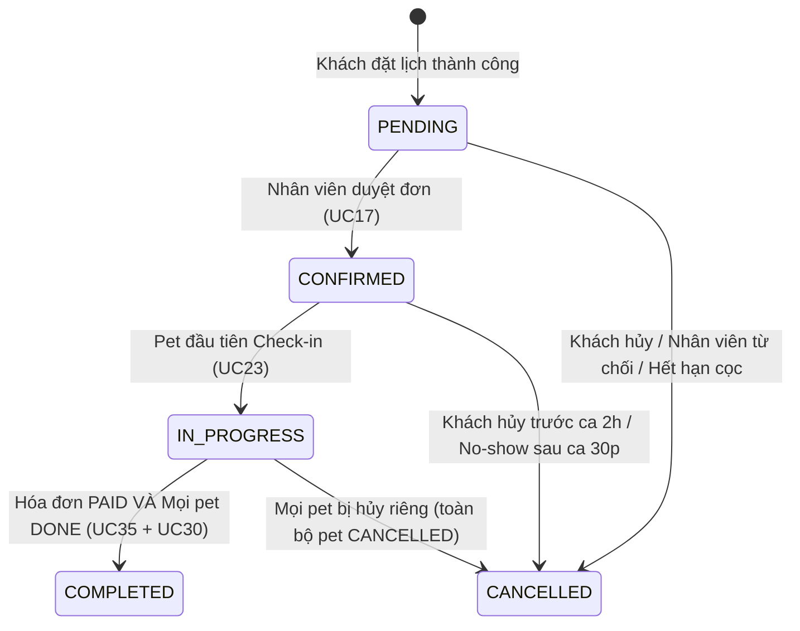

# TÀI LIỆU ĐẶC TẢ YÊU CẦU PHẦN MỀM (SRS v3.0)

> **Bổ sung được duyệt tại M2 — 03/11/2026:** giữ nguyên nội dung baseline v3.0 bên dưới để truy vết. [Nhật ký M2-01–M2-15](scope-and-decisions.md#m2-decisions) ghi rõ các điều chỉnh được nhóm trưởng duyệt sau khi đóng băng: thiết kế đủ ba Extension; cọc/hoàn thủ công; công thức cọc toàn đơn; hoàn phần dư; hết hạn khi chưa xác nhận; OTP email và quyền chọn pet cũ; snapshot chính sách vaccine; tách PAID/DONE; hoàn tất đơn có pet CANCELLED và quyết toán đơn toàn pet hủy; miễn đón trễ sau PAID; cho phép bổ sung bảng theo nhóm; phạm vi đo NFR 500ms cho API/DB, tách thời gian truyền file và SMTP. Những điều chỉnh đó thay đoạn cũ trái ngược, không áp dụng cả hai cách hiểu. Gói sáu tài liệu, gồm thiết kế vật lý và API, đã được nhóm trưởng duyệt và khóa theo M2-15. Đây là phê duyệt baseline tài liệu; không chứng nhận code/tests/latency hoặc Mermaid đã render.
## HỆ THỐNG QUẢN LÝ VẬN HÀNH DỊCH VỤ SPA & HOTEL THÚ CƯNG (PETSPA & HOTEL)

- **Môn học:** SE310 - Công Nghệ .NET
- **Giảng viên hướng dẫn:** TS. Mai Trọng Khang
- **Nhóm sinh viên thực hiện (Nhóm 6):**
  - 24522005 - Trương Quốc Việt
  - 24521992 - Đỗ Trí Viễn
  - 24521934 - Nguyễn Dũng Quát Tuấn
  - 24521116 - Nguyễn Phùng Nam

---

# CHƯƠNG 1. GIỚI THIỆU TỔNG QUAN & PHẠM VI

## 1.1. Mục đích tài liệu
Tài liệu này xác định toàn bộ yêu cầu chức năng, bảng trạng thái chung, quy tắc nghiệp vụ bất biến, ma trận phân quyền và tiêu chí kiểm thử nghiệm thu cho hệ thống phần mềm quản lý một cơ sở PetSpa & Hotel. Tài liệu là **nguồn chân lý kỹ thuật duy nhất (Single Source of Truth)** làm căn cứ triển khai Backend ASP.NET Core Web API, cơ sở dữ liệu PostgreSQL (Neon) và nối API cho Frontend Vue 3.

## 1.2. Phạm vi hệ thống & Cơ cấu 29 mục nghiệp vụ
- **Tổng số mục quy chuẩn:** Tổng cộng **29 mục**, bao gồm **28 mục core** (27 Use Cases cốt lõi + 1 yêu cầu phân quyền hệ thống **FR01**) và **01 ngoại lệ đã duyệt** (**UC56** - Đánh giá dịch vụ).
- **Quy tắc mã hóa Use Case:** Các số UC bị nhảy cóc (như thiếu UC03, UC04, UC05, UC09, UC13...) là do giữ nguyên mã định danh gốc của nhóm đồ án; các số không có trong danh sách là các nghiệp vụ nằm ngoài phạm vi đồ án, không phải là UC bị thiếu sót.
- **Phân định Core và Extension (Phần mở rộng):**
  - **Phần Core (Bắt buộc chạy được):** Bao phủ toàn bộ luồng từ tạo khách/pet, xem bảng giá, đặt lịch, duyệt đơn, tiếp nhận check-in, chăm sóc pet theo ca, xuất hóa đơn gộp, thanh toán tại quầy và bàn giao pet.
  - **Phần Extension (Cấu hình có thể bật/tắt):** Gồm đúng 3 tính năng mở rộng:
    1. Xác thực OTP qua email/SMS khi đặt lịch.
    2. Đặt cọc Hotel online 30%.
    3. Giữ chỗ tạm thời 30 phút chờ thanh toán cọc.
    *(Nếu cấu hình Extension tắt: hệ thống bỏ qua bước OTP, đơn Hotel chuyển thẳng sang trạng thái Chờ duyệt `PENDING` mà không đòi cọc).*

## 1.3. Các quyết định nền tảng bất biến (Đã chốt)
1. **Khách hàng không tạo tài khoản:** Khách chỉ tương tác qua website bằng Tên, Số điện thoại và Email. Tra cứu tiến độ dịch vụ thông qua cặp đôi: **Số điện thoại + Mã tracking** ngẫu nhiên của đơn.
2. **Bảng size chung nửa mở:** Áp dụng thống nhất cho cả chó và mèo:
   - Size **S**: [0, 5) kg.
   - Size **M**: [5, 15) kg.
   - Size **L**: [15, 25) kg.
   - Size **XL**: Từ 25 kg trở lên.
   *(Giá Spa và Combo tính theo bảng size S/M/L/XL; giá phòng Hotel tính cố định theo loại phòng và số đêm, không đổi theo size).*
3. **Giấy tiêm chủng là cấu hình tùy chọn:** Mặc định tắt. Nếu Admin bật cho loại dịch vụ nào thì nhân viên phải kiểm tra xác minh tại quầy check-in mới được tiếp nhận. Khách thiếu giấy vẫn đặt lịch online được.
4. **Quy tắc gộp hóa đơn (1 Đơn = 1 Hóa đơn):** Dù đơn có nhiều pet, nhiều dịch vụ Spa hay nhiều đêm Hotel, toàn bộ đơn chỉ phát sinh **duy nhất 1 hóa đơn**. Mỗi pet và dịch vụ là một dòng chi tiết. Tuyệt đối không tách hóa đơn thu tiền riêng từng pet.
5. **Thứ tự hoàn tất bắt buộc:** **Tạo hóa đơn chốt $\rightarrow$ Khách trả đủ tiền (PAID) $\rightarrow$ Bàn giao pet mang về (DONE)** (Trừ trường hợp nhận sớm có Admin duyệt).
6. **Thanh toán trả đủ 100% một lần:** Hóa đơn chỉ có 2 trạng thái: Chưa trả (`UNPAID`) và Đã trả (`PAID`). Không có trạng thái trả một phần (`PARTIAL_PAID`), không trả thiếu/trả thừa trong quy trình chuẩn.

---

# CHƯƠNG 2. BẢNG TRẠNG THÁI CHUNG & QUY TẮC TOÀN VẸN NGHIỆP VỤ

## 2.1. Bảng đối chiếu mã trạng thái hệ thống

| Thực thể | Mã hệ thống (Code) | Tên tiếng Việt hiển thị | Ý nghĩa & Điều kiện chuyển trạng thái |
|---|---|---|---|
| **Đơn đặt lịch** (`DonDatLich`) | `PENDING` | Chờ xác nhận | Đơn mới tạo, đang giữ chỗ/slot, chờ nhân viên duyệt. |
| | `CONFIRMED` | Đã xác nhận | Nhân viên đã duyệt đơn; slot và phòng được bảo lưu chính thức. |
| | `IN_PROGRESS` | Đang thực hiện | Có ít nhất 1 pet trong đơn đã check-in tiếp nhận tại quầy. |
| | `COMPLETED` | Đã hoàn tất | Hóa đơn đã `PAID` VÀ tất cả pet đều đã bàn giao (`DONE`). |
| | `CANCELLED` | Đã hủy | Hủy toàn bộ đơn trước khi check-in, hoặc bị từ chối/no-show. |
| **Từng thú cưng** (`ChiTietDon`) | `NOT_ARRIVED` | Chưa tiếp nhận | Khách chưa mang pet đến quầy làm thủ tục check-in. |
| | `WAITING` | Chờ chăm sóc | Đã check-in, đã chốt giá, đang chờ kỹ thuật viên bắt đầu. |
| | `IN_PROGRESS` | Đang chăm sóc | Kỹ thuật viên đã chụp ảnh bắt đầu và đang làm dịch vụ. |
| | `PAUSED` | Tạm dừng | Tạm dừng do pet mệt/cần theo dõi (vẫn trong tiến trình). |
| | `READY` | Sẵn sàng đón | Đã làm xong dịch vụ, đã chụp ảnh hoàn thành, chờ khách đón. |
| | `DONE` | Đã bàn giao | Khách đã thực nhận pet tại quầy mang về (sau khi hóa đơn `PAID`). |
| | `CANCELLED` | Đã hủy riêng | Bé bị hủy riêng khỏi đơn (trước hoặc trong lúc làm có duyệt). |
| **Hóa đơn** (`HoaDon`) | `UNPAID` | Chưa thanh toán | Hóa đơn snapshot được tạo khi các pet đã sẵn sàng, chờ thu tiền. |
| | `PAID` | Đã thanh toán | Thu ngân đã xác nhận nhận đủ 100% tiền (Bất biến, không sửa). |
| | `REVOKED` | Đã thu hồi | Hóa đơn chưa trả bị hủy do phát sinh đổi dịch vụ/phụ phí. |

## 2.2. Ma trận vòng đời & Chuyển đổi trạng thái (State Transitions)

## 2.3. Quy tắc chốt giá duy nhất & Snapshot hóa đơn
1. **Thời điểm chốt giá duy nhất:** Giá dịch vụ chỉ được chốt chính thức **tại quầy lúc check-in (UC23)** sau khi cân thực tế và khách đồng ý size. 
2. **Xử lý lệch size:** Nếu cân thực tế làm đổi size (ví dụ: khai báo M nhưng cân ra L):
   - Nhân viên giải thích mức giá mới.
   - **Nhánh khách đồng ý:** Chốt giá theo size mới, lưu vào trường `can_nang_chot` và `size_chot` của đơn.
   - **Nhánh khách KHÔNG đồng ý:** Khách có quyền chọn giữ giá size cũ làm dịch vụ thu gọn, hoặc hủy riêng dịch vụ đó. Nhân viên ghi rõ xác nhận vào biên bản check-in.
3. **Tính bất biến của Hóa đơn:** Hóa đơn (UC31) chỉ chụp lại (snapshot) đúng đơn giá và size đã chốt lúc tiếp nhận. Giá danh mục trên hệ thống có thay đổi sau đó cũng không làm đổi tiền của hóa đơn đã chốt.

## 2.4. Quy tắc quản lý công suất 2 trần (Double-Ceiling Capacity)
Khi kiểm tra khả năng tiếp nhận của một ca làm việc (UC14, UC32, UC64), hệ thống kiểm tra đồng thời cả 2 điều kiện:
$$\text{Số pet đã nhận} + \text{Số pet mới} \le \text{Sức chứa tối đa của ca (Pet Capacity)}$$
$$\text{Tổng số phút dịch vụ đã giữ} + \text{Số phút dịch vụ mới} \le \text{Tổng phút làm việc của các nhân viên có ca APPROVED trong ca đó}$$
- Nếu ca làm việc **chưa có nhân viên nào được duyệt ca (`APPROVED`)**: Hệ thống tự động khóa không cho đặt lịch vào ca đó.

---

# CHƯƠNG 3. MA TRẬN PHÂN QUYỀN HỆ THỐNG (FR01)

Hệ thống quản lý phân quyền theo chức năng linh hoạt (Functional RBAC) với 2 nhóm người dùng nội bộ chính và 1 tác nhân khách vãng lai:
- **Khách hàng (Guest):** Không có tài khoản, chỉ thao tác trên cổng Public.
- **Lễ tân (Receptionist - Template mặc định):** Thao tác đón tiếp, tra cứu, check-in, lập hóa đơn, thu ngân và bàn giao.
- **Kỹ thuật viên Spa (Care Tech - Template mặc định):** Chỉ thao tác chăm sóc, tải ảnh cho các pet được phân công trực tiếp trong ca trực của mình.
- **Quản trị viên (Admin):** Có toàn quyền vận hành của Lễ tân, quyền override kỹ thuật viên, cấu hình bảng giá, duyệt ca và mở/khóa hệ thống.

| Mã Chức năng | Hành động nghiệp vụ chi tiết | Khách hàng | Lễ tân (Reception) | Kỹ thuật viên (Spa) | Quản trị viên (Admin) |
|---|---|:---:|:---:|:---:|:---:|
| **CATALOG_VIEW** | Xem dịch vụ, combo, bảng giá | ✅ | ✅ | ✅ | ✅ |
| **BOOKING_CREATE** | Đặt lịch mới (Public / Đặt hộ tại quầy) | ✅ | ✅ | ❌ | ✅ |
| **TRACKING_VIEW** | Tra cứu đơn bằng SĐT + Mã tracking | ✅ | ✅ | ❌ | ✅ |
| **CUSTOMER_LOOKUP** | Tra cứu hồ sơ khách hàng tại quầy qua SĐT | ❌ | ✅ | ❌ | ✅ |
| **BOOKING_APPROVE** | Duyệt đơn PENDING hoặc Từ chối đơn | ❌ | ✅ | ❌ | ✅ |
| **BOOKING_RESCHEDULE**| Dời lịch hẹn (Chuyển ngày/ca làm việc) | ❌ | ⚠️ (Khi cấp quyền) | ❌ | ✅ (Mặc định) |
| **CHECKIN_PERFORM** | Check-in tại quầy, chốt cân nặng, gán ca | ❌ | ✅ | ❌ | ✅ |
| **CARE_UPDATE** | Bắt đầu, tạm dừng, hoàn thành chăm sóc | ❌ | ❌ | ✅ (Chỉ pet được giao) | ✅ (Override) |
| **PHOTO_UPLOAD** | Chụp ảnh nhật ký, tải ảnh thành phẩm | ❌ | ❌ | ✅ (Chỉ pet được giao) | ✅ (Override) |
| **PET_HANDOVER** | Xác nhận khách thực nhận pet (bàn giao) | ❌ | ✅ | ⚠️ (Khi cấp quyền) | ✅ |
| **INVOICE_CREATE** | Tạo hóa đơn snapshot (UNPAID) | ❌ | ✅ | ❌ | ✅ |
| **INVOICE_COLLECT** | Xác nhận nhận đủ tiền thanh toán (PAID) | ❌ | ✅ | ❌ | ✅ |
| **INVOICE_REVOKE** | Thu hồi hóa đơn chưa trả để sửa đổi | ❌ | ⚠️ (Khi cấp quyền) | ❌ | ✅ (Mặc định) |
| **PET_CANCEL_LINE** | Duyệt hủy riêng một bé trong đơn | ❌ | ❌ | ❌ | ✅ |
| **SCHEDULE_REGISTER**| Đăng ký nguyện vọng ca làm việc tuần | ❌ | ✅ | ✅ | ✅ |
| **SCHEDULE_APPROVE** | Duyệt ca làm việc và chốt lịch chi nhánh | ❌ | ❌ | ❌ | ✅ |
| **SYSTEM_CONFIG** | Cấu hình giá, slot, loại phòng, ngày nghỉ | ❌ | ❌ | ❌ | ✅ |

*(Ghi chú: Luôn đảm bảo hệ thống có ít nhất 1 tài khoản Admin đang hoạt động. Mọi thay đổi cấp/bỏ quyền đều được ghi vết Audit Log).*

---

# CHƯƠNG 4. ĐẶC TẢ CHI TIẾT CÁC USE CASES (29 MỤC)

---

## PHÂN HỆ 1: QUẢN LÝ HỒ SƠ KHÁCH HÀNG & THÚ CƯNG

### UC01: Tạo thông tin khách hàng mới
- **Mục tiêu:** Lưu trữ thông tin khách hàng khi phát sinh giao dịch đặt lịch lần đầu.
- **Tác nhân:** Khách hàng (qua web đặt lịch), Lễ tân (tạo hộ tại quầy), Quản trị viên.
- **Điều kiện tiên quyết:** Số điện thoại chưa tồn tại trong hệ thống.
- **Luồng sự kiện chính:**
  1. Người dùng nhập Họ tên, Số điện thoại và Email.
  2. Hệ thống kiểm tra định dạng Số điện thoại (10 chữ số) và Email hợp lệ.
  3. Hệ thống kiểm tra số điện thoại chưa có trên cơ sở dữ liệu.
  4. Hệ thống tạo bản ghi khách hàng mới với `so_dien_thoai`, `ho_ten`, `email`.
- **Luồng rẽ nhánh & Ngoại lệ:**
  - *3a. Số điện thoại đã tồn tại:* Hệ thống không ghi đè hồ sơ cũ. Thông tin tên/email nhập trong đơn mới được lưu độc lập thành "Snapshot người đặt" của riêng đơn đó để đối chiếu lịch sử.
  - *3b. Số điện thoại dùng chung (gia đình):* Hệ thống phân biệt hồ sơ dựa trên mã khách hàng (`id`), không ép 1 SĐT chỉ đại diện cho 1 người nếu có sự can thiệp tách hồ sơ của Admin.
- **Điều kiện sau:** Hồ sơ khách hàng được khởi tạo thành công.
- **Tiêu chí kiểm thử nghiệm thu:**
  - *Case 1 (Thành công):* Nhập SĐT mới `0912345678`, hệ thống tạo hồ sơ và gán `id`.
  - *Case 2 (Trùng SĐT):* Nhập SĐT đã có, hệ thống không cập nhật đè tên gốc của hồ sơ cũ.

### UC02: Tra cứu thông tin khách hàng qua số điện thoại (Nội bộ quầy)
- **Mục tiêu:** Hỗ trợ nhân viên quầy tìm nhanh hồ sơ và danh sách thú cưng cũ của khách khi khách gọi điện hoặc đến quầy.
- **Tác nhân:** Lễ tân, Quản trị viên.
- **Điều kiện tiên quyết:** Người dùng đã đăng nhập hệ thống với quyền `CUSTOMER_LOOKUP`.
- **Luồng sự kiện chính:**
  1. Nhân viên nhập Số điện thoại vào ô tìm kiếm tại quầy tiếp nhận.
  2. Hệ thống truy vấn bảng `KhachHang` theo SĐT.
  3. Hệ thống hiển thị: Tên gốc, Email gốc, danh sách các thú cưng đã đăng ký kèm cân nặng hiện tại, và 3 đơn đặt lịch gần nhất.
- **Luồng rẽ nhánh & Ngoại lệ:**
  - *2a. Không tìm thấy SĐT:* Hệ thống hiển thị thông báo "Khách hàng mới" và cung cấp nút "Tạo nhanh hồ sơ & Đặt lịch".
- **Tiêu chí kiểm thử nghiệm thu:**
  - Tìm kiếm SĐT đã có: Trả về đầy đủ thông tin khách và danh sách pet liên kết.

### UC06: Tạo hồ sơ thú cưng
- **Mục tiêu:** Đăng ký thú cưng mới gắn với chủ nuôi.
- **Tác nhân:** Khách hàng (khi đặt lịch), Lễ tân, Quản trị viên.
- **Điều kiện tiên quyết:** Đã xác định được khách hàng sở hữu.
- **Luồng sự kiện chính:**
  1. Người dùng nhập: Tên thú cưng, Loài (Chó/Mèo), Giống, Cân nặng (kg), Dị ứng/bệnh nền (tùy chọn), Ảnh đại diện (tùy chọn).
  2. Hệ thống kiểm tra cân nặng $> 0$ và tính toán size tương ứng (S, M, L, XL).
  3. Hệ thống lưu bản ghi vào bảng `ThuCung` liên kết với `khach_hang_id`.
- **Luồng rẽ nhánh & Ngoại lệ:**
  - *1a. Đặt lịch online bỏ trống dị ứng/bệnh nền:* Hệ thống cho phép lưu, nhưng gắn cờ cảnh báo để nhân viên hỏi lại lúc tiếp nhận tại UC23.
- **Tiêu chí kiểm thử nghiệm thu:**
  - Nhập pet nặng 12kg $\rightarrow$ Hệ thống tự động gán size `M`.

### UC07: Xem danh sách hồ sơ thú cưng
- **Mục tiêu:** Xem thông tin các thú cưng thuộc sở hữu của một khách hàng.
- **Tác nhân:** Lễ tân, Quản trị viên, Kỹ thuật viên Spa (chỉ xem pet được giao trong ca).
- **Luồng sự kiện chính:**
  1. Nhân viên mở chi tiết khách hàng hoặc mở màn hình ca trực.
  2. Hệ thống liệt kê danh sách pet gồm: Tên, Loài, Giống, Cân nặng hiện tại, Ngày sinh/tuổi và Ghi chú đặc biệt.

### UC08: Cập nhật hồ sơ và cân nặng thú cưng
- **Mục tiêu:** Cập nhật thông tin y tế, đặc điểm hoặc cân nặng định kỳ của thú cưng.
- **Tác nhân:** Lễ tân, Quản trị viên.
- **Quy tắc phân tách 2 trường cân nặng:**
  - `ThuCung.can_nang`: Cân nặng hiện tại của hồ sơ pet (được cập nhật mới nhất để theo dõi sức khỏe).
  - `ChiTietDon.can_nang_chot`: Cân nặng tại thời điểm check-in của đơn đó (Bất biến, dùng để tính giá dịch vụ đơn đó).
  - *Cập nhật cân nặng ở UC08 chỉ đổi `ThuCung.can_nang`, tuyệt đối không làm đổi giá các đơn cũ đã tạo.*
- **Tiêu chí kiểm thử nghiệm thu:**
  - Cập nhật cân nặng pet từ 4kg lên 6kg (từ S lên M), kiểm tra đơn cũ đã hoàn tất không bị nhảy tiền.

---

## PHÂN HỆ 2: DANH MỤC DỊCH VỤ & GIÁ

### UC10: Xem danh mục dịch vụ và bảng giá
- **Mục tiêu:** Cung cấp thông tin minh bạch về giá dịch vụ Spa lẻ, dịch vụ Combo và giá phòng Hotel.
- **Tác nhân:** Khách hàng, Lễ tân, Kỹ thuật viên, Quản trị viên.
- **Luồng sự kiện chính:**
  1. Người dùng truy cập trang Dịch vụ hoặc form Đặt lịch.
  2. Hệ thống hiển thị danh mục phân cấp:
     - Dịch vụ Spa lẻ: Bảng giá theo 4 size S, M, L, XL.
     - Dịch vụ Combo: Giá combo trọn gói theo size (kèm ghi chú dịch vụ thành phần).
     - Dịch vụ Hotel: Giá theo từng loại phòng / đêm lưu trú.
- **Tiêu chí kiểm thử nghiệm thu:**
  - Giá combo hiển thị rõ tiết kiệm hơn so với tổng giá các dịch vụ lẻ cộng lại.

### UC11: Thêm dịch vụ và Combo mới
- **Mục tiêu:** Quản trị viên mở rộng danh mục kinh doanh của cửa hàng.
- **Tác nhân:** Quản trị viên (Admin).
- **Quy tắc ràng buộc:**
  - Dịch vụ "Cắt tỉa lông" bắt buộc phải đi kèm dịch vụ "Tắm vệ sinh" tạo thành Combo; hệ thống **chặn không cho lưu dịch vụ cắt tỉa ở dạng bán lẻ đơn độc**.
  - Cấu hình cờ `yeu_cau_tiem_chung` (Bật/Tắt). Đối với Combo, chỉ cần 1 dịch vụ con yêu cầu tiêm chủng thì toàn bộ Combo tự động yêu cầu tiêm chủng.
- **Tiêu chí kiểm thử nghiệm thu:**
  - Thử tạo dịch vụ cắt tỉa lẻ $\rightarrow$ Bị chặn báo lỗi. Tạo combo Tắm + Cắt $\rightarrow$ Lưu thành công.

### UC12: Cập nhật dịch vụ và bảng giá
- **Mục tiêu:** Điều chỉnh đơn giá hoặc tạm ngưng dịch vụ.
- **Tác nhân:** Quản trị viên (Admin).
- **Quy tắc:** Đổi giá trong danh mục chỉ áp dụng cho các đơn đặt lịch tạo sau thời điểm lưu. Toàn bộ đơn đang chờ, đã xác nhận hoặc đang làm giữ nguyên giá cũ đã cam kết.

---

## PHÂN HỆ 3: ĐẶT LỊCH & TRA CỨU TIẾN ĐỘ (BOOKING & TRACKING)

### UC14: Đặt lịch trực tuyến (Nhiều thú cưng)
- **Mục tiêu:** Cho phép khách hàng tự đặt lịch hẹn dịch vụ Spa hoặc lưu trú Hotel cho 1 hoặc nhiều bé trong 1 lần đặt.
- **Tác nhân:** Khách hàng, Lễ tân (đặt hộ).
- **Luồng sự kiện chính:**
  1. Khách nhập thông tin liên hệ: Tên, SĐT, Email.
  2. Khách chọn danh sách thú cưng:
     - Chọn pet cũ (hệ thống gợi ý theo SĐT: Tên, Loài, Giống, Cân nặng).
     - Hoặc thêm pet mới (nhập Tên, Loài, Giống, Cân nặng, Dị ứng).
  3. Với mỗi pet, khách chọn dịch vụ:
     - Spa/Combo: Chọn ngày và khung giờ bắt đầu (Ca làm việc).
     - Hotel: Chọn Loại phòng, Ngày nhận và Ngày trả dự kiến.
  4. Hệ thống kiểm tra công suất 2 trần (Slot và Số phút) và kiểm tra số suất phòng trống theo từng đêm.
  5. Hệ thống tính tổng tiền tạm tính.
  6. *(Nếu bật Extension Cọc Hotel):* Hệ thống tính tiền cọc 30% (30% tổng tiền phòng + dịch vụ đặt kèm), sinh mã VietQR và đếm ngược 30 phút giữ chỗ.
  7. Khách xác nhận đặt lịch $\rightarrow$ Hệ thống sinh **Mã tracking** (ngẫu nhiên 8 ký tự duy nhất, ví dụ: `TRK-8X2A`), tạo đơn ở trạng thái `PENDING`.
  8. Hệ thống gửi email xác nhận đặt lịch chứa mã tracking và đường link tra cứu đến email của khách.
- **Luồng rẽ nhánh & Ngoại lệ:**
  - *4a. Hết slot Spa hoặc hết phòng:* Hệ thống báo đỏ khung giờ/loại phòng bị đầy, gợi ý ca hoặc ngày gần nhất còn chỗ.
  - *4b. Ca chưa có nhân viên duyệt ca (`APPROVED`):* Hệ thống khóa không cho đặt vào ca đó.
  - *6a. Quá 30 phút không trả cọc (khi bật cọc):* Đơn tự hủy, giải phóng slot và phòng.
- **Tiêu chí kiểm thử nghiệm thu:**
  - Đặt 1 đơn 2 pet (1 Spa + 1 Hotel 2 đêm) $\rightarrow$ Sinh đúng 1 mã đơn cha, 2 dòng chi tiết, đơn ở trạng thái `PENDING`.

### UC15: Xác minh tra cứu tiến độ (Tracking Authentication)
- **Mục tiêu:** Cửa ngõ bảo mật để khách truy cập thông tin đơn mà không cần đăng nhập tài khoản.
- **Tác nhân:** Khách hàng.
- **Luồng sự kiện chính:**
  1. Khách truy cập trang `/tracking`, nhập cặp đôi: **Số điện thoại** + **Mã tracking**.
  2. Hệ thống kiểm tra khớp đúng đơn đặt lịch.
  3. Nếu khớp: Chuyển hướng hiển thị dữ liệu sang trang chi tiết theo **UC26**.
- **Quy tắc bảo mật chống khóa nhầm:**
  - Nhập sai quá 5 lần trong 15 phút: Tạm khóa tra cứu của IP/SĐT đó trong 15 phút.
  - Sau 15 phút tự mở khóa và reset số lần sai về 0. Quản trị viên có quyền mở khóa sớm tại quầy khi khách yêu cầu.
  - **Chức năng gửi lại mã:** Khách quên mã có thể bấm "Quên mã tracking", hệ thống gửi lại mã vào đúng email đã lưu trong đơn.

### UC16: Xem danh sách và chi tiết lịch hẹn (Nội bộ)
- **Mục tiêu:** Cho phép nhân viên theo dõi toàn bộ lịch hẹn theo ngày, lọc theo trạng thái (`PENDING`, `CONFIRMED`, `IN_PROGRESS`, `COMPLETED`, `CANCELLED`).
- **Tác nhân:** Lễ tân, Quản trị viên.

### UC17: Duyệt hoặc từ chối đơn đặt lịch
- **Mục tiêu:** Nhân viên quầy rà soát các đơn `PENDING` để chính thức tiếp nhận.
- **Tác nhân:** Lễ tân, Quản trị viên.
- **Luồng sự kiện chính:**
  1. Nhân viên mở danh sách đơn `PENDING`.
  2. Nhân viên kiểm tra thông tin ghi chú, xác nhận đủ điều kiện $\rightarrow$ Bấm "Duyệt đơn".
  3. Trạng thái đơn chuyển sang `CONFIRMED`. Hệ thống gửi email thông báo duyệt đơn thành công cho khách.
- **Luồng rẽ nhánh:**
  - *2a. Từ chối đơn:* Nhân viên nhập bắt buộc "Lý do từ chối" $\rightarrow$ Đơn chuyển sang `CANCELLED` (`STAFF_REJECTED`), giải phóng ngay lập tức slot Spa và suất phòng đã giữ. Hoàn trả cọc (nếu có cọc).

### UC18: Dời lịch hẹn (Reschedule)
- **Mục tiêu:** Đổi ngày hoặc đổi ca phục vụ cho khách khi có yêu cầu trước giờ hẹn.
- **Tác nhân:** Quản trị viên (Admin mặc định làm, Lễ tân chỉ làm khi được tick quyền).
- **Quy tắc bất biến:** **Chỉ được dời lịch khi đơn ở trạng thái `PENDING` hoặc `CONFIRMED` VÀ chưa có bất kỳ bé nào check-in.**
- **Tiêu chí kiểm thử nghiệm thu:**
  - Đơn có 1 pet đã bấm check-in $\rightarrow$ Nút dời lịch bị vô hiệu hóa hoàn toàn.

### UC19: Hủy toàn bộ lịch hẹn & Xử lý No-Show
- **Mục tiêu:** Hủy đơn đặt lịch khi khách yêu cầu hoặc khách không đến.
- **Tác nhân:** Khách hàng (tự hủy online), Lễ tân, Quản trị viên.
- **Quy tắc thời gian hủy:**
  - Khách tự hủy online: Chỉ được hủy khi đơn ở `PENDING` hoặc `CONFIRMED` và **trước giờ bắt đầu ca hẹn ít nhất 2 giờ**.
  - Hủy muộn dưới 2 giờ: Khách phải gọi điện tới quầy; chỉ Quản trị viên mới có quyền duyệt hủy.
  - **No-Show:** Sau khi hết ca hẹn 30 phút mà khách không đến và không liên hệ, nhân viên bấm "Đánh dấu No-show" $\rightarrow$ Đơn chuyển `CANCELLED` (`NO_SHOW`), giải phóng toàn bộ tài nguyên.
- **Bảng quy tắc hoàn cọc:**
  - Hủy trước 2 giờ: Hoàn 100% tiền cọc (ghi nhận trạng thái chờ Admin hoàn tiền).
  - Hủy dưới 2 giờ hoặc No-show: Cửa hàng giữ 100% tiền cọc làm phí giữ chỗ.

### UC19B: Hủy riêng một bé trong đơn nhiều bé (Pet Line Cancellation)
- **Mục tiêu:** Cho phép hủy dịch vụ của 1 pet mà không làm hủy toàn bộ đơn của các pet khác.
- **Tác nhân:** Quản trị viên (Admin duyệt bắt buộc).
- **Quy tắc tính tiền & Ràng buộc:**
  1. Trạng thái của pet bị hủy chuyển thành `CANCELLED` (Đã hủy riêng). Đơn vẫn tiếp tục phục vụ các pet còn lại.
  2. Thời điểm cho phép: Chỉ được hủy riêng **trước khi tạo hóa đơn thanh toán**.
  3. Cách tính tiền cho phần việc đã làm:
     - Dịch vụ chưa bắt đầu: Tiền $= 0$.
     - Dịch vụ Combo làm dở (đã tắm xong nhưng hủy cắt tỉa): Tính tiền theo giá lẻ của dịch vụ tắm đã hoàn thành.
     - Dịch vụ Hotel lưu trú dở: Đêm đã ở tính đủ 100%; đêm chưa ở được hoàn lại suất phòng.
  4. Nếu mọi bé trong đơn đều bị hủy riêng nhưng có dịch vụ đã làm dở dang: Hệ thống bắt buộc xuất hóa đơn thanh toán cho phần việc đã làm trước khi kết thúc đơn.

---

## PHÂN HỆ 4: CHECK-IN, CHĂM SÓC & BÀN GIAO (CARE & OPERATIONS)

### UC23: Tiếp nhận thú cưng tại quầy (Check-in)
- **Mục tiêu:** Tiếp nhận pet thực tế, kiểm tra thể trạng, chốt cân nặng và gán ca trực.
- **Tác nhân:** Lễ tân, Quản trị viên.
- **Điều kiện tiên quyết:** Đơn ở trạng thái `CONFIRMED`.
- **Luồng sự kiện chính:**
  1. Nhân viên đối chiếu SĐT/Mã tracking, mở đơn đặt lịch.
  2. Nhân viên đưa pet lên cân, nhập cân nặng thực tế $\rightarrow$ Hệ thống tự động xác định size thực tế.
  3. Nếu size thực tế khác size đặt: Áp dụng quy tắc chốt giá tại mục 2.3 (Báo khách và chốt giá đồng thuận).
  4. Nhân viên kiểm tra tình trạng lông (chọn từ danh mục chuẩn: *Bình thường, Rối nhẹ, Rối nặng, Có ve rận*) và ghi chú sức khỏe.
  5. *(Nếu dịch vụ yêu cầu tiêm chủng):* Nhân viên kiểm tra sổ tiêm trực tiếp hoặc ảnh tải lên, bấm "Xác nhận giấy hợp lệ".
  6. Nhân viên chụp 1 **Ảnh lúc tiếp nhận** (đây đồng thời là ảnh ban đầu của tiến trình).
  7. Bấm "Hoàn tất tiếp nhận":
     - Trạng thái pet chuyển sang `WAITING` (Chờ chăm sóc).
     - Trạng thái đơn chuyển sang `IN_PROGRESS`.
- **Tiêu chí kiểm thử nghiệm thu:**
  - Chưa chụp ảnh tiếp nhận hoặc chưa xác nhận giấy tiêm (khi có yêu cầu) $\rightarrow$ Hệ thống chặn không cho bấm hoàn tất tiếp nhận.

### UC23B: Phân công kỹ thuật viên phụ trách (Assignment)
- **Mục tiêu:** Giao thú cưng cho kỹ thuật viên cụ thể thực hiện dịch vụ trong ca trực.
- **Tác nhân:** Lễ tân, Quản trị viên.
- **Quy tắc:**
  - Chỉ được phân công cho nhân viên **có ca làm việc ở trạng thái `APPROVED` đúng ngày và ca đó**.
  - Đổi người phụ trách: Quản trị viên ghi rõ lý do đổi; toàn bộ ảnh và nhật ký cũ vẫn giữ nguyên tên tác giả ban đầu.

### UC24: Cập nhật tiến độ chăm sóc thú cưng
- **Mục tiêu:** Kỹ thuật viên cập nhật trạng thái làm việc theo thời gian thực.
- **Tác nhân:** Kỹ thuật viên Spa (được phân công), Quản trị viên (override).
- **Vòng đời trạng thái pet:**
  1. `WAITING` $\rightarrow$ Bấm "Bắt đầu" $\rightarrow$ Chuyển sang `IN_PROGRESS` (Kế thừa ảnh tiếp nhận làm ảnh bắt đầu).
  2. `IN_PROGRESS` $\rightarrow$ Bấm "Tạm dừng" (ghi lý do: pet mệt/ăn) $\rightarrow$ Chuyển sang `PAUSED`.
  3. `PAUSED` $\rightarrow$ Chỉ được bấm "Tiếp tục" $\rightarrow$ Quay lại `IN_PROGRESS`.
  4. `IN_PROGRESS` $\rightarrow$ Sau khi hoàn thành xong dịch vụ, kỹ thuật viên chụp **Ảnh thành phẩm** $\rightarrow$ Bấm "Hoàn thành dịch vụ" $\rightarrow$ Chuyển sang `READY` (Sẵn sàng đón).
- **Xử lý ngoại lệ không chụp được ảnh (Pet hung dữ / Thiết bị hỏng):**
  - Nhân viên nhập lý do cụ thể $\rightarrow$ Yêu cầu Quản trị viên xác nhận duyệt mới được chuyển sang `READY` mà không có ảnh thành phẩm.

### UC25: Nhật ký chăm sóc & Đăng tải hình ảnh
- **Mục tiêu:** Lưu trữ nhật ký và tải ảnh lên Supabase Storage riêng tư để khách xem qua trang Tracking.
- **Tác nhân:** Kỹ thuật viên Spa phụ trách.

### UC26: Khách hàng theo dõi tiến độ trực tuyến (Live Tracking View)
- **Mục tiêu:** Màn hình minh bạch giúp khách hàng theo dõi thú cưng từ xa sau khi xác minh UC15.
- **Tác nhân:** Khách hàng.
- **Nội dung hiển thị:**
  1. Thông tin chung: Mã đơn, Ngày hẹn, Trạng thái đơn.
  2. Tiến độ từng thú cưng: Tên pet, Dịch vụ đang làm, Trạng thái hiện tại (`WAITING`, `IN_PROGRESS`, `READY`, `DONE`), Tên gọi tại quầy của kỹ thuật viên phụ trách.
  3. Album ảnh nhật ký: Ảnh lúc tiếp nhận và Ảnh thành phẩm hoàn thành (xem ảnh qua CDN bảo mật).
  4. Thông tin tài chính: Hóa đơn tạm tính (nếu chưa lập hóa đơn chốt) hoặc Chi tiết hóa đơn chính thức (kèm mã QR VietQR khi hóa đơn đã được lập ở UC31).
- **Cơ chế cập nhật:** Không hỗ trợ WebSocket thời gian thực; khách bấm nút "Tải lại trang" để lấy dữ liệu mới nhất.

### UC30: Bàn giao thú cưng khi hoàn thành (Pet Handover)
- **Mục tiêu:** Xác nhận khách hàng đã thực nhận thú cưng mang về.
- **Tác nhân:** Lễ tân, Quản trị viên.
- **Quy tắc bàn giao chuẩn:**
  1. **Khách chỉ được mang pet về sau khi Hóa đơn của đơn đã chuyển sang trạng thái `PAID` (Đã thanh toán đủ 100%).**
  2. Khi khách đến nhận tại quầy, nhân viên kiểm tra hóa đơn đã `PAID` $\rightarrow$ Bấm nút "Bàn giao pet".
  3. Trạng thái của pet chuyển từ `READY` $\rightarrow$ `DONE` (Đã bàn giao).
  4. **Kết thúc đơn:** Khi tất cả pet trong đơn đều đã chuyển sang `DONE` VÀ Hóa đơn đã `PAID` $\rightarrow$ Đơn đặt lịch chính thức chuyển sang trạng thái `COMPLETED` (Đã hoàn tất).
- **Trường hợp ngoại lệ: Nhận sớm 1 bé trong đơn nhiều bé:**
  - Khách có việc gấp muốn đón trước 1 bé đã `READY`, trong khi các bé khác vẫn đang làm hoặc lưu trú Hotel.
  - **Điều kiện:** Phải được **Quản trị viên duyệt** VÀ **Cửa hàng phải còn giữ ít nhất 1 bé khác của đơn tại tiệm** làm vật đảm bảo thanh toán.
  - Bé nhận sớm chuyển sang `DONE` (có ghi vết nhận sớm). Đơn vẫn ở trạng thái `IN_PROGRESS`.
  - **Chặn kẽ hở:** Tuyệt đối cấm khách hủy riêng các bé còn lại sau khi đã nhận sớm 1 bé về nhà (Áp dụng Cách B theo báo cáo EGM). Khách bắt buộc phải quay lại trả đủ tiền hóa đơn cuối cùng mới được nhận các bé còn lại.

---

## PHÂN HỆ 5: HÓA ĐƠN, THANH TOÁN & ĐÁNH GIÁ (FINANCE)

### UC31: Tạo và chốt hóa đơn thanh toán (Invoice Snapshot)
- **Mục tiêu:** Tạo hóa đơn duy nhất cho toàn bộ đơn đặt lịch để thu tiền khách hàng.
- **Tác nhân:** Lễ tân, Quản trị viên.
- **Thời điểm tạo hóa đơn:** Chỉ được bấm "Tạo hóa đơn" khi **TẤT CẢ các pet trong đơn đều đã đạt trạng thái `READY` (Sẵn sàng đón) hoặc `DONE` (Đã nhận sớm)**.
- **Cơ chế Snapshot:**
  - Hệ thống gom toàn bộ dịch vụ của các pet, tiền phòng hotel, phụ phí phát sinh thành các dòng chi tiết (`ct_hoa_don`).
  - Chụp lại cố định: Tên khoản, Tên pet, Size tính giá, Đơn giá, Số lượng, Thành tiền.
  - Công thức tổng tiền:
    $$\text{Tổng tiền hóa đơn} = \sum (\text{Thành tiền các dòng dịch vụ, phòng, phụ phí})$$
    $$\text{Số tiền còn phải trả} = \text{Tổng tiền hóa đơn} - \text{Tiền cọc đã trả (nếu có)}$$
  - Hóa đơn sinh ra ở trạng thái `UNPAID` (Chưa thanh toán). Khóa cứng đơn không cho thêm dịch vụ mới.

### UC32: Thêm phụ phí và Dịch vụ Spa phát sinh trong lưu trú
- **Mục tiêu:** Xử lý các chi phí phát sinh ngoài thỏa thuận ban đầu (ví dụ: gỡ lông rối, tắm khử mùi, phụ phí đón trễ, dịch vụ spa làm thêm trong lúc ở hotel).
- **Tác nhân:** Lễ tân, Quản trị viên.
- **Bảng điều kiện thêm phụ phí / dịch vụ:**
  - **Chỉ được thêm khi:** Chưa lập hóa đơn hiệu lực (hoặc hóa đơn đang ở trạng thái `UNPAID` phải thu hồi rồi tạo lại) VÀ pet chưa chuyển sang `DONE`.
  - **Phụ phí gỡ rối lông:** Bắt buộc căn cứ trên tình trạng lông "Rối nặng" đã tích lúc check-in hoặc có ảnh chụp xác nhận của kỹ thuật viên.
  - **Dịch vụ Spa phát sinh cho pet Hotel:** Kiểm tra công suất ca thực hiện (slot + phút); nếu đủ chỗ mới được thêm; tính theo bảng size đã chốt lúc check-in ban đầu.
  - **Phụ phí đón trễ:** Chỉ tính và ghi nhận vào hóa đơn trước thời điểm thanh toán.

### UC34: Xem chi tiết hóa đơn thanh toán
- **Mục tiêu:** Cung cấp giao diện xem hóa đơn chi tiết minh bạch cho khách hàng và thu ngân.
- **Tác nhân:** Khách hàng (trên trang Tracking), Lễ tân, Quản trị viên.
- **Các trường bắt buộc trên hóa đơn:**
  - Thông tin chung: Mã hóa đơn, Ngày giờ lập, Người lập, Mã đơn đặt lịch gốc, Ngày hẹn, Tên khách, SĐT.
  - Bảng chi tiết từng dòng: Tên pet, Tên dịch vụ/phụ phí/loại phòng, Size, Số lượng/Số đêm, Đơn giá snapshot, Thành tiền.
  - Bảng tổng kết: Tổng tiền, Tiền cọc đã khấu trừ (nếu có), **Số tiền thực tế còn phải trả**, Trạng thái hóa đơn (`UNPAID` / `PAID` / `REVOKED`).
  - Mã QR thanh toán VietQR động: Tự động nhúng đúng số tiền còn phải trả và mã đơn.
- *Hóa đơn đã thu hồi (`REVOKED`):* Vẫn được lưu lịch sử nhưng hiển thị nhãn đỏ "ĐÃ THU HỒI - KHÔNG CÒN HIỆU LỰC", ẩn mã QR thanh toán để ngăn khách chuyển tiền vào hóa đơn cũ.

### UC35: Xác nhận thanh toán & Hoàn tất đơn
- **Mục tiêu:** Thu ngân xác nhận đã nhận đủ tiền và hoàn tất giao dịch tài chính.
- **Tác nhân:** Lễ tân (đóng vai trò Thu ngân), Quản trị viên.
- **Phương thức thanh toán:** Tiền mặt hoặc Chuyển khoản ngân hàng (VietQR).
- **Quy tắc kiểm tra tiền chuyển khoản (Không dùng Webhook tự động):**
  - Hệ thống không tự động tích hợp biến động số dư ngân hàng. Thu ngân phải kiểm tra app ngân hàng xác nhận tiền đã vào tài khoản cửa hàng đúng bằng **Số tiền còn phải trả**.
  - **Xử lý tiền chuyển sai lệch số tiền:**
    - Nếu khách chuyển thiếu: Thu ngân tuyệt đối **không bấm nút xác nhận**, yêu cầu khách quét mã chuyển thêm phần còn thiếu.
    - Nếu khách chuyển thừa: Thu ngân ghi nhận mã giao dịch, hoàn trả tiền mặt phần thừa tại quầy cho khách rồi mới bấm xác nhận.
- **Hành động khi bấm "Xác nhận thanh toán":**
  1. Hóa đơn chuyển trạng thái sang `PAID` (bất biến, lưu dấu vết ngày giờ và `nhan_vien_thu_id`).
  2. Hệ thống cho phép nhân viên thực hiện thao tác bàn giao pet (**UC30**) mang về.
  3. Cuối ngày, Quản trị viên thực hiện đối soát tổng tiền mặt + tiền sao kê chuyển khoản với tổng doanh thu hóa đơn `PAID`.

### UC56: Đánh giá chất lượng dịch vụ (Ngoại lệ đã duyệt)
- **Mục tiêu:** Tiếp nhận phản hồi đánh giá của khách hàng sau khi trải nghiệm xong dịch vụ.
- **Tác nhân:** Khách hàng (sau khi đơn `COMPLETED`), Quản trị viên (đọc đánh giá).
- **Quy tắc:**
  - Khách chỉ được đánh giá **duy nhất 1 lần cho mỗi đơn đã hoàn tất** trong vòng 30 ngày kể từ khi bàn giao.
  - Nội dung: Số sao (1 đến 5 sao), Lời nhận xét, Ảnh đính kèm (tùy chọn), và chọn đích danh Pet hoặc Dịch vụ cần đánh giá (tùy chọn).
  - Phản hồi 1–2 sao: Hệ thống gửi thông báo riêng đến hòm thư Admin để Admin chủ động liên hệ chăm sóc khách hàng ngoài hệ thống.

---

## PHÂN HỆ 6: QUẢN LÝ LỊCH LÀM VIỆC & CẤU HÌNH (ADMINISTRATION)

### UC41: Nhân viên đăng ký nguyện vọng ca làm việc
- **Mục tiêu:** Nhân viên chủ động đăng ký các ca làm việc mong muốn cho tuần kế tiếp.
- **Tác nhân:** Lễ tân, Kỹ thuật viên Spa.
- **Luồng sự kiện:**
  1. Quản trị viên mở đợt đăng ký ca cho tuần sau (ghi rõ thời hạn đóng đăng ký).
  2. Nhân viên đăng nhập, vào lịch tuần, chọn các ca muốn làm.
  3. Hệ thống kiểm tra: Không cho phép đăng ký trùng khung giờ trong cùng ngày.
  4. Bản ghi đăng ký ca lưu ở trạng thái chờ duyệt.

### UC50: Duyệt đăng ký và chốt lịch làm việc chi nhánh
- **Mục tiêu:** Quản trị viên cân đối nhân sự và công bố lịch làm việc chính thức cho toàn cửa hàng.
- **Tác nhân:** Quản trị viên (Admin).
- **Quy tắc:**
  - Admin duyệt/từ chối hoặc điều chuyển nhân viên sang ca khác để đảm bảo mỗi ca có đủ người trực.
  - Khi Admin bấm **"Duyệt ca"**, trạng thái ca chuyển thành **`APPROVED`**. Ca `APPROVED` đồng thời được coi là **đã công bố chính thức** (không cần bước publish riêng).
  - Khóa lịch: Lịch tuần đã `APPROVED` sẽ bị khóa; mọi thay đổi đổi ca sau đó phải do Admin thao tác và ghi vết lý do điều chuyển.

### UC53: Xem lịch làm việc và danh sách thú cưng phụ trách
- **Mục tiêu:** Nhân viên xem lịch trực cá nhân và danh sách pet được phân công phục vụ trong ngày.
- **Tác nhân:** Lễ tân, Kỹ thuật viên Spa.

### UC64: Cấu hình vận hành hệ thống (4 Nhóm cấu hình con)
- **Mục tiêu:** Cung cấp công cụ thiết lập thông số vận hành cho toàn bộ tiệm.
- **Tác nhân:** Quản trị viên (Admin).
- **Gồm 4 cấu hình độc lập:**
  1. **UC64.1 - Cấu hình ca mẫu:** Thiết lập giờ bắt đầu, giờ kết thúc, sức chứa tối đa số pet và số phút phục vụ trong ca.
  2. **UC64.2 - Cấu hình khung ca theo ngày:** Mở hoặc khóa ca theo từng ngày trong tuần.
  3. **UC64.3 - Cấu hình loại phòng Hotel:** Tên loại phòng, Giá theo đêm, Tổng số suất phòng có thể phục vụ đồng thời.
  4. **UC64.4 - Cấu hình ngày nghỉ lễ:**
     - Thiết lập ngày nghỉ của tiệm: Hệ thống tự động đặt sức chứa nhận mới bằng 0 (chặn đặt hẹn Spa mới và chặn nhận/trả Hotel mới trong ngày nghỉ).
     - *Bảo lưu dịch vụ lưu trú:* Thú cưng đang ở Hotel qua ngày nghỉ vẫn được chăm sóc bình thường; hệ thống vẫn yêu cầu Admin bố trí ca trực chăm sóc xuyên suốt ngày nghỉ.

---

# CHƯƠNG 5. YÊU CẦU PHI CHỨC NĂNG (NFR)

1. **Tính toàn vẹn dữ liệu (Data Integrity):**
   - Mọi thao tác trừ slot ca Spa hoặc trừ phòng trống Hotel bắt buộc phải sử dụng **Pessimistic Locking (`SELECT ... FOR UPDATE`)** trong database transaction để chống tình trạng đặt trùng phòng (Overbooking).
   - Snapshot hóa đơn (`ct_hoa_don`) và trạng thái thanh toán `PAID` là bất biến, nghiêm cấm các lệnh `UPDATE` hay `DELETE` trực tiếp trên các dòng hóa đơn đã thu tiền.
2. **Bảo mật & Quyền riêng tư (Security & Privacy):**
   - Không cung cấp bất kỳ API công khai nào cho phép tìm kiếm toàn bộ danh sách khách hàng hoặc lịch sử nuôi pet chỉ bằng Số điện thoại.
   - Ảnh tải lên lưu trong Supabase Storage bucket riêng tư, chỉ cho phép truy xuất qua Signed URL có thời hạn hoặc thông qua màn hình Tracking của đúng mã đơn đó.
3. **Hiệu năng & Khả năng đáp ứng (Performance):**
   - Thời gian phản hồi của các API tra cứu tiến độ và đặt lịch $< 500\text{ms}$.
   - Tối ưu hóa truy vấn Entity Framework Core với Neon PostgreSQL connection pooler (cổng 6543), hạn chế mở connection kéo dài.
