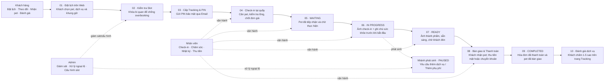
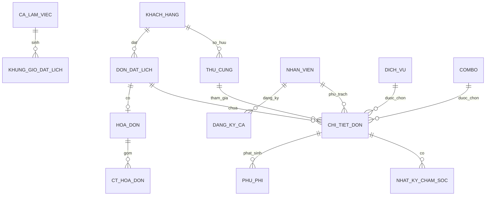

# TÀI LIỆU ĐẶC TẢ YÊU CẦU PHẦN MỀM

## HỆ THỐNG QUẢN LÝ VẬN HÀNH SPA & HOTEL THÚ CƯNG

- **Môn học:** SE310 - Công Nghệ .NET
- **Nhóm thực hiện:** Nhóm 6
  - 24522005 - Trương Quốc Việt
  - 24521992 - Đỗ Trí Viên
  - 24521934 - Nguyễn Dương Quất Tuấn
  - 24521116 - Nguyễn Phương Nam
- **Giảng viên hướng dẫn:** TS. Mai Trọng Khang

> **Ghi chú chuyển đổi:** File Markdown này được chuyển từ PDF gốc theo hướng ưu tiên khả năng đọc của AI: chuẩn hóa heading, bullet, bảng và biểu diễn sơ đồ bằng Mermaid/text. Nội dung nghiệp vụ được giữ nguyên theo tài liệu nguồn; các điểm chưa nhất quán trong SRS không được tự ý sửa hoặc hòa giải.

## Mục lục

- [Chương 1. Giới thiệu tổng quan](#chương-1-giới-thiệu-tổng-quan)
- [Chương 2. Mô tả tổng quan hệ thống & nghiệp vụ](#chương-2-mô-tả-tổng-quan-hệ-thống--nghiệp-vụ)
- [Chương 3. Đặc tả yêu cầu chức năng (Use Cases)](#chương-3-đặc-tả-yêu-cầu-chức-năng-use-cases)
- [Chương 4. Đặc tả yêu cầu phi chức năng (NFR)](#chương-4-đặc-tả-yêu-cầu-phi-chức-năng-nfr)
- [Chương 5. Kiến trúc dữ liệu & ràng buộc toàn vẹn](#chương-5-kiến-trúc-dữ-liệu--ràng-buộc-toàn-vẹn)
- [Phụ lục A. Thiết kế ERD & Data Dictionary chi tiết](#phụ-lục-a-thiết-kế-erd--data-dictionary-chi-tiết)

<!-- PDF p.3 -->
# CHƯƠNG 1. GIỚI THIỆU TỔNG QUAN

## 1.1. Mục đích tài liệu

Tài liệu Đặc tả Yêu cầu Phần mềm (Software Requirements Specification - SRS) này nhằm xác định chi tiết các yêu cầu chức năng (Functional Requirements) và phi chức năng (Non-Functional Requirements) cho Hệ thống Quản lý Vận hành Spa & Hotel Thú Cưng. Tài liệu đóng vai trò làm chuẩn cơ sở (baseline) phục vụ cho các giai đoạn thiết kế kiến trúc, mô hình hóa dữ liệu (Database Schema), lập trình Backend/Frontend và kiểm thử bàn giao đồ án môn học.

## 1.2. Phạm vi sản phẩm (Product Scope)

Hệ thống được xây dựng phục vụ vận hành cho một cơ sở chăm sóc thú cưng tích hợp 2 mảng dịch vụ:

1. **Dịch vụ Spa & Grooming:** Tắm vệ sinh, cắt tỉa lông, nhuộm lông tạo kiểu, cạo vôi răng, vệ sinh tai móng, điều trị ve rận.
2. **Dịch vụ Hotel (Lưu trú):** Đặt phòng lưu trú theo ngày đêm, theo dõi sinh hoạt và cho phép đặt thêm dịch vụ Spa phát sinh trong thời gian lưu trú.

Hệ thống phục vụ 3 nhóm tác nhân chính:

- **Khách hàng (Customer):** Không cần tạo tài khoản mật khẩu; thực hiện đặt lịch hẹn trên Web, tra cứu toàn bộ tiến độ, nhật ký ảnh chăm sóc và hóa đơn thông qua Số điện thoại + Mã Tracking gửi qua Email.
- **Nhân viên (Staff):** Đăng nhập tài khoản nội bộ; tiếp nhận pet, cân đo xác nhận tình trạng, cập nhật trạng thái chăm sóc, upload nhật ký ảnh theo thời gian thực, thêm phụ phí và thu tiền tại quầy.
- **Quản trị viên (Admin):** Toàn quyền kiểm soát danh mục dịch vụ, combo, hệ số tính giá, phê duyệt ca làm việc, cấu hình sức chứa khung giờ, điều chỉnh hóa đơn và giám sát chất lượng.

## 1.3. Định nghĩa và Thuật ngữ viết tắt
| Thuật ngữ | Viết tắt | Ý nghĩa |
| --- | --- | --- |
| Booking | Đơn đặt lịch | Phiếu ghi nhận lịch hẹn của khách hàng (chứa 1 hoặc nhiều thú cưng). |
| Tracking Code | Mã tra cứu | Chuỗi ký tự ngẫu nhiên entropy cao cấp cho khách hàng tra cứu tiến độ. |
| Multi-Pet Booking | Đặt lịch nhiều bé | Khả năng gom nhiều thú cưng của cùng 1 chủ vào chung 1 đơn đặt lịch. |
| Slot | Sức chứa | Số lượng thú cưng tối đa cơ sở có thể tiếp nhận phục vụ trong 1 khung ca. |
| Snapshot Invoice | Hóa đơn tức thời | Cơ chế chụp lại nguyên vẹn đơn giá dịch vụ tại thời điểm chốt thanh toán. |
| Pessimistic Lock | Khóa bi quan | Kỹ thuật khóa dòng dữ liệu trong CSDL (`SELECT ... FOR UPDATE`) chống Race Condition. |
| IDOR | Insecure Direct Object References | Lỗ hổng bảo mật truy cập trực tiếp đối tượng qua ID tuần tự đoán được. |

## 1.4. Kiến trúc Công nghệ dự kiến

- **Giao diện người dùng (Frontend):** React.js / Next.js (TailwindCSS, Shadcn UI / Ant Design).
- **Xử lý nghiệp vụ (Backend API):** .NET 8 Web API (C#), Entity Framework Core.
- **Hệ quản trị Cơ sở dữ liệu:** PostgreSQL 16.
- **Thư viện gửi Email:** MailKit / SendGrid SMTP.
- **Lưu trữ tệp hình ảnh:** Local File System (Development) / Cloud Object Storage (Production).

<!-- PDF p.5 -->
# CHƯƠNG 2. MÔ TẢ TỔNG QUAN HỆ THỐNG & NGHIỆP VỤ

## 2.1. Sơ đồ Bối cảnh Vận hành Vòng đời Dịch vụ

Sơ đồ trong PDF được chuyển sang Mermaid để AI có thể đọc được luồng nghiệp vụ bằng text:



**Các quy tắc được nhấn mạnh trong sơ đồ:** BR-03 khóa slot chống đặt trùng; BR-07 cần ảnh check-in + ghi chú sức khỏe; BR-08 mỗi Booking có một hóa đơn snapshot.

## 2.2. Các Tác nhân Hệ thống (Actors)

1. **Khách hàng (Customer):** Người sở hữu thú cưng, tương tác với hệ thống qua cổng Web tra cứu mà không cần đăng ký tài khoản truyền thống.
2. **Nhân viên (Staff):** Thợ groomer / chăm sóc và nhân viên lễ tân, làm việc theo ca được phân công.
3. **Quản trị viên (Admin):** Chủ cơ sở hoặc người quản lý vận hành cao nhất.

## 2.3. Quy tắc Nghiệp vụ Cốt lõi (Business Rules)
| Mã QĐ | Tên quy tắc | Nội dung quy định chi tiết |
| --- | --- | --- |
| BR-01 | Xác thực Tra cứu & Thao tác nhạy cảm | Khách hàng bắt buộc cung cấp SĐT + Email khi tạo lịch. Hệ thống tự động sinh mã tracking bảo mật gửi qua Email. Khách hàng phải nhập đúng cặp (SĐT + Tracking Code) để tra cứu tiến độ và thực hiện các thao tác nhạy cảm (Hủy lịch, Yêu cầu thêm dịch vụ). |
| BR-02 | Cấu trúc Multi-Pet Booking | Một lần đặt lịch (Booking) cho phép khách hàng chọn nhiều thú cưng cùng lúc. Mỗi thú cưng gắn với các dịch vụ cụ thể và có tiến độ thực hiện độc lập. |
| BR-03 | Kiểm soát Sức chứa & Chống Race Condition | Sức chứa được tính theo tổng số pet tiếp nhận trong từng khung giờ (Slot). Khi đặt lịch, hệ thống sử dụng khóa bi quan (`SELECT ... FOR UPDATE`) trên bảng khung giờ. Khung giờ đã hết chỗ (`slot_con_lai = 0`) sẽ bị chặn đặt ngay lập tức. |
| BR-04 | Giá tạm tính vs Giá chốt tại quầy | Giá hiển thị lúc đặt lịch trên Web chỉ là giá tạm tính. Khi khách mang thú cưng đến quầy, nhân viên bắt buộc cân lại thực tế và kiểm tra lông để chốt đơn giá cuối theo công thức: Đơn giá = Giá cơ bản × Hệ số cân nặng. |
| BR-05 | Ràng buộc Gói Combo | Dịch vụ cắt tỉa tạo kiểu bắt buộc phải đi kèm gói tắm vệ sinh, đóng gói dưới dạng Combo dịch vụ trong danh mục. |
| BR-06 | Ràng buộc Lưu trú Khách sạn | Đơn đặt khách sạn phải chọn ngày lưu trú liên tục. Thú cưng gửi khách sạn bắt buộc phải có ảnh giấy tiêm chủng hợp lệ tải lên hệ thống. |
| BR-07 | Điều kiện Chuyển trạng thái Chăm sóc | Nhân viên chỉ được chuyển trạng thái từ Waiting sang In Progress sau khi đã tải lên ít nhất 01 ảnh check-in và nhập ghi chú sức khỏe ban đầu của thú cưng. |
| BR-08 | Nguyên tắc Hóa đơn Snapshot | Mỗi Booking có 01 hóa đơn duy nhất. Chi tiết hóa đơn (`ct_hoa_don`) phải chụp lại chính xác tên dịch vụ và đơn giá tại thời điểm thanh toán để chống biến động giá danh mục sau này. |
| BR-09 | Bảo mật Đánh giá | Khách hàng chỉ được đánh giá dịch vụ 01 lần khi đơn hàng đạt trạng thái Completed. Nội dung đánh giá mặc định ẩn với nhân viên để tránh mâu thuẫn nội bộ. |
| BR-10 | Phân định Trách nhiệm 1-1 | Mỗi thú cưng trong ca làm việc tại một thời điểm chỉ do tối đa 01 nhân viên chịu trách nhiệm chính nhằm đảm bảo minh bạch chất lượng. |

<!-- PDF p.7 -->
# CHƯƠNG 3. ĐẶC TẢ YÊU CẦU CHỨC NĂNG (USE CASES)

## 3.1. Danh mục 28 Use Case Cốt lõi (Must-have Matrix)
| Phân hệ | Mã UC | Tên Use Case | Tác nhân chính |
| --- | --- | --- | --- |
| 1. Khách hàng & Thú cưng | UC01 | Tạo thông tin khách hàng | Khách hàng, Nhân viên |
|  | UC02 | Tra cứu thông tin khách hàng qua SĐT | Khách hàng, Nhân viên, Admin |
|  | UC06 | Tạo hồ sơ thú cưng | Khách hàng, Nhân viên |
|  | UC07 | Xem danh sách hồ sơ thú cưng | Khách hàng, Nhân viên, Admin |
|  | UC08 | Cập nhật hồ sơ & cân nặng thú cưng | Nhân viên, Admin |
|  | UC10 | Xem danh mục dịch vụ & bảng giá | Khách hàng, Nhân viên, Admin |
| 2. Đặt lịch & Tiếp nhận | UC14 | Đặt lịch hẹn và tạo mã Tracking | Khách hàng, Nhân viên |
|  | UC15 | Tra cứu lịch hẹn qua SĐT và mã Tracking | Khách hàng |
|  | UC16 | Xem danh sách & chi tiết lịch hẹn | Nhân viên, Admin |
|  | UC17 | Duyệt / Từ chối lịch hẹn | Nhân viên, Admin |
|  | UC18 | Dời lịch hẹn | Admin |
|  | UC19 | Hủy lịch hẹn | Khách hàng, Admin |
| 3. Chăm sóc & Tiến độ | UC23 | Tiếp nhận thú cưng tại quầy (Check-in) | Nhân viên |
|  | UC24 | Cập nhật trạng thái chăm sóc thú cưng | Nhân viên |
|  | UC25 | Cập nhật nhật ký chăm sóc & ảnh | Nhân viên |
|  | UC26 | Theo dõi tiến độ chăm sóc (Tracking) | Khách hàng |
|  | UC30 | Bàn giao thú cưng & Hoàn tất phiếu | Nhân viên |
| 4. Tài chính & Thanh toán | UC31 | Tạo và chốt hóa đơn dịch vụ | Nhân viên, Admin |
|  | UC32 | Thêm phụ phí phát sinh | Nhân viên |
|  | UC34 | Xem chi tiết hóa đơn thanh toán | Khách hàng, Nhân viên, Admin |
|  | UC35 | Xác nhận thanh toán hóa đơn | Khách hàng, Nhân viên |
| 5. Quản lý Nhân sự & Ca | UC41 | Nhân viên đăng ký ca làm việc | Nhân viên |
|  | UC50 | Xếp ca và xuất bản lịch làm việc | Admin |
|  | UC53 | Xem lịch làm việc & pet phụ trách | Nhân viên |
| 6. Quản trị Hệ thống | UC11 | Thêm dịch vụ / Combo mới | Admin |
|  | UC12 | Cập nhật dịch vụ & bảng giá | Admin |
|  | UC64 | Cấu hình giờ hoạt động & slot ca | Admin |
|  | FR01 | Đăng nhập nội bộ & Phân quyền | Nhân viên, Admin |

## 3.2. Đặc tả Chi tiết các Use Case Trọng yếu

### UC14: Đặt lịch hẹn và tạo mã Tracking (Multi-Pet)

- **Mục tiêu:** Cho phép khách hàng chọn nhiều thú cưng, đặt dịch vụ Spa hoặc Khách sạn theo khung giờ khả dụng và nhận mã Tracking duy nhất.
- **Tác nhân:** Khách hàng (hoặc Nhân viên tạo hộ tại quầy).
- **Tiền điều kiện:** Dịch vụ đang hoạt động, khung giờ còn slot khả dụng.
- **Luồng sự kiện chính:**
  1. Người dùng truy cập form Đặt lịch, nhập SĐT, Tên khách hàng và Email.
  2. Hệ thống kiểm tra: Nếu SĐT đã có hồ sơ, hiển thị danh sách pet đã lưu; nếu chưa, cho phép nhập thông tin pet mới.
  3. Người dùng chọn 1 hoặc nhiều thú cưng, chọn loại dịch vụ (Spa/Hotel/Combo) tương ứng cho từng bé.
  4. Người dùng chọn ngày và khung ca mong muốn.
  5. Hệ thống kiểm tra sức chứa khung giờ:
     - Thực thi câu lệnh:
       ```sql
       SELECT slot_con_lai
       FROM khung_gio_dat_lich
       WHERE ngay = @Ngay AND ca_lam_viec_id = @CaId
       FOR UPDATE;
       ```
     - Xác nhận `slot_con_lai >= so_luong_pet_dat`.
  6. Hệ thống hiển thị bảng giá tạm tính. Người dùng xác nhận đặt lịch.
  7. Hệ thống thực hiện Transaction:
     - Tạo bản ghi `don_dat_lich` với trạng thái `PENDING`.
     - Sinh `tracking_code` ngẫu nhiên duy nhất (VD: `TRK-8X2K9A`).
     - Tạo các bản ghi `chi_tiet_don` tương ứng từng pet.
     - Trừ `slot_con_lai` trong `khung_gio_dat_lich`.
     - Sinh mã Tracking ngẫu nhiên 8-12 chữ số, băm bcrypt lưu vào `khach_hang` và kích hoạt MailKit gửi email chứa Tracking Code cho khách.
  8. Hệ thống thông báo thành công và chuyển hướng sang trang chi tiết Tracking.
- **Luồng ngoại lệ (Exceptions):**
  - **E1 (Hết slot):** Tại bước 5, nếu `slot_con_lai < so_luong_pet_dat`, hệ thống báo lỗi: *"Khung giờ này chỉ còn X chỗ trống, vui lòng chọn ca khác"*, rollback transaction.
  - **E2 (Gửi email thất bại):** Đơn vẫn được lưu, mã Tracking hiển thị trực tiếp trên màn hình kết quả kèm cảnh báo người dùng chụp lại màn hình.

### UC15: Tra cứu lịch hẹn qua SĐT và mã Tracking

- **Mục tiêu:** Đảm bảo tính bảo mật và riêng tư, chỉ người có đủ thông tin mới tra cứu được hồ sơ và hình ảnh thú cưng.
- **Tác nhân:** Khách hàng.
- **Tiền điều kiện:** Khách hàng có SĐT và Tracking Code đã nhận qua Email.
- **Luồng sự kiện chính:**
  1. Khách hàng truy cập trang "Tra cứu tiến độ".
  2. Khách hàng nhập: Số điện thoại, Mã Tracking.
  3. Hệ thống đối chiếu dữ liệu:
     - Tìm `don_dat_lich` theo `tracking_code`.
     - Kiểm tra SĐT khách hàng liên kết.
  4. Xác thực thành công: Hệ thống hiển thị trang Tracking gồm: Thông tin pet, trạng thái đơn, thợ phụ trách, album ảnh nhật ký và hóa đơn tạm tính.
- **Luồng ngoại lệ:**
  - **E1 (Sai thông tin):** Nhập sai bất kỳ thông tin nào, hệ thống thông báo lỗi chung: *"Thông tin tra cứu không chính xác"*.
  - **E2 (Nhập sai quá 5 lần):** Tạm khóa quyền tra cứu của SĐT này trong 15 phút chống Brute-force.

### UC23: Tiếp nhận thú cưng tại quầy (Check-in)

- **Mục tiêu:** Cập nhật thông số thực tế để tính lại đơn giá chính xác trước khi đưa vào phòng chăm sóc.
- **Tác nhân:** Nhân viên quầy / Lễ tân.
- **Tiền điều kiện:** Đơn đặt lịch ở trạng thái `CONFIRMED`.
- **Luồng sự kiện chính:**
  1. Nhân viên mở danh sách lịch hẹn trong ngày (UC16), tìm đơn theo SĐT hoặc Tracking Code.
  2. Nhân viên đối chiếu thú cưng mang đến.
  3. Nhân viên cân pet tại quầy, nhập `can_nang_thuc_te` và `tinh_trang_long` vào từng mục `chi_tiet_don`.
  4. Hệ thống tự động truy vấn bảng `he_so_can_nang`, tính toán lại đơn giá chốt:
     ```text
     don_gia_chot = gia_co_ban * he_so
     ```
  5. Nhân viên thông báo mức giá cuối cùng cho khách hàng.
  6. Nhân viên bấm "Tiếp nhận vào hàng chờ", trạng thái chăm sóc của thú cưng chuyển sang `WAITING`.

### UC24 & UC25: Cập nhật Trạng thái Chăm sóc & Nhật ký Ảnh

- **Mục tiêu:** Minh bạch hóa quá trình làm dịch vụ, giúp khách hàng yên tâm theo dõi từ xa.
- **Tác nhân:** Nhân viên phụ trách chăm sóc.
- **Tiền điều kiện:** Thú cưng đang ở trạng thái `WAITING` hoặc `IN_PROGRESS`.
- **Luồng sự kiện chính:**
  1. Nhân viên đăng nhập, vào màn hình "Thú cưng phụ trách" (UC53).
  2. Chọn thú cưng cần chăm sóc, chọn "Bắt đầu dịch vụ".
  3. Hệ thống yêu cầu: Tải lên ít nhất 01 ảnh tình trạng ban đầu (Check-in) và nhập ghi chú sức khỏe (vết trầy, ve rận, nấm da nếu có).
  4. Nhân viên chọn ảnh và bấm xác nhận.
  5. Hệ thống lưu bản ghi vào `nhat_ky_cham_soc`, cập nhật `chi_tiet_don.trang_thai_cham_soc = 'IN_PROGRESS'`.
  6. Dữ liệu ảnh và tiến độ lập tức đồng bộ hiển thị lên trang Tracking của khách hàng.
  7. Sau khi hoàn thành xong các khâu tắm tỉa, nhân viên tải ảnh thành phẩm và bấm "Hoàn tất dịch vụ".
  8. Hệ thống cập nhật trạng thái sang `READY` (Sẵn sàng đón bé) và gửi email thông báo khách đến nhận thú cưng.

### UC31 & UC35: Tạo Hóa đơn Snapshot & Xác nhận Thanh toán

- **Mục tiêu:** Chốt hóa đơn thanh toán an toàn, không bị ảnh hưởng bởi biến động giá tương lai.
- **Tác nhân:** Nhân viên thu ngân, Khách hàng.
- **Tiền điều kiện:** Tất cả thú cưng trong đơn đã ở trạng thái `READY`.
- **Luồng sự kiện chính:**
  1. Khách hàng đến quầy nhận lại thú cưng.
  2. Nhân viên mở đơn, bấm "Tạo hóa đơn".
  3. Hệ thống tổng hợp:
     - Các dòng dịch vụ từ `chi_tiet_don`.
     - Các dòng phụ phí phát sinh từ `phu_phi` (nếu có: gỡ rối lông, đón trễ...).
  4. Hệ thống ghi nhận vào bảng `ct_hoa_don`: Chụp lại nguyên văn `ten_khoan_muc`, `don_gia_snapshot`, `thanh_tien`.
  5. Hệ thống tính tổng tiền phải thanh toán:
     ```text
     tong_thanh_toan = tong_tien_dich_vu + tong_phu_phi - giam_gia - tien_coc
     ```
  6. Khách hàng lựa chọn phương thức thanh toán:
     - **Tiền mặt:** Khách đưa tiền mặt, nhân viên nhận tiền và bấm "Xác nhận đã thu đủ tiền mặt".
     - **Chuyển khoản:** Hệ thống hiển thị mã VietQR động chứa số tiền chính xác, khách quét mã chuyển khoản.
  7. Nhân viên xác nhận tiền đã vào tài khoản, bấm "Hoàn tất thanh toán".
  8. Hệ thống cập nhật:
     - `hoa_don.trang_thai_thanh_toan = 'PAID'`.
     - `don_dat_lich.trang_thai = 'COMPLETED'`.
  9. Trang Tracking của khách hàng chuyển sang trạng thái đã hoàn tất và mở form Đánh giá dịch vụ (UC56).

<!-- PDF p.12 -->
# CHƯƠNG 4. ĐẶC TẢ YÊU CẦU PHI CHỨC NĂNG (NFR)

## 4.1. Hiệu năng & Khả năng chịu tải (Performance & Capacity)

- **NFR-P1 (Thời gian phản hồi API):** Các thao tác tra cứu, CRUD dữ liệu thông thường phải có thời gian phản hồi API dưới 500ms ở điều kiện mạng tiêu chuẩn.
- **NFR-P2 (Thời gian tải trang Tracking):** Trang tra cứu tiến độ (bao gồm tải 3-5 ảnh thumbnail nén) phải hoàn tất tải trang dưới 2 giây.
- **NFR-P3 (Quy mô chịu tải):** Thiết kế cho quy mô 1 cơ sở spa: phục vụ 30 - 50 booking/ngày, chịu tải đồng thời tối thiểu 10 người dùng tương tác tại cùng một thời điểm.

## 4.2. An toàn & Bảo mật (Security)

- **NFR-S1 (Mã hóa mật khẩu):** Toàn bộ mật khẩu của Nhân viên và Admin bắt buộc phải được băm bằng thuật toán bcrypt (Work factor/Cost factor ≥ 12) hoặc Argon2 trước khi lưu vào CSDL. Tuyệt đối không lưu plaintext hoặc MD5/SHA1.
- **NFR-S2 (Chống lộ IDOR):** Mã định danh hiển thị ra công cộng (Tracking Code) phải là chuỗi ngẫu nhiên dài từ 8 - 12 ký tự gồm chữ hoa và số với độ entropy cao, tách biệt hoàn toàn với khóa chính tự tăng `id`.
- **NFR-S3 (Bảo vệ điểm cuối API):** Toàn bộ các API nghiệp vụ nội bộ của Nhân viên và Quản trị viên bắt buộc phải kiểm tra xác thực bằng JWT (JSON Web Token) và phân quyền theo Role (`ADMIN`, `STAFF`) ở tầng Middleware của Backend.
- **NFR-S4 (Bảo vệ thông tin cá nhân):** Thông tin khách hàng và nhật ký thú cưng chỉ được hiển thị khi cung cấp chính xác SĐT + Mã Tracking hợp lệ.

## 4.3. Xử lý Tranh chấp Đồng thời (Concurrency & Locking)

- **NFR-C1 (Chống Overbooking):** Tại khâu ghi nhận đặt lịch, hệ thống bắt buộc sử dụng cơ chế Transaction ở mức độ cô lập kết hợp Pessimistic Locking (`SELECT ... FOR UPDATE`) trên dòng dữ liệu khung giờ tương ứng trong bảng `khung_gio_dat_lich`.
- **NFR-C2 (Ràng buộc cứng):** Cột `slot_con_lai` có ràng buộc CSDL `CHECK (slot_con_lai >= 0)` để đảm bảo ngay cả khi có xung đột phần mềm, CSDL sẽ từ chối giao dịch làm âm slot.

## 4.4. Tính Tin cậy & Toàn vẹn Dữ liệu (Reliability & Integrity)

- **NFR-R1 (Tính toàn vẹn tài chính):** Hóa đơn sau khi đã chuyển sang trạng thái `PAID` tuyệt đối không được phép chỉnh sửa hoặc xóa trực tiếp (chỉ ghi nhận biến động qua giao dịch hoàn tiền nếu có).
- **NFR-R2 (Lưu trữ hình ảnh):** CSDL chỉ lưu trữ đường dẫn URL ảnh; tệp tin ảnh gốc được nén tối ưu (WebP/JPEG) lưu tại thư mục file tĩnh hoặc dịch vụ lưu trữ đám mây.

## 4.5. Giao diện & Trải nghiệm Người dùng (Usability)

- **NFR-U1 (Tính tương thích di động):** Toàn bộ giao diện dành cho Khách hàng (Đặt lịch, Tra cứu Tracking, Xem ảnh) phải được tối ưu Responsive hoàn hảo trên màn hình điện thoại thông minh (Viewport từ 375px trở lên).
- **NFR-U2 (Giao diện quầy thu ngân):** Màn hình tiếp nhận và thanh toán của Nhân viên tối ưu cho máy tính bảng / desktop để thao tác nhập liệu nhanh bằng phím tắt.

<!-- PDF p.14 -->
# CHƯƠNG 5. KIẾN TRÚC DỮ LIỆU & RÀNG BUỘC TOÀN VẸN

## 5.1. Danh mục 19 Bảng Dữ liệu Chuẩn hóa (PostgreSQL)

ERD tổng thể trong PDF được diễn giải chi tiết ở **Phụ lục A.2** (quan hệ giữa các thực thể) và **Phụ lục A.3** (Data Dictionary 19 bảng). Các sơ đồ phân hệ ở các trang sau cũng được thể hiện bằng các bảng/quan hệ dạng text trong Markdown này để AI có thể đọc trực tiếp.

## 5.2. Các Ràng buộc Toàn vẹn CSDL Trọng yếu (Constraints)

### 1. Khóa ngoại và Hành vi Xóa (Foreign Keys & Delete Rules)

- `thu_cung` trỏ về `khach_hang`: `ON DELETE RESTRICT` (Không được xóa khách khi đang có hồ sơ pet).
- `chi_tiet_don` trỏ về `don_dat_lich`: `ON DELETE CASCADE`.
- `ct_hoa_don` trỏ về `hoa_don`: `ON DELETE CASCADE`.
- `chi_tiet_don` trỏ về `nhan_vien`: `ON DELETE SET NULL`.

### 2. Ràng buộc Kiểm tra Miền giá trị (CHECK Constraints)

- `thu_cung.loai_pet IN ('CHO', 'MEO')`
- `don_dat_lich.loai_don IN ('SPA', 'HOTEL', 'COMBO_SPA_HOTEL')`
- `don_dat_lich.trang_thai IN ('PENDING', 'CONFIRMED', 'IN_PROGRESS', 'READY', 'COMPLETED', 'CANCELLED')`
- `chi_tiet_don.trang_thai_cham_soc IN ('WAITING', 'IN_PROGRESS', 'PAUSED', 'READY', 'DONE')`
- `hoa_don.trang_thai_thanh_toan IN ('UNPAID', 'PARTIAL_PAID', 'PAID', 'REFUNDED')`
- `danh_gia.so_sao BETWEEN 1 AND 5`
- `khung_gio_dat_lich.slot_con_lai >= 0`

<!-- PDF p.15 -->
# PHỤ LỤC A. THIẾT KẾ ERD & DATA DICTIONARY CHI TIẾT

Phụ lục này mở rộng Chương 5 bằng mô hình thực thể quan hệ (ERD) chi tiết, danh mục thuộc tính của 19 bảng PostgreSQL, các quan hệ chính, ràng buộc toàn vẹn và index khuyến nghị. Thiết kế được chuẩn hóa theo 3NF và bám theo phạm vi MVP 28 Must-have Use Cases.

## A.1. Các cải tiến kỹ thuật cốt lõi

- Giải quyết mô hình Multi-Pet Booking: một Booking có thể đăng ký nhiều thú cưng, mỗi thú cưng có dịch vụ và tiến độ riêng.
- Tách biệt `id` khóa chính nội bộ với `tracking_code` dạng chuỗi ngẫu nhiên để giảm nguy cơ IDOR.
- Bổ sung `khung_gio_dat_lich` theo ngày để kiểm soát sức chứa bằng Pessimistic Locking (`SELECT ... FOR UPDATE`).
- Bổ sung `ct_hoa_don` dạng Snapshot để lưu nguyên đơn giá và tên khoản mục tại thời điểm chốt thanh toán.

## A.2. Quan hệ giữa các thực thể
| Thực thể nguồn | Quan hệ | Thực thể đích | Ý nghĩa |
| --- | --- | --- | --- |
| KHACH_HANG | 1-N | THU_CUNG | Một khách hàng sở hữu nhiều thú cưng |
| KHACH_HANG | 1-N | DON_DAT_LICH | Một khách hàng có nhiều booking |
| THU_CUNG | 1-N | CHI_TIET_DON | Một thú cưng có nhiều dịch vụ/booking |
| DON_DAT_LICH | 1-N | CHI_TIET_DON | Booking chứa nhiều pet/dịch vụ |
| DON_DAT_LICH | 1-0..1 | HOA_DON | Mỗi booking tối đa một hóa đơn |
| HOA_DON | 1-N | CT_HOA_DON | Hóa đơn gồm nhiều dòng snapshot |
| CHI_TIET_DON | 1-N | NHAT_KY_CHAM_SOC | Mỗi lượt dịch vụ có nhiều nhật ký |
| CHI_TIET_DON | 1-N | PHU_PHI | Phụ phí gắn với từng lượt dịch vụ |
| CA_LAM_VIEC | 1-N | KHUNG_GIO_DAT_LICH | Ca làm việc sinh slot theo ngày |
| NHAN_VIEN | 1-N | CHI_TIET_DON | Nhân viên phụ trách chăm sóc |
| DICH_VU / COMBO | 1-N | CHI_TIET_DON | Dịch vụ đơn hoặc combo được chọn |
| NHAN_VIEN | 1-N | DANG_KY_CA | Nhân viên đăng ký nhiều ca |

### ERD dạng Mermaid (biểu diễn các quan hệ nêu trên)



## A.3. Data Dictionary - Đặc tả 19 bảng

### PHÂN HỆ 1: KHÁCH HÀNG & THÚ CƯNG (CUSTOMER & PET)

#### 1. Bảng `khach_hang` (Thông tin khách hàng)
| STT | Tên Cột | Kiểu Dữ Liệu | Ràng Buộc | Ý Nghĩa / Nghiệp Vụ |
| --- | --- | --- | --- | --- |
| 1 | id | INT | PK, SERIAL | Khóa chính tự tăng |
| 2 | so_dien_thoai | VARCHAR(15) | UNIQUE, NOT NULL | SĐT định danh tài khoản, công cụ tra cứu chính |
| 3 | email | VARCHAR(150) | NOT NULL | Email nhận mã tracking và thông báo booking |
| 4 | ten_khach_hang | VARCHAR(100) | NOT NULL | Họ và tên khách hàng |
| 5 | ma_tracking_hash | VARCHAR(255) | NULL | Mã tracking bảo mật đã hash bằng bcrypt |
| 6 | thong_tin_stk | TEXT | NULL | Thông tin Ngân hàng + STK để nhận tiền hoàn (nếu có) |
| 7 | created_at | TIMESTAMP | DEFAULT CURRENT_TIMESTAMP | Thời điểm tạo hồ sơ |
| 8 | updated_at | TIMESTAMP | DEFAULT CURRENT_TIMESTAMP | Thời điểm cập nhật cuối |
| 9 | deleted_at | TIMESTAMP | NULL | Thời điểm xóa mềm (Soft delete) |

#### 2. Bảng `thu_cung` (Hồ sơ thú cưng)

| STT | Tên Cột | Kiểu Dữ Liệu | Ràng Buộc | Ý Nghĩa / Nghiệp Vụ |
| --- | --- | --- | --- | --- |
| 1 | id | INT | PK, SERIAL | Khóa chính tự tăng |
| 2 | khach_hang_id | INT | FK, NOT NULL | Khách hàng sở hữu (`khach_hang.id`) |
| 3 | ten_thu_cung | VARCHAR(100) | NOT NULL | Tên gọi của bé |
| 4 | loai_pet | VARCHAR(20) | NOT NULL | CHO hoặc MEO (CHECK constraint) |
| 5 | giong_loai | VARCHAR(100) | NULL | Giống (ví dụ: Poodle, Corgi, Mèo Anh lông ngắn...) |
| 6 | can_nang_dang_ky | NUMERIC(5,2) | NULL | Cân nặng ước tính khách khai báo lúc đặt lịch (kg) |
| 7 | ghi_chu_di_ung | TEXT | NULL | Bệnh nền, dị ứng dầu tắm, tính khí (dữ/nhát) |
| 8 | created_at | TIMESTAMP | DEFAULT CURRENT_TIMESTAMP | Thời điểm tạo |
| 9 | updated_at | TIMESTAMP | DEFAULT CURRENT_TIMESTAMP | Thời điểm cập nhật |
| 10 | deleted_at | TIMESTAMP | NULL | Xóa mềm |

#### 3. Bảng `ho_so_tiem_chung` (Ảnh giấy tờ tiêm phòng)

| STT | Tên Cột | Kiểu Dữ Liệu | Ràng Buộc | Ý Nghĩa / Nghiệp Vụ |
| --- | --- | --- | --- | --- |
| 1 | id | INT | PK, SERIAL | Khóa chính |
| 2 | thu_cung_id | INT | FK, NOT NULL | Thuộc thú cưng nào (`thu_cung.id`) |
| 3 | duong_dan_anh | TEXT | NOT NULL | Đường dẫn URL file ảnh sổ tiêm chủng |
| 4 | ngay_tiem | DATE | NULL | Ngày tiêm mũi gần nhất |
| 5 | loai_vac_xin | VARCHAR(100) | NULL | Tên vắc-xin (dại, 7 bệnh, 4 bệnh...) |
| 6 | created_at | TIMESTAMP | DEFAULT CURRENT_TIMESTAMP | Thời điểm tải lên |

### PHÂN HỆ 2: DANH MỤC DỊCH VỤ & KHÁCH SẠN (MASTER SERVICES)

#### 4. Bảng `dich_vu` (Dịch vụ Spa đơn lẻ)
| STT | Tên Cột | Kiểu Dữ Liệu | Ràng Buộc | Ý Nghĩa / Nghiệp Vụ |
| --- | --- | --- | --- | --- |
| 1 | id | INT | PK, SERIAL | Khóa chính |
| 2 | ten_dich_vu | VARCHAR(100) | NOT NULL | Tắm vệ sinh, cắt tỉa tạo kiểu, cạo vôi răng... |
| 3 | loai_dich_vu | VARCHAR(50) | NOT NULL | SPA_BASIC, SPA_ADVANCED, HEALTHCARE |
| 4 | mo_ta | TEXT | NULL | Mô tả quy trình |
| 5 | gia_co_ban | NUMERIC(12,2) | NOT NULL | Giá gốc dịch vụ chưa nhân hệ số cân nặng |
| 6 | thoi_luong_phut | INT | DEFAULT 60 | Thời lượng dự kiến thực hiện (phút) |
| 7 | is_active | BOOLEAN | DEFAULT TRUE | Trạng thái hiển thị (TRUE: mở, FALSE: ẩn) |

#### 5. Bảng `combo` (Gói combo dịch vụ)

| STT | Tên Cột | Kiểu Dữ Liệu | Ràng Buộc | Ý Nghĩa / Nghiệp Vụ |
| --- | --- | --- | --- | --- |
| 1 | id | INT | PK, SERIAL | Khóa chính |
| 2 | ten_combo | VARCHAR(100) | NOT NULL | Tên gói combo |
| 3 | mo_ta | TEXT | NULL | Chi tiết quyền lợi gói |
| 4 | gia_combo | NUMERIC(12,2) | NOT NULL | Giá trọn gói (hoặc giá cơ sở gói) |
| 5 | is_active | BOOLEAN | DEFAULT TRUE | Trạng thái áp dụng |

#### 6. Bảng `chi_tiet_combo` (Dịch vụ thành phần trong Combo)

| STT | Tên Cột | Kiểu Dữ Liệu | Ràng Buộc | Ý Nghĩa / Nghiệp Vụ |
| --- | --- | --- | --- | --- |
| 1 | id | INT | PK, SERIAL | Khóa chính |
| 2 | combo_id | INT | FK, NOT NULL | Thuộc combo (`combo.id`) |
| 3 | dich_vu_id | INT | FK, NOT NULL | Dịch vụ con (`dich_vu.id`) |

#### 7. Bảng `he_so_can_nang` (Bảng hệ số tính giá)

| STT | Tên Cột | Kiểu Dữ Liệu | Ràng Buộc | Ý Nghĩa / Nghiệp Vụ |
| --- | --- | --- | --- | --- |
| 1 | id | INT | PK, SERIAL | Khóa chính |
| 2 | can_nang_tu | NUMERIC(5,2) | NOT NULL | Mức cân từ (kg), ví dụ: 0.0 |
| 3 | can_nang_den | NUMERIC(5,2) | NOT NULL | Mức cân đến (kg), ví dụ: 5.0 |
| 4 | he_so | NUMERIC(4,2) | NOT NULL | Hệ số nhân giá (ví dụ: 1.0, 1.3, 1.6) |
| 5 | ghi_chu | VARCHAR(100) | NULL | Ví dụ: Dưới 5kg, 5-10kg, trên 20kg... |

#### 8. Bảng `loai_phong` (Danh mục phòng Hotel thú cưng)

| STT | Tên Cột | Kiểu Dữ Liệu | Ràng Buộc | Ý Nghĩa / Nghiệp Vụ |
| --- | --- | --- | --- | --- |
| 1 | id | INT | PK, SERIAL | Khóa chính |
| 2 | ten_phong | VARCHAR(100) | NOT NULL | Phòng tiêu chuẩn, Phòng VIP, Penthouse... |
| 3 | kich_co | VARCHAR(20) | NOT NULL | S, M, L, XL |
| 4 | gia_theo_ngay | NUMERIC(12,2) | NOT NULL | Đơn giá lưu trú 1 ngày đêm (VNĐ) |
| 5 | is_active | BOOLEAN | DEFAULT TRUE | Trạng thái phòng sẵn sàng hoạt động |

### PHÂN HỆ 3: ĐẶT LỊCH, SỨC CHỨA & VẬN HÀNH (BOOKING & CAPACITY)

#### 9. Bảng `ca_lam_viec` (Định mức ca mẫu)
| STT | Tên Cột | Kiểu Dữ Liệu | Ràng Buộc | Ý Nghĩa / Nghiệp Vụ |
| --- | --- | --- | --- | --- |
| 1 | id | INT | PK, SERIAL | Khóa chính |
| 2 | ten_ca | VARCHAR(50) | NOT NULL | Ca sáng, Ca chiều, Ca tối |
| 3 | gio_bat_dau | TIME | NOT NULL | Giờ mở (VD: 08:00) |
| 4 | gio_ket_thuc | TIME | NOT NULL | Giờ đóng (VD: 12:00) |
| 5 | slot_pet_mac_dinh | INT | DEFAULT 10 | Số pet tối đa tiếp nhận trong ca |
| 6 | is_active | BOOLEAN | DEFAULT TRUE | Có áp dụng không |

#### 10. Bảng `khung_gio_dat_lich` (Slot theo ngày - Kiểm soát Race Condition)

| STT | Tên Cột | Kiểu Dữ Liệu | Ràng Buộc | Ý Nghĩa / Nghiệp Vụ |
| --- | --- | --- | --- | --- |
| 1 | id | INT | PK, SERIAL | Khóa chính |
| 2 | ngay | DATE | NOT NULL | Ngày phục vụ (YYYY-MM-DD) |
| 3 | ca_lam_viec_id | INT | FK, NOT NULL | Khung ca tương ứng (`ca_lam_viec.id`) |
| 4 | tong_slot | INT | NOT NULL | Sức chứa tối đa của ngày đó |
| 5 | slot_da_dat | INT | DEFAULT 0 | Số pet đã đăng ký xác nhận |
| 6 | slot_con_lai | INT | NOT NULL | `tong_slot - slot_da_dat` (>= 0) |
| 7 | updated_at | TIMESTAMP | DEFAULT CURRENT_TIMESTAMP | Thời điểm lock & update |

#### 11. Bảng `don_dat_lich` (Đơn đặt lịch tổng quát)

| STT | Tên Cột | Kiểu Dữ Liệu | Ràng Buộc | Ý Nghĩa / Nghiệp Vụ |
| --- | --- | --- | --- | --- |
| 1 | id | INT | PK, SERIAL | Khóa chính nội bộ |
| 2 | tracking_code | VARCHAR(20) | UNIQUE, NOT NULL | Chuỗi random entropy cao (VD: TRK-8X2K9A) giao diện khách tra cứu |
| 3 | khach_hang_id | INT | FK, NOT NULL | Khách hàng đặt đơn |
| 4 | khung_gio_id | INT | FK, NULL | Slot giữ chỗ Spa (`khung_gio_dat_lich.id`) |
| 5 | loai_don | VARCHAR(20) | NOT NULL | SPA, HOTEL, COMBO_SPA_HOTEL |
| 6 | trang_thai | VARCHAR(30) | NOT NULL | PENDING, CONFIRMED, IN_PROGRESS, READY, COMPLETED, CANCELLED |
| 7 | thoi_gian_bat_dau | TIMESTAMP | NOT NULL | Thời gian hẹn bắt đầu |
| 8 | thoi_gian_ket_thuc | TIMESTAMP | NULL | Thời gian trả phòng nếu là Hotel |
| 9 | tong_tien_tam_tinh | NUMERIC(12,2) | DEFAULT 0 | Giá ước tính ban đầu khi đặt trên web |
| 10 | ghi_chu_khach | TEXT | NULL | Lời nhắn dặn dò của khách hàng |
| 11 | created_at | TIMESTAMP | DEFAULT CURRENT_TIMESTAMP | Thời điểm tạo |
| 12 | updated_at | TIMESTAMP | DEFAULT CURRENT_TIMESTAMP | Thời điểm cập nhật trạng thái |
| 13 | deleted_at | TIMESTAMP | NULL | Xóa mềm |

#### 12. Bảng `chi_tiet_don` (Dịch vụ theo từng Pet trong Booking)

| STT | Tên Cột | Kiểu Dữ Liệu | Ràng Buộc | Ý Nghĩa / Nghiệp Vụ |
| --- | --- | --- | --- | --- |
| 1 | id | INT | PK, SERIAL | Khóa chính |
| 2 | don_dat_lich_id | INT | FK, NOT NULL | Đơn đặt lịch cha (`don_dat_lich.id`) |
| 3 | thu_cung_id | INT | FK, NOT NULL | Bé thú cưng được làm dịch vụ (`thu_cung.id`) |
| 4 | dich_vu_id | INT | FK, NULL | Dịch vụ Spa đơn (nếu có) |
| 5 | combo_id | INT | FK, NULL | Gói Combo Spa (nếu có) |
| 6 | loai_phong_id | INT | FK, NULL | Loại phòng lưu trú Hotel (nếu có) |
| 7 | nhan_vien_id | INT | FK, NULL | Thợ trực tiếp phụ trách chăm sóc |
| 8 | can_nang_thuc_te | NUMERIC(5,2) | NULL | Cân nặng cân lại tại quầy khi check-in |
| 9 | tinh_trang_long | VARCHAR(50) | NULL | Tình trạng lông thực tế (rối, bình thường...) |
| 10 | don_gia_chot | NUMERIC(12,2) | NOT NULL | Giá sau khi nhân hệ số cân nặng thực tế |
| 11 | la_dich_vu_them | BOOLEAN | DEFAULT FALSE | TRUE nếu là dịch vụ khách yêu cầu thêm trong lúc làm |
| 12 | trang_thai_cham_soc | VARCHAR(30) | DEFAULT 'WAITING' | WAITING, IN_PROGRESS, PAUSED, READY, DONE |
| 13 | created_at | TIMESTAMP | DEFAULT CURRENT_TIMESTAMP | Thời điểm tạo |
| 14 | updated_at | TIMESTAMP | DEFAULT CURRENT_TIMESTAMP | Cập nhật tiến độ |

#### 13. Bảng `nhat_ky_cham_soc` (Nhật ký tiến độ chăm sóc)

| STT | Tên Cột | Kiểu Dữ Liệu | Ràng Buộc | Ý Nghĩa / Nghiệp Vụ |
| --- | --- | --- | --- | --- |
| 1 | id | INT | PK, SERIAL | Khóa chính |
| 2 | chi_tiet_don_id | INT | FK, NOT NULL | Thuộc lượt dịch vụ của pet nào (`chi_tiet_don.id`) |
| 3 | nhan_vien_id | INT | FK, NOT NULL | Nhân viên tải ảnh / ghi nhận |
| 4 | loai_nhat_ky | VARCHAR(30) | NOT NULL | CHECK_IN, IN_PROGRESS, SU_CO, READY_CHECK_OUT |
| 5 | duong_dan_anh | TEXT | NOT NULL | URL ảnh thực tế của bé |
| 6 | ghi_chu_suc_khoe | TEXT | NOT NULL | Tình trạng da, ve rận, vết thương (nếu có) |
| 7 | thoi_gian_ghi_nhan | TIMESTAMP | DEFAULT CURRENT_TIMESTAMP | Giờ hệ thống ghi nhận |

### PHÂN HỆ 4: TÀI CHÍNH, HÓA ĐƠN & PHỤ PHÍ (FINANCE & BILLING)

#### 14. Bảng `hoa_don` (Hóa đơn thanh toán)
| STT | Tên Cột | Kiểu Dữ Liệu | Ràng Buộc | Ý Nghĩa / Nghiệp Vụ |
| --- | --- | --- | --- | --- |
| 1 | id | INT | PK, SERIAL | Khóa chính |
| 2 | don_dat_lich_id | INT | FK, NOT NULL | Liên kết 1-1 với đơn (`don_dat_lich.id`) |
| 3 | tong_tien_dich_vu | NUMERIC(12,2) | NOT NULL | Tổng tiền các gói spa / khách sạn |
| 4 | tong_phu_phi | NUMERIC(12,2) | DEFAULT 0 | Tổng các khoản gỡ rối, đón trễ, phụ thu... |
| 5 | giam_gia | NUMERIC(12,2) | DEFAULT 0 | Tiền khuyến mãi / Voucher giảm |
| 6 | tong_thanh_toan | NUMERIC(12,2) | NOT NULL | `tong_tien_dich_vu + tong_phu_phi - giam_gia` |
| 7 | tien_coc | NUMERIC(12,2) | DEFAULT 0 | Tiền khách đã cọc trước (nếu có) |
| 8 | da_thanh_toan | NUMERIC(12,2) | DEFAULT 0 | Số tiền thực tế khách đã trả |
| 9 | trang_thai_thanh_toan | VARCHAR(20) | NOT NULL | UNPAID, PARTIAL_PAID, PAID, REFUNDED |
| 10 | phuong_thuc_thanh_toan | VARCHAR(30) | NULL | CASH, BANK_TRANSFER |
| 11 | created_at | TIMESTAMP | DEFAULT CURRENT_TIMESTAMP | Thời điểm tạo hóa đơn |
| 12 | updated_at | TIMESTAMP | DEFAULT CURRENT_TIMESTAMP | Thời điểm chốt thanh toán |

#### 15. Bảng `ct_hoa_don` (Snapshot chi tiết dòng Hóa đơn)

| STT | Tên Cột | Kiểu Dữ Liệu | Ràng Buộc | Ý Nghĩa / Nghiệp Vụ |
| --- | --- | --- | --- | --- |
| 1 | id | INT | PK, SERIAL | Khóa chính |
| 2 | hoa_don_id | INT | FK, NOT NULL | Thuộc hóa đơn nào (`hoa_don.id`) |
| 3 | chi_tiet_don_id | INT | FK, NULL | Xuất phát từ mục booking nào |
| 4 | ten_khoan_muc | VARCHAR(150) | NOT NULL | Tên dịch vụ chụp lại (VD: Tắm Poodle 4kg) |
| 5 | so_luong | INT | DEFAULT 1 | Số lượng (lần / ngày) |
| 6 | don_gia_snapshot | NUMERIC(12,2) | NOT NULL | Đơn giá đã áp dụng |
| 7 | thanh_tien | NUMERIC(12,2) | NOT NULL | `so_luong * don_gia_snapshot` |

#### 16. Bảng `phu_phi` (Phụ phí phát sinh thực tế)

| STT | Tên Cột | Kiểu Dữ Liệu | Ràng Buộc | Ý Nghĩa / Nghiệp Vụ |
| --- | --- | --- | --- | --- |
| 1 | id | INT | PK, SERIAL | Khóa chính |
| 2 | hoa_don_id | INT | FK, NOT NULL | Cộng vào hóa đơn (`hoa_don.id`) |
| 3 | chi_tiet_don_id | INT | FK, NULL | Phát sinh cho bé thú cưng nào |
| 4 | ten_phu_phi | VARCHAR(100) | NOT NULL | Phí gỡ lông rối, Trị bọ chét, Đón trễ 2h... |
| 5 | so_tien | NUMERIC(12,2) | NOT NULL | Số tiền phụ thu |
| 6 | ly_do | TEXT | NULL | Ghi chú giải thích cho khách hàng |
| 7 | created_at | TIMESTAMP | DEFAULT CURRENT_TIMESTAMP | Giờ nhân viên thêm phụ phí |

### PHÂN HỆ 5: NHÂN SỰ & ĐÁNH GIÁ (HR & REVIEWS)

#### 17. Bảng `nhan_vien` (Tài khoản nhân sự & Admin)
| STT | Tên Cột | Kiểu Dữ Liệu | Ràng Buộc | Ý Nghĩa / Nghiệp Vụ |
| --- | --- | --- | --- | --- |
| 1 | id | INT | PK, SERIAL | Khóa chính |
| 2 | ten_nhan_vien | VARCHAR(100) | NOT NULL | Tên nhân sự |
| 3 | ten_dang_nhap | VARCHAR(50) | UNIQUE, NOT NULL | Tên đăng nhập vào hệ thống quản trị |
| 4 | mat_khau_hash | VARCHAR(255) | NOT NULL | Mật khẩu hash bằng bcrypt / Argon2 |
| 5 | vai_tro | VARCHAR(20) | NOT NULL | ADMIN hoặc STAFF |
| 6 | so_dien_thoai | VARCHAR(15) | NULL | Số điện thoại liên lạc nội bộ |
| 7 | email | VARCHAR(150) | NULL | Email công việc |
| 8 | is_active | BOOLEAN | DEFAULT TRUE | Trạng thái tài khoản (đang làm/nghỉ việc) |
| 9 | created_at | TIMESTAMP | DEFAULT CURRENT_TIMESTAMP | Ngày tạo tài khoản |

#### 18. Bảng `dang_ky_ca` (Lịch làm việc thực tế của nhân viên)

| STT | Tên Cột | Kiểu Dữ Liệu | Ràng Buộc | Ý Nghĩa / Nghiệp Vụ |
| --- | --- | --- | --- | --- |
| 1 | id | INT | PK, SERIAL | Khóa chính |
| 2 | nhan_vien_id | INT | FK, NOT NULL | Nhân viên trực (`nhan_vien.id`) |
| 3 | ca_lam_viec_id | INT | FK, NOT NULL | Ca làm việc (`ca_lam_viec.id`) |
| 4 | ngay_lam_viec | DATE | NOT NULL | Ngày trực cụ thể (YYYY-MM-DD) |
| 5 | trang_thai_duyet | VARCHAR(20) | DEFAULT 'PENDING' | PENDING, APPROVED, REJECTED |
| 6 | created_at | TIMESTAMP | DEFAULT CURRENT_TIMESTAMP | Thời điểm nộp đăng ký |

#### 19. Bảng `danh_gia` (Phản hồi & Số sao từ khách hàng)

| STT | Tên Cột | Kiểu Dữ Liệu | Ràng Buộc | Ý Nghĩa / Nghiệp Vụ |
| --- | --- | --- | --- | --- |
| 1 | id | INT | PK, SERIAL | Khóa chính |
| 2 | don_dat_lich_id | INT | FK, NOT NULL | Đơn được đánh giá (`don_dat_lich.id`) |
| 3 | khach_hang_id | INT | FK, NOT NULL | Khách hàng thực hiện review |
| 4 | so_sao | INT | NOT NULL | Từ 1 đến 5 sao (`CHECK (so_sao BETWEEN 1 AND 5)`) |
| 5 | binh_luan | TEXT | NULL | Nội dung nhận xét |
| 6 | hien_thi_nhan_vien | BOOLEAN | DEFAULT FALSE | Cấu hình bảo mật: mặc định ẩn với nhân viên |
| 7 | created_at | TIMESTAMP | DEFAULT CURRENT_TIMESTAMP | Thời điểm gửi đánh giá |

## A.4. Ràng buộc và Index khuyến nghị
| Nhóm | Định nghĩa |
| --- | --- |
| CHECK | `thu_cung.loai_pet IN (CHO, MEO)` |
| CHECK | `don_dat_lich.loai_don IN (SPA, HOTEL, COMBO_SPA_HOTEL)` |
| CHECK | `don_dat_lich.trang_thai IN (PENDING, CONFIRMED, IN_PROGRESS, READY, COMPLETED, CANCELLED)` |
| CHECK | `chi_tiet_don.trang_thai_cham_soc IN (WAITING, IN_PROGRESS, PAUSED, READY, DONE)` |
| CHECK | `hoa_don.trang_thai_thanh_toan IN (UNPAID, PARTIAL_PAID, PAID, REFUNDED)` |
| CHECK | `nhan_vien.vai_tro IN (ADMIN, STAFF)` |
| CHECK | `danh_gia.so_sao BETWEEN 1 AND 5` |
| CHECK | `khung_gio_dat_lich.slot_con_lai >= 0` |
| UNIQUE | `khung_gio_dat_lich(ngay, ca_lam_viec_id)` |
| INDEX | `khach_hang(so_dien_thoai)` |
| INDEX | `don_dat_lich(tracking_code)` |
| INDEX | `don_dat_lich(trang_thai, thoi_gian_bat_dau)` |
| INDEX | `khung_gio_dat_lich(ngay, ca_lam_viec_id)` |
| INDEX | `chi_tiet_don(don_dat_lich_id)` |
| INDEX | `nhat_ky_cham_soc(chi_tiet_don_id)` |
| INDEX | `dang_ky_ca(ngay_lam_viec, nhan_vien_id)` |

---

Tài liệu này là căn cứ chuẩn để lập trình Backend Web API, xây dựng CSDL PostgreSQL và thiết kế giao diện Frontend React/Next.js cho đồ án.
