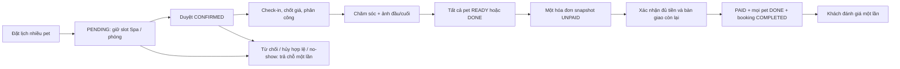

# TÀI LIỆU ĐẶC TẢ YÊU CẦU PHẦN MỀM

## HỆ THỐNG QUẢN LÝ VẬN HÀNH SPA & HOTEL THÚ CƯNG

- **Môn học:** SE310 - Công Nghệ .NET
- **Nhóm thực hiện:** Nhóm 6
  - 24522005 - Trương Quốc Việt
  - 24521992 - Đỗ Trí Viên
  - 24521934 - Nguyễn Dương Quất Tuấn
  - 24521116 - Nguyễn Phương Nam
- **Giảng viên hướng dẫn:** TS. Mai Trọng Khang

> **Phiên bản 1.1 — baseline nghiệp vụ 17/10/2026:** cập nhật từ SRS chuyển đổi PDF theo các quyết định đã được người dùng xác nhận. Tài liệu này thay thế các nội dung cũ mâu thuẫn về PIN, hồ sơ Public, Hotel, phân quyền, lịch published và thanh toán. ERD/Data Dictionary vật lý sẽ được chuẩn hóa ở tài liệu thiết kế riêng; danh sách 19 bảng cũ không phải schema cuối cùng đã duyệt.
>
> **Nguồn quyết định:** [scope-and-decisions.md](scope-and-decisions.md). **Đối chiếu UI:** [frontend-use-case-mapping.md](frontend-use-case-mapping.md). **Phân tích:** [system-analysis.md](../design/system-analysis.md).

# CHƯƠNG 1. GIỚI THIỆU TỔNG QUAN

## 1.1. Mục đích

Xác định yêu cầu chức năng, business rules, yêu cầu phi chức năng và tiêu chí nghiệm thu cho hệ thống vận hành một cơ sở Spa & Hotel thú cưng. Tài liệu là baseline báo cáo và thiết kế Backend, không khẳng định mock frontend đã đáp ứng mọi yêu cầu hoặc Backend đã hoạt động.

## 1.2. Phạm vi

- Khách không cần tài khoản: xem danh mục, đặt nhiều pet, nhận Tracking, tra đúng một booking, xem ảnh/hóa đơn, hủy đúng điều kiện và đánh giá sau hoàn tất.
- STAFF: tra hồ sơ tại quầy, đặt hộ, duyệt/hủy/tiếp nhận, chốt giá, phân công, chăm sóc, bàn giao, thu tiền và xem/đăng ký ca. STAFF không chia role quầy/groomer; quyền cập nhật chăm sóc theo assignment.
- ADMIN: mọi thao tác vận hành của STAFF, quản trị danh mục/giá/slot/phòng, duyệt và xếp ca, xem đánh giá.
- Core giữ 27 UC + FR01 của bảng gốc, thêm UC56 tối thiểu. Tài khoản seed 1 Admin + 3–4 Staff. Dashboard chỉ tổng hợp dữ liệu sẵn có hoặc query nhẹ.
- Không làm payment gateway/webhook, đặt cọc, voucher/giảm giá, hoàn tiền/ticket khiếu nại, CRUD user đầy đủ, mã phòng vật lý, bảng lịch sử sức khỏe riêng hoặc báo cáo phân tích phức tạp. Ngoại lệ mới ngày 18/10: Admin đổi role account ADMIN ↔ STAFF theo D18, không mở rộng toàn bộ quản lý tài khoản.

## 1.3. Thuật ngữ

| Thuật ngữ | Ý nghĩa |
|---|---|
| Booking / don_dat_lich | Đơn gồm nhiều pet có chung thời điểm nhận/trả dự kiến; có thể bàn giao thực tế từng pet khi READY. |
| Pet chính | Pet được đặt ban đầu; một pet có thể kèm dịch vụ thêm nhưng không giữ thêm slot/phòng do thêm dòng. |
| Slot Spa | Sức chứa pet có Spa trong ca ngày bắt đầu; Hotel-only không chiếm. |
| Suất phòng Hotel | Một pet lưu trú chiếm một suất thuộc loại phòng trong từng đêm đã đặt. |
| Tracking Code | Mã ngẫu nhiên duy nhất của booking, không phải khóa chính và không thuộc hồ sơ khách. |
| Assignment | Nhân viên chịu trách nhiệm hiện tại tại nhan_vien_id; STAFF cập nhật đúng pet của mình, Admin được override. |
| Snapshot | Tên khoản mục, đơn giá, số lượng và thành tiền được chụp khi tạo hóa đơn. |
| READY / DONE / COMPLETED | READY: xong dịch vụ chờ nhận; DONE: pet đã bàn giao; COMPLETED: booking đã thu đủ và bàn giao toàn bộ. |
| APPROVED | Ca đã được duyệt và công bố; không có cờ published thứ hai trong phạm vi Backend. |

## 1.4. Công nghệ được chọn

Frontend Vue hiện có; Backend .NET Web API + Entity Framework Core; PostgreSQL; Supabase Storage cho ảnh; MailKit gửi SMTP. Phiên bản cụ thể và hosting được chốt ở thiết kế kỹ thuật. Không mặc định dùng Supabase Auth hoặc thay PostgreSQL bằng storage.

# CHƯƠNG 2. MÔ TẢ TỔNG QUAN HỆ THỐNG & NGHIỆP VỤ

## 2.1. Vòng đời chính

Khách tra cứu đúng booking xuyên suốt tiến độ. Pet READY có thể bàn giao lẻ trước khi cả đơn xong; không có thanh toán riêng từng pet. Email/QR không quyết định trạng thái đã thanh toán.

## 2.2. Tác nhân

Customer không có Auth role; Public dùng SĐT + Tracking cho dữ liệu một đơn. STAFF và ADMIN đăng nhập nội bộ. SMTP, Supabase Storage và dịch vụ ảnh VietQR là tác nhân ngoài; không truy cập CSDL thay Backend.

## 2.3. Business Rules

| Mã | Quy tắc chuẩn hóa |
|---|---|
| BR-01 | Đặt lịch bắt buộc SĐT + email + tên. Tracking thuộc booking; luôn trả mã sau commit. Public không tra hồ sơ/lịch sử chỉ bằng SĐT; không PIN hoặc khach_hang.ma_tracking_hash. |
| BR-02 | Một booking nhiều pet, chung thời điểm nhận/trả dự kiến ở cha. Pet qua đêm đều có loại phòng; nhu cầu khác lịch dự kiến phải tách booking. Bàn giao thực tế lẻ không tạo hóa đơn lẻ. |
| BR-03 | PENDING giữ tài nguyên ngay. Spa giữ số pet có Spa ở ca ngày bắt đầu; Hotel-only không giữ slot Spa. Không đếm dòng dịch vụ thêm thành pet mới. |
| BR-04 | Spa/Combo Spa: giá cơ sở × hệ số cân nặng. Hotel: giá theo đêm × số đêm. Dòng tích hợp cộng hai phần. Web dùng cân khai báo để tạm tính; check-in dùng cân thực tế để chốt. |
| BR-05 | Cắt tỉa tạo kiểu chỉ đặt qua Combo có tắm; không cho chọn dịch vụ cắt tỉa độc lập để né quy tắc. |
| BR-06 | Xác minh giấy tiêm chủng cấu hình theo loại dịch vụ, mặc định không bắt buộc. Khách được đặt khi chưa upload; nếu bật bắt buộc, nhân viên phải xác minh ảnh/giấy trực tiếp tại check-in trước tiếp nhận. Upload không tự được coi là xác minh. Hotel phải có loại phòng cho mỗi pet và ngày trả sau nhận. Một pet = một suất phòng; khoảng đêm [nhận, trả). Mỗi đêm không vượt so_luong_phong của loại đó, tính cả PENDING/CONFIRMED/IN_PROGRESS/READY. |
| BR-07 | WAITING chỉ sau check-in. Bắt đầu IN_PROGRESS cần ảnh đầu + ghi chú sức khỏe. READY cần ảnh cuối. PAUSED/tiếp tục không được bỏ qua yêu cầu ảnh; mọi ảnh nhật ký của đơn được xem qua Tracking hợp lệ. |
| BR-08 | Mọi pet READY/DONE mới được tạo snapshot và thu tiền. Một hóa đơn hiệu lực cho booking; snapshot khóa dịch vụ/phụ phí. Được thu hồi UNPAID để tạo lại; PAID không sửa/xóa. |
| BR-09 | Một đánh giá/booking, chỉ khi COMPLETED; 1–5 sao, nhận xét tùy chọn. hien_thi_nhan_vien mặc định false và API danh sách chỉ Admin; Admin xử lý đánh giá thấp ngoài hệ thống. |
| BR-10 | Mỗi pet có một nhân viên phụ trách hiện tại; STAFF chăm sóc đúng assignment. Có thể đổi trước DONE; lịch sử ảnh/ghi chú giữ tác giả thực tế. Admin được thao tác care không bị giới hạn vào assignment của mình. |
| BR-11 | Người được gán/chuyển phải có ca APPROVED đúng ngày/ca thao tác. APPROVED là công bố; Hotel không yêu cầu cùng một người có ca suốt thời gian lưu trú. |
| BR-12 | Khách tự hủy PENDING/CONFIRMED khi còn >=2 giờ trước đầu ca và chưa pet nào check-in. STAFF/Admin hủy PENDING/CONFIRMED trước tiếp nhận, bắt buộc lý do. Từ chối/hủy giải phóng đúng slot/phòng đã giữ, không hai lần. |
| BR-13 | No-show khi quá cuối ca 30 phút và chưa bất kỳ pet nào check-in; được lazy evaluation hoặc nút Staff/Admin, không bắt buộc cronjob. Không no-show/hủy cả đơn đã tiếp nhận một phần. |
| BR-14 | Phát sinh dịch vụ/phụ phí do STAFF liên hệ khách ngoài hệ thống rồi ghi nhận lý do; có thể PAUSED. Không bắt khách lên web đồng ý. Không thêm/sửa/xóa sau snapshot còn hiệu lực. |
| BR-15 | Giam_gia=0, không tiền cọc/partial payment trong core. Trả sớm giữ giá Hotel cam kết; đón trễ vài giờ thêm phụ phí trước snapshot hoặc hủy nháp UNPAID để tạo lại. Không tự gia hạn/tính lại ngày. |
| BR-16 | Pet READY được bàn giao riêng thành DONE. Một nút xác nhận đủ tiền + bàn giao còn lại cập nhật PAID, các pet READY→DONE và booking COMPLETED trong cùng transaction. |
| BR-17 | Public có SĐT cũ chỉ map customer ID, không trả pet cũ hoặc ghi đè tên/email master. Lưu thông tin người đặt theo booking. Nội bộ xác minh rồi chọn pet cũ, phải đúng ownership; không gộp theo tên. |
| BR-18 | Check-in lưu cân/lông của lần phục vụ ở chi_tiet_don và cập nhật cân hiện tại ở thu_cung.can_nang_dang_ky. Không ghi lại cân lịch sử theo giá trị mới của hồ sơ master. |

**Công suất Hotel:** với mỗi loại phòng r, tại mọi đêm d của yêu cầu, `so_suat_da_giu(r,d) + so_pet_hotel_muon_dat(r) <= so_luong_phong(r)`. Dòng dịch vụ thêm không được tạo thêm room reservation. Đặt/hủy/dời lịch phải tuân thủ transaction/lock; kiểm tra trước insert không có khóa là chưa đủ.

**Chuẩn hóa đã duyệt D13:** booking từ chối/no-show dùng CANCELLED với loai_huy thuộc CUSTOMER_CANCELLED, STAFF_REJECTED, NO_SHOW, STAFF_CANCELLED và lý do; không thêm state REJECTED/NO_SHOW. Nhân viên dùng lệnh hủy thường có lý do nếu khách báo không đến trước hạn; nút no-show tự động chỉ áp dụng đúng BR-13. Mọi đường CANCELLED dùng cùng logic hoàn tài nguyên đã giữ.

# CHƯƠNG 3. YÊU CẦU CHỨC NĂNG

## 3.1. Bảng 28 mục core và kết quả yêu cầu

Giữ 27 mã UC + FR01 của SRS gốc. Actor Admin bao gồm mọi thao tác vận hành Staff; bảng ghi rõ người có quyền.

| Mã | Chức năng | Actor | Kết quả yêu cầu |
|---|---|---|---|
| UC01 | Tạo thông tin khách hàng | Customer, STAFF, ADMIN | Tạo khách mới hoặc map ngầm khách cũ trong booking; không Public overwrite master. |
| UC02 | Tra hồ sơ qua SĐT | STAFF, ADMIN | Nội bộ nhận hồ sơ sau xác minh tại quầy; không Public lookup. |
| UC06 | Tạo hồ sơ pet | Customer, STAFF, ADMIN | Tạo pet thuộc đúng khách trong luồng booking; không gộp theo tên. |
| UC07 | Xem hồ sơ pet | STAFF, ADMIN; Customer giới hạn booking | Nội bộ xem pet của khách; Public chỉ pet của đơn đã xác minh. |
| UC08 | Cập nhật hồ sơ/cân nặng | STAFF, ADMIN | Cập nhật dữ liệu đúng pet và cân hiện tại; bảo toàn dữ liệu từng lần phục vụ. |
| UC10 | Xem dịch vụ/bảng giá | Customer, STAFF, ADMIN | Danh mục đang hoạt động, giá và điều kiện combo/Hotel. |
| UC14 | Đặt lịch/cấp Tracking | Customer, STAFF, ADMIN | Booking PENDING, giữ đúng chỗ, tracking và kết quả email. |
| UC15 | Tra cứu SĐT + Tracking | Customer | Chỉ dữ liệu booking tương ứng; sai cặp trả lỗi chung. |
| UC16 | Danh sách/chi tiết lịch hẹn | STAFF, ADMIN | Danh sách theo ngày/ca, thông tin đủ tiếp nhận/thu ngân. |
| UC17 | Duyệt/từ chối lịch | STAFF, ADMIN | PENDING→CONFIRMED hoặc hủy vì từ chối; không trừ/hoàn chỗ lặp. |
| UC18 | Dời lịch | ADMIN | Chuyển lịch trước tiếp nhận; giữ chỗ mới và nhả chỗ cũ nguyên tử, không mất đơn nếu lịch mới đầy. |
| UC19 | Hủy lịch | Customer theo BR-12; STAFF, ADMIN | Hủy trước tiếp nhận với lý do và trả tài nguyên đúng một lần. |
| UC23 | Check-in | STAFF, ADMIN | Cân/lông, giá chốt, assignment hợp lệ, pet WAITING. |
| UC24 | Cập nhật chăm sóc | STAFF được gán, ADMIN | Chuyển trạng thái có guard ảnh/ghi chú, không sửa DONE. |
| UC25 | Nhật ký/ảnh | STAFF được gán, ADMIN | Lưu file và metadata, người thực hiện, thời điểm; không tạo nhật ký mồ côi khi upload lỗi. |
| UC26 | Theo dõi tiến độ | Customer | Tiến độ từng pet, ảnh và thông tin đơn qua cặp tra cứu hợp lệ. |
| UC30 | Bàn giao/hoàn tất | STAFF, ADMIN | READY→DONE từng pet; thanh toán gộp hoàn tất phần bàn giao còn lại. |
| UC31 | Tạo/chốt hóa đơn | STAFF, ADMIN | Snapshot khi mọi pet READY/DONE, một hóa đơn hiệu lực; hủy nháp UNPAID để tạo lại được. |
| UC32 | Phụ phí phát sinh | STAFF, ADMIN | Khoản tiền/lý do theo booking/pet, tồn tại trước invoice; phản ánh vào snapshot. |
| UC34 | Xem hóa đơn | STAFF, ADMIN; Customer đúng booking | Hiển thị đúng khoản mục và trạng thái, không invoice của đơn khác. |
| UC35 | Xác nhận thanh toán | STAFF, ADMIN | Thu đủ bằng CASH/BANK_TRANSFER, đồng thời PAID + mọi pet DONE + COMPLETED. Khách không gọi thao tác xác nhận tiền. |
| UC41 | Đăng ký ca | STAFF, ADMIN nếu tham gia ca | Đăng ký chờ duyệt; không tự APPROVED. |
| UC50 | Xếp/duyệt ca, công bố | ADMIN | APPROVED chính là lịch hiển thị và đủ điều kiện phân công; xuất bằng print là đủ, không bắt buộc Excel. |
| UC53 | Xem lịch/pet phụ trách | STAFF, ADMIN | Lịch APPROVED và nhiệm vụ theo assignment; Admin có góc nhìn quản trị. |
| UC11 | Thêm dịch vụ/Combo | ADMIN | Thêm catalog và thành phần combo hợp lệ; seed không thay chức năng này. |
| UC12 | Cập nhật dịch vụ/giá | ADMIN | Cập nhật catalog trong phạm vi được đặc tả, không tác động invoice snapshot. |
| UC64 | Giờ hoạt động/slot | ADMIN | Cấu hình ca và sức chứa; không giảm dưới chỗ đã giữ hoặc làm lịch/booking hiện hữu vô hiệu. |
| FR01 | Đăng nhập/phân quyền | STAFF, ADMIN | Auth hợp lệ, đúng role và điều kiện tài nguyên; tài khoản demo có mật khẩu hash, không hardcode secret. |

## 3.2. UC14 — Đặt lịch nhiều pet

**Tiền điều kiện:** catalog đang hoạt động; thông tin khách/pet hợp lệ; cùng lịch dự kiến; Hotel có loại phòng cho mọi pet qua đêm. Ảnh tiêm chủng được đính kèm tùy chọn, không là điều kiện chặn đặt lịch; yêu cầu xác minh nếu được bật sẽ kiểm tra tại check-in.

1. Public nhập tên/SĐT/email và pet; không nhận thông tin cũ từ SĐT. Nội bộ được xác minh rồi chọn hồ sơ cũ.
2. Chọn ngày/ca, dịch vụ/combo/phòng; tính ước tính đúng BR-04. Không chọn cắt tỉa độc lập.
3. Backend xác định số pet Spa và suất phòng mỗi loại, xử lý đơn đủ điều kiện no-show nếu dùng lazy evaluation.
4. Trong transaction, khóa tài nguyên, kiểm tra lại từng slot/đêm, lưu booking PENDING, pet/dịch vụ, tracking và phần giữ chỗ.
5. Commit trước khi gửi SMTP. Luôn trả tracking_code trong JSON và hiển thị rõ ở kết quả; không chuyển thành thất bại đặt lịch chỉ vì email lỗi.

**Ngoại lệ:** dữ liệu không hợp lệ; thiếu slot/phòng; tài nguyên vừa bị đặt; upload chưa hoàn tất; request trùng. Không lưu một nửa booking/giữ một phần tài nguyên. Retry đặt lịch không được tạo thêm đơn hoặc trừ chỗ hai lần.

**UC14-E2:** SMTP thất bại: đơn vẫn thành công, trả cảnh báo email chưa gửi và mã có thể lưu/chụp lại; không yêu cầu tạo lại booking. Email phải dùng thông tin người đặt của booking, không vô tình gửi cho email master cũ không liên quan lần đặt.

## 3.3. UC15/UC26/UC34 — Tra cứu Public

Nhập SĐT + tracking_code; Backend xác minh cặp và scope một booking trước khi trả pet, nhật ký, ảnh và hóa đơn. Thông tin sai dùng cùng lỗi chung, giới hạn thử sai; không trả dấu hiệu SĐT đã tồn tại. Khách xem mọi ảnh nhật ký của chính đơn, không mọi ảnh của pet qua các đơn khác. Thông tin người đặt hiển thị từ snapshot của booking, không trả toàn bộ master/email cũ của khách chỉ vì một người tạo đơn mới bằng cùng SĐT. Public booking không phải endpoint tra hồ sơ khách.

## 3.4. UC17/UC18/UC19 — Quyết định và thay lịch

- Duyệt PENDING không giữ chỗ lần hai. Từ chối có lý do và giải phóng tài nguyên đã giữ.
- UC18 đã duyệt D14: chỉ PENDING/CONFIRMED và trước check-in bất kỳ pet nào. Lịch mới phải thỏa slot Spa/phòng từng đêm và lịch dự kiến chung; thất bại giữ nguyên booking/lịch cũ. Các tài nguyên cũ/mới được khóa theo thứ tự thống nhất trước khi chuyển bộ đếm để giảm nguy cơ deadlock khi dời chéo.
- Hủy kiểm tra role/cặp Tracking, trạng thái, thời điểm và tình trạng tiếp nhận; không chỉ ẩn nút ở frontend. No-show chỉ sau cuối ca +30 phút và chưa pet nào check-in.
- Đánh dấu hủy và trả tài nguyên cùng transaction, thao tác lại không hoàn thêm. Hotel-only không cộng slot Spa vì chưa giữ slot đó.

## 3.5. UC23/UC24/UC25 — Tiếp nhận và chăm sóc

Check-in ghi cân thực tế/tình trạng lông, tính tổng giá chốt Spa + Hotel, cập nhật cân hiện tại của pet và gán nhân viên có ca APPROVED của ngày/ca thao tác. Không check-in lặp để đổi giá đã chốt ngoài ý muốn.

STAFF được gán mới cập nhật care; Admin có quyền override nhưng vẫn phải có ảnh/ghi chú hợp lệ. Ảnh được upload thành công trước khi chuyển trạng thái. IN_PROGRESS có thể PAUSED vì trao đổi phát sinh; tiếp tục không làm mất nhật ký. READY cần ảnh cuối. Dịch vụ thêm/phụ phí chỉ ghi trước snapshot còn hiệu lực; không approval khách qua web. Thay nhân viên trước DONE giữ đúng tác giả nhật ký cũ.

## 3.6. UC30/UC31/UC35 — Bàn giao và thanh toán

- Pet READY được bàn giao riêng thành DONE, không thu tiền lẻ. Booking vẫn IN_PROGRESS nếu còn pet chưa READY/DONE; mọi pet xong thì READY, kể cả mọi pet đã DONE mà chưa thu tiền.
- Tạo snapshot UNPAID khi mọi pet READY/DONE; tiền dịch vụ/phòng/phụ phí đã chốt, không cọc, giảm giá bằng 0. Khóa thay đổi khi snapshot còn hiệu lực.
- Có thể thu hồi nháp UNPAID trước khi chỉnh phát sinh và tạo lại; không sửa trực tiếp snapshot, không tồn tại hai invoice hiệu lực. Cách lưu lịch sử thu hồi sẽ được chốt ở thiết kế.
- Chọn CASH hoặc BANK_TRANSFER. Với chuyển khoản, hiển thị ảnh VietQR chứa số tiền chốt và mã đơn; không mặc định QR hiển thị là đã trả.
- STAFF/Admin kiểm tra đã nhận đủ tiền rồi bấm một hành động: trong transaction xác minh invoice chưa PAID, mọi pet READY/DONE, ghi PAID, READY còn lại→DONE, booking→COMPLETED.
- Request lặp không ghi nhận tiền lần hai. Không PAID mà booking chưa hoàn tất vì lỗi giữa chừng; không COMPLETED khi tiền chưa ghi nhận. PAID bất biến, refund ngoài phạm vi.

## 3.7. UC41/UC50/UC53 — Ca làm và phân công

STAFF đăng ký ngày/ca; Admin duyệt/từ chối/xếp ca. APPROVED đủ để hiển thị như lịch chính thức, không thêm bước publish. Nhân viên được gán tại thời điểm thao tác phải có ca APPROVED tương ứng; Hotel nhiều ngày được đổi người ca hôm sau, không yêu cầu một người trực toàn kỳ. Không sửa/xóa ca theo cách làm assignment đang dùng trở nên không hợp lệ mà không xử lý phụ thuộc. Mở/đóng đợt/deadline chi tiết của mock không tự thành phân hệ bổ sung; thiết kế hỗ trợ tối thiểu các UC này.

## 3.8. UC56 — Ngoại lệ core được duyệt

- `POST /api/tracking/reviews`: cặp SĐT/tracking, 1–5 sao và nhận xét tùy chọn; chỉ COMPLETED, tối đa một bản ghi/booking. ID khách/đơn do Backend suy ra từ cặp xác minh, không tin ID tự gửi.
- `GET /api/admin/reviews`: ADMIN xem danh sách, thông tin liên hệ cần thiết để xử lý đánh giá thấp ngoài hệ thống; không endpoint danh sách cho STAFF.
- Không thêm ticket, phản hồi nhiều vòng, approval review hoặc refund workflow. Hợp đồng request/response/pagination sẽ được chốt sau; đây là hai đường API được người dùng chỉ định, chưa phải implementation.

# CHƯƠNG 4. YÊU CẦU PHI CHỨC NĂNG

| Mã | Yêu cầu / cách kiểm chứng |
|---|---|
| NFR-P1 | Mục tiêu thao tác CRUD/tra cứu thông thường <500ms ở cấu hình và dataset demo được ghi lại; đo API riêng với thời gian SMTP/upload bên ngoài. Chưa có benchmark, không bảo đảm truy vấn Hotel <5ms chỉ từ quy mô giả định. |
| NFR-P2 | Mục tiêu Tracking tải kèm 3–5 thumbnail <2s trong điều kiện mạng/cấu hình đã ghi nhận; không đòi ảnh gốc tải hết mới hiển thị tiến độ. |
| NFR-P3 | Quy mô 30–50 booking/ngày, ít nhất 10 người đồng thời; kịch bản tranh suất cuối không overbook. |
| NFR-S1 | Mật khẩu hash bcrypt cost >=12 hoặc Argon2 theo thư viện Backend được chọn. Không plaintext/MD5/SHA1, không secret trong frontend/Git/tài liệu. SMTP cấu hình qua environment/User Secrets, appsettings chỉ chứa cấu trúc không nhạy cảm. |
| NFR-S2 | Tracking ngẫu nhiên an toàn, unique, độc lập ID tuần tự; giữ yêu cầu gốc 8–12 ký tự chữ hoa/số cho phần mã. Format/prefix/entropy cụ thể được chốt ở contract, không dùng ví dụ ngắn làm cấu hình. Không cần khach_hang.ma_tracking_hash. |
| NFR-S3 | API nội bộ xác thực JWT và role ADMIN/STAFF. Auth role chưa đủ: server kiểm tra assignment/ca/trạng thái. Admin được override assignment actor, không bypass invariants tiền/ảnh/sức chứa. |
| NFR-S4 | Public chỉ đọc một booking sau xác minh cặp SĐT/tracking; không tra customer/pet bằng SĐT đơn lẻ hoặc xem lịch sử toàn khách. Giới hạn thử sai theo UC15 gốc: quá 5 lần trong cửa sổ 15 phút thì chặn tiếp 15 phút; thiết kế cần tránh khóa toàn bộ khách chỉ vì attacker biết SĐT. |
| NFR-S5 | Supabase Storage không công khai cả bucket. Khóa storage đặc quyền ở Backend; cấp quyền ảnh theo booking/role đã xác minh. Lưu object reference, không lưu signed URL ngắn hạn như URL bền vững. |
| NFR-C1 | Giữ/hủy/dời slot/phòng dùng transaction và khóa tài nguyên tương ứng; Hotel khóa các dòng loại phòng, Spa khóa khung ca. Không check-then-insert ngoài khóa. |
| NFR-C2 | Không âm slot, không vượt phòng từng đêm, không tăng slot do retry, không tạo hai invoice hiệu lực hoặc hai đánh giá/booking. Thiết kế ràng buộc CSDL tương ứng. |
| NFR-R1 | PAID bất biến. Xác nhận tiền + DONE còn lại + COMPLETED nguyên tử; lưu người/thời điểm/phương thức. Thu hồi nháp chỉ UNPAID và không xóa dấu vết giao dịch đã PAID. |
| NFR-R2 | File ảnh ngoài DB, metadata/tham chiếu trong DB. Kiểm tra nội dung/định dạng/kích thước file; upload lỗi không chuyển care state. Chính sách kích thước/nén cụ thể ở thiết kế. |
| NFR-R3 | Commit booking độc lập SMTP, tracking luôn có trong response thành công. Dịch vụ QR không khả dụng phải có tiền/mã/nội dung chuyển khoản đọc được hoặc lựa chọn CASH, không giả PAID. |
| NFR-U1 | Public dùng được từ 375px; nội bộ hỗ trợ desktop/tablet; không thay UI chỉ để phục vụ schema. Các khoảng thiếu UC sẽ được bổ sung thao tác tối thiểu ở giai đoạn tích hợp được duyệt. |

# CHƯƠNG 5. THÔNG TIN NGHIỆP VỤ & RÀNG BUỘC THIẾT KẾ

## 5.1. Các khái niệm dữ liệu

Khách hàng sở hữu pet; booking thuộc khách và có snapshot thông tin người đặt/lịch nhận-trả; chi tiết chứa pet và thành phần Spa/Hotel, cân thực tế, giá chốt và assignment. Nhật ký thuộc lượt phục vụ với tác giả/thời gian/ảnh. Slot Spa theo ngày/ca; loại phòng có tổng suất, đặt Hotel theo khoảng đêm. Phụ phí phải tồn tại trước hóa đơn. Invoice chứa các khoản snapshot, tối đa một invoice hiệu lực của booking. Ca được APPROVED trực tiếp; đánh giá unique theo booking hoàn tất.

## 5.2. Những chỗ ERD gốc bắt buộc phải điều chỉnh

| Chỗ cũ | Yêu cầu mới; chưa phải DDL |
|---|---|
| khach_hang.ma_tracking_hash / PIN | Bỏ; tracking thuộc booking. |
| loai_phong thiếu tổng suất | Thêm so_luong_phong không âm; kiểm tra reservation từng đêm. |
| khung_gio_id bị hiểu là đã trừ slot | Hotel vẫn cần ca hẹn để tính hủy/no-show nhưng giữ Spa=0; mô hình phải phân biệt liên kết lịch và lượng tài nguyên giữ. |
| Một booking có nhiều checkout ở frontend | Một lịch dự kiến ở cha; có thể bàn giao thực tế từng pet, không chia bill. |
| WAITING mặc định cả khi chưa check-in | Phải phân biệt chưa tiếp nhận với WAITING sau tiếp nhận; không dùng WAITING một mình suy ra đã ở tiệm. |
| chi_tiet_don có thể nhiều dòng cùng pet | Không nhân slot/phòng/pet state theo số dòng add-on; cần mô hình nhóm pet/lượt phục vụ nhất quán. |
| phu_phi.hoa_don_id NOT NULL nhưng thêm trước invoice | Phụ phí liên quan booking/pet trước snapshot; chốt FK trong ERD kế tiếp. |
| Invoice 1–1 và được hủy nháp để tạo lại | Một invoice hiệu lực, không nhiều khoản thu; cách giữ lịch sử nháp chốt ở thiết kế. |
| PARTIAL_PAID/REFUNDED/tien_coc/giam_gia | Core chỉ UNPAID/PAID của invoice hiệu lực, không cọc/voucher; trạng thái thu hồi nháp không được lẫn với refund. |
| FK cascade cho mọi booking | Không xóa dây chuyền dữ liệu đã chốt/PAID. Delete rules cụ thể chốt sau cùng yêu cầu audit. |

Không gọi cấu trúc 19 bảng ban đầu là schema đã hoàn thiện. [ERD/Data Dictionary gốc](../design/references/erd-original-reference.md) được giữ làm bản đối chiếu không chuẩn tắc, không phải bản để sinh code/migration trực tiếp. Thiết kế vật lý/ERD/Data Dictionary/endpoint đầy đủ nằm ở chặng thiết kế sau khi tài liệu phân tích được duyệt; chưa chạy migration.

# PHỤ LỤC A. TRUY VẾT VÀ QUẢN LÝ THAY ĐỔI

## A.1. Nguồn thay đổi

- D01–D12 ghi phạm vi ban đầu; Q01–Q08 ngày 17/10 đóng các câu hỏi và bổ sung bàn giao lẻ, ca APPROVED công bố trực tiếp, SMTP thật, hủy nháp UNPAID, UC56.
- Cập nhật actor UC02/07 (không Public dò hồ sơ), UC19 (STAFF hủy đúng điều kiện), UC35 (chỉ nội bộ xác nhận tiền), Admin kế thừa thao tác vận hành.
- React/Next.js trong bản gốc được thay bằng Vue hiện có; bỏ sơ đồ có PIN, logic tự ghi đè hồ sơ và các công thức có tiền cọc/voucher.
- Đây là chuẩn hóa tài liệu, không thay UI, Auth source, mock workflow, database hoặc API đang chạy.

## A.2. Điểm duyệt tiếp theo

D13/D14 và T01–T09 đã duyệt. [System design 1.0](../design/system-design.md) là baseline thiết kế, chưa phải schema đã áp dụng. Tiếp theo rà soát [API contract 0.1](../design/api-contract.md) và [traceability/lộ trình](../design/requirements-traceability.md) trước khi cho phép code. Kiểm chứng tài liệu ở consistency và kịch bản giấy; không chạy build/test ứng dụng cho lượt này.

## A.3. Bổ sung yêu cầu ngày 18/10/2026

[D15–D19](scope-and-decisions.md) được người dùng xác nhận sau baseline 1.1 và ưu tiên khi khác nội dung trước đó:

- Giấy tiêm chủng có cấu hình xác minh theo loại dịch vụ, mặc định không bắt buộc. Không chặn đặt lịch vì thiếu upload; khi bật, nhân viên phải xác minh ảnh hoặc giấy tại quầy trước check-in. Upload không tự xác nhận; lưu dấu vết người và thời điểm kiểm tra.
- Thêm loại lông riêng; giữ tình trạng lông khi check-in. Chưa có quy tắc tăng giá theo loại lông.
- Ngày nghỉ chặn tiếp nhận Spa và nhận/trả Hotel, nhưng vẫn chăm sóc pet lưu trú; khoảng lưu trú có thể đi qua ngày nghỉ. Admin cấu hình cho tuần chưa mở đăng ký; không làm booking/ca đã cam kết vô hiệu một cách tự động.
- Admin được đổi ADMIN ↔ STAFF cho account; đây là ngoại lệ mới với phạm vi seed, không mở toàn bộ CRUD user. Cơ chế bảo vệ Admin cuối và làm mới quyền phiên được đề xuất trong kế hoạch triển khai.
- Cho gửi lại các mã booking chưa hoàn tất vào đúng email snapshot đã lưu. Public response luôn thông báo chung, không trả mã/danh sách đơn; có chống gửi dồn. Mock chỉ mô phỏng thư nội bộ, không chứng minh đã gửi SMTP.

Đợt UI bổ sung lịch Spa/Hotel theo công suất đúng loại, ngày nghỉ, notification PENDING, màn từ chối có lý do/xác nhận và nút cuối chi tiết, chọn ca trực tiếp từ lịch và hiển thị thứ/ngày. [Kế hoạch frontend mục 7](../design/frontend-update-plan.md) đã được duyệt và triển khai ở frontend/mock; xem [progress](../design/frontend-update-progress.md) cho kiểm chứng và giới hạn. Chưa triển khai Backend; Word/ERD/API cũ chưa tự động có đầy đủ các bổ sung này.
